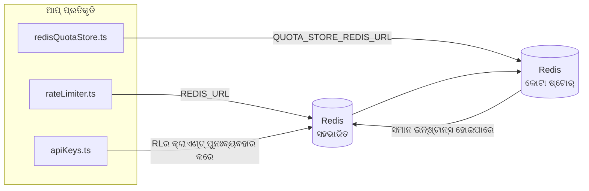

# Redis Production Configuration Guide (ଓଡ଼ିଆ)

🌐 **Languages:** 🇺🇸 [English](../../../../ops/REDIS_PRODUCTION_CONFIG.md) · 🇪🇹 [am](../../../am/docs/ops/REDIS_PRODUCTION_CONFIG.md) · 🇸🇦 [ar](../../../ar/docs/ops/REDIS_PRODUCTION_CONFIG.md) · 🇦🇿 [az](../../../az/docs/ops/REDIS_PRODUCTION_CONFIG.md) · 🇧🇬 [bg](../../../bg/docs/ops/REDIS_PRODUCTION_CONFIG.md) · 🇧🇩 [bn](../../../bn/docs/ops/REDIS_PRODUCTION_CONFIG.md) · 🇧🇦 [bs](../../../bs/docs/ops/REDIS_PRODUCTION_CONFIG.md) · 🇨🇿 [cs](../../../cs/docs/ops/REDIS_PRODUCTION_CONFIG.md) · 🇩🇰 [da](../../../da/docs/ops/REDIS_PRODUCTION_CONFIG.md) · 🇩🇪 [de](../../../de/docs/ops/REDIS_PRODUCTION_CONFIG.md) · 🇬🇷 [el](../../../el/docs/ops/REDIS_PRODUCTION_CONFIG.md) · 🇪🇸 [es](../../../es/docs/ops/REDIS_PRODUCTION_CONFIG.md) · 🇪🇪 [et](../../../et/docs/ops/REDIS_PRODUCTION_CONFIG.md) · 🇮🇷 [fa](../../../fa/docs/ops/REDIS_PRODUCTION_CONFIG.md) · 🇫🇮 [fi](../../../fi/docs/ops/REDIS_PRODUCTION_CONFIG.md) · 🇫🇷 [fr](../../../fr/docs/ops/REDIS_PRODUCTION_CONFIG.md) · 🇮🇪 [ga](../../../ga/docs/ops/REDIS_PRODUCTION_CONFIG.md) · 🇮🇳 [gu](../../../gu/docs/ops/REDIS_PRODUCTION_CONFIG.md) · 🇳🇬 [ha](../../../ha/docs/ops/REDIS_PRODUCTION_CONFIG.md) · 🇮🇱 [he](../../../he/docs/ops/REDIS_PRODUCTION_CONFIG.md) · 🇮🇳 [hi](../../../hi/docs/ops/REDIS_PRODUCTION_CONFIG.md) · 🇭🇷 [hr](../../../hr/docs/ops/REDIS_PRODUCTION_CONFIG.md) · 🇭🇺 [hu](../../../hu/docs/ops/REDIS_PRODUCTION_CONFIG.md) · 🇦🇲 [hy](../../../hy/docs/ops/REDIS_PRODUCTION_CONFIG.md) · 🇮🇩 [id](../../../id/docs/ops/REDIS_PRODUCTION_CONFIG.md) · 🇳🇬 [ig](../../../ig/docs/ops/REDIS_PRODUCTION_CONFIG.md) · 🇮🇹 [it](../../../it/docs/ops/REDIS_PRODUCTION_CONFIG.md) · 🇯🇵 [ja](../../../ja/docs/ops/REDIS_PRODUCTION_CONFIG.md) · 🇬🇪 [ka](../../../ka/docs/ops/REDIS_PRODUCTION_CONFIG.md) · 🇰🇭 [km](../../../km/docs/ops/REDIS_PRODUCTION_CONFIG.md) · 🇮🇳 [kn](../../../kn/docs/ops/REDIS_PRODUCTION_CONFIG.md) · 🇰🇷 [ko](../../../ko/docs/ops/REDIS_PRODUCTION_CONFIG.md) · 🇱🇹 [lt](../../../lt/docs/ops/REDIS_PRODUCTION_CONFIG.md) · 🇱🇻 [lv](../../../lv/docs/ops/REDIS_PRODUCTION_CONFIG.md) · 🇮🇳 [ml](../../../ml/docs/ops/REDIS_PRODUCTION_CONFIG.md) · 🇮🇳 [mr](../../../mr/docs/ops/REDIS_PRODUCTION_CONFIG.md) · 🇲🇾 [ms](../../../ms/docs/ops/REDIS_PRODUCTION_CONFIG.md) · 🇲🇹 [mt](../../../mt/docs/ops/REDIS_PRODUCTION_CONFIG.md) · 🇲🇲 [my](../../../my/docs/ops/REDIS_PRODUCTION_CONFIG.md) · 🇳🇵 [ne](../../../ne/docs/ops/REDIS_PRODUCTION_CONFIG.md) · 🇳🇱 [nl](../../../nl/docs/ops/REDIS_PRODUCTION_CONFIG.md) · 🇳🇴 [no](../../../no/docs/ops/REDIS_PRODUCTION_CONFIG.md) · 🇮🇳 [pa](../../../pa/docs/ops/REDIS_PRODUCTION_CONFIG.md) · 🇵🇭 [phi](../../../phi/docs/ops/REDIS_PRODUCTION_CONFIG.md) · 🇵🇱 [pl](../../../pl/docs/ops/REDIS_PRODUCTION_CONFIG.md) · 🇵🇹 [pt](../../../pt/docs/ops/REDIS_PRODUCTION_CONFIG.md) · 🇧🇷 [pt-BR](../../../pt-BR/docs/ops/REDIS_PRODUCTION_CONFIG.md) · 🇷🇴 [ro](../../../ro/docs/ops/REDIS_PRODUCTION_CONFIG.md) · 🇷🇺 [ru](../../../ru/docs/ops/REDIS_PRODUCTION_CONFIG.md) · 🇱🇰 [si](../../../si/docs/ops/REDIS_PRODUCTION_CONFIG.md) · 🇸🇰 [sk](../../../sk/docs/ops/REDIS_PRODUCTION_CONFIG.md) · 🇸🇮 [sl](../../../sl/docs/ops/REDIS_PRODUCTION_CONFIG.md) · 🇷🇸 [sr](../../../sr/docs/ops/REDIS_PRODUCTION_CONFIG.md) · 🇸🇪 [sv](../../../sv/docs/ops/REDIS_PRODUCTION_CONFIG.md) · 🇰🇪 [sw](../../../sw/docs/ops/REDIS_PRODUCTION_CONFIG.md) · 🇮🇳 [ta](../../../ta/docs/ops/REDIS_PRODUCTION_CONFIG.md) · 🇮🇳 [te](../../../te/docs/ops/REDIS_PRODUCTION_CONFIG.md) · 🇹🇭 [th](../../../th/docs/ops/REDIS_PRODUCTION_CONFIG.md) · 🇹🇷 [tr](../../../tr/docs/ops/REDIS_PRODUCTION_CONFIG.md) · 🇺🇦 [uk-UA](../../../uk-UA/docs/ops/REDIS_PRODUCTION_CONFIG.md) · 🇵🇰 [ur](../../../ur/docs/ops/REDIS_PRODUCTION_CONFIG.md) · 🇺🇿 [uz](../../../uz/docs/ops/REDIS_PRODUCTION_CONFIG.md) · 🇻🇳 [vi](../../../vi/docs/ops/REDIS_PRODUCTION_CONFIG.md) · 🇳🇬 [yo](../../../yo/docs/ops/REDIS_PRODUCTION_CONFIG.md) · 🇨🇳 [zh-CN](../../../zh-CN/docs/ops/REDIS_PRODUCTION_CONFIG.md) · 🇹🇼 [zh-TW](../../../zh-TW/docs/ops/REDIS_PRODUCTION_CONFIG.md)

---

## ସାରାଂଶ

Redis ହେଉଛି OmniRouteରେ ଏକ **ଇଚ୍ଛାଧୀନ, ଅନାବଶ୍ୟକ ନିର୍ଭରଶୀଳତା** — Redis ଉପଲବ୍ଧ ନଥିବାବେଳେ ଆପ୍ଲିକେସନ୍ ସୁଚାରୁ ଭାବେ କ୍ଷମତା ହ୍ରାସ କରେ (ଇନ୍-ମେମୋରି
ଫଲ୍ବ୍ୟାକ୍)। ପ୍ରଡକ୍ସନ୍ରେ Redisକୁ ଟ୍ୟୁନ୍ କରିବା ଦ୍ୱାରା ଚାରୋଟି ସ୍ୱତନ୍ତ୍ର
କାର୍ଯ୍ୟଭାର ପାଇଁ ବିଳମ୍ବତା ହ୍ରାସ ପାଏ:

| କାର୍ଯ୍ୟଭାର               | ଡ୍ରାଇଭର୍                      | କ୍ଲାଏଣ୍ଟ ଫ୍ୟାକ୍ଟରୀ                            | କି ପ୍ୟାଟର୍ନ                                          |
| ------------------------ | ----------------------------- | --------------------------------------------- | ---------------------------------------------------- |
| ରେଟ୍ ସୀମିତକରଣ            | `rateLimiter.ts`              | `getRedisClient()` — ଲେଜି `ioredis` ସିଙ୍ଗଲଟନ୍ | `<prefix>rl:*` Lua‑ଆଟମିକ୍ ରେଟ୍ ସୀମା ୱିଣ୍ଡୋ           |
| ପ୍ରମାଣୀକରଣ କ୍ୟାଶ୍        | `apiKeys.ts`                  | `rateLimiter`ର କ୍ଲାଏଣ୍ଟକୁ ପୁନଃବ୍ୟବହାର କରେ     | TTL ସହିତ `<prefix>auth:api_key:<sha256>`             |
| କୋଟା ଷ୍ଟୋର୍              | `redisQuotaStore.ts`          | ପୃଥକ `getRedisClient(url)` ସିଙ୍ଗଲଟନ୍          | ପ୍ରତି ଇନ୍ଷ୍ଟାନ୍ସ ପାଇଁ ବିନ୍ୟାସଯୋଗ୍ୟ `<prefix>quota:*` |
| ୱାର୍ମଅପ୍ ସର୍କିଟ୍ ବ୍ରେକର୍ | `redisCircuitBreakerStore.ts` | `circuitBreakerFactory.ts`ରେ ପୃଥକ କ୍ଲାଏଣ୍ଟ    | `<prefix>warmup:cb:<connectionId>`                   |

ସମସ୍ତ ଚାରୋଟି କାର୍ଯ୍ୟଭାର ଗୋଟିଏ ନେମସ୍ପେସ୍ ପ୍ରିଫିକ୍ସ ସହଭାଗ କରନ୍ତି, ଯାହାଦ୍ୱାରା OmniRoute ଗୋଟିଏ
Redis ଇନ୍ଷ୍ଟାନ୍ସରେ ଅନ୍ୟ ଆପ୍ଗୁଡ଼ିକ ସହିତ ସହାବସ୍ଥାନ କରିପାରିବ (ଯଥା `127.0.0.1:6379`)। [କି ନେମସ୍ପେସିଂ](#key-namespacing) ଦେଖନ୍ତୁ।

---

## ବର୍ତ୍ତମାନର ବିନ୍ୟାସ (କୋଡ୍ ଡିଫଲ୍ଟ)

| ସେଟିଂ                                   | ମୂଲ୍ୟ                                                          | ସ୍ଥାନ                                                                                 |
| --------------------------------------- | -------------------------------------------------------------- | ------------------------------------------------------------------------------------- |
| `REDIS_URL` ପରିବେଶ ଭେରିଏବଲ୍             | `redis://redis:6379` (compose), ଇଚ୍ଛାଧୀନ                       | `rateLimiter.ts:5`, `.env.example`                                                    |
| `REDIS_KEY_PREFIX` ପରିବେଶ ଭେରିଏବଲ୍      | `omniroute:` (ଡିଫଲ୍ଟ)                                          | `rateLimiter.ts`, `redisQuotaStore.ts`, `redisCircuitBreakerStore.ts`, `.env.example` |
| `QUOTA_STORE_REDIS_URL` ପରିବେଶ ଭେରିଏବଲ୍ | ପୃଥକ, `REDIS_URL`ଠାରୁ ଭିନ୍ନ ହୋଇପାରେ                            | `quota/storeFactory.ts`                                                               |
| `QUOTA_STORE_DRIVER`                    | `"sqlite"` (ଡିଫଲ୍ଟ), `"redis"` ଇଚ୍ଛାଧୀନ                        | `quota/storeFactory.ts`                                                               |
| ioredis `maxRetriesPerRequest`          | `3`                                                            | `rateLimiter.ts` କ୍ଲାଏଣ୍ଟ ସୃଷ୍ଟି                                                      |
| `enableReadyCheck`                      | ସେଟ୍ କରାଯାଇନାହିଁ (ioredis ଡିଫଲ୍ଟ: `true`)                      | —                                                                                     |
| `lazyConnect`                           | ସେଟ୍ କରାଯାଇନାହିଁ (ioredis ଡିଫଲ୍ଟ: `false`)                     | —                                                                                     |
| `retryStrategy`                         | ସେଟ୍ କରାଯାଇନାହିଁ (ioredis ଡିଫଲ୍ଟ: 200ms ଆଧାର, ଏକ୍ସପୋନେନ୍ସିଆଲ୍) | —                                                                                     |
| TLS / ପାସ୍ୱାର୍ଡ / DB ଇଣ୍ଡେକ୍ସ           | **ବିନ୍ୟାସ କରାଯାଇନାହିଁ**                                        | —                                                                                     |
| Sentinel / Cluster                      | **ବିନ୍ୟାସ କରାଯାଇନାହିଁ** — କେବଳ ସ୍ୱତନ୍ତ୍ର ସିଙ୍ଗଲ୍-ନୋଡ୍          | —                                                                                     |

---

## କି ନେମସ୍ପେସିଂ

OmniRoute ହୋଷ୍ଟରେ ଚାଲୁଥିବା ଅନ୍ୟ ସମସ୍ତ ସେବା ସହିତ ଏକ Redis ଇନ୍ଷ୍ଟାନ୍ସ ସହଭାଗ କରେ। ଏକ ନେମସ୍ପେସ୍ ବିନା,
`auth:api_key:<sha256>` କିମ୍ବା `rl:*` ପରି କିଗୁଡ଼ିକ ସେହି Redis ବ୍ୟବହାର କରୁଥିବା ଅନ୍ୟ ଆପ୍ଲିକେସନ୍ର
କିଗୁଡ଼ିକ ସହିତ ସଂଘର୍ଷ କରିପାରେ (ଏହି ଇନ୍ଷ୍ଟାନ୍ସଟି ଅନ୍ୟ ସେବାଗୁଡ଼ିକ ସହିତ `127.0.0.1:6379`ରେ Redis ଚଲାଏ)।

**ପ୍ରତ୍ୟେକ** OmniRoute କିରେ ପ୍ରିଫିକ୍ସ ଯୋଡ଼ିବାକୁ `REDIS_KEY_PREFIX`କୁ ଏକ ଅଣ-ଖାଲି ଷ୍ଟ୍ରିଙ୍ଗ୍ରେ ସେଟ୍ କରନ୍ତୁ:

```bash
# .env — ସମସ୍ତ OmniRoute କି omniroute:rl:*, omniroute:auth:*, omniroute:quota:*, omniroute:warmup:cb:* ହୋଇଯାଏ
REDIS_KEY_PREFIX=omniroute:
```

- **ଡିଫଲ୍ଟ:** `omniroute:` (`REDIS_KEY_PREFIX` ସେଟ୍ ହୋଇନଥିଲେ କିମ୍ବା ଖାଲି ଥିଲେ ପ୍ରୟୋଗ କରାଯାଏ)।
- **ଏଗୁଡ଼ିକରେ ପ୍ରୟୋଗ ହୁଏ:** ରେଟ୍ ଲିମିଟର୍ + ପ୍ରମାଣୀକରଣ କ୍ୟାଶ୍ (`keyPrefix` ମାଧ୍ୟମରେ ସହଭାଗୀ `ioredis` କ୍ଲାଏଣ୍ଟ) ଏବଂ
  କୋଟା ଷ୍ଟୋର୍ (`KEY_PREFIX = "${REDIS_KEY_PREFIX}quota"`) ଓ ୱାର୍ମଅପ୍ ସର୍କିଟ୍ ବ୍ରେକର୍
  (`KEY_PREFIX = "${REDIS_KEY_PREFIX}warmup:cb:"`)।
- Redisରେ କିଗୁଡ଼ିକ ପୂର୍ବରୁ ଥିବାବେଳେ **ପ୍ରିଫିକ୍ସ ପରିବର୍ତ୍ତନ କଲେ** ପୁରୁଣା କିଗୁଡ଼ିକ ଅନାଥ ହୋଇଯାଏ (ସେଗୁଡ଼ିକ
  TTL / LRU ମାଧ୍ୟମରେ ମିଆଦ ସମାପ୍ତ ହୁଏ)। ପରିବର୍ତ୍ତନ କରିବା ସୁରକ୍ଷିତ; କୌଣସି ମାଇଗ୍ରେସନ୍ ଆବଶ୍ୟକ ନାହିଁ। ଏକମାତ୍ର ବ୍ୟତିକ୍ରମ ହେଉଛି ନିଷିଦ୍ଧ ଭାବେ ଚିହ୍ନିତ ଏକ କନେକ୍ସନ୍ର
  ୱାର୍ମଅପ୍ ସର୍କିଟ୍-ବ୍ରେକର୍ କି: ଏହା TTL ବିନା ସ୍ଥାୟୀ ଭାବେ ସଂରକ୍ଷିତ ହୁଏ, ତେଣୁ
  `redis-cli --scan --pattern '<old-prefix>warmup:cb:*'` ସହିତ ଅବଶିଷ୍ଟ କିଗୁଡ଼ିକୁ ତାଲିକାଭୁକ୍ତ କରି ସେଗୁଡ଼ିକୁ ଡିଲିଟ୍ କରନ୍ତୁ।
- **ioredis `keyPrefix`** ଲେଖିବା ସମୟରେ ସ୍ୱୟଂଚାଳିତ ଭାବେ ପ୍ରିଫିକ୍ସ ଯୋଡ଼େ **ଏବଂ** ପଢ଼ିବା ସମୟରେ ଏହାକୁ ହଟାଇଦିଏ,
  ତେଣୁ ଆପ୍ଲିକେସନ୍ କୋଡ୍ କେବେବି ପ୍ରିଫିକ୍ସ ଦେଖେନାହିଁ।

---

## ସୁପାରିଶ କରାଯାଇଥିବା ଉତ୍ପାଦନ ଟ୍ୟୁନିଂ।

### 1। ସଂଯୋଗ ପୁଲ୍ / କ୍ଲାଏଣ୍ଟ ବିକଳ୍ପସମୂହ (ioredis `Redis` କନଷ୍ଟ୍ରକ୍ଟର)

କ code ଣସି କଷ୍ଟମ୍ ଅପ୍ସନ୍ ସହିତ ସାମ୍ପ୍ରତିକ କୋଡ୍ ଗୋଟିଏ `new Redis(url)` ସୃଷ୍ଟି କରେ। ଉତ୍ପାଦନ ମଲ୍ଟି - ପ୍ରତିକୃତି ନିୟୋଜନ ପାଇଁ, ଏକ କ୍ଲାଏଣ୍ଟ କାରଖାନାକୁ କୋଡ୍ ରେ ପାସ୍ କର କିମ୍ବା `getRedisClient()` ଗୁଡ଼ାଇ ରଖ:

```typescript
const redis = new Redis(REDIS_URL, {
  maxRetriesPerRequest: null, // no retry limit; let retryStrategy decide
  enableReadyCheck: true, // verify server is ready before accepting calls
  lazyConnect: true, // don't connect on construction; wait for first call
  retryStrategy: (times) => {
    if (times > 10) return null; // give up after 10 retries → reconnect later
    return Math.min(times * 200, 5000); // 200ms, 400ms, …, 5s cap
  },
  enableAutoPipelining: true, // coalesce concurrent commands into one TCP write
  keepAlive: 10000, // TCP keep‑alive every 10s
});
```

**ପ୍ରମୁଖ ବାଣିଜ୍ୟ ବନ୍ଦ:**

- `maxRetriesPerRequest: null` + `retryStrategy` — ଉତ୍ପାଦନ ପାଇଁ ପସନ୍ଦ କରେ ତେଣୁ କ୍ଷଣସ୍ଥାୟୀ Redis ପୁନ art ଆରମ୍ଭ ପ୍ରତ୍ୟେକ ଅନୁରୋଧ ତୁରନ୍ତ ବିଫଳ ହୁଏ ନାହିଁ। `checkRateLimit()` ରେ ଥିବା ମେମୋରୀ ଫଲବ୍ୟାକ୍ ବିଫଳତା ପଥକୁ ଅବଶୋଷଣ କରେ।
- `lazyConnect: true` — ସର୍ଭର ସଂଯୋଗ ଗ୍ରହଣ କରିବା ପୂର୍ବରୁ Redis ଉପରେ ଥିବା ଏକ ଷ୍ଟାର୍ଟଅପ୍ ନିର୍ଭରଶୀଳତାକୁ ଏଡାଇଥାଏ।
- `enableAutoPipelining: true` — ଏକକାଳୀନ ହାର-ସୀମା ଯାଞ୍ଚ ପାଇଁ ରାଉଣ୍ଡ-ଟ୍ରିପ୍ ହ୍ରାସ କରେ। ଗୋଟିଏ ସଂଯୋଗରେ > 50 RPS ରେ ଲାଭଦାୟକ।

### 2। Redis ସର୍ଭର ବିନ୍ୟାସକରଣ (`redis.conf`)

```
# Memory
maxmemory 80%                        # leave room for OS page cache
maxmemory-policy allkeys-lru         # evict stale auth cache entries under pressure

# Persistence (optional — OmniRoute is crash‑safe without it)
save 300 1                           # snapshot at least every 5 min if ≥1 key changed
appendonly no                        # AOF not needed; data is regeneratable
appendfsync no                       # no fsync overhead (RDB is sufficient)

# Networking
timeout 0                            # no idle disconnect
tcp-keepalive 300                    # 5 min keep‑alive
tcp-backlog 511                      # connection backlog for bursty load

# Performance
hz 10                                # default; 100 for latency‑sensitive
activedefrag yes                     # auto‑defragment when fragmentation >10%
```

**`maxmemory-policy allkeys-lru` ପାଇଁ ବାଣିଜ୍ୟ ବନ୍ଦ:** ସ୍ମୃତି ଚାପରେ Auth କ୍ୟାଚ୍ ଏଣ୍ଟ୍ରିଗୁଡିକ ବାହାର କରାଯାଇପାରେ। ଏହା ନିରାପଦ — `setCachedApiKey` ସର୍ବଦା ମିସରେ ପୁନ pop ଜନସଂଖ୍ୟା କରେ, ଏବଂ SQLite ଫଲବ୍ୟାକ୍ ପ୍ରାଧିକୃତ ଅଟେ। ରେଟ୍-ସୀମାବଦ୍ଧ ଲୁଆ ସ୍କ୍ରିପ୍ଟ ଛୋଟ ଚାବି ସୃଷ୍ଟି କରେ ଯାହା ଡିଜାଇନ୍ ଦ୍ୱାରା ସ୍ୱଳ୍ପ ସମୟର ଅଟେ।

### 3। Docker ସେଟିଂସମୂହ ରଚନା କରନ୍ତୁ।

ପ୍ରୋଡ୍ ରଚନା (`docker-compose.prod.yml`) `redis:8.6.2-alpine` ବ୍ୟବହାର କରେ। ଯୋଡନ୍ତୁ:

```yaml
redis:
  image: redis:8.6.2-alpine
  command:
    [
      "redis-server",
      "--maxmemory",
      "512mb",
      "--maxmemory-policy",
      "allkeys-lru",
      "--activedefrag",
      "yes",
      "--save",
      "300 1",
    ]
  healthcheck:
    test: ["CMD", "redis-cli", "ping"]
    interval: 10s
    timeout: 3s
    retries: 3
    start_period: 5s
```

### 4। ମଲ୍ଟି - ଇନଷ୍ଟାନ୍ସ / ସ୍କେଲିଂ ବିଚାର।

**ସମସ୍ତ ପ୍ରତିକୃତି ପାଇଁ ଏକକ Redis** — ରେଟ୍-ସୀମାବଦ୍ଧ ଲୁଆ ସ୍କ୍ରିପ୍ଟ ଏକକ ପ୍ରାଧିକୃତ କି ସ୍ଥାନ ଉପରେ ନିର୍ଭର କରେ। ପ୍ରତିକୃତି ପଛରେ ଏକାଧିକ Redis ଉଦାହରଣ ପରମାଣୁ ହରାଇବ ଏବଂ ବଜେଟକୁ ଦ୍ୱିଗୁଣିତ କରିବ। ସମସ୍ତ ପ୍ରୟୋଗ ପ୍ରତିକୃତି ପାଇଁ ଗୋଟିଏ Redis (କିମ୍ବା ବିଫଳତା ସହିତ Redis ସେଣ୍ଟିନେଲ କ୍ଲଷ୍ଟର) ବ୍ୟବହାର କରନ୍ତୁ।

**ସଂଯୋଗ ଗଣନା:** ପ୍ରତ୍ୟେକ ପ୍ରୟୋଗର ପ୍ରତିକୃତି ଖୋଲିବ।** 2 TCP ସଂଯୋଗ** Redis କୁ (ରେଟ୍ ସୀମିତ କ୍ଲାଏଣ୍ଟ + କୋଟା ଷ୍ଟୋର କ୍ଲାଏଣ୍ଟ)। 10 ପ୍ରତିକୃତି → 20 ସଂଯୋଗରେ, ଏକ ଡିଫଲ୍ଟ Redis ଉଦାହରଣର 10k ସଂଯୋଗ ଛାତ ମଧ୍ୟରେ।

### ମନିଟରିଂ

ସ୍ୱାସ୍ଥ୍ୟ-ଯାଞ୍ଚ ଶେଷ ପଏଣ୍ଟ ମାଧ୍ୟମରେ ପ୍ରକାଶ କରନ୍ତୁ:

```typescript
// src/app/api/monitoring/health/route.ts already calls rateLimiter functions
// Add Redis-specific checks:
//   1. PING latency via ioredis .ping()
//   2. Memory usage via INFO memory
//   3. Connection count via INFO clients
//   4. Hit rate for maxmemory-policy (evicted_keys / keyspace_hits)
```

ଦେଖିବା ପାଇଁ ମୁଖ୍ୟ ମେଟ୍ରିକ୍:

- **ବହିଷ୍କୃତ କି / ସେକେଣ୍ଡ** — ଯଦି କ୍ରମାଗତ ଭାବରେ ଶୂନ୍ୟ ନୁହେଁ, `maxmemory` ବୃଦ୍ଧି କରନ୍ତୁ।
- **ଅବରୋଧିତ ଗ୍ରାହକ।** — ଅଣ-ଶୂନ୍ୟ ଧୀର ଲୁଆ ସ୍କ୍ରିପ୍ଟ କିମ୍ବା ଉଚ୍ଚ ବିବାଦକୁ ସୂଚିତ କରେ।
- **ପ୍ରତ୍ୟାଖ୍ୟାନ ସଂଯୋଗଗୁଡ଼ିକ।** — ସଂଯୋଗ ସୀମା ହିଟ୍; 20 ସଂଯୋଗରେ ବିରଳ।

### 6। ରେଡିସ୍-ସୁସଙ୍ଗତ ସର୍ଭରଗୁଡ଼ିକ।

ଏଠାରେ ବ୍ୟବହୃତ ଯେକ Any ଣସି ସର୍ଭର ନିଶ୍ଚିତ ଭାବରେ ଲୁଆ ସ୍କ୍ରିପ୍ଟଗୁଡ଼ିକୁ ଚଲାଇବା ଉଚିତ: ରେଟ୍ ସୀମା ଏକ `EVAL`। ଲୁଆ ବିନା ଏକ ସର୍ଭରରେ, `checkRateLimit()` ଲଗ୍ `[RATE_LIMITER] Redis eval failed, falling back to in-memory rate limiting` ଏବଂ ପ୍ରତି ପ୍ରକ୍ରିୟାରେ ଗଣନା କରେ, ତେଣୁ ପ୍ରତ୍ୟେକ ପ୍ରତିକୃତି ନିଜେ ସୀମାକୁ କାର୍ଯ୍ୟକାରୀ କରେ। ଅପ୍ଟ-ଇନ୍ ଅଂଶୀଦାରୀ ଅଧିବେଶନ-ଆଫିନିଟି ଷ୍ଟୋର୍ (`OMNIROUTE_SESSION_AFFINITY_STORE=redis`) ମଧ୍ୟ `EVAL` ସହିତ ପିନଗୁଡିକ ପ read ଼ି ଅପଡେଟ୍ କରେ। ଲୁଆ ବିନା ଏହା `[SESSION_AFFINITY] Redis error; falling back to SQLite.` ଲଗ୍ କରେ ଏବଂ ପ୍ରତ୍ୟେକ ପ୍ରତିକୃତି ନିଜସ୍ୱ ପିନ ରଖେ। ଅନ୍ୟ କାର୍ଯ୍ୟଭାରଗୁଡ଼ିକ ସାଧା କମାଣ୍ଡ ବ୍ୟବହାର କରନ୍ତି (`SET ... EX`, `GET`, `DEL`, `MGET`, `EXPIRE`, `INCRBYFLOAT`, ହ୍ୟାସ୍ ଏବଂ ସେଟ୍), ଏବଂ ଅର୍ଥଗତ କ୍ୟାଚ୍ ର Redis ବ୍ୟାକେଣ୍ଡ କ z ଣସି `FT.*` ନିର୍ଦ୍ଦେଶ ପଠାଏ ନାହିଁ।

OmniRoute 3.8.52: KiviDB 1.2.0 ସହିତ ଏହାର Lua ପ୍ରତିଛବି (`kividb/kividb:v1.2.0-lua`) ସହିତ ପରୀକ୍ଷା କରାଯାଇଛି। ରେଟ୍ ସୀମାବଦ୍ଧ (କାଉଣ୍ଟରଗୁଡିକ ଅଂଶୀଦାର କରୁଥିବା ଦ୍ୱିତୀୟ ପ୍ରକ୍ରିୟା ଅନ୍ତର୍ଭୂକ୍ତ କରି), ଅଥ୍ କ୍ୟାଚ୍, କୋଟା ଷ୍ଟୋର୍, ୱାର୍ମଅପ୍ ସର୍କିଟ୍ ବ୍ରେକର୍, ସେମାଣ୍ଟିକ୍ କ୍ୟାଚ୍ ଷ୍ଟୋର୍, ଏବଂ ଚାଟ୍ ହ୍ୟାଣ୍ଡେଲର୍ ମାଧ୍ୟମରେ ଏକ `/v1/chat/completions` ଅନୁରୋଧ Redis 8.10.3 ରେ ପାସ୍ ହୋଇଥିବା 19 ଟି ଚେକ୍ ମଧ୍ୟରୁ 18 ଟି ପାସ୍ କରିଛି। ଯାହା ଭିନ୍ନ: `INCRBYFLOAT` `0.1 + 0.2` `0.30000000000000004` ଭାବରେ ଗଚ୍ଛିତ କରେ ଯେଉଁଠାରେ Redis `0.3` ( [kividbio/kividb# 387](https://github.com/kividbio/kividb/issues/387) ) ଗଚ୍ଛିତ କରେ। କୋଟା ଷ୍ଟୋର ଉଭୟ `parseFloat` ସହିତ ବିଶ୍ଳେଷଣ କରେ, କିନ୍ତୁ ଶେଷ ସଂଖ୍ୟାରେ ଦୁଇଟି ସଂଖ୍ୟା ଭିନ୍ନ, ତେଣୁ ଏକ କୋଟା ସୀମା ଉପରେ ପଡିଥିବା ଏକ ତୁଳନା ଭିନ୍ନ ଭାବରେ ବାହାରକୁ ଆସିପାରେ। ଅଧିବେଶନ-ଆଫିନିଟି ଷ୍ଟୋର ସେହି ଚାଲିବାର ଅଂଶ ନୁହେଁ। ( [ସେଟଅପ୍](https://github.com/kividbio/kividb/blob/master/docs/integrations/omniroute.md), [ଫଳାଫଳ](https://github.com/kividbio/kividb/tree/master/benchmarks/omniroute-compat) )

---

## ଆର୍କିଟେକ୍ଚର୍ ଡାୟାଗ୍ରାମ୍



---

## ସନ୍ଦର୍ଭଗୁଡ଼ିକ

| ଫାଇଲ୍                              | ଉଦ୍ଦେଶ୍ୟ                                                                   |
| ---------------------------------- | -------------------------------------------------------------------------- |
| `src/shared/utils/rateLimiter.ts`  | ପ୍ରାଥମିକ Redis କ୍ଲାଏଣ୍ଟ୍, Lua ରେଟ୍-ଲିମିଟ୍ ସ୍କ୍ରିପ୍ଟ୍, ଇନ୍-ମେମୋରି ଫଲ୍ବ୍ୟାକ୍ |
| `src/lib/db/apiKeys.ts`            | ପ୍ରମାଣୀକରଣ କ୍ୟାଶ୍ — Redis→SQLite ଫଲ୍ବ୍ୟାକ୍                                 |
| `src/lib/quota/redisQuotaStore.ts` | ଇଚ୍ଛାଧୀନ କୋଟା ଷ୍ଟୋର୍ ପାଇଁ ପୃଥକ Redis କ୍ଲାଏଣ୍ଟ୍                             |
| `src/lib/quota/storeFactory.ts`    | `sqlite` ଏବଂ `redis` କୋଟା ଡ୍ରାଇଭର୍ଗୁଡ଼ିକ ମଧ୍ୟରେ ସୁଇଚ୍ କରେ                  |
| `docker-compose.prod.yml`          | ପ୍ରଡକ୍ସନ୍ Redis କଣ୍ଟେନର୍ (ଇମେଜ୍ `redis:8.6.2-alpine`)                      |
| `.env.example`                     | Redis ପରିବେଶ ଭେରିଏବଲ୍ଗୁଡ଼ିକର ଡକ୍ୟୁମେଣ୍ଟେସନ୍                                |
| `src/app/api/local/redis/`         | ଡେଭଲପମେଣ୍ଟ କଣ୍ଟେନର୍ ଅର୍କେଷ୍ଟ୍ରେସନ୍ ପାଇଁ API ରୁଟ୍ଗୁଡ଼ିକ                     |
| `bin/cli/commands/redis.mjs`       | ଡେଭଲପମେଣ୍ଟ କଣ୍ଟେନର୍ ଅର୍କେଷ୍ଟ୍ରେସନ୍ ପାଇଁ CLI କମାଣ୍ଡ୍ଗୁଡ଼ିକ                  |
