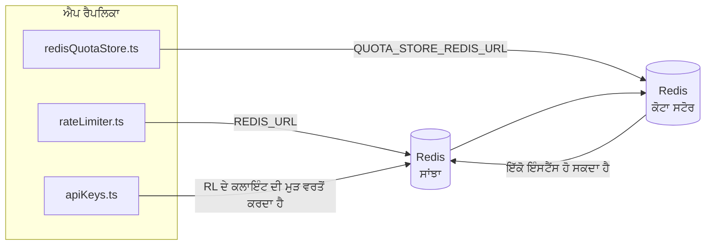

# Redis Production Configuration Guide (ਪੰਜਾਬੀ)

🌐 **Languages:** 🇺🇸 [English](../../../../ops/REDIS_PRODUCTION_CONFIG.md) · 🇪🇹 [am](../../../am/docs/ops/REDIS_PRODUCTION_CONFIG.md) · 🇸🇦 [ar](../../../ar/docs/ops/REDIS_PRODUCTION_CONFIG.md) · 🇦🇿 [az](../../../az/docs/ops/REDIS_PRODUCTION_CONFIG.md) · 🇧🇬 [bg](../../../bg/docs/ops/REDIS_PRODUCTION_CONFIG.md) · 🇧🇩 [bn](../../../bn/docs/ops/REDIS_PRODUCTION_CONFIG.md) · 🇧🇦 [bs](../../../bs/docs/ops/REDIS_PRODUCTION_CONFIG.md) · 🇨🇿 [cs](../../../cs/docs/ops/REDIS_PRODUCTION_CONFIG.md) · 🇩🇰 [da](../../../da/docs/ops/REDIS_PRODUCTION_CONFIG.md) · 🇩🇪 [de](../../../de/docs/ops/REDIS_PRODUCTION_CONFIG.md) · 🇬🇷 [el](../../../el/docs/ops/REDIS_PRODUCTION_CONFIG.md) · 🇪🇸 [es](../../../es/docs/ops/REDIS_PRODUCTION_CONFIG.md) · 🇪🇪 [et](../../../et/docs/ops/REDIS_PRODUCTION_CONFIG.md) · 🇮🇷 [fa](../../../fa/docs/ops/REDIS_PRODUCTION_CONFIG.md) · 🇫🇮 [fi](../../../fi/docs/ops/REDIS_PRODUCTION_CONFIG.md) · 🇫🇷 [fr](../../../fr/docs/ops/REDIS_PRODUCTION_CONFIG.md) · 🇮🇪 [ga](../../../ga/docs/ops/REDIS_PRODUCTION_CONFIG.md) · 🇮🇳 [gu](../../../gu/docs/ops/REDIS_PRODUCTION_CONFIG.md) · 🇳🇬 [ha](../../../ha/docs/ops/REDIS_PRODUCTION_CONFIG.md) · 🇮🇱 [he](../../../he/docs/ops/REDIS_PRODUCTION_CONFIG.md) · 🇮🇳 [hi](../../../hi/docs/ops/REDIS_PRODUCTION_CONFIG.md) · 🇭🇷 [hr](../../../hr/docs/ops/REDIS_PRODUCTION_CONFIG.md) · 🇭🇺 [hu](../../../hu/docs/ops/REDIS_PRODUCTION_CONFIG.md) · 🇦🇲 [hy](../../../hy/docs/ops/REDIS_PRODUCTION_CONFIG.md) · 🇮🇩 [id](../../../id/docs/ops/REDIS_PRODUCTION_CONFIG.md) · 🇳🇬 [ig](../../../ig/docs/ops/REDIS_PRODUCTION_CONFIG.md) · 🇮🇹 [it](../../../it/docs/ops/REDIS_PRODUCTION_CONFIG.md) · 🇯🇵 [ja](../../../ja/docs/ops/REDIS_PRODUCTION_CONFIG.md) · 🇬🇪 [ka](../../../ka/docs/ops/REDIS_PRODUCTION_CONFIG.md) · 🇰🇭 [km](../../../km/docs/ops/REDIS_PRODUCTION_CONFIG.md) · 🇮🇳 [kn](../../../kn/docs/ops/REDIS_PRODUCTION_CONFIG.md) · 🇰🇷 [ko](../../../ko/docs/ops/REDIS_PRODUCTION_CONFIG.md) · 🇱🇹 [lt](../../../lt/docs/ops/REDIS_PRODUCTION_CONFIG.md) · 🇱🇻 [lv](../../../lv/docs/ops/REDIS_PRODUCTION_CONFIG.md) · 🇮🇳 [ml](../../../ml/docs/ops/REDIS_PRODUCTION_CONFIG.md) · 🇮🇳 [mr](../../../mr/docs/ops/REDIS_PRODUCTION_CONFIG.md) · 🇲🇾 [ms](../../../ms/docs/ops/REDIS_PRODUCTION_CONFIG.md) · 🇲🇹 [mt](../../../mt/docs/ops/REDIS_PRODUCTION_CONFIG.md) · 🇲🇲 [my](../../../my/docs/ops/REDIS_PRODUCTION_CONFIG.md) · 🇳🇵 [ne](../../../ne/docs/ops/REDIS_PRODUCTION_CONFIG.md) · 🇳🇱 [nl](../../../nl/docs/ops/REDIS_PRODUCTION_CONFIG.md) · 🇳🇴 [no](../../../no/docs/ops/REDIS_PRODUCTION_CONFIG.md) · 🇮🇳 [or](../../../or/docs/ops/REDIS_PRODUCTION_CONFIG.md) · 🇵🇭 [phi](../../../phi/docs/ops/REDIS_PRODUCTION_CONFIG.md) · 🇵🇱 [pl](../../../pl/docs/ops/REDIS_PRODUCTION_CONFIG.md) · 🇵🇹 [pt](../../../pt/docs/ops/REDIS_PRODUCTION_CONFIG.md) · 🇧🇷 [pt-BR](../../../pt-BR/docs/ops/REDIS_PRODUCTION_CONFIG.md) · 🇷🇴 [ro](../../../ro/docs/ops/REDIS_PRODUCTION_CONFIG.md) · 🇷🇺 [ru](../../../ru/docs/ops/REDIS_PRODUCTION_CONFIG.md) · 🇱🇰 [si](../../../si/docs/ops/REDIS_PRODUCTION_CONFIG.md) · 🇸🇰 [sk](../../../sk/docs/ops/REDIS_PRODUCTION_CONFIG.md) · 🇸🇮 [sl](../../../sl/docs/ops/REDIS_PRODUCTION_CONFIG.md) · 🇷🇸 [sr](../../../sr/docs/ops/REDIS_PRODUCTION_CONFIG.md) · 🇸🇪 [sv](../../../sv/docs/ops/REDIS_PRODUCTION_CONFIG.md) · 🇰🇪 [sw](../../../sw/docs/ops/REDIS_PRODUCTION_CONFIG.md) · 🇮🇳 [ta](../../../ta/docs/ops/REDIS_PRODUCTION_CONFIG.md) · 🇮🇳 [te](../../../te/docs/ops/REDIS_PRODUCTION_CONFIG.md) · 🇹🇭 [th](../../../th/docs/ops/REDIS_PRODUCTION_CONFIG.md) · 🇹🇷 [tr](../../../tr/docs/ops/REDIS_PRODUCTION_CONFIG.md) · 🇺🇦 [uk-UA](../../../uk-UA/docs/ops/REDIS_PRODUCTION_CONFIG.md) · 🇵🇰 [ur](../../../ur/docs/ops/REDIS_PRODUCTION_CONFIG.md) · 🇺🇿 [uz](../../../uz/docs/ops/REDIS_PRODUCTION_CONFIG.md) · 🇻🇳 [vi](../../../vi/docs/ops/REDIS_PRODUCTION_CONFIG.md) · 🇳🇬 [yo](../../../yo/docs/ops/REDIS_PRODUCTION_CONFIG.md) · 🇨🇳 [zh-CN](../../../zh-CN/docs/ops/REDIS_PRODUCTION_CONFIG.md) · 🇹🇼 [zh-TW](../../../zh-TW/docs/ops/REDIS_PRODUCTION_CONFIG.md)

---

## ਸੰਖੇਪ ਜਾਣਕਾਰੀ

Redis OmniRoute ਵਿੱਚ ਇੱਕ **ਵਿਕਲਪਿਕ, ਗੈਰ-ਲਾਜ਼ਮੀ ਨਿਰਭਰਤਾ** ਹੈ — Redis ਉਪਲਬਧ ਨਾ ਹੋਣ 'ਤੇ ਐਪਲੀਕੇਸ਼ਨ ਸੁਚਾਰੂ ਢੰਗ ਨਾਲ ਘੱਟ ਸਮਰੱਥਾ ਵਾਲੇ ਮੋਡ ਵਿੱਚ ਚਲੀ ਜਾਂਦੀ ਹੈ (ਇਨ-ਮੈਮੋਰੀ
ਫਾਲਬੈਕ)। ਪ੍ਰੋਡਕਸ਼ਨ ਵਿੱਚ, Redis ਨੂੰ ਟਿਊਨ ਕਰਨ ਨਾਲ ਚਾਰ ਵੱਖ-ਵੱਖ
ਵਰਕਲੋਡਾਂ ਲਈ ਲੇਟੈਂਸੀ ਘਟਦੀ ਹੈ:

| ਵਰਕਲੋਡ               | ਡਰਾਈਵਰ                        | ਕਲਾਇੰਟ ਫੈਕਟਰੀ                                | ਕੁੰਜੀ ਪੈਟਰਨ                                |
| -------------------- | ----------------------------- | -------------------------------------------- | ------------------------------------------ |
| ਦਰ ਸੀਮਾਬੰਦੀ          | `rateLimiter.ts`              | `getRedisClient()` — ਲੇਜ਼ੀ `ioredis` ਸਿੰਗਲਟਨ | `<prefix>rl:*` Lua‑ਐਟਾਮਿਕ ਦਰ ਸੀਮਾ ਵਿੰਡੋਜ਼  |
| ਪ੍ਰਮਾਣੀਕਰਨ ਕੈਸ਼      | `apiKeys.ts`                  | `rateLimiter` ਦੇ ਕਲਾਇੰਟ ਦੀ ਮੁੜ ਵਰਤੋਂ ਕਰਦਾ ਹੈ | TTL ਨਾਲ `<prefix>auth:api_key:<sha256>`    |
| ਕੋਟਾ ਸਟੋਰ            | `redisQuotaStore.ts`          | ਵੱਖਰਾ `getRedisClient(url)` ਸਿੰਗਲਟਨ          | `<prefix>quota:*` ਪ੍ਰਤੀ-ਇੰਸਟੈਂਸ ਸੰਰਚਨਾ ਯੋਗ |
| ਵਾਰਮਅੱਪ ਸਰਕਿਟ ਬ੍ਰੇਕਰ | `redisCircuitBreakerStore.ts` | `circuitBreakerFactory.ts` ਵਿੱਚ ਵੱਖਰਾ ਕਲਾਇੰਟ | `<prefix>warmup:cb:<connectionId>`         |

ਸਾਰੇ ਚਾਰ ਵਰਕਲੋਡ ਇੱਕੋ ਨੇਮਸਪੇਸ ਪ੍ਰੀਫਿਕਸ ਸਾਂਝਾ ਕਰਦੇ ਹਨ, ਤਾਂ ਜੋ OmniRoute ਇੱਕੋ
Redis ਇੰਸਟੈਂਸ (ਉਦਾਹਰਨ ਲਈ `127.0.0.1:6379`) ਉੱਤੇ ਹੋਰ ਐਪਾਂ ਦੇ ਨਾਲ ਮੌਜੂਦ ਰਹਿ ਸਕੇ। [ਕੁੰਜੀ ਨੇਮਸਪੇਸਿੰਗ](#key-namespacing) ਵੇਖੋ।

---

## ਮੌਜੂਦਾ ਸੰਰਚਨਾ (ਕੋਡ ਡਿਫਾਲਟ)

| ਸੈਟਿੰਗ                                  | ਮੁੱਲ                                                          | ਸਥਾਨ                                                                                  |
| --------------------------------------- | ------------------------------------------------------------- | ------------------------------------------------------------------------------------- |
| `REDIS_URL` ਵਾਤਾਵਰਨ ਵੇਰੀਏਬਲ             | `redis://redis:6379` (compose), ਵਿਕਲਪਿਕ                       | `rateLimiter.ts:5`, `.env.example`                                                    |
| `REDIS_KEY_PREFIX` ਵਾਤਾਵਰਨ ਵੇਰੀਏਬਲ      | `omniroute:` (ਡਿਫਾਲਟ)                                         | `rateLimiter.ts`, `redisQuotaStore.ts`, `redisCircuitBreakerStore.ts`, `.env.example` |
| `QUOTA_STORE_REDIS_URL` ਵਾਤਾਵਰਨ ਵੇਰੀਏਬਲ | ਵੱਖਰਾ, `REDIS_URL` ਤੋਂ ਭਿੰਨ ਹੋ ਸਕਦਾ ਹੈ                        | `quota/storeFactory.ts`                                                               |
| `QUOTA_STORE_DRIVER`                    | `"sqlite"` (ਡਿਫਾਲਟ), `"redis"` ਵਿਕਲਪਿਕ                        | `quota/storeFactory.ts`                                                               |
| ioredis `maxRetriesPerRequest`          | `3`                                                           | `rateLimiter.ts` ਕਲਾਇੰਟ ਬਣਾਉਣਾ                                                        |
| `enableReadyCheck`                      | ਸੈੱਟ ਨਹੀਂ ਕੀਤਾ ਗਿਆ (ioredis ਡਿਫਾਲਟ: `true`)                   | —                                                                                     |
| `lazyConnect`                           | ਸੈੱਟ ਨਹੀਂ ਕੀਤਾ ਗਿਆ (ioredis ਡਿਫਾਲਟ: `false`)                  | —                                                                                     |
| `retryStrategy`                         | ਸੈੱਟ ਨਹੀਂ ਕੀਤਾ ਗਿਆ (ioredis ਡਿਫਾਲਟ: 200ms ਬੇਸ, ਐਕਸਪੋਨੇਨਸ਼ੀਅਲ) | —                                                                                     |
| TLS / ਪਾਸਵਰਡ / DB ਇੰਡੈਕਸ                | **ਸੰਰਚਿਤ ਨਹੀਂ**                                               | —                                                                                     |
| Sentinel / Cluster                      | **ਸੰਰਚਿਤ ਨਹੀਂ** — ਸਿਰਫ਼ ਸਟੈਂਡਅਲੋਨ ਸਿੰਗਲ-ਨੋਡ                   | —                                                                                     |

---

## ਕੁੰਜੀ ਨੇਮਸਪੇਸਿੰਗ

OmniRoute ਇੱਕ Redis ਇੰਸਟੈਂਸ ਨੂੰ ਹੋਸਟ ਉੱਤੇ ਚੱਲ ਰਹੀ ਕਿਸੇ ਵੀ ਹੋਰ ਚੀਜ਼ ਨਾਲ ਸਾਂਝਾ ਕਰਦਾ ਹੈ। ਨੇਮਸਪੇਸ ਤੋਂ ਬਿਨਾਂ,
`auth:api_key:<sha256>` ਜਾਂ `rl:*` ਵਰਗੀਆਂ ਕੁੰਜੀਆਂ ਉਸੇ Redis ਦੀ ਵਰਤੋਂ ਕਰਨ ਵਾਲੀਆਂ ਹੋਰ ਐਪਲੀਕੇਸ਼ਨਾਂ ਦੀਆਂ
ਕੁੰਜੀਆਂ ਨਾਲ ਟਕਰਾ ਸਕਦੀਆਂ ਹਨ (ਇਹ ਇੰਸਟੈਂਸ ਹੋਰ ਸੇਵਾਵਾਂ ਦੇ ਨਾਲ `127.0.0.1:6379` ਉੱਤੇ Redis ਚਲਾਉਂਦਾ ਹੈ)।

**ਹਰ** OmniRoute ਕੁੰਜੀ ਅੱਗੇ ਪ੍ਰੀਫਿਕਸ ਲਗਾਉਣ ਲਈ `REDIS_KEY_PREFIX` ਨੂੰ ਇੱਕ ਗੈਰ-ਖਾਲੀ ਸਟ੍ਰਿੰਗ 'ਤੇ ਸੈੱਟ ਕਰੋ:

```bash
# .env — ਸਾਰੀਆਂ OmniRoute ਕੁੰਜੀਆਂ omniroute:rl:*, omniroute:auth:*, omniroute:quota:*, omniroute:warmup:cb:* ਬਣ ਜਾਂਦੀਆਂ ਹਨ
REDIS_KEY_PREFIX=omniroute:
```

- **ਡਿਫਾਲਟ:** `omniroute:` (`REDIS_KEY_PREFIX` ਅਣਸੈੱਟ ਜਾਂ ਖਾਲੀ ਹੋਣ 'ਤੇ ਲਾਗੂ ਹੁੰਦਾ ਹੈ)।
- **ਇਨ੍ਹਾਂ 'ਤੇ ਲਾਗੂ:** ਦਰ ਸੀਮਾਕਾਰ + ਪ੍ਰਮਾਣੀਕਰਨ ਕੈਸ਼ (`keyPrefix` ਰਾਹੀਂ ਸਾਂਝਾ `ioredis` ਕਲਾਇੰਟ), ਅਤੇ
  ਕੋਟਾ ਸਟੋਰ (`KEY_PREFIX = "${REDIS_KEY_PREFIX}quota"`), ਅਤੇ ਵਾਰਮਅੱਪ ਸਰਕਿਟ ਬ੍ਰੇਕਰ
  (`KEY_PREFIX = "${REDIS_KEY_PREFIX}warmup:cb:"`)।
- ਜਦੋਂ Redis ਵਿੱਚ ਕੁੰਜੀਆਂ ਪਹਿਲਾਂ ਹੀ ਮੌਜੂਦ ਹੋਣ, ਤਾਂ **ਪ੍ਰੀਫਿਕਸ ਬਦਲਣ ਨਾਲ** ਪੁਰਾਣੀਆਂ ਕੁੰਜੀਆਂ ਅਨਾਥ ਹੋ ਜਾਂਦੀਆਂ ਹਨ (ਉਹ TTL / LRU
  ਰਾਹੀਂ ਮਿਆਦ ਪੁੱਗਣ 'ਤੇ ਹਟ ਜਾਂਦੀਆਂ ਹਨ)। ਇਸਨੂੰ ਬਦਲਣਾ ਸੁਰੱਖਿਅਤ ਹੈ; ਕਿਸੇ ਮਾਈਗ੍ਰੇਸ਼ਨ ਦੀ ਲੋੜ ਨਹੀਂ। ਇੱਕੋ ਅਪਵਾਦ ਉਸ ਕਨੈਕਸ਼ਨ ਲਈ ਵਾਰਮਅੱਪ
  ਸਰਕਿਟ-ਬ੍ਰੇਕਰ ਕੁੰਜੀ ਹੈ ਜਿਸਨੂੰ ਮਨਾਹੀਸ਼ੁਦਾ ਵਜੋਂ ਚਿੰਨ੍ਹਿਤ ਕੀਤਾ ਗਿਆ ਹੋਵੇ: ਇਹ TTL ਤੋਂ ਬਿਨਾਂ ਸਥਾਈ ਤੌਰ 'ਤੇ ਸੰਭਾਲੀ ਜਾਂਦੀ ਹੈ, ਇਸ ਲਈ
  ਬਚੀਆਂ ਹੋਈਆਂ ਕੁੰਜੀਆਂ ਨੂੰ `redis-cli --scan --pattern '<old-prefix>warmup:cb:*'` ਨਾਲ ਸੂਚੀਬੱਧ ਕਰੋ ਅਤੇ ਮਿਟਾ ਦਿਓ।
- **ioredis `keyPrefix`** ਲਿਖਣ ਵੇਲੇ ਪ੍ਰੀਫਿਕਸ ਨੂੰ ਆਪਣੇ ਆਪ ਅੱਗੇ ਜੋੜਦਾ ਹੈ **ਅਤੇ** ਪੜ੍ਹਨ ਵੇਲੇ ਇਸਨੂੰ ਹਟਾ ਦਿੰਦਾ ਹੈ,
  ਇਸ ਲਈ ਐਪਲੀਕੇਸ਼ਨ ਕੋਡ ਨੂੰ ਪ੍ਰੀਫਿਕਸ ਕਦੇ ਦਿਖਾਈ ਨਹੀਂ ਦਿੰਦਾ।

---

## ਸਿਫ਼ਾਰਿਸ਼ ਕੀਤੀ ਉਤਪਾਦਨ ਟਿਊਨਿੰਗ

### 1. ਕਨੈਕਸ਼ਨ ਪੂਲ / ਕਲਾਇੰਟ ਵਿਕਲਪ (ioredis `Redis` ਕੰਸਟਰਕਟਰ)

ਮੌਜੂਦਾ ਕੋਡ ਬਿਨਾਂ ਕਸਟਮ ਵਿਕਲਪਾਂ ਦੇ ਇੱਕ ਸਿੰਗਲ `new Redis(url)` ਬਣਾਉਂਦਾ ਹੈ। ਉਤਪਾਦਨ ਮਲਟੀ-ਰਿਪਲੀਕਾ ਤੈਨਾਤੀਆਂ ਲਈ, ਕੋਡ ਵਿੱਚ ਇੱਕ ਕਲਾਇੰਟ ਫੈਕਟਰੀ ਪਾਸ ਕਰੋ ਜਾਂ `getRedisClient()` ਲਪੇਟੋ:

```typescript
const redis = new Redis(REDIS_URL, {
  maxRetriesPerRequest: null, // no retry limit; let retryStrategy decide
  enableReadyCheck: true, // verify server is ready before accepting calls
  lazyConnect: true, // don't connect on construction; wait for first call
  retryStrategy: (times) => {
    if (times > 10) return null; // give up after 10 retries → reconnect later
    return Math.min(times * 200, 5000); // 200ms, 400ms, …, 5s cap
  },
  enableAutoPipelining: true, // coalesce concurrent commands into one TCP write
  keepAlive: 10000, // TCP keep‑alive every 10s
});
```

**ਮੁੱਖ ਵਪਾਰ-ਆਫ:**

- `maxRetriesPerRequest: null` + `retryStrategy` — ਨੂੰ ਉਤਪਾਦਨ ਲਈ ਤਰਜੀਹ ਦਿੱਤੀ ਜਾਂਦੀ ਹੈ ਇਸ ਲਈ ਅਸਥਾਈ Redis ਮੁੜ-ਚਾਲੂ ਹਰ ਬੇਨਤੀ ਨੂੰ ਤੁਰੰਤ ਅਸਫਲ ਨਹੀਂ ਕਰਦਾ ਹੈ। `checkRateLimit()` ਵਿੱਚ ਇਨ-ਮੈਮੋਰੀ ਫਾਲਬੈਕ ਅਸਫਲਤਾ ਮਾਰਗ ਨੂੰ ਜਜ਼ਬ ਕਰ ਲੈਂਦਾ ਹੈ।
- `lazyConnect: true` — ਸਰਵਰ ਦੁਆਰਾ ਕੁਨੈਕਸ਼ਨਾਂ ਨੂੰ ਸਵੀਕਾਰ ਕਰਨਾ ਸ਼ੁਰੂ ਕਰਨ ਤੋਂ ਪਹਿਲਾਂ Redis 'ਤੇ ਸ਼ੁਰੂਆਤੀ ਨਿਰਭਰਤਾ ਤੋਂ ਬਚਦਾ ਹੈ।
- `enableAutoPipelining: true` — ਸਮਕਾਲੀ ਦਰ-ਸੀਮਾ ਜਾਂਚਾਂ ਲਈ ਰਾਉਂਡ-ਟਰਿੱਪਾਂ ਨੂੰ ਘਟਾਉਂਦਾ ਹੈ; ਇੱਕ ਸਿੰਗਲ ਕੁਨੈਕਸ਼ਨ 'ਤੇ > 50 RPS 'ਤੇ ਲਾਭਕਾਰੀ।

### 2. Redis ਸਰਵਰ ਸੰਰਚਨਾ (`redis.conf`)

```
# Memory
maxmemory 80%                        # leave room for OS page cache
maxmemory-policy allkeys-lru         # evict stale auth cache entries under pressure

# Persistence (optional — OmniRoute is crash‑safe without it)
save 300 1                           # snapshot at least every 5 min if ≥1 key changed
appendonly no                        # AOF not needed; data is regeneratable
appendfsync no                       # no fsync overhead (RDB is sufficient)

# Networking
timeout 0                            # no idle disconnect
tcp-keepalive 300                    # 5 min keep‑alive
tcp-backlog 511                      # connection backlog for bursty load

# Performance
hz 10                                # default; 100 for latency‑sensitive
activedefrag yes                     # auto‑defragment when fragmentation >10%
```

**`maxmemory-policy allkeys-lru` ਲਈ ਵਪਾਰ ਬੰਦ:** ਮੈਮੋਰੀ ਦੇ ਦਬਾਅ ਹੇਠ ਪ੍ਰਮਾਣਿਤ ਕੈਸ਼ ਐਂਟਰੀਆਂ ਨੂੰ ਬੇਦਖਲ ਕੀਤਾ ਜਾ ਸਕਦਾ ਹੈ। ਇਹ ਸੁਰੱਖਿਅਤ ਹੈ — `setCachedApiKey` ਹਮੇਸ਼ਾ ਮਿਸ ਹੋਣ 'ਤੇ ਦੁਬਾਰਾ ਤਿਆਰ ਹੁੰਦਾ ਹੈ, ਅਤੇ SQLite ਫਾਲਬੈਕ ਅਧਿਕਾਰਤ ਹੈ। ਦਰ-ਸੀਮਾ ਕਰਨ ਵਾਲੀ ਲੂਆ ਸਕ੍ਰਿਪਟ ਛੋਟੀਆਂ ਕੁੰਜੀਆਂ ਬਣਾਉਂਦੀ ਹੈ ਜੋ ਡਿਜ਼ਾਈਨ ਦੁਆਰਾ ਥੋੜ੍ਹੇ ਸਮੇਂ ਲਈ ਹੁੰਦੀਆਂ ਹਨ।

### 3. Docker ਕੰਪੋਜ਼ ਸੈਟਿੰਗਜ਼

ਪ੍ਰੋਡ ਕੰਪੋਜ਼ (`docker-compose.prod.yml`) `redis:8.6.2-alpine` ਦੀ ਵਰਤੋਂ ਕਰਦਾ ਹੈ। ਸ਼ਾਮਲ ਕਰੋ:

```yaml
redis:
  image: redis:8.6.2-alpine
  command:
    [
      "redis-server",
      "--maxmemory",
      "512mb",
      "--maxmemory-policy",
      "allkeys-lru",
      "--activedefrag",
      "yes",
      "--save",
      "300 1",
    ]
  healthcheck:
    test: ["CMD", "redis-cli", "ping"]
    interval: 10s
    timeout: 3s
    retries: 3
    start_period: 5s
```

### 4. ਮਲਟੀ-ਇਨਸਟੈਂਸ / ਸਕੇਲਿੰਗ ਵਿਚਾਰ

**ਸਾਰੀਆਂ ਪ੍ਰਤੀਕ੍ਰਿਤੀਆਂ ਲਈ ਸਿੰਗਲ Redis** — ਦਰ-ਸੀਮਾ ਲੂਆ ਸਕ੍ਰਿਪਟ ਇੱਕ ਇੱਕਲੇ ਅਧਿਕਾਰਤ ਕੁੰਜੀ ਸਪੇਸ 'ਤੇ ਨਿਰਭਰ ਕਰਦੀ ਹੈ। ਪ੍ਰਤੀਕ੍ਰਿਤੀਆਂ ਦੇ ਪਿੱਛੇ ਇੱਕ ਤੋਂ ਵੱਧ Redis ਉਦਾਹਰਨਾਂ ਪ੍ਰਮਾਣੂਤਾ ਨੂੰ ਗੁਆ ਦੇਣਗੀਆਂ ਅਤੇ ਬਜਟ ਨੂੰ ਦੁੱਗਣਾ ਕਰ ਦੇਵੇਗਾ। ਸਾਰੀਆਂ ਐਪਲੀਕੇਸ਼ਨ ਪ੍ਰਤੀਕ੍ਰਿਤੀਆਂ ਲਈ ਇੱਕ ਸਿੰਗਲ Redis (ਜਾਂ ਫੇਲਓਵਰ ਦੇ ਨਾਲ Redis ਸੈਂਟੀਨੇਲ ਕਲੱਸਟਰ) ਦੀ ਵਰਤੋਂ ਕਰੋ।

**ਕਨੈਕਸ਼ਨ ਦੀ ਗਿਣਤੀ:** ਹਰੇਕ ਐਪਲੀਕੇਸ਼ਨ ਦੀ ਪ੍ਰਤੀਕ੍ਰਿਤੀ ਖੁੱਲ੍ਹਦੀ ਹੈ** 2 TCP ਕਨੈਕਸ਼ਨ** ਨੂੰ Redis (ਰੇਟ ਲਿਮਿਟਰ ਕਲਾਇੰਟ + ਕੋਟਾ ਸਟੋਰ ਕਲਾਇੰਟ)। 10 ਪ੍ਰਤੀਕ੍ਰਿਤੀਆਂ → 20 ਕੁਨੈਕਸ਼ਨਾਂ 'ਤੇ, ਇੱਕ ਡਿਫੌਲਟ Redis ਉਦਾਹਰਣ ਦੀ 10k ਕੁਨੈਕਸ਼ਨ ਸੀਲਿੰਗ ਦੇ ਅੰਦਰ।

### 5. ਨਿਗਰਾਨੀ

ਸਿਹਤ-ਜਾਂਚ ਅੰਤਮ ਬਿੰਦੂ ਦੁਆਰਾ ਪ੍ਰਗਟ ਕਰੋ:

```typescript
// src/app/api/monitoring/health/route.ts already calls rateLimiter functions
// Add Redis-specific checks:
//   1. PING latency via ioredis .ping()
//   2. Memory usage via INFO memory
//   3. Connection count via INFO clients
//   4. Hit rate for maxmemory-policy (evicted_keys / keyspace_hits)
```

ਦੇਖਣ ਲਈ ਮੁੱਖ ਮਾਪਦੰਡ:

- **ਬੇਦਖਲ ਕੁੰਜੀਆਂ / ਸਕਿੰਟ** — ਜੇਕਰ ਲਗਾਤਾਰ ਗੈਰ-ਜ਼ੀਰੋ ਹੈ, `maxmemory` ਵਧਾਓ
- **ਬਲਾਕ ਕੀਤੇ ਗਾਹਕ** — ਗੈਰ-ਜ਼ੀਰੋ ਹੌਲੀ ਲੂਆ ਸਕ੍ਰਿਪਟਾਂ ਜਾਂ ਉੱਚ ਵਿਵਾਦ ਦਾ ਸੁਝਾਅ ਦਿੰਦਾ ਹੈ
- **ਰੱਦ ਕੀਤੇ ਕਨੈਕਸ਼ਨ** — ਕੁਨੈਕਸ਼ਨ ਸੀਮਾ ਹਿੱਟ; 20 ਕੁਨੈਕਸ਼ਨਾਂ 'ਤੇ ਦੁਰਲੱਭ

### 6. ਰੀਡਿਸ-ਅਨੁਕੂਲ ਸਰਵਰ

ਇੱਥੇ ਵਰਤੇ ਗਏ ਕਿਸੇ ਵੀ ਸਰਵਰ ਨੂੰ ਲੁਆ ਸਕ੍ਰਿਪਟਾਂ ਚਲਾਉਣੀਆਂ ਚਾਹੀਦੀਆਂ ਹਨ: ਰੇਟ ਸੀਮਾ ਇੱਕ `EVAL` ਹੈ। ਲੂਆ ਤੋਂ ਬਿਨਾਂ ਸਰਵਰ 'ਤੇ, `checkRateLimit()` `[RATE_LIMITER] Redis eval failed, falling back to in-memory rate limiting` ਨੂੰ ਲੌਗ ਕਰਦਾ ਹੈ ਅਤੇ ਪ੍ਰਤੀ ਪ੍ਰਕਿਰਿਆ ਦੀ ਗਿਣਤੀ ਕਰਦਾ ਹੈ, ਇਸਲਈ ਹਰੇਕ ਪ੍ਰਤੀਕ੍ਰਿਤੀ ਆਪਣੇ ਆਪ ਸੀਮਾ ਨੂੰ ਲਾਗੂ ਕਰਦੀ ਹੈ। ਆਪਟ-ਇਨ ਸ਼ੇਅਰਡ ਸੈਸ਼ਨ-ਐਫੀਨਿਟੀ ਸਟੋਰ (`OMNIROUTE_SESSION_AFFINITY_STORE=redis`) `EVAL` ਨਾਲ ਪਿੰਨਾਂ ਨੂੰ ਪੜ੍ਹਦਾ ਅਤੇ ਅੱਪਡੇਟ ਕਰਦਾ ਹੈ; ਲੂਆ ਤੋਂ ਬਿਨਾਂ ਇਹ `[SESSION_AFFINITY] Redis error; falling back to SQLite.` ਨੂੰ ਲੌਗ ਕਰਦਾ ਹੈ ਅਤੇ ਹਰੇਕ ਪ੍ਰਤੀਕ੍ਰਿਤੀ ਆਪਣੇ ਖੁਦ ਦੇ ਪਿੰਨ ਰੱਖਦਾ ਹੈ। ਹੋਰ ਵਰਕਲੋਡ ਸਧਾਰਨ ਕਮਾਂਡਾਂ (`SET ... EX`, `GET`, `DEL`, `MGET`, `EXPIRE`, `INCRBYFLOAT`, ਹੈਸ਼ ਅਤੇ ਸੈੱਟ) ਦੀ ਵਰਤੋਂ ਕਰਦੇ ਹਨ, ਅਤੇ ਸਿਮੈਂਟਿਕ ਕੈਸ਼ ਦਾ Redis ਬੈਕਐਂਡ ਕੋਈ `FT.*` ਕਮਾਂਡ ਨਹੀਂ ਭੇਜਦਾ ਹੈ।

OmniRoute 3.8.52: KiviDB 1.2.0 ਨਾਲ ਇਸਦੇ Lua ਚਿੱਤਰ (`kividb/kividb:v1.2.0-lua`) ਨਾਲ ਟੈਸਟ ਕੀਤਾ ਗਿਆ। ਰੇਟ ਲਿਮਿਟਰ (ਕਾਊਂਟਰਾਂ ਨੂੰ ਸਾਂਝਾ ਕਰਨ ਵਾਲੀ ਦੂਜੀ ਪ੍ਰਕਿਰਿਆ ਸਮੇਤ), ਪ੍ਰਮਾਣਿਕਤਾ ਕੈਸ਼, ਕੋਟਾ ਸਟੋਰ, ਵਾਰਮਅੱਪ ਸਰਕਟ ਬ੍ਰੇਕਰ, ਸਿਮੈਂਟਿਕ ਕੈਸ਼ ਸਟੋਰ, ਅਤੇ ਚੈਟ ਹੈਂਡਲਰ ਦੁਆਰਾ ਇੱਕ `/v1/chat/completions` ਬੇਨਤੀ ਨੇ 19 ਵਿੱਚੋਂ 18 ਚੈੱਕ ਪਾਸ ਕੀਤੇ ਜੋ Redis 8.10.3 'ਤੇ ਪਾਸ ਹੁੰਦੇ ਹਨ। ਇੱਕ ਜੋ ਵੱਖਰਾ ਹੈ: `INCRBYFLOAT` `0.1 + 0.2` `0.30000000000000004` ਵਜੋਂ ਸਟੋਰ ਕਰਦਾ ਹੈ ਜਿੱਥੇ Redis `0.3` ਸਟੋਰ ਕਰਦਾ ਹੈ ( [kividbio/kividb#387](https://github.com/kividbio/kividb/issues/387) )। ਕੋਟਾ ਸਟੋਰ ਦੋਵਾਂ ਨੂੰ `parseFloat` ਨਾਲ ਪਾਰਸ ਕਰਦਾ ਹੈ, ਪਰ ਦੋ ਨੰਬਰ ਆਖਰੀ ਅੰਕਾਂ ਵਿੱਚ ਵੱਖਰੇ ਹੁੰਦੇ ਹਨ, ਇਸਲਈ ਇੱਕ ਤੁਲਨਾ ਜੋ ਬਿਲਕੁਲ ਕੋਟਾ ਸੀਮਾ 'ਤੇ ਆਉਂਦੀ ਹੈ, ਵੱਖਰੇ ਤੌਰ 'ਤੇ ਸਾਹਮਣੇ ਆ ਸਕਦੀ ਹੈ। ਸੈਸ਼ਨ-ਐਫੀਨਿਟੀ ਸਟੋਰ ਉਸ ਰਨ ਦਾ ਹਿੱਸਾ ਨਹੀਂ ਸੀ। ( [ਸੈਟਅੱਪ](https://github.com/kividbio/kividb/blob/master/docs/integrations/omniroute.md), [ਨਤੀਜੇ](https://github.com/kividbio/kividb/tree/master/benchmarks/omniroute-compat) )

---

## ਆਰਕੀਟੈਕਚਰ ਡਾਇਗ੍ਰਾਮ



---

## ਹਵਾਲੇ

| ਫ਼ਾਈਲ                              | ਉਦੇਸ਼                                                      |
| ---------------------------------- | ---------------------------------------------------------- |
| `src/shared/utils/rateLimiter.ts`  | ਮੁੱਖ Redis ਕਲਾਇੰਟ, Lua ਰੇਟ-ਲਿਮਿਟ ਸਕ੍ਰਿਪਟ, ਇਨ-ਮੈਮੋਰੀ ਫਾਲਬੈਕ |
| `src/lib/db/apiKeys.ts`            | ਪ੍ਰਮਾਣੀਕਰਨ ਕੈਸ਼ — Redis→SQLite ਫਾਲਬੈਕ                      |
| `src/lib/quota/redisQuotaStore.ts` | ਵਿਕਲਪਿਕ ਕੋਟਾ ਸਟੋਰ ਲਈ ਵੱਖਰਾ Redis ਕਲਾਇੰਟ                    |
| `src/lib/quota/storeFactory.ts`    | `sqlite` ਅਤੇ `redis` ਕੋਟਾ ਡਰਾਈਵਰਾਂ ਵਿਚਕਾਰ ਸਵਿੱਚ ਕਰਦਾ ਹੈ    |
| `docker-compose.prod.yml`          | ਪ੍ਰੋਡਕਸ਼ਨ Redis ਕੰਟੇਨਰ (ਇਮੇਜ `redis:8.6.2-alpine`)         |
| `.env.example`                     | Redis env vars ਦਾ ਦਸਤਾਵੇਜ਼ੀਕਰਨ                             |
| `src/app/api/local/redis/`         | ਡਿਵੈਲਪਮੈਂਟ ਕੰਟੇਨਰ ਔਰਕੈਸਟ੍ਰੇਸ਼ਨ ਲਈ API ਰੂਟ                  |
| `bin/cli/commands/redis.mjs`       | ਡਿਵੈਲਪਮੈਂਟ ਕੰਟੇਨਰ ਔਰਕੈਸਟ੍ਰੇਸ਼ਨ ਲਈ CLI ਕਮਾਂਡਾਂ              |
