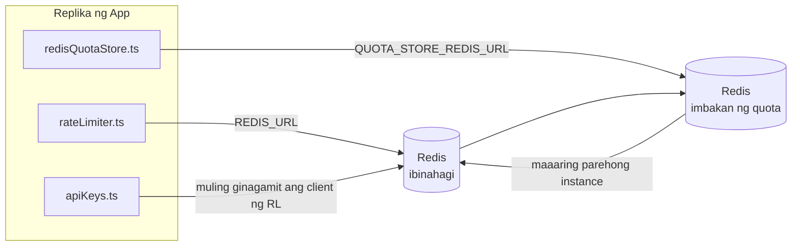

# Redis Production Configuration Guide (Filipino)

🌐 **Languages:** 🇺🇸 [English](../../../../ops/REDIS_PRODUCTION_CONFIG.md) · 🇪🇹 [am](../../../am/docs/ops/REDIS_PRODUCTION_CONFIG.md) · 🇸🇦 [ar](../../../ar/docs/ops/REDIS_PRODUCTION_CONFIG.md) · 🇦🇿 [az](../../../az/docs/ops/REDIS_PRODUCTION_CONFIG.md) · 🇧🇬 [bg](../../../bg/docs/ops/REDIS_PRODUCTION_CONFIG.md) · 🇧🇩 [bn](../../../bn/docs/ops/REDIS_PRODUCTION_CONFIG.md) · 🇧🇦 [bs](../../../bs/docs/ops/REDIS_PRODUCTION_CONFIG.md) · 🇨🇿 [cs](../../../cs/docs/ops/REDIS_PRODUCTION_CONFIG.md) · 🇩🇰 [da](../../../da/docs/ops/REDIS_PRODUCTION_CONFIG.md) · 🇩🇪 [de](../../../de/docs/ops/REDIS_PRODUCTION_CONFIG.md) · 🇬🇷 [el](../../../el/docs/ops/REDIS_PRODUCTION_CONFIG.md) · 🇪🇸 [es](../../../es/docs/ops/REDIS_PRODUCTION_CONFIG.md) · 🇪🇪 [et](../../../et/docs/ops/REDIS_PRODUCTION_CONFIG.md) · 🇮🇷 [fa](../../../fa/docs/ops/REDIS_PRODUCTION_CONFIG.md) · 🇫🇮 [fi](../../../fi/docs/ops/REDIS_PRODUCTION_CONFIG.md) · 🇫🇷 [fr](../../../fr/docs/ops/REDIS_PRODUCTION_CONFIG.md) · 🇮🇪 [ga](../../../ga/docs/ops/REDIS_PRODUCTION_CONFIG.md) · 🇮🇳 [gu](../../../gu/docs/ops/REDIS_PRODUCTION_CONFIG.md) · 🇳🇬 [ha](../../../ha/docs/ops/REDIS_PRODUCTION_CONFIG.md) · 🇮🇱 [he](../../../he/docs/ops/REDIS_PRODUCTION_CONFIG.md) · 🇮🇳 [hi](../../../hi/docs/ops/REDIS_PRODUCTION_CONFIG.md) · 🇭🇷 [hr](../../../hr/docs/ops/REDIS_PRODUCTION_CONFIG.md) · 🇭🇺 [hu](../../../hu/docs/ops/REDIS_PRODUCTION_CONFIG.md) · 🇦🇲 [hy](../../../hy/docs/ops/REDIS_PRODUCTION_CONFIG.md) · 🇮🇩 [id](../../../id/docs/ops/REDIS_PRODUCTION_CONFIG.md) · 🇳🇬 [ig](../../../ig/docs/ops/REDIS_PRODUCTION_CONFIG.md) · 🇮🇹 [it](../../../it/docs/ops/REDIS_PRODUCTION_CONFIG.md) · 🇯🇵 [ja](../../../ja/docs/ops/REDIS_PRODUCTION_CONFIG.md) · 🇬🇪 [ka](../../../ka/docs/ops/REDIS_PRODUCTION_CONFIG.md) · 🇰🇭 [km](../../../km/docs/ops/REDIS_PRODUCTION_CONFIG.md) · 🇮🇳 [kn](../../../kn/docs/ops/REDIS_PRODUCTION_CONFIG.md) · 🇰🇷 [ko](../../../ko/docs/ops/REDIS_PRODUCTION_CONFIG.md) · 🇱🇹 [lt](../../../lt/docs/ops/REDIS_PRODUCTION_CONFIG.md) · 🇱🇻 [lv](../../../lv/docs/ops/REDIS_PRODUCTION_CONFIG.md) · 🇮🇳 [ml](../../../ml/docs/ops/REDIS_PRODUCTION_CONFIG.md) · 🇮🇳 [mr](../../../mr/docs/ops/REDIS_PRODUCTION_CONFIG.md) · 🇲🇾 [ms](../../../ms/docs/ops/REDIS_PRODUCTION_CONFIG.md) · 🇲🇹 [mt](../../../mt/docs/ops/REDIS_PRODUCTION_CONFIG.md) · 🇲🇲 [my](../../../my/docs/ops/REDIS_PRODUCTION_CONFIG.md) · 🇳🇵 [ne](../../../ne/docs/ops/REDIS_PRODUCTION_CONFIG.md) · 🇳🇱 [nl](../../../nl/docs/ops/REDIS_PRODUCTION_CONFIG.md) · 🇳🇴 [no](../../../no/docs/ops/REDIS_PRODUCTION_CONFIG.md) · 🇮🇳 [or](../../../or/docs/ops/REDIS_PRODUCTION_CONFIG.md) · 🇮🇳 [pa](../../../pa/docs/ops/REDIS_PRODUCTION_CONFIG.md) · 🇵🇱 [pl](../../../pl/docs/ops/REDIS_PRODUCTION_CONFIG.md) · 🇵🇹 [pt](../../../pt/docs/ops/REDIS_PRODUCTION_CONFIG.md) · 🇧🇷 [pt-BR](../../../pt-BR/docs/ops/REDIS_PRODUCTION_CONFIG.md) · 🇷🇴 [ro](../../../ro/docs/ops/REDIS_PRODUCTION_CONFIG.md) · 🇷🇺 [ru](../../../ru/docs/ops/REDIS_PRODUCTION_CONFIG.md) · 🇱🇰 [si](../../../si/docs/ops/REDIS_PRODUCTION_CONFIG.md) · 🇸🇰 [sk](../../../sk/docs/ops/REDIS_PRODUCTION_CONFIG.md) · 🇸🇮 [sl](../../../sl/docs/ops/REDIS_PRODUCTION_CONFIG.md) · 🇷🇸 [sr](../../../sr/docs/ops/REDIS_PRODUCTION_CONFIG.md) · 🇸🇪 [sv](../../../sv/docs/ops/REDIS_PRODUCTION_CONFIG.md) · 🇰🇪 [sw](../../../sw/docs/ops/REDIS_PRODUCTION_CONFIG.md) · 🇮🇳 [ta](../../../ta/docs/ops/REDIS_PRODUCTION_CONFIG.md) · 🇮🇳 [te](../../../te/docs/ops/REDIS_PRODUCTION_CONFIG.md) · 🇹🇭 [th](../../../th/docs/ops/REDIS_PRODUCTION_CONFIG.md) · 🇹🇷 [tr](../../../tr/docs/ops/REDIS_PRODUCTION_CONFIG.md) · 🇺🇦 [uk-UA](../../../uk-UA/docs/ops/REDIS_PRODUCTION_CONFIG.md) · 🇵🇰 [ur](../../../ur/docs/ops/REDIS_PRODUCTION_CONFIG.md) · 🇺🇿 [uz](../../../uz/docs/ops/REDIS_PRODUCTION_CONFIG.md) · 🇻🇳 [vi](../../../vi/docs/ops/REDIS_PRODUCTION_CONFIG.md) · 🇳🇬 [yo](../../../yo/docs/ops/REDIS_PRODUCTION_CONFIG.md) · 🇨🇳 [zh-CN](../../../zh-CN/docs/ops/REDIS_PRODUCTION_CONFIG.md) · 🇹🇼 [zh-TW](../../../zh-TW/docs/ops/REDIS_PRODUCTION_CONFIG.md)

---

## Pangkalahatang-ideya

Ang Redis ay isang **opsyonal at hindi mahigpit na dependency** sa OmniRoute — maayos na bumababa ang kakayahan ng application (gumagamit ng mga in-memory na fallback) kapag hindi available ang Redis. Sa production, ang pag-tune sa Redis ay nagpapababa ng latency para sa apat na magkakaibang workload:

| Workload                  | Driver                        | Client Factory                                   | Pattern ng Key                                        |
| ------------------------- | ----------------------------- | ------------------------------------------------ | ----------------------------------------------------- |
| Paglilimita ng rate       | `rateLimiter.ts`              | `getRedisClient()` — lazy na `ioredis` singleton | `<prefix>rl:*` mga Lua-atomic na window ng rate limit |
| Cache ng auth             | `apiKeys.ts`                  | Muling ginagamit ang client ng `rateLimiter`     | `<prefix>auth:api_key:<sha256>` na may TTL            |
| Imbakan ng quota          | `redisQuotaStore.ts`          | Hiwalay na `getRedisClient(url)` singleton       | `<prefix>quota:*` na nako-configure sa bawat instance |
| Circuit breaker ng warmup | `redisCircuitBreakerStore.ts` | Hiwalay na client sa `circuitBreakerFactory.ts`  | `<prefix>warmup:cb:<connectionId>`                    |

Iisang namespace prefix ang ginagamit ng lahat ng apat na workload upang makapagpatakbo ang OmniRoute kasama ng iba pang app sa iisang Redis instance (hal. `127.0.0.1:6379`). Tingnan ang [Paglalagay sa Namespace ng mga Key](#key-namespacing).

---

## Kasalukuyang Configuration (Mga Default sa Code)

| Setting                         | Value                                                         | Lokasyon                                                                              |
| ------------------------------- | ------------------------------------------------------------- | ------------------------------------------------------------------------------------- |
| `REDIS_URL` env var             | `redis://redis:6379` (compose), opsyonal                      | `rateLimiter.ts:5`, `.env.example`                                                    |
| `REDIS_KEY_PREFIX` env var      | `omniroute:` (default)                                        | `rateLimiter.ts`, `redisQuotaStore.ts`, `redisCircuitBreakerStore.ts`, `.env.example` |
| `QUOTA_STORE_REDIS_URL` env var | hiwalay, maaaring iba sa `REDIS_URL`                          | `quota/storeFactory.ts`                                                               |
| `QUOTA_STORE_DRIVER`            | `"sqlite"` (default), opsyonal ang `"redis"`                  | `quota/storeFactory.ts`                                                               |
| ioredis `maxRetriesPerRequest`  | `3`                                                           | paggawa ng client sa `rateLimiter.ts`                                                 |
| `enableReadyCheck`              | hindi nakatakda (default ng ioredis: `true`)                  | —                                                                                     |
| `lazyConnect`                   | hindi nakatakda (default ng ioredis: `false`)                 | —                                                                                     |
| `retryStrategy`                 | hindi nakatakda (default ng ioredis: 200ms base, exponential) | —                                                                                     |
| TLS / password / DB index       | **hindi naka-configure**                                      | —                                                                                     |
| Sentinel / Cluster              | **hindi naka-configure** — standalone na single-node lamang   | —                                                                                     |

---

## Paglalagay sa Namespace ng mga Key

Nakikibahagi ang OmniRoute sa isang Redis instance kasama ng anumang iba pang tumatakbo sa host. Kung walang namespace, maaaring magbanggaan ang mga key tulad ng `auth:api_key:<sha256>` o `rl:*` at ang mga key mula sa iba pang application na gumagamit ng parehong Redis (nagpapatakbo ang instance na ito ng Redis sa `127.0.0.1:6379` kasama ng iba pang serbisyo).

Itakda ang `REDIS_KEY_PREFIX` sa isang string na hindi walang laman upang lagyan ng prefix ang **bawat** key ng OmniRoute:

```bash
# .env — magiging omniroute:rl:*, omniroute:auth:*, omniroute:quota:*, omniroute:warmup:cb:* ang lahat ng key ng OmniRoute
REDIS_KEY_PREFIX=omniroute:
```

- **Default:** `omniroute:` (inilalapat kapag hindi nakatakda o blangko ang `REDIS_KEY_PREFIX`).
- **Inilalapat sa:** rate limiter + auth cache (nakabahaging `ioredis` client sa pamamagitan ng `keyPrefix`) at sa quota store (`KEY_PREFIX = "${REDIS_KEY_PREFIX}quota"`) at sa warmup circuit breaker (`KEY_PREFIX = "${REDIS_KEY_PREFIX}warmup:cb:"`).
- Kapag **binago ang prefix** habang mayroon nang mga key sa Redis, maiiwang hindi naa-access ang mga lumang key (mag-e-expire ang mga ito sa pamamagitan ng TTL / LRU). Ligtas itong baguhin; walang kinakailangang migration. Ang tanging exception ay ang warmup circuit-breaker key para sa isang connection na minarkahang forbidden: sine-save ito nang walang TTL, kaya ilista ang mga natira gamit ang `redis-cli --scan --pattern '<old-prefix>warmup:cb:*'` at i-delete ang mga ito.
- Awtomatikong inilalagay ng **ioredis `keyPrefix`** ang prefix sa unahan kapag nagsusulat **at** inaalis ito kapag nagbabasa, kaya hindi kailanman nakikita ng application code ang prefix.

---

## Inirerekomendang Pag-tune ng Produksyon

### 1. Connection Pool / Client Options (ioredis `Redis` constructor)

Ang kasalukuyang code ay lumilikha ng iisang `new Redis(url)` na walang custom na opsyon. Para sa production multi‑replica deployment, ipasa ang isang client factory sa code o wrap `getRedisClient()`:

```typescript
const redis = new Redis(REDIS_URL, {
  maxRetriesPerRequest: null, // no retry limit; let retryStrategy decide
  enableReadyCheck: true, // verify server is ready before accepting calls
  lazyConnect: true, // don't connect on construction; wait for first call
  retryStrategy: (times) => {
    if (times > 10) return null; // give up after 10 retries → reconnect later
    return Math.min(times * 200, 5000); // 200ms, 400ms, …, 5s cap
  },
  enableAutoPipelining: true, // coalesce concurrent commands into one TCP write
  keepAlive: 10000, // TCP keep‑alive every 10s
});
```

**Mga pangunahing trade-off:**

- `maxRetriesPerRequest: null` + `retryStrategy` — ginustong para sa produksyon kaya lumilipas Redis restart ay hindi kaagad mabigo sa bawat kahilingan. Ang in-memory fallback sa `checkRateLimit()` ay sumisipsip ng failure path.
- Iniiwasan `lazyConnect: true` — ang isang startup dependency sa Redis na naka-up bago magsimulang tumanggap ang server ng mga koneksyon.
- binabawasan ng `enableAutoPipelining: true` — ang mga round-trip para sa sabay-sabay na mga pagsusuri sa limitasyon sa rate; kapaki-pakinabang sa > 50 RPS sa isang koneksyon.

### 2. Redis Server Configuration (`redis.conf`)

```
# Memory
maxmemory 80%                        # leave room for OS page cache
maxmemory-policy allkeys-lru         # evict stale auth cache entries under pressure

# Persistence (optional — OmniRoute is crash‑safe without it)
save 300 1                           # snapshot at least every 5 min if ≥1 key changed
appendonly no                        # AOF not needed; data is regeneratable
appendfsync no                       # no fsync overhead (RDB is sufficient)

# Networking
timeout 0                            # no idle disconnect
tcp-keepalive 300                    # 5 min keep‑alive
tcp-backlog 511                      # connection backlog for bursty load

# Performance
hz 10                                # default; 100 for latency‑sensitive
activedefrag yes                     # auto‑defragment when fragmentation >10%
```

**Trade-off para sa `maxmemory-policy allkeys-lru`:** Ang mga entry ng auth cache ay maaaring maalis sa ilalim ng presyon ng memorya. Ito ay ligtas — `setCachedApiKey` ay palaging muling napupuno sa miss, at ang SQLite fallback ay may awtoridad. Lumilikha ang script ng Lua-limiter ng rate ng maliliit na key na panandalian sa disenyo.

### 3. Docker Gumawa ng Mga Setting

Ang prod compose (`docker-compose.prod.yml`) ay gumagamit ng `redis:8.6.2-alpine`. Idagdag:

```yaml
redis:
  image: redis:8.6.2-alpine
  command:
    [
      "redis-server",
      "--maxmemory",
      "512mb",
      "--maxmemory-policy",
      "allkeys-lru",
      "--activedefrag",
      "yes",
      "--save",
      "300 1",
    ]
  healthcheck:
    test: ["CMD", "redis-cli", "ping"]
    interval: 10s
    timeout: 3s
    retries: 3
    start_period: 5s
```

### 4. Mga Pagsasaalang-alang sa Multi‑Instance / Pag-scale

**Single Redis para sa lahat ng replika** — ang rate-limiter na Lua script ay nakasalalay sa iisang authoritative key space. Maraming Redis instance sa likod ng mga replika ang mawawalan ng atomicity at doble ang budget. Gumamit ng iisang Redis (o Redis Sentinel cluster na may failover) para sa lahat ng mga replika ng application.

**Bilang ng koneksyon:** Ang bawat replika ng application ay bubukas** 2 TCP na koneksyon** hanggang Redis (kliyente ng limiter ng rate + quota store client). Sa 10 replicas → 20 na koneksyon, na nasa loob ng 10k na kisame ng koneksyon ng default Redis instance.

### 5. Pagsubaybay

Ilantad sa pamamagitan ng endpoint ng pagsusuri sa kalusugan:

```typescript
// src/app/api/monitoring/health/route.ts already calls rateLimiter functions
// Add Redis-specific checks:
//   1. PING latency via ioredis .ping()
//   2. Memory usage via INFO memory
//   3. Connection count via INFO clients
//   4. Hit rate for maxmemory-policy (evicted_keys / keyspace_hits)
```

Mga pangunahing sukatan upang panoorin:

- **Mga pinaalis na susi / seg** — kung patuloy na hindi zero, dagdagan `maxmemory`
- **Mga naka-block na kliyente** — non-zero ay nagmumungkahi ng mabagal na mga script ng Lua o mataas na pagtatalo
- **Mga tinanggihang koneksyon** pindutin ang limitasyon ng koneksyon — ; bihira sa 20 koneksyon

### 6. Mga Redis-Compatible na Server

Ang anumang server na ginamit dito ay dapat magpatakbo ng mga script ng Lua: ang limiter ng rate ay isang `EVAL`. Sa isang server na walang Lua, `checkRateLimit()` ay nagla-log ng `[RATE_LIMITER] Redis eval failed, falling back to in-memory rate limiting` at nagbibilang sa bawat proseso, kaya ang bawat replica ay nagpapatupad ng limitasyon sa sarili nitong. Ang opt-in shared session-affinity store (`OMNIROUTE_SESSION_AFFINITY_STORE=redis`) ay nagbabasa at nag-a-update din ng mga pin gamit ang `EVAL`; nang walang Lua ito ay nag-log `[SESSION_AFFINITY] Redis error; falling back to SQLite.` at bawat replica ay nagpapanatili ng sarili nitong mga pin. Ang iba pang mga workload ay gumagamit ng mga simpleng command (`SET ... EX`, `GET`, `DEL`, `MGET`, `EXPIRE`, `INCRBYFLOAT`, mga hash at set), at ang Redis backend ng semantic cache ay hindi nagpapadala ng mga `FT.*` command.

Sinubukan gamit ang OmniRoute 3.8.52: KiviDB 1.2.0 kasama ang imahe nitong Lua (`kividb/kividb:v1.2.0-lua`). Ang rate limiter (kabilang ang pangalawang proseso na nagbabahagi ng mga counter), auth cache, quota store, warmup circuit breaker, semantic cache store, at isang `/v1/chat/completions` na kahilingan sa pamamagitan ng chat handler ay pumasa sa 18 sa 19 na tseke na pumasa sa Redis 8.10.3. Ang isa na naiiba: `INCRBYFLOAT` ay nag-iimbak ng `0.1 + 0.2` bilang `0.30000000000000004` kung saan Redis ay nag-iimbak ng `0.3` ( [kividbio/kividb#387](https://github.com/kividbio/kividb/issues/387) ). Parehong pina-parse ng tindahan ng quota ang `parseFloat`, ngunit magkaiba ang dalawang numero sa mga huling digit, kaya ang paghahambing na eksaktong nahuhulog sa hangganan ng quota ay maaaring magkaiba. Ang tindahan ng session-affinity ay hindi bahagi ng pagtakbo na iyon. ( [setup](https://github.com/kividbio/kividb/blob/master/docs/integrations/omniroute.md), [mga resulta](https://github.com/kividbio/kividb/tree/master/benchmarks/omniroute-compat) )

---

## Diagram ng Arkitektura



---

## Mga Sanggunian

| File                               | Layunin                                                                |
| ---------------------------------- | ---------------------------------------------------------------------- |
| `src/shared/utils/rateLimiter.ts`  | Pangunahing Redis client, Lua rate-limit script, at in-memory fallback |
| `src/lib/db/apiKeys.ts`            | Auth cache — Redis→SQLite fallback                                     |
| `src/lib/quota/redisQuotaStore.ts` | Hiwalay na Redis client para sa opsyonal na imbakan ng quota           |
| `src/lib/quota/storeFactory.ts`    | Nagpapalit sa pagitan ng `sqlite` at `redis` na mga quota driver       |
| `docker-compose.prod.yml`          | Redis container para sa production (image na `redis:8.6.2-alpine`)     |
| `.env.example`                     | Dokumentasyon ng mga Redis env var                                     |
| `src/app/api/local/redis/`         | Mga API route para sa orkestrasyon ng dev container                    |
| `bin/cli/commands/redis.mjs`       | Mga CLI command para sa orkestrasyon ng dev container                  |
