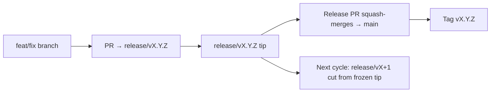

# Branching & Release Model (Polski)

🌐 **Languages:** 🇺🇸 [English](../../../../ops/BRANCHING_MODEL.md) · 🇪🇹 [am](../../../am/docs/ops/BRANCHING_MODEL.md) · 🇸🇦 [ar](../../../ar/docs/ops/BRANCHING_MODEL.md) · 🇦🇿 [az](../../../az/docs/ops/BRANCHING_MODEL.md) · 🇧🇬 [bg](../../../bg/docs/ops/BRANCHING_MODEL.md) · 🇧🇩 [bn](../../../bn/docs/ops/BRANCHING_MODEL.md) · 🇧🇦 [bs](../../../bs/docs/ops/BRANCHING_MODEL.md) · 🇨🇿 [cs](../../../cs/docs/ops/BRANCHING_MODEL.md) · 🇩🇰 [da](../../../da/docs/ops/BRANCHING_MODEL.md) · 🇩🇪 [de](../../../de/docs/ops/BRANCHING_MODEL.md) · 🇬🇷 [el](../../../el/docs/ops/BRANCHING_MODEL.md) · 🇪🇸 [es](../../../es/docs/ops/BRANCHING_MODEL.md) · 🇪🇪 [et](../../../et/docs/ops/BRANCHING_MODEL.md) · 🇮🇷 [fa](../../../fa/docs/ops/BRANCHING_MODEL.md) · 🇫🇮 [fi](../../../fi/docs/ops/BRANCHING_MODEL.md) · 🇫🇷 [fr](../../../fr/docs/ops/BRANCHING_MODEL.md) · 🇮🇪 [ga](../../../ga/docs/ops/BRANCHING_MODEL.md) · 🇮🇳 [gu](../../../gu/docs/ops/BRANCHING_MODEL.md) · 🇳🇬 [ha](../../../ha/docs/ops/BRANCHING_MODEL.md) · 🇮🇱 [he](../../../he/docs/ops/BRANCHING_MODEL.md) · 🇮🇳 [hi](../../../hi/docs/ops/BRANCHING_MODEL.md) · 🇭🇷 [hr](../../../hr/docs/ops/BRANCHING_MODEL.md) · 🇭🇺 [hu](../../../hu/docs/ops/BRANCHING_MODEL.md) · 🇦🇲 [hy](../../../hy/docs/ops/BRANCHING_MODEL.md) · 🇮🇩 [id](../../../id/docs/ops/BRANCHING_MODEL.md) · 🇳🇬 [ig](../../../ig/docs/ops/BRANCHING_MODEL.md) · 🇮🇹 [it](../../../it/docs/ops/BRANCHING_MODEL.md) · 🇯🇵 [ja](../../../ja/docs/ops/BRANCHING_MODEL.md) · 🇬🇪 [ka](../../../ka/docs/ops/BRANCHING_MODEL.md) · 🇰🇭 [km](../../../km/docs/ops/BRANCHING_MODEL.md) · 🇮🇳 [kn](../../../kn/docs/ops/BRANCHING_MODEL.md) · 🇰🇷 [ko](../../../ko/docs/ops/BRANCHING_MODEL.md) · 🇱🇹 [lt](../../../lt/docs/ops/BRANCHING_MODEL.md) · 🇱🇻 [lv](../../../lv/docs/ops/BRANCHING_MODEL.md) · 🇮🇳 [ml](../../../ml/docs/ops/BRANCHING_MODEL.md) · 🇮🇳 [mr](../../../mr/docs/ops/BRANCHING_MODEL.md) · 🇲🇾 [ms](../../../ms/docs/ops/BRANCHING_MODEL.md) · 🇲🇹 [mt](../../../mt/docs/ops/BRANCHING_MODEL.md) · 🇲🇲 [my](../../../my/docs/ops/BRANCHING_MODEL.md) · 🇳🇵 [ne](../../../ne/docs/ops/BRANCHING_MODEL.md) · 🇳🇱 [nl](../../../nl/docs/ops/BRANCHING_MODEL.md) · 🇳🇴 [no](../../../no/docs/ops/BRANCHING_MODEL.md) · 🇮🇳 [or](../../../or/docs/ops/BRANCHING_MODEL.md) · 🇮🇳 [pa](../../../pa/docs/ops/BRANCHING_MODEL.md) · 🇵🇭 [phi](../../../phi/docs/ops/BRANCHING_MODEL.md) · 🇵🇹 [pt](../../../pt/docs/ops/BRANCHING_MODEL.md) · 🇧🇷 [pt-BR](../../../pt-BR/docs/ops/BRANCHING_MODEL.md) · 🇷🇴 [ro](../../../ro/docs/ops/BRANCHING_MODEL.md) · 🇷🇺 [ru](../../../ru/docs/ops/BRANCHING_MODEL.md) · 🇱🇰 [si](../../../si/docs/ops/BRANCHING_MODEL.md) · 🇸🇰 [sk](../../../sk/docs/ops/BRANCHING_MODEL.md) · 🇸🇮 [sl](../../../sl/docs/ops/BRANCHING_MODEL.md) · 🇷🇸 [sr](../../../sr/docs/ops/BRANCHING_MODEL.md) · 🇸🇪 [sv](../../../sv/docs/ops/BRANCHING_MODEL.md) · 🇰🇪 [sw](../../../sw/docs/ops/BRANCHING_MODEL.md) · 🇮🇳 [ta](../../../ta/docs/ops/BRANCHING_MODEL.md) · 🇮🇳 [te](../../../te/docs/ops/BRANCHING_MODEL.md) · 🇹🇭 [th](../../../th/docs/ops/BRANCHING_MODEL.md) · 🇹🇷 [tr](../../../tr/docs/ops/BRANCHING_MODEL.md) · 🇺🇦 [uk-UA](../../../uk-UA/docs/ops/BRANCHING_MODEL.md) · 🇵🇰 [ur](../../../ur/docs/ops/BRANCHING_MODEL.md) · 🇺🇿 [uz](../../../uz/docs/ops/BRANCHING_MODEL.md) · 🇻🇳 [vi](../../../vi/docs/ops/BRANCHING_MODEL.md) · 🇳🇬 [yo](../../../yo/docs/ops/BRANCHING_MODEL.md) · 🇨🇳 [zh-CN](../../../zh-CN/docs/ops/BRANCHING_MODEL.md) · 🇹🇼 [zh-TW](../../../zh-TW/docs/ops/BRANCHING_MODEL.md)

---

title: "Model gałęzi i wydań"
lastUpdated: 2026-07-22
---

# Model gałęzi i wydań

OmniRoute stosuje model wydań oparty na **równoległych cyklach**: dedykowana gałąź
`release/vX.Y.Z` dla aktywnego cyklu, `main` dla opublikowanej linii oraz niezmienny
tag `vX.Y.Z`, gdy dany cykl trafia do produkcji. Widok commitów lądujących na
`release/*` _oraz_ na `main` jest oczekiwany — to nie pomyłka.

Szczegóły dla maintainerów znajdują się w `CLAUDE.md` (Hard Rule #21) oraz w
[RELEASE_CHECKLIST.md](./RELEASE_CHECKLIST.md). Ta strona to publiczne
podsumowanie skierowane do contributorów.

## W skrócie

| Ref              | Rola                                                                                        |
| ---------------- | ------------------------------------------------------------------------------------------- |
| `release/vX.Y.Z` | **Aktywny cykl** — codzienna praca deweloperska i merge PR-ów dla tej wersji                |
| `main`           | **Opublikowana linia** — przyjmuje cykl przez squash-merge w momencie wydania               |
| `vX.Y.Z` (tag)   | **Znacznik wydania** — niezmienny wskaźnik „co zostało wydane”, tworzony w momencie release |



## Na którą gałąź celować PR?

**Celuj w aktywną gałąź `release/vX.Y.Z` — nie w `main`.**

1. Znajdź najwyższą otwartą gałąź `release/v*` (przykład w momencie pisania:
   `release/v3.8.49`).
2. Utwórz gałąź od jej tipa (`git fetch` + checkout / rebase na nią).
3. Otwórz PR z **base = ta `release/vX.Y.Z`**.

`main` nie jest codzienną gałęzią integracyjną. PR-y otwarte względem `main`
zazwyczaj wymagają zmiany celu (retarget) przed merge.

## Zwolnij zamrożenie (cykle równoległe)

Kiedy wydanie jest uzgadniane, otwierany jest znacznik problemu oznaczony jako `release-freeze`. To** nie zatrzymuje rozwoju** :

- Zamrożona `release/vX.Y.Z` należy do kapitana uwalniającego ten statek.
- `release/vX+1` następnego cyklu jest wycinana z zamrożonej końcówki, więc autorzy mogą kontynuować prace związane z lądowaniem.
- Otwarte PRs, które nadal celują w zamrożoną gałąź, powinno być** ponownie ukierunkowane** do aktywnej (najwyższej) gałęzi `release/v*`.

Sprawdź, czy nie ma otwartego zamrożenia, zanim założysz, że żądaną gałąź można połączyć:

```bash
gh issue list --repo diegosouzapw/OmniRoute --label release-freeze --state open
```

Mechanika scalania (właściciel `queue` label → Mergify) jest udokumentowana w [MERGE_TRAIN.md](./MERGE_TRAIN.md).

> **19.11.2026: kolejka scalania Mergify została wycofana** (decyzja właściciela). `.mergify.yml` nie definiuje już kolejki i odrzuca polecenia Mergify, które łączą lub przepisują żądanie ściągnięcia. Wydania PRs są łączone ręcznie w ramach zestawu reguł repozytorium „Wymagaj zielonych bramek w aktywnym wydaniu” (`Gate / CI` + `Gate / Quality`) do momentu uruchomienia omni-queue w trybie na żywo, a następnie poprzez omni-queue ( [OMNI_QUEUE.md](./OMNI_QUEUE.md) ). Etykieta `queue` nie łączy już niczego.

## Po co i gałąź, i tag?

| Artefakt         | Czas życia  | Cel                                                                |
| ---------------- | ----------- | ------------------------------------------------------------------ |
| `release/vX.Y.Z` | Cykl w toku | Zbiera zrecenzowane PR-y, utrzymuje CI na zielono, jest base PR-ów |
| Tag `vX.Y.Z`     | Na zawsze   | Oznacza dokładne bity, które trafiły do npm / GitHub Releases      |

Gałąź to warsztat; tag to zapieczętowana paczka. Po squash-merge do
`main` kolejny cykl kontynuuje na `release/vX+1` bez czekania na zakończenie
poprzedniego release PR.

## Powiązane dokumenty

- [CONTRIBUTING.md](../../CONTRIBUTING.md) — setup, testy, checklista PR
- [RELEASE_CHECKLIST.md](./RELEASE_CHECKLIST.md) — walidacja przed wydaniem
- [MERGE_TRAIN.md](./MERGE_TRAIN.md) — kolejka merge i zapasowy train
- [RELEASE_GREEN.md](./RELEASE_GREEN.md) — utrzymanie zielonego tipa wydania
