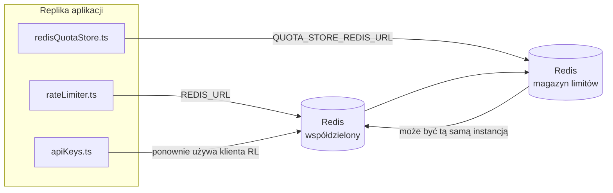

# Redis Production Configuration Guide (Polski)

🌐 **Languages:** 🇺🇸 [English](../../../../ops/REDIS_PRODUCTION_CONFIG.md) · 🇪🇹 [am](../../../am/docs/ops/REDIS_PRODUCTION_CONFIG.md) · 🇸🇦 [ar](../../../ar/docs/ops/REDIS_PRODUCTION_CONFIG.md) · 🇦🇿 [az](../../../az/docs/ops/REDIS_PRODUCTION_CONFIG.md) · 🇧🇬 [bg](../../../bg/docs/ops/REDIS_PRODUCTION_CONFIG.md) · 🇧🇩 [bn](../../../bn/docs/ops/REDIS_PRODUCTION_CONFIG.md) · 🇧🇦 [bs](../../../bs/docs/ops/REDIS_PRODUCTION_CONFIG.md) · 🇨🇿 [cs](../../../cs/docs/ops/REDIS_PRODUCTION_CONFIG.md) · 🇩🇰 [da](../../../da/docs/ops/REDIS_PRODUCTION_CONFIG.md) · 🇩🇪 [de](../../../de/docs/ops/REDIS_PRODUCTION_CONFIG.md) · 🇬🇷 [el](../../../el/docs/ops/REDIS_PRODUCTION_CONFIG.md) · 🇪🇸 [es](../../../es/docs/ops/REDIS_PRODUCTION_CONFIG.md) · 🇪🇪 [et](../../../et/docs/ops/REDIS_PRODUCTION_CONFIG.md) · 🇮🇷 [fa](../../../fa/docs/ops/REDIS_PRODUCTION_CONFIG.md) · 🇫🇮 [fi](../../../fi/docs/ops/REDIS_PRODUCTION_CONFIG.md) · 🇫🇷 [fr](../../../fr/docs/ops/REDIS_PRODUCTION_CONFIG.md) · 🇮🇪 [ga](../../../ga/docs/ops/REDIS_PRODUCTION_CONFIG.md) · 🇮🇳 [gu](../../../gu/docs/ops/REDIS_PRODUCTION_CONFIG.md) · 🇳🇬 [ha](../../../ha/docs/ops/REDIS_PRODUCTION_CONFIG.md) · 🇮🇱 [he](../../../he/docs/ops/REDIS_PRODUCTION_CONFIG.md) · 🇮🇳 [hi](../../../hi/docs/ops/REDIS_PRODUCTION_CONFIG.md) · 🇭🇷 [hr](../../../hr/docs/ops/REDIS_PRODUCTION_CONFIG.md) · 🇭🇺 [hu](../../../hu/docs/ops/REDIS_PRODUCTION_CONFIG.md) · 🇦🇲 [hy](../../../hy/docs/ops/REDIS_PRODUCTION_CONFIG.md) · 🇮🇩 [id](../../../id/docs/ops/REDIS_PRODUCTION_CONFIG.md) · 🇳🇬 [ig](../../../ig/docs/ops/REDIS_PRODUCTION_CONFIG.md) · 🇮🇹 [it](../../../it/docs/ops/REDIS_PRODUCTION_CONFIG.md) · 🇯🇵 [ja](../../../ja/docs/ops/REDIS_PRODUCTION_CONFIG.md) · 🇬🇪 [ka](../../../ka/docs/ops/REDIS_PRODUCTION_CONFIG.md) · 🇰🇭 [km](../../../km/docs/ops/REDIS_PRODUCTION_CONFIG.md) · 🇮🇳 [kn](../../../kn/docs/ops/REDIS_PRODUCTION_CONFIG.md) · 🇰🇷 [ko](../../../ko/docs/ops/REDIS_PRODUCTION_CONFIG.md) · 🇱🇹 [lt](../../../lt/docs/ops/REDIS_PRODUCTION_CONFIG.md) · 🇱🇻 [lv](../../../lv/docs/ops/REDIS_PRODUCTION_CONFIG.md) · 🇮🇳 [ml](../../../ml/docs/ops/REDIS_PRODUCTION_CONFIG.md) · 🇮🇳 [mr](../../../mr/docs/ops/REDIS_PRODUCTION_CONFIG.md) · 🇲🇾 [ms](../../../ms/docs/ops/REDIS_PRODUCTION_CONFIG.md) · 🇲🇹 [mt](../../../mt/docs/ops/REDIS_PRODUCTION_CONFIG.md) · 🇲🇲 [my](../../../my/docs/ops/REDIS_PRODUCTION_CONFIG.md) · 🇳🇵 [ne](../../../ne/docs/ops/REDIS_PRODUCTION_CONFIG.md) · 🇳🇱 [nl](../../../nl/docs/ops/REDIS_PRODUCTION_CONFIG.md) · 🇳🇴 [no](../../../no/docs/ops/REDIS_PRODUCTION_CONFIG.md) · 🇮🇳 [or](../../../or/docs/ops/REDIS_PRODUCTION_CONFIG.md) · 🇮🇳 [pa](../../../pa/docs/ops/REDIS_PRODUCTION_CONFIG.md) · 🇵🇭 [phi](../../../phi/docs/ops/REDIS_PRODUCTION_CONFIG.md) · 🇵🇹 [pt](../../../pt/docs/ops/REDIS_PRODUCTION_CONFIG.md) · 🇧🇷 [pt-BR](../../../pt-BR/docs/ops/REDIS_PRODUCTION_CONFIG.md) · 🇷🇴 [ro](../../../ro/docs/ops/REDIS_PRODUCTION_CONFIG.md) · 🇷🇺 [ru](../../../ru/docs/ops/REDIS_PRODUCTION_CONFIG.md) · 🇱🇰 [si](../../../si/docs/ops/REDIS_PRODUCTION_CONFIG.md) · 🇸🇰 [sk](../../../sk/docs/ops/REDIS_PRODUCTION_CONFIG.md) · 🇸🇮 [sl](../../../sl/docs/ops/REDIS_PRODUCTION_CONFIG.md) · 🇷🇸 [sr](../../../sr/docs/ops/REDIS_PRODUCTION_CONFIG.md) · 🇸🇪 [sv](../../../sv/docs/ops/REDIS_PRODUCTION_CONFIG.md) · 🇰🇪 [sw](../../../sw/docs/ops/REDIS_PRODUCTION_CONFIG.md) · 🇮🇳 [ta](../../../ta/docs/ops/REDIS_PRODUCTION_CONFIG.md) · 🇮🇳 [te](../../../te/docs/ops/REDIS_PRODUCTION_CONFIG.md) · 🇹🇭 [th](../../../th/docs/ops/REDIS_PRODUCTION_CONFIG.md) · 🇹🇷 [tr](../../../tr/docs/ops/REDIS_PRODUCTION_CONFIG.md) · 🇺🇦 [uk-UA](../../../uk-UA/docs/ops/REDIS_PRODUCTION_CONFIG.md) · 🇵🇰 [ur](../../../ur/docs/ops/REDIS_PRODUCTION_CONFIG.md) · 🇺🇿 [uz](../../../uz/docs/ops/REDIS_PRODUCTION_CONFIG.md) · 🇻🇳 [vi](../../../vi/docs/ops/REDIS_PRODUCTION_CONFIG.md) · 🇳🇬 [yo](../../../yo/docs/ops/REDIS_PRODUCTION_CONFIG.md) · 🇨🇳 [zh-CN](../../../zh-CN/docs/ops/REDIS_PRODUCTION_CONFIG.md) · 🇹🇼 [zh-TW](../../../zh-TW/docs/ops/REDIS_PRODUCTION_CONFIG.md)

---

## Przegląd

Redis jest **opcjonalna, miękka zależność** w OmniRoute — aplikacja ulega płynnej degradacji (awaria w pamięci), gdy Redis jest niedostępne. W środowisku produkcyjnym dostrajanie Redis zmniejsza opóźnienia w przypadku czterech różnych obciążeń:

| Obciążenie pracą                  | Kierowca                      | Fabryka Klienta                                 | Kluczowy wzór                                                 |
| --------------------------------- | ----------------------------- | ----------------------------------------------- | ------------------------------------------------------------- |
| Ograniczanie szybkości            | `rateLimiter.ts`              | `getRedisClient()` — leniwy singleton `ioredis` | Okna limitów szybkości transmisji `<prefix>rl:*` Lua-atomic   |
| Pamięć podręczna uwierzytelniania | `apiKeys.ts`                  | Ponownie wykorzystuje klienta `rateLimiter`     | `<prefix>auth:api_key:<sha256>` z TTL                         |
| Sklep kwotowy                     | `redisQuotaStore.ts`          | Oddzielny singleton `getRedisClient(url)`       | Możliwość konfiguracji `<prefix>quota:*` dla każdej instancji |
| Wyłącznik rozgrzewający           | `redisCircuitBreakerStore.ts` | Oddzielny klient w `circuitBreakerFactory.ts`   | `<prefix>warmup:cb:<connectionId>`                            |

Wszystkie cztery obciążenia mają wspólny przedrostek przestrzeni nazw, dzięki czemu OmniRoute może współistnieć z innymi aplikacjami w jednej instancji Redis (np. `127.0.0.1:6379`). Zobacz [Kluczowe przestrzenie nazw](#key-namespacing).

---

## Bieżąca konfiguracja (domyślne wartości kodu)

| Ustawienie                      | Wartość                                                           | Gdzie                                                                                 |
| ------------------------------- | ----------------------------------------------------------------- | ------------------------------------------------------------------------------------- |
| `REDIS_URL` env var             | `redis://redis:6379` (utwórz), opcjonalnie                        | `rateLimiter.ts:5`, `.env.example`                                                    |
| `REDIS_KEY_PREFIX` env var      | `omniroute:` (domyślnie)                                          | `rateLimiter.ts`, `redisQuotaStore.ts`, `redisCircuitBreakerStore.ts`, `.env.example` |
| `QUOTA_STORE_REDIS_URL` env var | oddzielne, mogą różnić się od `REDIS_URL`                         | `quota/storeFactory.ts`                                                               |
| `QUOTA_STORE_DRIVER`            | `"sqlite"` (domyślnie), `"redis"` opcjonalnie                     | `quota/storeFactory.ts`                                                               |
| ioredis `maxRetriesPerRequest`  | `3`                                                               | Tworzenie klienta `rateLimiter.ts`                                                    |
| `enableReadyCheck`              | nie ustawiono (ioredis domyślnie: `true`)                         | —                                                                                     |
| `lazyConnect`                   | nie ustawiono (ioredis domyślnie: `false`)                        | —                                                                                     |
| `retryStrategy`                 | nie ustawiono (domyślnie ioredis: podstawowy 200 ms, wykładniczy) | —                                                                                     |
| TLS / hasło / indeks DB         | **nie skonfigurowany**                                            | —                                                                                     |
| Strażnik / Gromada              | **nie skonfigurowany** Tylko samodzielny, jednowęzłowy moduł —    | —                                                                                     |

---

## Przestrzeń nazw kluczy

OmniRoute współdzieli instancję Redis ze wszystkimi innymi usługami działającymi na hoście. Bez przestrzeni nazw
klucze takie jak `auth:api_key:<sha256>` lub `rl:*` mogłyby kolidować z kluczami innych aplikacji
korzystających z tego samego Redis (ta instancja uruchamia Redis pod adresem `127.0.0.1:6379` razem z innymi usługami).

Ustaw `REDIS_KEY_PREFIX` na niepusty ciąg znaków, aby dodać prefiks do **każdego** klucza OmniRoute:

```bash
# .env — wszystkie klucze OmniRoute przyjmują postać omniroute:rl:*, omniroute:auth:*, omniroute:quota:*, omniroute:warmup:cb:*
REDIS_KEY_PREFIX=omniroute:
```

- **Wartość domyślna:** `omniroute:` (stosowana, gdy `REDIS_KEY_PREFIX` jest nieustawiony lub pusty).
- **Zastosowanie:** ogranicznik częstotliwości żądań + pamięć podręczna uwierzytelniania (współdzielony klient `ioredis` za pośrednictwem `keyPrefix`) oraz
  magazyn limitów (`KEY_PREFIX = "${REDIS_KEY_PREFIX}quota"`) i wyłącznik automatyczny rozgrzewania
  (`KEY_PREFIX = "${REDIS_KEY_PREFIX}warmup:cb:"`).
- **Zmiana prefiksu**, gdy klucze już istnieją w Redis, pozostawia stare klucze osierocone (wygasają one
  zgodnie z TTL / LRU). Zmiana jest bezpieczna i nie wymaga migracji. Jedynym wyjątkiem jest klucz wyłącznika
  automatycznego rozgrzewania dla połączenia oznaczonego jako zabronione: jest on utrwalany bez TTL, dlatego
  wyświetl pozostałości za pomocą `redis-cli --scan --pattern '<old-prefix>warmup:cb:*'` i je usuń.
- **`keyPrefix` biblioteki ioredis** automatycznie dodaje prefiks podczas zapisu **oraz** usuwa go podczas odczytu,
  dzięki czemu kod aplikacji nigdy nie widzi prefiksu.

---

## Zalecane strojenie produkcyjne

### 1. Pula połączeń/Opcje klienta (konstruktor Ioredis `Redis` )

Obecny kod tworzy pojedynczy `new Redis(url)` bez opcji niestandardowych. W przypadku wdrożeń produkcyjnych z wieloma replikami przekaż fabrykę klienta w kodzie lub zawiń `getRedisClient()`:

```typescript
const redis = new Redis(REDIS_URL, {
  maxRetriesPerRequest: null, // no retry limit; let retryStrategy decide
  enableReadyCheck: true, // verify server is ready before accepting calls
  lazyConnect: true, // don't connect on construction; wait for first call
  retryStrategy: (times) => {
    if (times > 10) return null; // give up after 10 retries → reconnect later
    return Math.min(times * 200, 5000); // 200ms, 400ms, …, 5s cap
  },
  enableAutoPipelining: true, // coalesce concurrent commands into one TCP write
  keepAlive: 10000, // TCP keep‑alive every 10s
});
```

**Kluczowe kompromisy:**

- `maxRetriesPerRequest: null` + `retryStrategy` — preferowany do produkcji, więc przejściowe ponowne uruchomienie Redis nie powoduje natychmiastowego niepowodzenia każdego żądania. Rezerwa w pamięci w `checkRateLimit()` pochłania ścieżkę awarii.
- `lazyConnect: true` — pozwala uniknąć uzależnienia uruchamiania od działania Redis, zanim serwer zacznie akceptować połączenia.
- `enableAutoPipelining: true` — ogranicza liczbę przejazdów w obie strony w przypadku równoczesnych kontroli limitów prędkości; korzystne w cenie > 50 RPS na jednym połączeniu.

### 2. Konfiguracja serwera Redis (`redis.conf`)

```
# Memory
maxmemory 80%                        # leave room for OS page cache
maxmemory-policy allkeys-lru         # evict stale auth cache entries under pressure

# Persistence (optional — OmniRoute is crash‑safe without it)
save 300 1                           # snapshot at least every 5 min if ≥1 key changed
appendonly no                        # AOF not needed; data is regeneratable
appendfsync no                       # no fsync overhead (RDB is sufficient)

# Networking
timeout 0                            # no idle disconnect
tcp-keepalive 300                    # 5 min keep‑alive
tcp-backlog 511                      # connection backlog for bursty load

# Performance
hz 10                                # default; 100 for latency‑sensitive
activedefrag yes                     # auto‑defragment when fragmentation >10%
```

**Kompromis dla `maxmemory-policy allkeys-lru`:** Wpisy pamięci podręcznej uwierzytelniania mogą zostać usunięte pod wpływem dużej ilości pamięci. Jest to bezpieczne — `setCachedApiKey` zawsze zapełnia się ponownie w przypadku chybienia, a rezerwa SQLite jest miarodajna. Skrypt Lua ograniczający prędkość tworzy małe klucze, które z założenia są krótkotrwałe.

### 3. Ustawienia tworzenia Docker

Prod compose (`docker-compose.prod.yml`) używa `redis:8.6.2-alpine`. Dodać:

```yaml
redis:
  image: redis:8.6.2-alpine
  command:
    [
      "redis-server",
      "--maxmemory",
      "512mb",
      "--maxmemory-policy",
      "allkeys-lru",
      "--activedefrag",
      "yes",
      "--save",
      "300 1",
    ]
  healthcheck:
    test: ["CMD", "redis-cli", "ping"]
    interval: 10s
    timeout: 3s
    retries: 3
    start_period: 5s
```

### 4. Rozważania dotyczące wielu instancji/skalowania

**Pojedyncze Redis dla wszystkich replik** — skrypt Lua ograniczający szybkość, zależy od pojedynczej autorytatywnej przestrzeni kluczy. Wiele instancji Redis za replikami utraciłoby atomowość i podwoiłoby budżet. Użyj pojedynczego klastra Redis (lub klastra Redis Sentinel z przełączaniem awaryjnym) dla wszystkich replik aplikacji.

**Liczba połączeń:** Otwiera się każda replika aplikacji **2 połączenia TCP** do Redis (klient ograniczający szybkość transmisji, klient magazynu kwot + ). Przy 10 replikach połączeń → 20, mieszczących się w domyślnym pułapie 10 tys. połączeń instancji Redis.

### 5. Monitorowanie

Ujawnij poprzez punkt końcowy kontroli stanu:

```typescript
// src/app/api/monitoring/health/route.ts already calls rateLimiter functions
// Add Redis-specific checks:
//   1. PING latency via ioredis .ping()
//   2. Memory usage via INFO memory
//   3. Connection count via INFO clients
//   4. Hit rate for maxmemory-policy (evicted_keys / keyspace_hits)
```

Kluczowe wskaźniki do obejrzenia:

- **Eksmitowane klucze / sek** — jeśli stale jest niezerowe, zwiększ `maxmemory`
- **Zablokowani klienci** — niezerowe sugeruje powolne skrypty Lua lub wysoką rywalizację
- **Odrzucone połączenia** Osiągnięto limit połączenia — ; rzadko przy 20 połączeniach

### 6. Serwery kompatybilne z Redis

Każdy używany tutaj serwer musi uruchamiać skrypty Lua: ogranicznikiem szybkości jest jeden `EVAL`. Na serwerze bez Lua `checkRateLimit()` rejestruje `[RATE_LIMITER] Redis eval failed, falling back to in-memory rate limiting` i zlicza dla każdego procesu, więc każda replika samodzielnie egzekwuje limit. Opcjonalny sklep wspólnego powinowactwa sesji (`OMNIROUTE_SESSION_AFFINITY_STORE=redis`) również odczytuje i aktualizuje piny za pomocą `EVAL`; bez Lua loguje się do `[SESSION_AFFINITY] Redis error; falling back to SQLite.` i każda replika ma swoje własne piny. Inne obciążenia wykorzystują zwykłe polecenia (`SET ... EX`, `GET`, `DEL`, `MGET`, `EXPIRE`, `INCRBYFLOAT`, skróty i zestawy), a zaplecze Redis semantycznej pamięci podręcznej nie wysyła żadnych poleceń `FT.*`.

Testowane z OmniRoute 3.8.52: KiviDB 1.2.0 z obrazem Lua (`kividb/kividb:v1.2.0-lua`). Ogranicznik szybkości (w tym drugi proces współdzielący liczniki), pamięć podręczna uwierzytelniania, magazyn przydziałów, wyłącznik rozgrzewający, magazyn semantycznej pamięci podręcznej i żądanie `/v1/chat/completions` za pośrednictwem modułu obsługi czatu przeszły 18 z 19 kontroli, które przeszły Redis 8.10.3. Ten, który się różni: `INCRBYFLOAT` przechowuje `0.1 + 0.2` jako `0.30000000000000004`, gdzie Redis przechowuje `0.3` ( [kividbio/kividb#387](https://github.com/kividbio/kividb/issues/387) ). Magazyn kwot analizuje oba za pomocą `parseFloat`, ale te dwie liczby różnią się ostatnimi cyframi, więc porównanie, które przypada dokładnie na granicę kwoty, może wyjść inaczej. Sklep powinowactwa sesji nie był częścią tego przebiegu. ( [konfiguracja](https://github.com/kividbio/kividb/blob/master/docs/integrations/omniroute.md), [wyniki](https://github.com/kividbio/kividb/tree/master/benchmarks/omniroute-compat) )

---

## Diagram architektury



---

## Referencje

| Plik                               | Zamiar                                                                        |
| ---------------------------------- | ----------------------------------------------------------------------------- |
| `src/shared/utils/rateLimiter.ts`  | Podstawowy klient Redis, skrypt ograniczający prędkość Lua, rezerwa w pamięci |
| `src/lib/db/apiKeys.ts`            | Pamięć podręczna uwierzytelniania — Redis→SQLite rezerwa                      |
| `src/lib/quota/redisQuotaStore.ts` | Oddzielny klient Redis dla opcjonalnego magazynu kwot                         |
| `src/lib/quota/storeFactory.ts`    | Przełącza między sterownikami kwotowymi `sqlite` i `redis`                    |
| `docker-compose.prod.yml`          | Pojemnik Prod Redis (obrazek `redis:8.6.2-alpine`)                            |
| `.env.example`                     | Dokumentacja Redis env vars                                                   |
| `src/app/api/local/redis/`         | Trasy API do orkiestracji kontenerów deweloperskich                           |
| `bin/cli/commands/redis.mjs`       | Polecenia CLI do orkiestracji kontenerów deweloperskich                       |
