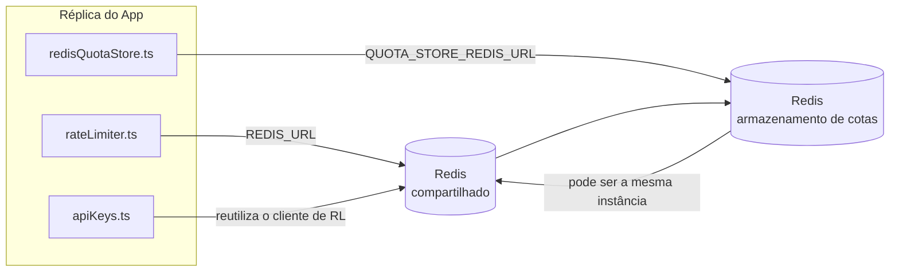

# Redis Production Configuration Guide (Português (Brasil))

🌐 **Languages:** 🇺🇸 [English](../../../../ops/REDIS_PRODUCTION_CONFIG.md) · 🇪🇹 [am](../../../am/docs/ops/REDIS_PRODUCTION_CONFIG.md) · 🇸🇦 [ar](../../../ar/docs/ops/REDIS_PRODUCTION_CONFIG.md) · 🇦🇿 [az](../../../az/docs/ops/REDIS_PRODUCTION_CONFIG.md) · 🇧🇬 [bg](../../../bg/docs/ops/REDIS_PRODUCTION_CONFIG.md) · 🇧🇩 [bn](../../../bn/docs/ops/REDIS_PRODUCTION_CONFIG.md) · 🇧🇦 [bs](../../../bs/docs/ops/REDIS_PRODUCTION_CONFIG.md) · 🇨🇿 [cs](../../../cs/docs/ops/REDIS_PRODUCTION_CONFIG.md) · 🇩🇰 [da](../../../da/docs/ops/REDIS_PRODUCTION_CONFIG.md) · 🇩🇪 [de](../../../de/docs/ops/REDIS_PRODUCTION_CONFIG.md) · 🇬🇷 [el](../../../el/docs/ops/REDIS_PRODUCTION_CONFIG.md) · 🇪🇸 [es](../../../es/docs/ops/REDIS_PRODUCTION_CONFIG.md) · 🇪🇪 [et](../../../et/docs/ops/REDIS_PRODUCTION_CONFIG.md) · 🇮🇷 [fa](../../../fa/docs/ops/REDIS_PRODUCTION_CONFIG.md) · 🇫🇮 [fi](../../../fi/docs/ops/REDIS_PRODUCTION_CONFIG.md) · 🇫🇷 [fr](../../../fr/docs/ops/REDIS_PRODUCTION_CONFIG.md) · 🇮🇪 [ga](../../../ga/docs/ops/REDIS_PRODUCTION_CONFIG.md) · 🇮🇳 [gu](../../../gu/docs/ops/REDIS_PRODUCTION_CONFIG.md) · 🇳🇬 [ha](../../../ha/docs/ops/REDIS_PRODUCTION_CONFIG.md) · 🇮🇱 [he](../../../he/docs/ops/REDIS_PRODUCTION_CONFIG.md) · 🇮🇳 [hi](../../../hi/docs/ops/REDIS_PRODUCTION_CONFIG.md) · 🇭🇷 [hr](../../../hr/docs/ops/REDIS_PRODUCTION_CONFIG.md) · 🇭🇺 [hu](../../../hu/docs/ops/REDIS_PRODUCTION_CONFIG.md) · 🇦🇲 [hy](../../../hy/docs/ops/REDIS_PRODUCTION_CONFIG.md) · 🇮🇩 [id](../../../id/docs/ops/REDIS_PRODUCTION_CONFIG.md) · 🇳🇬 [ig](../../../ig/docs/ops/REDIS_PRODUCTION_CONFIG.md) · 🇮🇹 [it](../../../it/docs/ops/REDIS_PRODUCTION_CONFIG.md) · 🇯🇵 [ja](../../../ja/docs/ops/REDIS_PRODUCTION_CONFIG.md) · 🇬🇪 [ka](../../../ka/docs/ops/REDIS_PRODUCTION_CONFIG.md) · 🇰🇭 [km](../../../km/docs/ops/REDIS_PRODUCTION_CONFIG.md) · 🇮🇳 [kn](../../../kn/docs/ops/REDIS_PRODUCTION_CONFIG.md) · 🇰🇷 [ko](../../../ko/docs/ops/REDIS_PRODUCTION_CONFIG.md) · 🇱🇹 [lt](../../../lt/docs/ops/REDIS_PRODUCTION_CONFIG.md) · 🇱🇻 [lv](../../../lv/docs/ops/REDIS_PRODUCTION_CONFIG.md) · 🇮🇳 [ml](../../../ml/docs/ops/REDIS_PRODUCTION_CONFIG.md) · 🇮🇳 [mr](../../../mr/docs/ops/REDIS_PRODUCTION_CONFIG.md) · 🇲🇾 [ms](../../../ms/docs/ops/REDIS_PRODUCTION_CONFIG.md) · 🇲🇹 [mt](../../../mt/docs/ops/REDIS_PRODUCTION_CONFIG.md) · 🇲🇲 [my](../../../my/docs/ops/REDIS_PRODUCTION_CONFIG.md) · 🇳🇵 [ne](../../../ne/docs/ops/REDIS_PRODUCTION_CONFIG.md) · 🇳🇱 [nl](../../../nl/docs/ops/REDIS_PRODUCTION_CONFIG.md) · 🇳🇴 [no](../../../no/docs/ops/REDIS_PRODUCTION_CONFIG.md) · 🇮🇳 [or](../../../or/docs/ops/REDIS_PRODUCTION_CONFIG.md) · 🇮🇳 [pa](../../../pa/docs/ops/REDIS_PRODUCTION_CONFIG.md) · 🇵🇭 [phi](../../../phi/docs/ops/REDIS_PRODUCTION_CONFIG.md) · 🇵🇱 [pl](../../../pl/docs/ops/REDIS_PRODUCTION_CONFIG.md) · 🇵🇹 [pt](../../../pt/docs/ops/REDIS_PRODUCTION_CONFIG.md) · 🇷🇴 [ro](../../../ro/docs/ops/REDIS_PRODUCTION_CONFIG.md) · 🇷🇺 [ru](../../../ru/docs/ops/REDIS_PRODUCTION_CONFIG.md) · 🇱🇰 [si](../../../si/docs/ops/REDIS_PRODUCTION_CONFIG.md) · 🇸🇰 [sk](../../../sk/docs/ops/REDIS_PRODUCTION_CONFIG.md) · 🇸🇮 [sl](../../../sl/docs/ops/REDIS_PRODUCTION_CONFIG.md) · 🇷🇸 [sr](../../../sr/docs/ops/REDIS_PRODUCTION_CONFIG.md) · 🇸🇪 [sv](../../../sv/docs/ops/REDIS_PRODUCTION_CONFIG.md) · 🇰🇪 [sw](../../../sw/docs/ops/REDIS_PRODUCTION_CONFIG.md) · 🇮🇳 [ta](../../../ta/docs/ops/REDIS_PRODUCTION_CONFIG.md) · 🇮🇳 [te](../../../te/docs/ops/REDIS_PRODUCTION_CONFIG.md) · 🇹🇭 [th](../../../th/docs/ops/REDIS_PRODUCTION_CONFIG.md) · 🇹🇷 [tr](../../../tr/docs/ops/REDIS_PRODUCTION_CONFIG.md) · 🇺🇦 [uk-UA](../../../uk-UA/docs/ops/REDIS_PRODUCTION_CONFIG.md) · 🇵🇰 [ur](../../../ur/docs/ops/REDIS_PRODUCTION_CONFIG.md) · 🇺🇿 [uz](../../../uz/docs/ops/REDIS_PRODUCTION_CONFIG.md) · 🇻🇳 [vi](../../../vi/docs/ops/REDIS_PRODUCTION_CONFIG.md) · 🇳🇬 [yo](../../../yo/docs/ops/REDIS_PRODUCTION_CONFIG.md) · 🇨🇳 [zh-CN](../../../zh-CN/docs/ops/REDIS_PRODUCTION_CONFIG.md) · 🇹🇼 [zh-TW](../../../zh-TW/docs/ops/REDIS_PRODUCTION_CONFIG.md)

---

## Visão geral

Redis é um **opcional, dependência suave** no OmniRoute — o aplicativo degrada normalmente (fallbacks na memória) quando Redis não está disponível. Na produção, o ajuste Redis reduz a latência para quatro cargas de trabalho distintas:

| Carga de trabalho        | Motorista                     | Fábrica do Cliente                                  | Padrão Chave                                         |
| ------------------------ | ----------------------------- | --------------------------------------------------- | ---------------------------------------------------- |
| Limitação de taxa        | `rateLimiter.ts`              | Singleton `getRedisClient()` — preguiçoso `ioredis` | Janelas de limite de taxa atômica `<prefix>rl:*` Lua |
| Cache de autenticação    | `apiKeys.ts`                  | Reutiliza o cliente do `rateLimiter`                | `<prefix>auth:api_key:<sha256>` com TTL              |
| Armazenamento de cotas   | `redisQuotaStore.ts`          | Singleton `getRedisClient(url)` separado            | `<prefix>quota:*` configurável por instância         |
| Disjuntor de aquecimento | `redisCircuitBreakerStore.ts` | Cliente separado no `circuitBreakerFactory.ts`      | `<prefix>warmup:cb:<connectionId>`                   |

Todas as quatro cargas de trabalho compartilham um prefixo de namespace para que OmniRoute possa coexistir com outros aplicativos em uma única instância Redis (por exemplo, `127.0.0.1:6379`). Consulte [Namespace de chave](#key-namespacing).

---

## Configuração atual (padrões de código)

| Contexto                                     | Valor                                                  | Onde                                                                                  |
| -------------------------------------------- | ------------------------------------------------------ | ------------------------------------------------------------------------------------- |
| Variável de ambiente `REDIS_URL`             | `redis://redis:6379` (compor), opcional                | `rateLimiter.ts:5`, `.env.example`                                                    |
| Variável de ambiente `REDIS_KEY_PREFIX`      | `omniroute:` (padrão)                                  | `rateLimiter.ts`, `redisQuotaStore.ts`, `redisCircuitBreakerStore.ts`, `.env.example` |
| Variável de ambiente `QUOTA_STORE_REDIS_URL` | separado, pode diferir do `REDIS_URL`                  | `quota/storeFactory.ts`                                                               |
| `QUOTA_STORE_DRIVER`                         | `"sqlite"` (padrão), `"redis"` opcional                | `quota/storeFactory.ts`                                                               |
| Ioredis `maxRetriesPerRequest`               | `3`                                                    | Criação de cliente `rateLimiter.ts`                                                   |
| `enableReadyCheck`                           | não definido (padrão ioredis: `true`)                  | —                                                                                     |
| `lazyConnect`                                | não definido (padrão ioredis: `false`)                 | —                                                                                     |
| `retryStrategy`                              | não definido (padrão ioredis: base 200ms, exponencial) | —                                                                                     |
| TLS / senha / índice DB                      | **não configurado**                                    | —                                                                                     |
| Sentinela / Cluster                          | **não configurado** Somente nó único autônomo —        | —                                                                                     |

---

## Namespace de chaves

O OmniRoute compartilha uma instância do Redis com qualquer outro serviço executado no host. Sem um namespace,
chaves como `auth:api_key:<sha256>` ou `rl:*` poderiam colidir com chaves de outras aplicações
que usam o mesmo Redis (esta instância executa o Redis em `127.0.0.1:6379` junto com outros serviços).

Defina `REDIS_KEY_PREFIX` como uma string não vazia para adicionar um prefixo a **todas** as chaves do OmniRoute:

```bash
# .env — todas as chaves do OmniRoute passam a ser omniroute:rl:*, omniroute:auth:*, omniroute:quota:*, omniroute:warmup:cb:*
REDIS_KEY_PREFIX=omniroute:
```

- **Padrão:** `omniroute:` (aplicado quando `REDIS_KEY_PREFIX` não está definido ou está em branco).
- **Aplicado a:** limitador de taxa + cache de autenticação (cliente `ioredis` compartilhado via `keyPrefix`), armazenamento
  de cotas (`KEY_PREFIX = "${REDIS_KEY_PREFIX}quota"`) e disjuntor de warmup
  (`KEY_PREFIX = "${REDIS_KEY_PREFIX}warmup:cb:"`).
- **Alterar o prefixo** quando já existem chaves no Redis deixa as chaves antigas órfãs (elas expiram
  via TTL / LRU). É seguro alterá-lo; nenhuma migração é necessária. A única exceção é uma chave do
  disjuntor de warmup para uma conexão marcada como proibida: ela é persistida sem TTL, portanto,
  liste as chaves restantes com `redis-cli --scan --pattern '<old-prefix>warmup:cb:*'` e exclua-as.
- O **`keyPrefix` do ioredis** adiciona automaticamente o prefixo nas gravações **e** o remove nas leituras,
  portanto, o código da aplicação nunca vê o prefixo.

---

## Ajuste de produção recomendado

### 1. Opções de pool de conexão/cliente (construtor ioredis `Redis` )

O código atual cria um único `new Redis(url)` sem opções personalizadas. Para implantações de múltiplas réplicas de produção, passe uma fábrica de cliente no código ou envolva `getRedisClient()`:

```typescript
const redis = new Redis(REDIS_URL, {
  maxRetriesPerRequest: null, // no retry limit; let retryStrategy decide
  enableReadyCheck: true, // verify server is ready before accepting calls
  lazyConnect: true, // don't connect on construction; wait for first call
  retryStrategy: (times) => {
    if (times > 10) return null; // give up after 10 retries → reconnect later
    return Math.min(times * 200, 5000); // 200ms, 400ms, …, 5s cap
  },
  enableAutoPipelining: true, // coalesce concurrent commands into one TCP write
  keepAlive: 10000, // TCP keep‑alive every 10s
});
```

**Principais compensações:**

- `maxRetriesPerRequest: null` + `retryStrategy` — preferido para produção para que reinicializações transitórias Redis não falhem imediatamente em todas as solicitações. O fallback na memória no `checkRateLimit()` absorve o caminho da falha.
- `lazyConnect: true` — evita uma dependência de inicialização do Redis antes que o servidor comece a aceitar conexões.
- `enableAutoPipelining: true` — reduz viagens de ida e volta para verificações simultâneas de limite de taxa; benéfico no > 50 RPS em uma única conexão.

### 2. Configuração do servidor Redis (`redis.conf`)

```
# Memory
maxmemory 80%                        # leave room for OS page cache
maxmemory-policy allkeys-lru         # evict stale auth cache entries under pressure

# Persistence (optional — OmniRoute is crash‑safe without it)
save 300 1                           # snapshot at least every 5 min if ≥1 key changed
appendonly no                        # AOF not needed; data is regeneratable
appendfsync no                       # no fsync overhead (RDB is sufficient)

# Networking
timeout 0                            # no idle disconnect
tcp-keepalive 300                    # 5 min keep‑alive
tcp-backlog 511                      # connection backlog for bursty load

# Performance
hz 10                                # default; 100 for latency‑sensitive
activedefrag yes                     # auto‑defragment when fragmentation >10%
```

**Compensação para `maxmemory-policy allkeys-lru`:** As entradas do cache de autenticação podem ser removidas sob pressão de memória. Isso é seguro. — `setCachedApiKey` sempre é preenchido novamente em caso de falha, e o substituto SQLite é oficial. O script Lua do limitador de taxa cria pequenas chaves que têm vida curta por design.

### 3. Configurações de composição Docker

O prod compose (`docker-compose.prod.yml`) usa `redis:8.6.2-alpine`. Adicionar:

```yaml
redis:
  image: redis:8.6.2-alpine
  command:
    [
      "redis-server",
      "--maxmemory",
      "512mb",
      "--maxmemory-policy",
      "allkeys-lru",
      "--activedefrag",
      "yes",
      "--save",
      "300 1",
    ]
  healthcheck:
    test: ["CMD", "redis-cli", "ping"]
    interval: 10s
    timeout: 3s
    retries: 3
    start_period: 5s
```

### 4. Considerações sobre multiinstâncias/escalonamento

**Redis único para todas as réplicas** — o script Lua do limitador de taxa, depende de um único espaço de chave autoritativo. Múltiplas instâncias Redis atrás de réplicas perderiam a atomicidade e duplicariam o orçamento. Use um único Redis (ou cluster Redis Sentinel com failover) para todas as réplicas de aplicativos.

**Contagem de conexões:** Cada réplica de aplicativo é aberta **2 conexões TCP** para Redis (cliente de armazenamento de cotas + do cliente limitador de taxa). Com 10 réplicas de conexões → 20, bem dentro do limite máximo de conexões de 10k de uma instância Redis padrão.

### 5. Monitoramento

Expor por meio de endpoint de verificação de integridade:

```typescript
// src/app/api/monitoring/health/route.ts already calls rateLimiter functions
// Add Redis-specific checks:
//   1. PING latency via ioredis .ping()
//   2. Memory usage via INFO memory
//   3. Connection count via INFO clients
//   4. Hit rate for maxmemory-policy (evicted_keys / keyspace_hits)
```

Principais métricas a serem observadas:

- **Chaves despejadas/s** — se persistentemente diferente de zero, aumente `maxmemory`
- **Clientes bloqueados** — diferente de zero sugere scripts Lua lentos ou alta contenção
- **Conexões rejeitadas** Limite de conexão — atingido; raro em 20 conexões

### 6. Servidores compatíveis com Redis

Qualquer servidor usado aqui deve executar scripts Lua: o limitador de taxa é um `EVAL`. Em um servidor sem Lua, `checkRateLimit()` registra `[RATE_LIMITER] Redis eval failed, falling back to in-memory rate limiting` e conta por processo, de modo que cada réplica impõe o limite por conta própria. O armazenamento de afinidade de sessão compartilhada (`OMNIROUTE_SESSION_AFFINITY_STORE=redis`) opcional também lê e atualiza pinos com `EVAL`; sem Lua ele registra `[SESSION_AFFINITY] Redis error; falling back to SQLite.` e cada réplica mantém seus próprios pinos. As outras cargas de trabalho usam comandos simples (`SET ... EX`, `GET`, `DEL`, `MGET`, `EXPIRE`, `INCRBYFLOAT`, hashes e conjuntos), e o backend Redis do cache semântico não envia comandos `FT.*`.

Testado com OmniRoute 3.8.52: KiviDB 1.2.0 com sua imagem Lua (`kividb/kividb:v1.2.0-lua`). O limitador de taxa (incluindo um segundo processo compartilhando os contadores), cache de autenticação, armazenamento de cotas, disjuntor de aquecimento, armazenamento de cache semântico e uma solicitação `/v1/chat/completions` por meio do manipulador de bate-papo passaram em 18 das 19 verificações aprovadas no Redis 8.10.3. O que difere: `INCRBYFLOAT` armazena `0.1 + 0.2` como `0.30000000000000004` onde Redis armazena `0.3` ( [kividbio/kividb#387](https://github.com/kividbio/kividb/issues/387) ). O armazenamento de cotas analisa ambos com `parseFloat`, mas os dois números diferem nos últimos dígitos, portanto, uma comparação que caia exatamente em um limite de cota pode sair diferente. O armazenamento de afinidade de sessão não fez parte dessa execução. ( [configuração](https://github.com/kividbio/kividb/blob/master/docs/integrations/omniroute.md), [resultados](https://github.com/kividbio/kividb/tree/master/benchmarks/omniroute-compat) )

---

## Diagrama de Arquitetura



---

## Referências

| Arquivo                            | Propósito                                                                 |
| ---------------------------------- | ------------------------------------------------------------------------- |
| `src/shared/utils/rateLimiter.ts`  | Cliente Redis primário, script de limite de taxa Lua, fallback na memória |
| `src/lib/db/apiKeys.ts`            | Cache de autenticação — Redis→SQLite substituto                           |
| `src/lib/quota/redisQuotaStore.ts` | Cliente Redis separado para armazenamento de cotas opcional               |
| `src/lib/quota/storeFactory.ts`    | Alterna entre drivers de cota `sqlite` e `redis`                          |
| `docker-compose.prod.yml`          | Contêiner Prod Redis (imagem `redis:8.6.2-alpine`)                        |
| `.env.example`                     | Documentação Redis env vars                                               |
| `src/app/api/local/redis/`         | Rotas API para orquestração de contêineres de desenvolvimento             |
| `bin/cli/commands/redis.mjs`       | Comandos CLI para orquestração de contêiner de desenvolvimento            |
