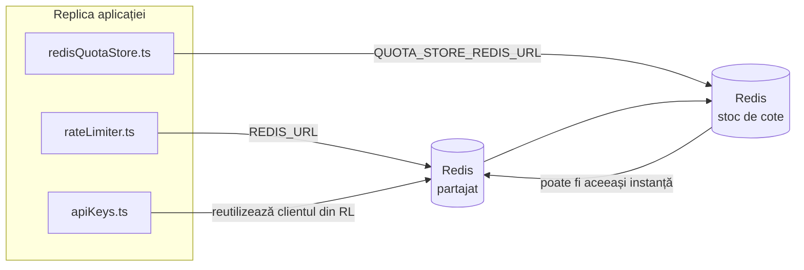

# Redis Production Configuration Guide (Română)

🌐 **Languages:** 🇺🇸 [English](../../../../ops/REDIS_PRODUCTION_CONFIG.md) · 🇪🇹 [am](../../../am/docs/ops/REDIS_PRODUCTION_CONFIG.md) · 🇸🇦 [ar](../../../ar/docs/ops/REDIS_PRODUCTION_CONFIG.md) · 🇦🇿 [az](../../../az/docs/ops/REDIS_PRODUCTION_CONFIG.md) · 🇧🇬 [bg](../../../bg/docs/ops/REDIS_PRODUCTION_CONFIG.md) · 🇧🇩 [bn](../../../bn/docs/ops/REDIS_PRODUCTION_CONFIG.md) · 🇧🇦 [bs](../../../bs/docs/ops/REDIS_PRODUCTION_CONFIG.md) · 🇨🇿 [cs](../../../cs/docs/ops/REDIS_PRODUCTION_CONFIG.md) · 🇩🇰 [da](../../../da/docs/ops/REDIS_PRODUCTION_CONFIG.md) · 🇩🇪 [de](../../../de/docs/ops/REDIS_PRODUCTION_CONFIG.md) · 🇬🇷 [el](../../../el/docs/ops/REDIS_PRODUCTION_CONFIG.md) · 🇪🇸 [es](../../../es/docs/ops/REDIS_PRODUCTION_CONFIG.md) · 🇪🇪 [et](../../../et/docs/ops/REDIS_PRODUCTION_CONFIG.md) · 🇮🇷 [fa](../../../fa/docs/ops/REDIS_PRODUCTION_CONFIG.md) · 🇫🇮 [fi](../../../fi/docs/ops/REDIS_PRODUCTION_CONFIG.md) · 🇫🇷 [fr](../../../fr/docs/ops/REDIS_PRODUCTION_CONFIG.md) · 🇮🇪 [ga](../../../ga/docs/ops/REDIS_PRODUCTION_CONFIG.md) · 🇮🇳 [gu](../../../gu/docs/ops/REDIS_PRODUCTION_CONFIG.md) · 🇳🇬 [ha](../../../ha/docs/ops/REDIS_PRODUCTION_CONFIG.md) · 🇮🇱 [he](../../../he/docs/ops/REDIS_PRODUCTION_CONFIG.md) · 🇮🇳 [hi](../../../hi/docs/ops/REDIS_PRODUCTION_CONFIG.md) · 🇭🇷 [hr](../../../hr/docs/ops/REDIS_PRODUCTION_CONFIG.md) · 🇭🇺 [hu](../../../hu/docs/ops/REDIS_PRODUCTION_CONFIG.md) · 🇦🇲 [hy](../../../hy/docs/ops/REDIS_PRODUCTION_CONFIG.md) · 🇮🇩 [id](../../../id/docs/ops/REDIS_PRODUCTION_CONFIG.md) · 🇳🇬 [ig](../../../ig/docs/ops/REDIS_PRODUCTION_CONFIG.md) · 🇮🇹 [it](../../../it/docs/ops/REDIS_PRODUCTION_CONFIG.md) · 🇯🇵 [ja](../../../ja/docs/ops/REDIS_PRODUCTION_CONFIG.md) · 🇬🇪 [ka](../../../ka/docs/ops/REDIS_PRODUCTION_CONFIG.md) · 🇰🇭 [km](../../../km/docs/ops/REDIS_PRODUCTION_CONFIG.md) · 🇮🇳 [kn](../../../kn/docs/ops/REDIS_PRODUCTION_CONFIG.md) · 🇰🇷 [ko](../../../ko/docs/ops/REDIS_PRODUCTION_CONFIG.md) · 🇱🇹 [lt](../../../lt/docs/ops/REDIS_PRODUCTION_CONFIG.md) · 🇱🇻 [lv](../../../lv/docs/ops/REDIS_PRODUCTION_CONFIG.md) · 🇮🇳 [ml](../../../ml/docs/ops/REDIS_PRODUCTION_CONFIG.md) · 🇮🇳 [mr](../../../mr/docs/ops/REDIS_PRODUCTION_CONFIG.md) · 🇲🇾 [ms](../../../ms/docs/ops/REDIS_PRODUCTION_CONFIG.md) · 🇲🇹 [mt](../../../mt/docs/ops/REDIS_PRODUCTION_CONFIG.md) · 🇲🇲 [my](../../../my/docs/ops/REDIS_PRODUCTION_CONFIG.md) · 🇳🇵 [ne](../../../ne/docs/ops/REDIS_PRODUCTION_CONFIG.md) · 🇳🇱 [nl](../../../nl/docs/ops/REDIS_PRODUCTION_CONFIG.md) · 🇳🇴 [no](../../../no/docs/ops/REDIS_PRODUCTION_CONFIG.md) · 🇮🇳 [or](../../../or/docs/ops/REDIS_PRODUCTION_CONFIG.md) · 🇮🇳 [pa](../../../pa/docs/ops/REDIS_PRODUCTION_CONFIG.md) · 🇵🇭 [phi](../../../phi/docs/ops/REDIS_PRODUCTION_CONFIG.md) · 🇵🇱 [pl](../../../pl/docs/ops/REDIS_PRODUCTION_CONFIG.md) · 🇵🇹 [pt](../../../pt/docs/ops/REDIS_PRODUCTION_CONFIG.md) · 🇧🇷 [pt-BR](../../../pt-BR/docs/ops/REDIS_PRODUCTION_CONFIG.md) · 🇷🇺 [ru](../../../ru/docs/ops/REDIS_PRODUCTION_CONFIG.md) · 🇱🇰 [si](../../../si/docs/ops/REDIS_PRODUCTION_CONFIG.md) · 🇸🇰 [sk](../../../sk/docs/ops/REDIS_PRODUCTION_CONFIG.md) · 🇸🇮 [sl](../../../sl/docs/ops/REDIS_PRODUCTION_CONFIG.md) · 🇷🇸 [sr](../../../sr/docs/ops/REDIS_PRODUCTION_CONFIG.md) · 🇸🇪 [sv](../../../sv/docs/ops/REDIS_PRODUCTION_CONFIG.md) · 🇰🇪 [sw](../../../sw/docs/ops/REDIS_PRODUCTION_CONFIG.md) · 🇮🇳 [ta](../../../ta/docs/ops/REDIS_PRODUCTION_CONFIG.md) · 🇮🇳 [te](../../../te/docs/ops/REDIS_PRODUCTION_CONFIG.md) · 🇹🇭 [th](../../../th/docs/ops/REDIS_PRODUCTION_CONFIG.md) · 🇹🇷 [tr](../../../tr/docs/ops/REDIS_PRODUCTION_CONFIG.md) · 🇺🇦 [uk-UA](../../../uk-UA/docs/ops/REDIS_PRODUCTION_CONFIG.md) · 🇵🇰 [ur](../../../ur/docs/ops/REDIS_PRODUCTION_CONFIG.md) · 🇺🇿 [uz](../../../uz/docs/ops/REDIS_PRODUCTION_CONFIG.md) · 🇻🇳 [vi](../../../vi/docs/ops/REDIS_PRODUCTION_CONFIG.md) · 🇳🇬 [yo](../../../yo/docs/ops/REDIS_PRODUCTION_CONFIG.md) · 🇨🇳 [zh-CN](../../../zh-CN/docs/ops/REDIS_PRODUCTION_CONFIG.md) · 🇹🇼 [zh-TW](../../../zh-TW/docs/ops/REDIS_PRODUCTION_CONFIG.md)

---

## Prezentare generală

Redis este un **dependență opțională, soft** în OmniRoute — aplicația se degradează în mod grațios (in-memory fallbacks) atunci când Redis nu este disponibil. În producție, reglarea Redis reduce latența pentru patru sarcini de lucru distincte:

| Volumul de muncă          | Șofer                         | Fabrica Client                                 | Model cheie                                           |
| ------------------------- | ----------------------------- | ---------------------------------------------- | ----------------------------------------------------- |
| Limitarea ratei           | `rateLimiter.ts`              | `getRedisClient()` — leneș `ioredis` singleton | Ferestre de limită a ratei atomice `<prefix>rl:*` Lua |
| Cache de autentificare    | `apiKeys.ts`                  | Refolosește clientul lui `rateLimiter`         | `<prefix>auth:api_key:<sha256>` cu TTL                |
| Magazin de cote           | `redisQuotaStore.ts`          | Singleton `getRedisClient(url)` separat        | `<prefix>quota:*` configurabil per-instanță           |
| Întrerupător de încălzire | `redisCircuitBreakerStore.ts` | Client separat în `circuitBreakerFactory.ts`   | `<prefix>warmup:cb:<connectionId>`                    |

Toate cele patru sarcini de lucru partajează un prefix de spațiu de nume, astfel încât OmniRoute să poată coexista cu alte aplicații pe o singură instanță Redis (de exemplu, `127.0.0.1:6379`). Consultați [Spațierea numelor cheilor](#key-namespacing).

---

## Configurație curentă (Valori implicite ale codului)

| Setare                          | Valoare                                                 | Unde                                                                                  |
| ------------------------------- | ------------------------------------------------------- | ------------------------------------------------------------------------------------- |
| `REDIS_URL` env var             | `redis://redis:6379` (compune), opțional                | `rateLimiter.ts:5`, `.env.example`                                                    |
| `REDIS_KEY_PREFIX` env var      | `omniroute:` (implicit)                                 | `rateLimiter.ts`, `redisQuotaStore.ts`, `redisCircuitBreakerStore.ts`, `.env.example` |
| `QUOTA_STORE_REDIS_URL` env var | separat, poate diferi de `REDIS_URL`                    | `quota/storeFactory.ts`                                                               |
| `QUOTA_STORE_DRIVER`            | `"sqlite"` (implicit), `"redis"` opțional               | `quota/storeFactory.ts`                                                               |
| ioredis `maxRetriesPerRequest`  | `3`                                                     | Crearea clientului `rateLimiter.ts`                                                   |
| `enableReadyCheck`              | nesetat (ioredis implicit: `true`)                      | —                                                                                     |
| `lazyConnect`                   | nesetat (ioredis implicit: `false`)                     | —                                                                                     |
| `retryStrategy`                 | nesetat (ioredis implicit: 200 ms de bază, exponențial) | —                                                                                     |
| TLS / parola / index DB         | **neconfigurat**                                        | —                                                                                     |
| Santinela / Cluster             | **neconfigurat** Doar un singur nod autonom —           | —                                                                                     |

---

## Spațiul de nume al cheilor

OmniRoute partajează o instanță Redis cu orice altceva rulează pe gazdă. Fără un spațiu de nume,
chei precum `auth:api_key:<sha256>` sau `rl:*` ar putea intra în conflict cu cheile altor aplicații
care utilizează aceeași instanță Redis (această instanță rulează Redis la `127.0.0.1:6379` alături de alte servicii).

Setați `REDIS_KEY_PREFIX` la un șir nevid pentru a adăuga un prefix la **fiecare** cheie OmniRoute:

```bash
# .env — toate cheile OmniRoute devin omniroute:rl:*, omniroute:auth:*, omniroute:quota:*, omniroute:warmup:cb:*
REDIS_KEY_PREFIX=omniroute:
```

- **Implicit:** `omniroute:` (se aplică atunci când `REDIS_KEY_PREFIX` este nesetat sau gol).
- **Se aplică pentru:** limitatorul de rată + cache-ul de autentificare (client `ioredis` partajat prin `keyPrefix`) și
  stocarea pentru cote (`KEY_PREFIX = "${REDIS_KEY_PREFIX}quota"`) și întrerupătorul de circuit pentru încălzire
  (`KEY_PREFIX = "${REDIS_KEY_PREFIX}warmup:cb:"`).
- **Schimbarea prefixului** atunci când există deja chei în Redis face ca vechile chei să rămână nereferențiate (acestea expiră
  prin TTL / LRU). Prefixul poate fi schimbat în siguranță; nu este necesară nicio migrare. Singura excepție este o cheie a
  întrerupătorului de circuit pentru încălzire aferentă unei conexiuni marcate ca interzisă: aceasta este stocată fără TTL, așadar
  listați cheile rămase folosind `redis-cli --scan --pattern '<old-prefix>warmup:cb:*'` și ștergeți-le.
- **`keyPrefix` din ioredis** adaugă automat prefixul la scriere **și** îl elimină la citire,
  astfel încât codul aplicației nu vede niciodată prefixul.

---

## Reglajul de producție recomandat

### 1. Pool de conexiuni / Opțiuni client (constructor ioredis `Redis` )

Codul actual creează un singur `new Redis(url)` fără opțiuni personalizate. Pentru implementări multi-replica de producție, treceți o fabrică de client în cod sau includeți `getRedisClient()`:

```typescript
const redis = new Redis(REDIS_URL, {
  maxRetriesPerRequest: null, // no retry limit; let retryStrategy decide
  enableReadyCheck: true, // verify server is ready before accepting calls
  lazyConnect: true, // don't connect on construction; wait for first call
  retryStrategy: (times) => {
    if (times > 10) return null; // give up after 10 retries → reconnect later
    return Math.min(times * 200, 5000); // 200ms, 400ms, …, 5s cap
  },
  enableAutoPipelining: true, // coalesce concurrent commands into one TCP write
  keepAlive: 10000, // TCP keep‑alive every 10s
});
```

**Principalele compromisuri:**

- `maxRetriesPerRequest: null` + `retryStrategy` — preferat pentru producție, astfel încât repornirile Redis tranzitorii să nu eșueze imediat fiecare solicitare. Funcția de rezervă în memorie în `checkRateLimit()` absoarbe calea de defecțiune.
- `lazyConnect: true` — evită o dependență de pornire de activarea Redis înainte ca serverul să înceapă să accepte conexiuni.
- `enableAutoPipelining: true` — reduce călătoriile dus-întors pentru verificări concurente ale limitelor de rată; benefic la > 50 RPS pe o singură conexiune.

### 2. Configurare server Redis (`redis.conf`)

```
# Memory
maxmemory 80%                        # leave room for OS page cache
maxmemory-policy allkeys-lru         # evict stale auth cache entries under pressure

# Persistence (optional — OmniRoute is crash‑safe without it)
save 300 1                           # snapshot at least every 5 min if ≥1 key changed
appendonly no                        # AOF not needed; data is regeneratable
appendfsync no                       # no fsync overhead (RDB is sufficient)

# Networking
timeout 0                            # no idle disconnect
tcp-keepalive 300                    # 5 min keep‑alive
tcp-backlog 511                      # connection backlog for bursty load

# Performance
hz 10                                # default; 100 for latency‑sensitive
activedefrag yes                     # auto‑defragment when fragmentation >10%
```

**Compensație pentru `maxmemory-policy allkeys-lru`:** Intrările din memoria cache de autentificare pot fi evacuate sub presiunea memoriei. Acesta este sigur — `setCachedApiKey` se repopulează întotdeauna la ratare, iar alternativa SQLite este autoritară. Scriptul Lua de limitare a ratei creează chei mici care sunt de scurtă durată prin proiectare.

### 3. Setări Docker Compose

Prod compose (`docker-compose.prod.yml`) folosește `redis:8.6.2-alpine`. Adăuga:

```yaml
redis:
  image: redis:8.6.2-alpine
  command:
    [
      "redis-server",
      "--maxmemory",
      "512mb",
      "--maxmemory-policy",
      "allkeys-lru",
      "--activedefrag",
      "yes",
      "--save",
      "300 1",
    ]
  healthcheck:
    test: ["CMD", "redis-cli", "ping"]
    interval: 10s
    timeout: 3s
    retries: 3
    start_period: 5s
```

### 4. Considerații multi-instanță / scalare

**Redis unic pentru toate replicile** — scriptul Lua cu limitator de viteză depinde de un singur spațiu de cheie autorizat. Mai multe instanțe Redis din spatele replicilor ar pierde atomicitatea și ar dubla bugetul. Utilizați un singur Redis (sau cluster Redis Sentinel cu failover) pentru toate replicile aplicației.

**Număr de conexiuni:** Fiecare replică a aplicației se deschide **2 conexiuni TCP** la Redis (client limitator de rată + client magazin de cote). La 10 replici conexiuni → 20, bine în limitele plafonului de conexiune de 10k al unei instanțe Redis implicite.

### 5. Monitorizare

Expuneți prin punctul final de verificare a stării de sănătate:

```typescript
// src/app/api/monitoring/health/route.ts already calls rateLimiter functions
// Add Redis-specific checks:
//   1. PING latency via ioredis .ping()
//   2. Memory usage via INFO memory
//   3. Connection count via INFO clients
//   4. Hit rate for maxmemory-policy (evicted_keys / keyspace_hits)
```

Valori cheie de urmărit:

- **Chei evacuate / sec** — dacă este constant diferit de zero, crește `maxmemory`
- **Clienți blocați** — non-zero sugerează scripturi Lua lente sau disputa ridicată
- **Conexiuni respinse** Atinge limita de conexiune — ; rar la 20 de conexiuni

### 6. Servere compatibile cu Redis

Orice server folosit aici trebuie să ruleze scripturi Lua: limitatorul de rată este un `EVAL`. Pe un server fără Lua, `checkRateLimit()` înregistrează `[RATE_LIMITER] Redis eval failed, falling back to in-memory rate limiting` și contorizează per proces, astfel încât fiecare replică impune limita singură. Magazinul de afinitate de sesiune partajat (`OMNIROUTE_SESSION_AFFINITY_STORE=redis`) cu înscriere citește și actualizează, de asemenea, pinii cu `EVAL`; fără Lua înregistrează `[SESSION_AFFINITY] Redis error; falling back to SQLite.` și fiecare replică își păstrează propriile ace. Celelalte sarcini de lucru folosesc comenzi simple (`SET ... EX`, `GET`, `DEL`, `MGET`, `EXPIRE`, `INCRBYFLOAT`, hashes și seturi), iar backend-ul Redis al cache-ului semantic nu trimite comenzi `FT.*`.

Testat cu OmniRoute 3.8.52: KiviDB 1.2.0 cu imaginea sa Lua (`kividb/kividb:v1.2.0-lua`). Limitatorul de rată (inclusiv un al doilea proces care partajează contoarele), memoria cache de autentificare, stocarea cotelor, întrerupătorul de circuit de încălzire, stocarea cache semantică și o solicitare `/v1/chat/completions` prin gestionarea de chat au trecut 18 din cele 19 verificări care trec pe Redis 8.10.3. Cel care diferă: `INCRBYFLOAT` stochează `0.1 + 0.2` ca `0.30000000000000004` unde Redis stochează `0.3` ( [kividbio/kividb#387](https://github.com/kividbio/kividb/issues/387) ). Magazinul de cote le analizează pe ambele cu `parseFloat`, dar cele două numere diferă în ultimele cifre, așa că o comparație care se încadrează exact pe o limită de cotă poate ieși diferit. Magazinul de afinitate sesiune nu a făcut parte din acea rulare. ( [configurare](https://github.com/kividbio/kividb/blob/master/docs/integrations/omniroute.md), [rezultate](https://github.com/kividbio/kividb/tree/master/benchmarks/omniroute-compat) )

---

## Diagrama arhitecturii



---

## Referințe

| Fişier                             | Scop                                                                     |
| ---------------------------------- | ------------------------------------------------------------------------ |
| `src/shared/utils/rateLimiter.ts`  | Client Redis principal, script de limită de rată Lua, rezervă în memorie |
| `src/lib/db/apiKeys.ts`            | Cache de autentificare — Redis→SQLite alternativă                        |
| `src/lib/quota/redisQuotaStore.ts` | Client Redis separat pentru stocarea cotelor opționale                   |
| `src/lib/quota/storeFactory.ts`    | Comută între driverele de cotă `sqlite` și `redis`                       |
| `docker-compose.prod.yml`          | Container Prod Redis (imagine `redis:8.6.2-alpine`)                      |
| `.env.example`                     | Redis env vars documentație                                              |
| `src/app/api/local/redis/`         | Rute API pentru orchestrarea containerelor de dezvoltare                 |
| `bin/cli/commands/redis.mjs`       | Comenzi CLI pentru orchestrarea containerelor de dezvoltare              |
