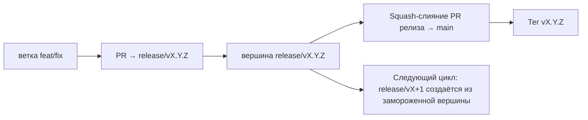

# Branching & Release Model (Русский)

🌐 **Languages:** 🇺🇸 [English](../../../../ops/BRANCHING_MODEL.md) · 🇪🇹 [am](../../../am/docs/ops/BRANCHING_MODEL.md) · 🇸🇦 [ar](../../../ar/docs/ops/BRANCHING_MODEL.md) · 🇦🇿 [az](../../../az/docs/ops/BRANCHING_MODEL.md) · 🇧🇬 [bg](../../../bg/docs/ops/BRANCHING_MODEL.md) · 🇧🇩 [bn](../../../bn/docs/ops/BRANCHING_MODEL.md) · 🇧🇦 [bs](../../../bs/docs/ops/BRANCHING_MODEL.md) · 🇨🇿 [cs](../../../cs/docs/ops/BRANCHING_MODEL.md) · 🇩🇰 [da](../../../da/docs/ops/BRANCHING_MODEL.md) · 🇩🇪 [de](../../../de/docs/ops/BRANCHING_MODEL.md) · 🇬🇷 [el](../../../el/docs/ops/BRANCHING_MODEL.md) · 🇪🇸 [es](../../../es/docs/ops/BRANCHING_MODEL.md) · 🇪🇪 [et](../../../et/docs/ops/BRANCHING_MODEL.md) · 🇮🇷 [fa](../../../fa/docs/ops/BRANCHING_MODEL.md) · 🇫🇮 [fi](../../../fi/docs/ops/BRANCHING_MODEL.md) · 🇫🇷 [fr](../../../fr/docs/ops/BRANCHING_MODEL.md) · 🇮🇪 [ga](../../../ga/docs/ops/BRANCHING_MODEL.md) · 🇮🇳 [gu](../../../gu/docs/ops/BRANCHING_MODEL.md) · 🇳🇬 [ha](../../../ha/docs/ops/BRANCHING_MODEL.md) · 🇮🇱 [he](../../../he/docs/ops/BRANCHING_MODEL.md) · 🇮🇳 [hi](../../../hi/docs/ops/BRANCHING_MODEL.md) · 🇭🇷 [hr](../../../hr/docs/ops/BRANCHING_MODEL.md) · 🇭🇺 [hu](../../../hu/docs/ops/BRANCHING_MODEL.md) · 🇦🇲 [hy](../../../hy/docs/ops/BRANCHING_MODEL.md) · 🇮🇩 [id](../../../id/docs/ops/BRANCHING_MODEL.md) · 🇳🇬 [ig](../../../ig/docs/ops/BRANCHING_MODEL.md) · 🇮🇹 [it](../../../it/docs/ops/BRANCHING_MODEL.md) · 🇯🇵 [ja](../../../ja/docs/ops/BRANCHING_MODEL.md) · 🇬🇪 [ka](../../../ka/docs/ops/BRANCHING_MODEL.md) · 🇰🇭 [km](../../../km/docs/ops/BRANCHING_MODEL.md) · 🇮🇳 [kn](../../../kn/docs/ops/BRANCHING_MODEL.md) · 🇰🇷 [ko](../../../ko/docs/ops/BRANCHING_MODEL.md) · 🇱🇹 [lt](../../../lt/docs/ops/BRANCHING_MODEL.md) · 🇱🇻 [lv](../../../lv/docs/ops/BRANCHING_MODEL.md) · 🇮🇳 [ml](../../../ml/docs/ops/BRANCHING_MODEL.md) · 🇮🇳 [mr](../../../mr/docs/ops/BRANCHING_MODEL.md) · 🇲🇾 [ms](../../../ms/docs/ops/BRANCHING_MODEL.md) · 🇲🇹 [mt](../../../mt/docs/ops/BRANCHING_MODEL.md) · 🇲🇲 [my](../../../my/docs/ops/BRANCHING_MODEL.md) · 🇳🇵 [ne](../../../ne/docs/ops/BRANCHING_MODEL.md) · 🇳🇱 [nl](../../../nl/docs/ops/BRANCHING_MODEL.md) · 🇳🇴 [no](../../../no/docs/ops/BRANCHING_MODEL.md) · 🇮🇳 [or](../../../or/docs/ops/BRANCHING_MODEL.md) · 🇮🇳 [pa](../../../pa/docs/ops/BRANCHING_MODEL.md) · 🇵🇭 [phi](../../../phi/docs/ops/BRANCHING_MODEL.md) · 🇵🇱 [pl](../../../pl/docs/ops/BRANCHING_MODEL.md) · 🇵🇹 [pt](../../../pt/docs/ops/BRANCHING_MODEL.md) · 🇧🇷 [pt-BR](../../../pt-BR/docs/ops/BRANCHING_MODEL.md) · 🇷🇴 [ro](../../../ro/docs/ops/BRANCHING_MODEL.md) · 🇱🇰 [si](../../../si/docs/ops/BRANCHING_MODEL.md) · 🇸🇰 [sk](../../../sk/docs/ops/BRANCHING_MODEL.md) · 🇸🇮 [sl](../../../sl/docs/ops/BRANCHING_MODEL.md) · 🇷🇸 [sr](../../../sr/docs/ops/BRANCHING_MODEL.md) · 🇸🇪 [sv](../../../sv/docs/ops/BRANCHING_MODEL.md) · 🇰🇪 [sw](../../../sw/docs/ops/BRANCHING_MODEL.md) · 🇮🇳 [ta](../../../ta/docs/ops/BRANCHING_MODEL.md) · 🇮🇳 [te](../../../te/docs/ops/BRANCHING_MODEL.md) · 🇹🇭 [th](../../../th/docs/ops/BRANCHING_MODEL.md) · 🇹🇷 [tr](../../../tr/docs/ops/BRANCHING_MODEL.md) · 🇺🇦 [uk-UA](../../../uk-UA/docs/ops/BRANCHING_MODEL.md) · 🇵🇰 [ur](../../../ur/docs/ops/BRANCHING_MODEL.md) · 🇺🇿 [uz](../../../uz/docs/ops/BRANCHING_MODEL.md) · 🇻🇳 [vi](../../../vi/docs/ops/BRANCHING_MODEL.md) · 🇳🇬 [yo](../../../yo/docs/ops/BRANCHING_MODEL.md) · 🇨🇳 [zh-CN](../../../zh-CN/docs/ops/BRANCHING_MODEL.md) · 🇹🇼 [zh-TW](../../../zh-TW/docs/ops/BRANCHING_MODEL.md)

---

OmniRoute использует** параллельный цикл** модель выпуска: выделенная ветка `release/vX.Y.Z` для активного цикла, `main` для опубликованной строки и неизменяемый тег `vX.Y.Z` при отправке этого цикла. Ожидается, что коммиты попадут на `release/*` _и_ на `main`, — не путаница.

Детали сопровождающего находятся в `CLAUDE.md` (жесткое правило #21) и [RELEASE_CHECKLIST.md](./RELEASE_CHECKLIST.md). Эта страница представляет собой общедоступное резюме для участников.

## Краткий обзор

| Ссылка           | Роль                                                                                              |
| ---------------- | ------------------------------------------------------------------------------------------------- |
| `release/vX.Y.Z` | **Активный цикл** — повседневная разработка и слияние PR для этой версии                          |
| `main`           | **Опубликованная линия** — получает изменения цикла посредством squash-слияния при выпуске релиза |
| `vX.Y.Z` (тег)   | **Маркер выпуска** — неизменяемый указатель на выпущенное состояние, создаваемый в момент релиза  |



## На какую ветку должен быть направлен мой PR?

**Направляйте PR в активную ветку `release/vX.Y.Z`, а не в `main`.**

1. Найдите старшую открытую ветку `release/v*` (пример на момент написания:
   `release/v3.8.49`).
2. Создайте ветку от её вершины (`git fetch`, затем checkout / rebase на неё).
3. Откройте PR, указав **base = эту ветку `release/vX.Y.Z`**.

`main` не является веткой для повседневной интеграции. PR, открытые в `main`,
обычно необходимо перенаправить на другую ветку перед слиянием.

## Заморозка выпуска (параллельные циклы)

Во время согласования релиза открывается проблема с маркером `release-freeze`. Что** не останавливает развитие** :

- Замороженная `release/vX.Y.Z` принадлежит капитану освобождения этого корабля.
- `release/vX+1` следующего цикла вырезается из замороженного кончика, поэтому участники продолжают работу по посадке.
- Открытая PRs, которая по-прежнему нацелена на замороженную ветку, должна быть** перенацелен** к активной (высшей) ветке `release/v*`.

Проверьте наличие открытого замораживания, прежде чем предполагать, что нужная вам ветка является объединяемой:

```bash
gh issue list --repo diegosouzapw/OmniRoute --label release-freeze --state open
```

Механика слияния (владелец `queue` label → Mergify) документирована в [MERGE_TRAIN.md](./MERGE_TRAIN.md).

> **19 ноября 2026 г.: очередь слияния Mergify удалена из эксплуатации.** (решение владельца). `.mergify.yml` больше не определяет очередь и отклоняет команды Mergify, которые объединяют или перезаписывают запрос на включение. Релизы PRs объединяются вручную в соответствии с набором правил репозитория «Требовать зеленые ворота для активного выпуска» (`Gate / CI` + `Gate / Quality`) до тех пор, пока омни-очередь не заработает в режиме реального времени, а затем через омни-очередь ( [OMNI_QUEUE.md](./OMNI_QUEUE.md) ). Метка `queue` больше ничего не объединяет.

## Зачем нужны и ветка, и тег?

| Артефакт         | Срок существования | Назначение                                                                                |
| ---------------- | ------------------ | ----------------------------------------------------------------------------------------- |
| `release/vX.Y.Z` | Текущий цикл       | Собирает проверенные PR, сохраняет успешное прохождение CI и служит базовой веткой для PR |
| Тег `vX.Y.Z`     | Навсегда           | Отмечает точное состояние, выпущенное в npm / GitHub Releases                             |

Ветка — это мастерская, а тег — запечатанная упаковка. После squash-слияния в
`main` следующий цикл продолжается в `release/vX+1`, не дожидаясь завершения PR
предыдущего релиза.

## Связанная документация

- [CONTRIBUTING.md](../../CONTRIBUTING.md) — настройка, тесты, контрольный список PR
- [RELEASE_CHECKLIST.md](./RELEASE_CHECKLIST.md) — проверка перед выпуском
- [MERGE_TRAIN.md](./MERGE_TRAIN.md) — очередь слияния и резервный процесс последовательных слияний
- [RELEASE_GREEN.md](./RELEASE_GREEN.md) — поддержание успешного прохождения проверок вершиной релизной ветки
