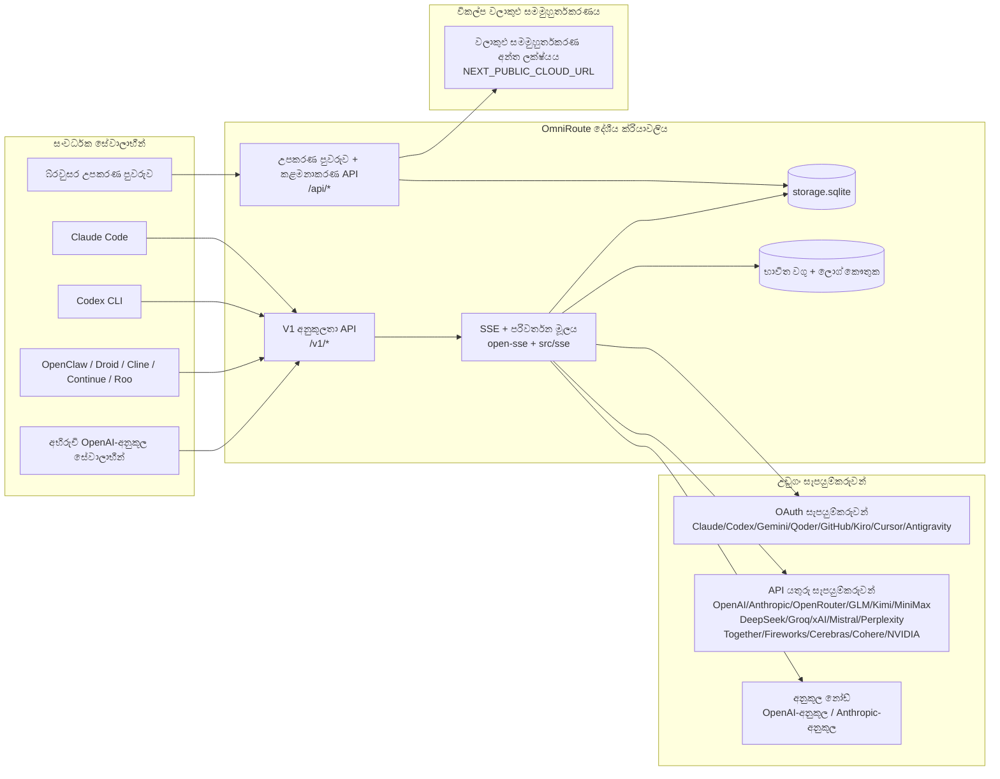
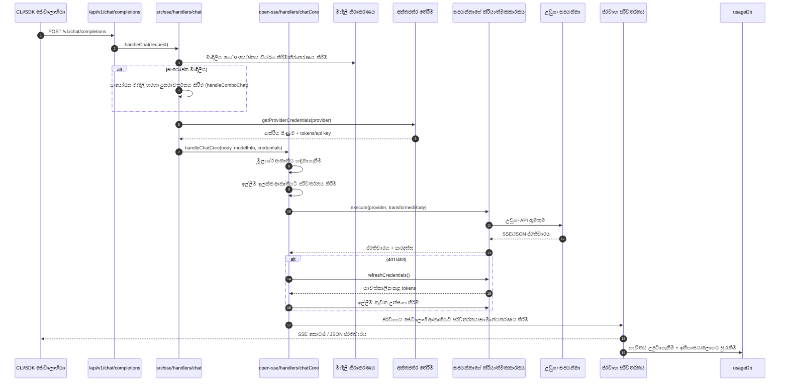
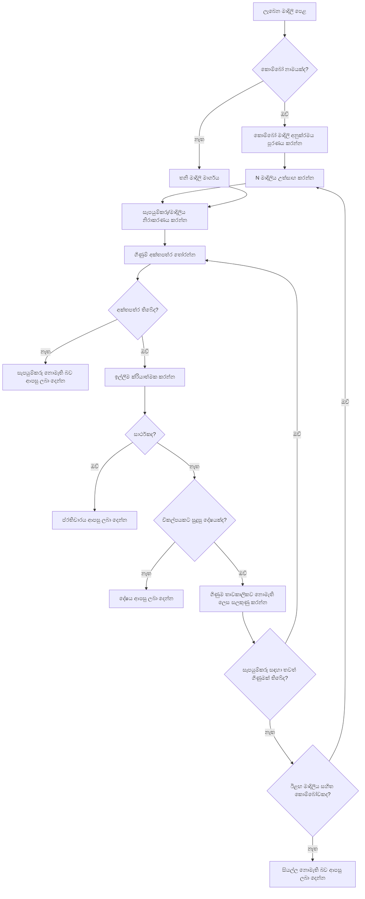
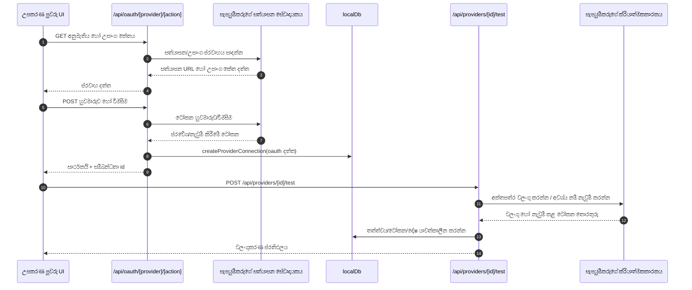
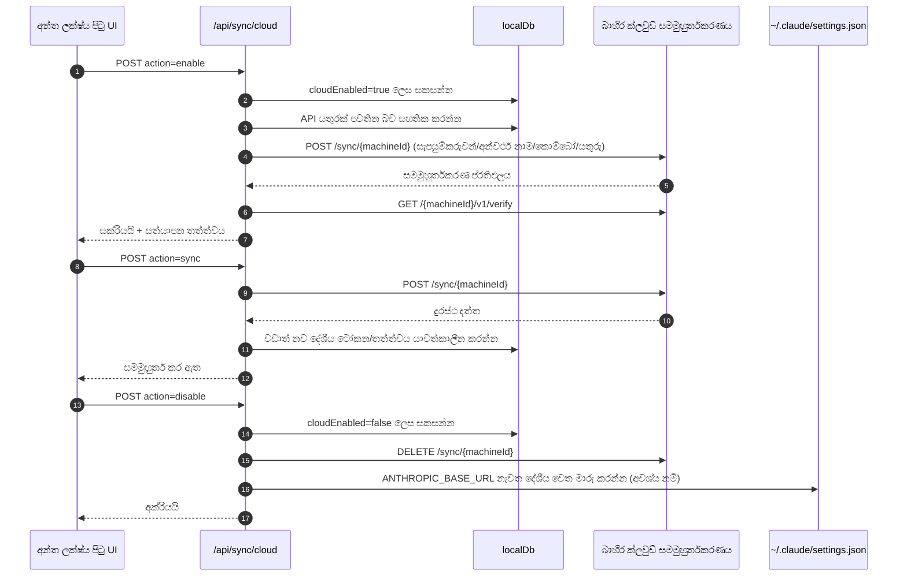
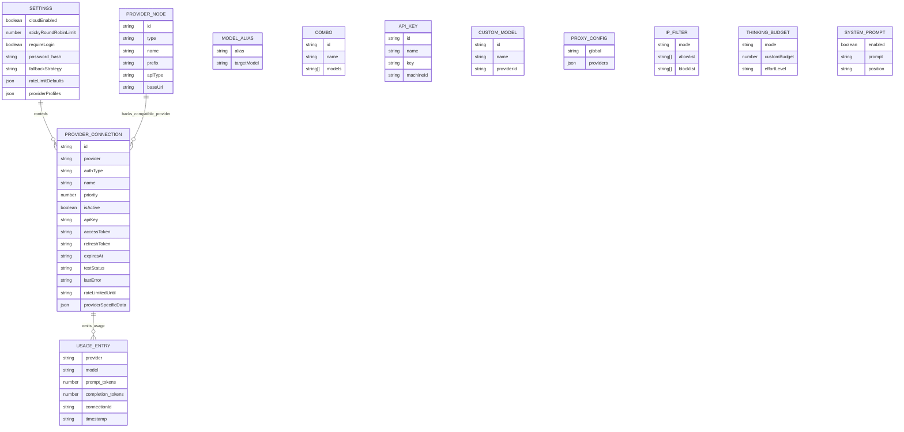
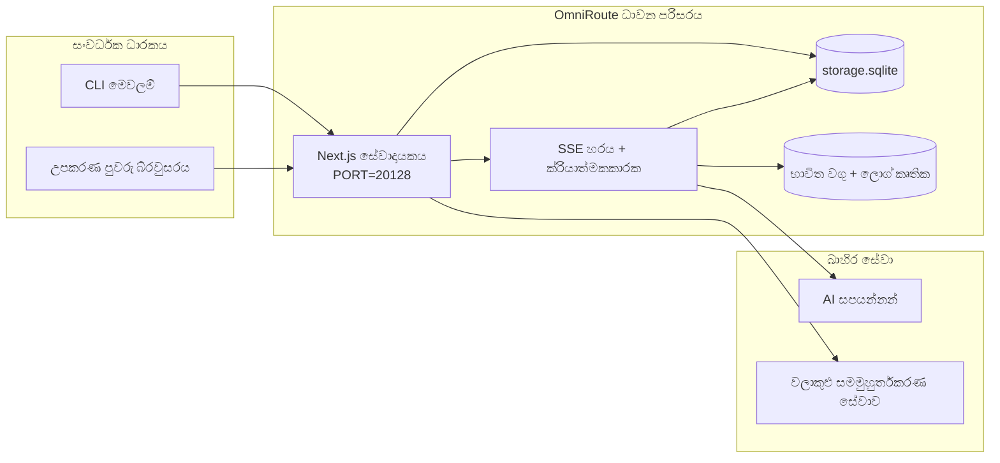

# OmniRoute Architecture (සිංහල)

🌐 **Languages:** 🇺🇸 [English](../../../../architecture/ARCHITECTURE.md) · 🇪🇹 [am](../../../am/docs/architecture/ARCHITECTURE.md) · 🇸🇦 [ar](../../../ar/docs/architecture/ARCHITECTURE.md) · 🇦🇿 [az](../../../az/docs/architecture/ARCHITECTURE.md) · 🇧🇬 [bg](../../../bg/docs/architecture/ARCHITECTURE.md) · 🇧🇩 [bn](../../../bn/docs/architecture/ARCHITECTURE.md) · 🇧🇦 [bs](../../../bs/docs/architecture/ARCHITECTURE.md) · 🇨🇿 [cs](../../../cs/docs/architecture/ARCHITECTURE.md) · 🇩🇰 [da](../../../da/docs/architecture/ARCHITECTURE.md) · 🇩🇪 [de](../../../de/docs/architecture/ARCHITECTURE.md) · 🇬🇷 [el](../../../el/docs/architecture/ARCHITECTURE.md) · 🇪🇸 [es](../../../es/docs/architecture/ARCHITECTURE.md) · 🇪🇪 [et](../../../et/docs/architecture/ARCHITECTURE.md) · 🇮🇷 [fa](../../../fa/docs/architecture/ARCHITECTURE.md) · 🇫🇮 [fi](../../../fi/docs/architecture/ARCHITECTURE.md) · 🇫🇷 [fr](../../../fr/docs/architecture/ARCHITECTURE.md) · 🇮🇪 [ga](../../../ga/docs/architecture/ARCHITECTURE.md) · 🇮🇳 [gu](../../../gu/docs/architecture/ARCHITECTURE.md) · 🇳🇬 [ha](../../../ha/docs/architecture/ARCHITECTURE.md) · 🇮🇱 [he](../../../he/docs/architecture/ARCHITECTURE.md) · 🇮🇳 [hi](../../../hi/docs/architecture/ARCHITECTURE.md) · 🇭🇷 [hr](../../../hr/docs/architecture/ARCHITECTURE.md) · 🇭🇺 [hu](../../../hu/docs/architecture/ARCHITECTURE.md) · 🇦🇲 [hy](../../../hy/docs/architecture/ARCHITECTURE.md) · 🇮🇩 [id](../../../id/docs/architecture/ARCHITECTURE.md) · 🇳🇬 [ig](../../../ig/docs/architecture/ARCHITECTURE.md) · 🇮🇹 [it](../../../it/docs/architecture/ARCHITECTURE.md) · 🇯🇵 [ja](../../../ja/docs/architecture/ARCHITECTURE.md) · 🇬🇪 [ka](../../../ka/docs/architecture/ARCHITECTURE.md) · 🇰🇭 [km](../../../km/docs/architecture/ARCHITECTURE.md) · 🇮🇳 [kn](../../../kn/docs/architecture/ARCHITECTURE.md) · 🇰🇷 [ko](../../../ko/docs/architecture/ARCHITECTURE.md) · 🇱🇹 [lt](../../../lt/docs/architecture/ARCHITECTURE.md) · 🇱🇻 [lv](../../../lv/docs/architecture/ARCHITECTURE.md) · 🇮🇳 [ml](../../../ml/docs/architecture/ARCHITECTURE.md) · 🇮🇳 [mr](../../../mr/docs/architecture/ARCHITECTURE.md) · 🇲🇾 [ms](../../../ms/docs/architecture/ARCHITECTURE.md) · 🇲🇹 [mt](../../../mt/docs/architecture/ARCHITECTURE.md) · 🇲🇲 [my](../../../my/docs/architecture/ARCHITECTURE.md) · 🇳🇵 [ne](../../../ne/docs/architecture/ARCHITECTURE.md) · 🇳🇱 [nl](../../../nl/docs/architecture/ARCHITECTURE.md) · 🇳🇴 [no](../../../no/docs/architecture/ARCHITECTURE.md) · 🇮🇳 [or](../../../or/docs/architecture/ARCHITECTURE.md) · 🇮🇳 [pa](../../../pa/docs/architecture/ARCHITECTURE.md) · 🇵🇭 [phi](../../../phi/docs/architecture/ARCHITECTURE.md) · 🇵🇱 [pl](../../../pl/docs/architecture/ARCHITECTURE.md) · 🇵🇹 [pt](../../../pt/docs/architecture/ARCHITECTURE.md) · 🇧🇷 [pt-BR](../../../pt-BR/docs/architecture/ARCHITECTURE.md) · 🇷🇴 [ro](../../../ro/docs/architecture/ARCHITECTURE.md) · 🇷🇺 [ru](../../../ru/docs/architecture/ARCHITECTURE.md) · 🇸🇰 [sk](../../../sk/docs/architecture/ARCHITECTURE.md) · 🇸🇮 [sl](../../../sl/docs/architecture/ARCHITECTURE.md) · 🇷🇸 [sr](../../../sr/docs/architecture/ARCHITECTURE.md) · 🇸🇪 [sv](../../../sv/docs/architecture/ARCHITECTURE.md) · 🇰🇪 [sw](../../../sw/docs/architecture/ARCHITECTURE.md) · 🇮🇳 [ta](../../../ta/docs/architecture/ARCHITECTURE.md) · 🇮🇳 [te](../../../te/docs/architecture/ARCHITECTURE.md) · 🇹🇭 [th](../../../th/docs/architecture/ARCHITECTURE.md) · 🇹🇷 [tr](../../../tr/docs/architecture/ARCHITECTURE.md) · 🇺🇦 [uk-UA](../../../uk-UA/docs/architecture/ARCHITECTURE.md) · 🇵🇰 [ur](../../../ur/docs/architecture/ARCHITECTURE.md) · 🇺🇿 [uz](../../../uz/docs/architecture/ARCHITECTURE.md) · 🇻🇳 [vi](../../../vi/docs/architecture/ARCHITECTURE.md) · 🇳🇬 [yo](../../../yo/docs/architecture/ARCHITECTURE.md) · 🇨🇳 [zh-CN](../../../zh-CN/docs/architecture/ARCHITECTURE.md) · 🇹🇼 [zh-TW](../../../zh-TW/docs/architecture/ARCHITECTURE.md)

---

🌐 **Languages:** 🇺🇸 [English](../../../../architecture/ARCHITECTURE.md) · 🇪🇹 [am](../../../am/docs/architecture/ARCHITECTURE.md) · 🇸🇦 [ar](../../../ar/docs/architecture/ARCHITECTURE.md) · 🇦🇿 [az](../../../az/docs/architecture/ARCHITECTURE.md) · 🇧🇬 [bg](../../../bg/docs/architecture/ARCHITECTURE.md) · 🇧🇩 [bn](../../../bn/docs/architecture/ARCHITECTURE.md) · 🇧🇦 [bs](../../../bs/docs/architecture/ARCHITECTURE.md) · 🇨🇿 [cs](../../../cs/docs/architecture/ARCHITECTURE.md) · 🇩🇰 [da](../../../da/docs/architecture/ARCHITECTURE.md) · 🇩🇪 [de](../../../de/docs/architecture/ARCHITECTURE.md) · 🇬🇷 [el](../../../el/docs/architecture/ARCHITECTURE.md) · 🇪🇸 [es](../../../es/docs/architecture/ARCHITECTURE.md) · 🇪🇪 [et](../../../et/docs/architecture/ARCHITECTURE.md) · 🇮🇷 [fa](../../../fa/docs/architecture/ARCHITECTURE.md) · 🇫🇮 [fi](../../../fi/docs/architecture/ARCHITECTURE.md) · 🇫🇷 [fr](../../../fr/docs/architecture/ARCHITECTURE.md) · 🇮🇪 [ga](../../../ga/docs/architecture/ARCHITECTURE.md) · 🇮🇳 [gu](../../../gu/docs/architecture/ARCHITECTURE.md) · 🇳🇬 [ha](../../../ha/docs/architecture/ARCHITECTURE.md) · 🇮🇱 [he](../../../he/docs/architecture/ARCHITECTURE.md) · 🇮🇳 [hi](../../../hi/docs/architecture/ARCHITECTURE.md) · 🇭🇷 [hr](../../../hr/docs/architecture/ARCHITECTURE.md) · 🇭🇺 [hu](../../../hu/docs/architecture/ARCHITECTURE.md) · 🇦🇲 [hy](../../../hy/docs/architecture/ARCHITECTURE.md) · 🇮🇩 [id](../../../id/docs/architecture/ARCHITECTURE.md) · 🇳🇬 [ig](../../../ig/docs/architecture/ARCHITECTURE.md) · 🇮🇹 [it](../../../it/docs/architecture/ARCHITECTURE.md) · 🇯🇵 [ja](../../../ja/docs/architecture/ARCHITECTURE.md) · 🇬🇪 [ka](../../../ka/docs/architecture/ARCHITECTURE.md) · 🇰🇭 [km](../../../km/docs/architecture/ARCHITECTURE.md) · 🇮🇳 [kn](../../../kn/docs/architecture/ARCHITECTURE.md) · 🇰🇷 [ko](../../../ko/docs/architecture/ARCHITECTURE.md) · 🇱🇹 [lt](../../../lt/docs/architecture/ARCHITECTURE.md) · 🇱🇻 [lv](../../../lv/docs/architecture/ARCHITECTURE.md) · 🇮🇳 [ml](../../../ml/docs/architecture/ARCHITECTURE.md) · 🇮🇳 [mr](../../../mr/docs/architecture/ARCHITECTURE.md) · 🇲🇾 [ms](../../../ms/docs/architecture/ARCHITECTURE.md) · 🇲🇹 [mt](../../../mt/docs/architecture/ARCHITECTURE.md) · 🇲🇲 [my](../../../my/docs/architecture/ARCHITECTURE.md) · 🇳🇵 [ne](../../../ne/docs/architecture/ARCHITECTURE.md) · 🇳🇱 [nl](../../../nl/docs/architecture/ARCHITECTURE.md) · 🇳🇴 [no](../../../no/docs/architecture/ARCHITECTURE.md) · 🇮🇳 [or](../../../or/docs/architecture/ARCHITECTURE.md) · 🇮🇳 [pa](../../../pa/docs/architecture/ARCHITECTURE.md) · 🇵🇭 [phi](../../../phi/docs/architecture/ARCHITECTURE.md) · 🇵🇱 [pl](../../../pl/docs/architecture/ARCHITECTURE.md) · 🇵🇹 [pt](../../../pt/docs/architecture/ARCHITECTURE.md) · 🇧🇷 [pt-BR](../../../pt-BR/docs/architecture/ARCHITECTURE.md) · 🇷🇴 [ro](../../../ro/docs/architecture/ARCHITECTURE.md) · 🇷🇺 [ru](../../../ru/docs/architecture/ARCHITECTURE.md) · 🇸🇰 [sk](../../../sk/docs/architecture/ARCHITECTURE.md) · 🇸🇮 [sl](../../../sl/docs/architecture/ARCHITECTURE.md) · 🇷🇸 [sr](../../../sr/docs/architecture/ARCHITECTURE.md) · 🇸🇪 [sv](../../../sv/docs/architecture/ARCHITECTURE.md) · 🇰🇪 [sw](../../../sw/docs/architecture/ARCHITECTURE.md) · 🇮🇳 [ta](../../../ta/docs/architecture/ARCHITECTURE.md) · 🇮🇳 [te](../../../te/docs/architecture/ARCHITECTURE.md) · 🇹🇭 [th](../../../th/docs/architecture/ARCHITECTURE.md) · 🇹🇷 [tr](../../../tr/docs/architecture/ARCHITECTURE.md) · 🇺🇦 [uk-UA](../../../uk-UA/docs/architecture/ARCHITECTURE.md) · 🇵🇰 [ur](../../../ur/docs/architecture/ARCHITECTURE.md) · 🇺🇿 [uz](../../../uz/docs/architecture/ARCHITECTURE.md) · 🇻🇳 [vi](../../../vi/docs/architecture/ARCHITECTURE.md) · 🇳🇬 [yo](../../../yo/docs/architecture/ARCHITECTURE.md) · 🇨🇳 [zh-CN](../../../zh-CN/docs/architecture/ARCHITECTURE.md) · 🇹🇼 [zh-TW](../../../zh-TW/docs/architecture/ARCHITECTURE.md)

_අවසන් වරට යාවත්කාලීන කළේ: 2026-06-28_

## විධායක සාරාංශය

OmniRoute යනු Next.js මත ගොඩනගා ඇති දේශීය AI මාර්ගගත ද්වාර සහ උපකරණ පුවරුවකි. එය තනි OpenAI-අනුකූල අන්ත ලක්ෂ්‍යයක් (`/v1/*`) සපයන අතර පරිවර්තනය, පසුබැසීම, ටෝකන නැවුම් කිරීම සහ භාවිත ලුහුබැඳීම සමඟින් බහු උඩුගං සැපයුම්කරුවන් හරහා ගමනාගමනය සිදු කරයි.

මූලික හැකියාවන්:

- CLI/tools සඳහා OpenAI-අනුකූල API මතුපිට (සපයන්නන් 377, විධායක මොඩියුල 156)
- සපයන්නන්ගේ ආකෘති හරහාRequest/response පරිවර්තනය
- Model Combo Falback (බහු මාදිලි අනුපිළිවෙල)
- `compositeTiers` මඟින් ධාවන කාල අනුපිළිවෙල සමඟ ව්‍යුහගත සංයුක්ත පියවර (`provider + model + connection`).
- ගිණුම් මට්ටමේ පසුබැසීම (සපයන්නෙකුට බහු ගිණුම්)
- ප්‍රධාන කතාබස් මාර්ගයේ කෝටා පෙර පියාසර කිරීම සහ කෝටා-දැනුවත් P2C ගිණුම් තේරීම
- OAuth + API-ප්‍රධාන සැපයුම්කරු සම්බන්ධතා කළමනාකරණය ( OAuth සපයන්නාගේ මොඩියුල 27)
- `/v1/embeddings` හරහා උත්පාදනය කාවැද්දීම (සපයන්නන් 18)
- `/v1/images/generations` හරහා රූප උත්පාදනය (10 + සපයන්නන්, 20 + මාදිලි)
- `/v1/audio/transcriptions` හරහා ශ්‍රව්‍ය පිටපත් කිරීම (සපයන්නන් 18)
- `/v1/audio/speech` හරහා පෙළ සිට කථනය (24 බිල්ට් සපයන්නන්)
- `/v1/videos/generations` හරහා වීඩියෝ උත්පාදනය (ComfyUI + SD WebUI)
- `/v1/music/generations` (ComfyUI) හරහා සංගීත උත්පාදනය
- `/v1/search` හරහා වෙබ් සෙවීම (සපයන්නන් 20)
- `/v1/moderations` හරහා නවීකරණය
- `/v1/rerank` හරහා නැවත ශ්‍රේණිගත කිරීම
- තර්ක කිරීමේ ආකෘති සඳහා ටැග් විග්‍රහ කිරීම (`<think>...</think>`) සිතන්න
- දැඩි OpenAI SDK අනුකූලතාව සඳහා ප්‍රතිචාර සනීපාරක්ෂකකරණය
- හරස් සපයන්නාගේ ගැළපුම සඳහා භූමිකාව සාමාන්‍යකරණය (සංවර්ධක → පද්ධතිය, පද්ධති→ පරිශීලක)
- ව්‍යුහගත ප්‍රතිදාන පරිවර්තනය (json_schema → Gemini responseSchema)
- සපයන්නන්, යතුරු, අන්වර්ථ, සංයෝජන, සැකසීම්, මිලකරණය ( DB මොඩියුල 122) සඳහා දේශීය අඛණ්ඩ පැවැත්ම
- Usage/cost ලුහුබැඳීම සහ ලොග් කිරීම ඉල්ලීම
- multi-device/state සමමුහුර්ත කිරීම සඳහා විකල්ප වලාකුළු සමමුහුර්තකරණය
- API ප්රවේශ පාලනය සඳහාIP allowlist/blocklist
- චින්තන අයවැය කළමනාකරණය (passthrough/auto/custom/adaptive)
- ගෝලීය පද්ධති ක්ෂණික එන්නත් කිරීම
- සැසි ලුහුබැඳීම සහ ඇඟිලි සලකුණු
- සැපයුම්කරු-විශේෂිත පැතිකඩ සමඟ එක් ගිණුමකට වැඩි දියුණු කළ අනුපාතය සීමා කිරීම
- සැපයුම්කරුගේ ඔරොත්තු දීමේ හැකියාව සඳහා පරිපථ කඩන රටාව
- මුටෙක්ස් අගුලු දැමීම සමඟින් ගිගුරුම් විරෝධී රංචු ආරක්ෂාව
- අත්සන මත පදනම් වූ ඉල්ලීම් අඩු කිරීමේ හැඹිලිය
- වසම් ස්තරය: පිරිවැය රීති, පසුබැසීමේ ප්‍රතිපත්තිය, අගුලු දැමීමේ ප්‍රතිපත්තිය
- සන්දර්භය රිලේ: ගිණුම් භ්‍රමණ අඛණ්ඩතාව සඳහා සැසි භාර දීමේ සාරාංශ
- වසම් රාජ්‍ය ස්ථීරභාවය ( වැටීම්, අයවැය, අගුලු දැමීම්, පරිපථ කඩනයන් සඳහාSQLite ලිවීම-හරහා හැඹිලිය)
- මධ්‍යගත ඉල්ලීම් ඇගයීම සඳහා ප්‍රතිපත්ති එන්ජිම (lockout → අයවැය → පසුබැසීම)
- p50/p95/p99 ප්‍රමාදය එකතු කිරීම සමඟින් ටෙලිමෙට්‍රි ඉල්ලන්න
- Combo target telemetry සහ historical combo target health `combo_execution_key` / `combo_step_id` හරහා
- සහසම්බන්ධය ID (X-Request-Id) අන්තයේ සිට අවසානය දක්වා සොයා ගැනීම සඳහා
- API යතුරකින් ඉවත් වීම සමග අනුකූලතා විගණන ලොග් වීම
- LLM තත්ත්ව සහතිකය සඳහා Eval රාමුව
- තත්‍ය කාලීන සැපයුම්කරු පරිපථ කඩන තත්ත්වය සහිත සෞඛ්‍ය උපකරණ පුවරුව
- MCP සේවාදායකය (මෙවලම් 110) ප්‍රවාහන 3ක් (stdio/SSE/Streamable HTTP)
- A2A සේවාදායකය (JSON-RPC 2.0 + SSE) කුසලතා සහ කාර්ය ජීවන චක්‍රය සමඟ
- මතක පද්ධතිය (නිස්සාරණය, එන්නත් කිරීම, ලබා ගැනීම, සාරාංශ කිරීම)
- නිපුණතා පද්ධතිය (රෙජිස්ට්‍රි, ක්‍රියාත්මක කරන්නා, වැලිපිල්ල, ගොඩනඟන ලද කුසලතා)
- සහතික කළමනාකරණය සහ DNS හැසිරවීම සමඟ MITM proxy
- ඉක්මන් එන්නත් ආරක්ෂක මිඩ්ල්වෙයාර්
- Caveman, RTK, ස්ටැක් කරන ලද නල මාර්ග, සම්පීඩන සංයෝජන, භාෂා ඇසුරුම් සහ විශ්ලේෂණ සමඟ ඉක්මන් සම්පීඩන නල මාර්ගය
- ACP (නියෝජිත සන්නිවේදන ප්‍රොටෝකෝලය) රෙජිස්ට්‍රිය
- මොඩියුලර් OAuth සපයන්නන් ( `src/lib/oauth/providers/` යටතේ තනි මොඩියුල 22)
- Uninstall/full-uninstall ස්ක්‍රිප්ට්
- OAuth පරිසරය අලුත්වැඩියා කිරීමේ ක්‍රියාව
- OpenAI-අනුකූල WS සේවාදායකයන් සඳහාWebSocket පාලම (`/v1/ws`)
- සමමුහුර්ත ටෝකන් කළමනාකරණය (issue/revoke, ETag-අනුවාද සහිත වින්‍යාස මිටි බාගැනීම)
- GLM චින්තනය (`glmt`) පළමු පන්තියේ සැපයුම්කරු පෙරසැකසුම
- දෙමුහුන් ටෝකන් ගණන් කිරීම (ඇස්තමේන්තු පසුබැසීම සමඟ සැපයුම්කරුගේ පැත්තේ `/messages/count_tokens` )
- මාදිලිය අන්වර්ථය ස්වයං-බීජ කිරීම (ආරම්භයේදී 30 + හරස් ප්‍රොක්සි උපභාෂා සාමාන්‍යකරණය)
- SSRF ආරක්ෂකය, පුද්ගලික URL අවහිර කිරීම සහ වින්‍යාසගත කළ හැකි නැවත උත්සාහ කිරීම සමඟ ආරක්ෂිත පිටතට ගෙන ඒම
- වින්‍යාසගත කළ හැකි `requestRetry` සහ `maxRetryIntervalSec` සමඟ Cooldown-aware chat නැවත උත්සාහ කරයි
- ආරම්භයේදී Zod සමඟ ධාවන කාල පරිසරය වලංගු කිරීම
- පිටුකරණය, සැපයුම්කරු CRUD සිදුවීම් සහ SSRF-අවහිර කළ වලංගුකරණ ලොග් කිරීම සමඟ අනුකූලතා විගණනය v2

ප්‍රාථමික ධාවන කාල ආකෘතිය:

- `src/app/api/*` යටතේNext.js යෙදුම් මාර්ග උපකරණ පුවරුව APIs සහ ගැළපුම APIs යන දෙකම ක්‍රියාත්මක කරයි
- `src/sse/*` + `open-sse/*` හි හවුල් SSE/routing හරයක් සැපයුම්කරු ක්‍රියාත්මක කිරීම, පරිවර්තනය, ප්‍රවාහය, පසුබැසීම සහ භාවිතය හසුරුවයි

## යොමු රූප සටහන්

v3.8.0 වේදිකාව සඳහා සම්මත, අනුවාද පාලිත Mermaid මූලාශ්ර
[`docs/diagrams/`](../diagrams/README.md) තුළ ඇත. දිශානතිය සඳහා ඒවායින් දෙකක් පහතින් නැවත දක්වා ඇත;
අනෙක් ඒවා ඒවාට අදාළ වසම්-විශේෂිත මාර්ගෝපදේශවලින් සබැඳි කර ඇත.


> මූලාශ්රය: [diagrams/request-pipeline.mmd](../diagrams/request-pipeline.mmd)


> මූලාශ්රය: [diagrams/resilience-3layers.mmd](../diagrams/resilience-3layers.mmd) — මෙය
> [RESILIENCE_GUIDE.md](./RESILIENCE_GUIDE.md) සහ `CLAUDE.md` ප්රත්යස්ථතා යොමුවෙන්ද සබැඳි කර ඇත.

## විෂය පථය සහ සීමා

### විෂය පථයට ඇතුළත්

- දේශීය ද්වාර ධාවන පරිසරය
- උපකරණ පුවරු කළමනාකරණ API
- සැපයුම්කරු සත්යාපනය සහ ටෝකන නැවුම් කිරීම
- ඉල්ලීම් පරිවර්තනය සහ SSE ප්රවාහනය
- දේශීය තත්ත්වය + භාවිත දත්ත සුරැකීම
- විකල්ප වලාකුළු සමමුහුර්තකරණ මෙහෙයවීම

### විෂය පථයෙන් බැහැර

- `NEXT_PUBLIC_CLOUD_URL` පසුපස ඇති වලාකුළු සේවා ක්රියාත්මක කිරීම
- දේශීය ක්රියාවලියෙන් පිටත සැපයුම්කරුගේ SLA/පාලන තලය
- බාහිර CLI ද්විමය ගොනුම (Claude CLI, Codex CLI, ආදිය)

## ඩෑෂ්බෝඩ් මතුපිට (වත්මන්)

`src/app/(dashboard)/dashboard/` යටතේ ඇති ප්රධාන පිටු:

- `/dashboard` — ඉක්මන් ආරම්භය + සැපයුම්කරු පිළිබඳ දළ විශ්ලේෂණය
- `/dashboard/endpoint` — endpoint proxy + MCP + A2A + API endpoint ටැබ්
- `/dashboard/providers` — සැපයුම්කරු සම්බන්ධතා සහ අක්තපත්ර
- `/dashboard/combos` — combo උපායමාර්ග, සැකිලි, පියවර මත පදනම් වූ builder, model routing නීති, අතින් පවත්වාගෙන යන අනුපිළිවෙළ
- `/dashboard/auto-combo` — Auto Combo Engine: ලකුණුකරණ බර, mode packs, virtual factory පෙරසිටුවම්, telemetry
- `/dashboard/costs` — පිරිවැය සමූහනය සහ මිල දෘශ්යතාව
- `/dashboard/analytics` — භාවිත විශ්ලේෂණ, ඇගයීම්, combo target සෞඛ්යය
- `/dashboard/limits` — quota/rate පාලන
- `/dashboard/cli-tools` — CLI ආරම්භක සැකසුම, runtime හඳුනාගැනීම, config ජනනය
- `/dashboard/agents` — හඳුනාගත් ACP agents + අභිරුචි agent ලියාපදිංචිය
- `/dashboard/cloud-agents` — cloud-hosted agent කාර්යයන් (Codex Cloud, Devin, Jules) සහ කාර්ය ජීවන චක්රය
- `/dashboard/skills` — A2A skill registry, sandbox ක්රියාත්මක කිරීම, අන්තර්ගත skill නාමාවලිය
- `/dashboard/memory` — ස්ථිර සංවාද මතකය පරීක්ෂා කිරීම සහ නැවත ලබාගැනීම
- `/dashboard/webhooks` — පිටතට යන webhook දායකත්ව, රහස් යතුරු මාරු කිරීම, නැවත උත්සාහ කිරීමේ සංඛ්යාලේඛන
- `/dashboard/batch` — batch job ඉදිරිපත් කිරීම සහ ප්රගතිය
- `/dashboard/cache` — read-through සහ reasoning cache සංඛ්යාලේඛන, ඉවත් කිරීමේ පාලන
- `/dashboard/playground` — වින්යාස කළ ඕනෑම combo/model එකකට එරෙහි අන්තර්ක්රියාකාරී chat playground
- `/dashboard/changelog` — යෙදුම තුළ changelog නරඹනය (`CHANGELOG.md` render කරයි)
- `/dashboard/system` — runtime නිර්ණය, අනුවාද තොරතුරු, පරිසරය වලංගු කිරීමේ මතුපිට
- `/dashboard/onboarding` — නව ස්ථාපනයන් සඳහා පළමු ධාවන සැකසුම් විශාරදය
- `/dashboard/media` — රූප/වීඩියෝ/සංගීත playground
- `/dashboard/search-tools` — සෙවුම් සැපයුම්කරු පරීක්ෂා කිරීම සහ ඉතිහාසය
- `/dashboard/health` — uptime, circuit breakers, rate limits, quota නිරීක්ෂිත sessions
- `/dashboard/logs` — request/proxy/audit/console logs
- `/dashboard/settings` — පද්ධති සැකසුම් ටැබ් (සාමාන්ය, routing, combo පෙරනිමි ආදිය)
- `/dashboard/context/caveman` — Caveman සම්පීඩන නීති, භාෂා ඇසුරුම්, පෙරදසුන සහ ප්රතිදාන ආකාරය
- `/dashboard/context/rtk` — RTK command-output filters, පෙරදසුන සහ runtime ආරක්ෂණ සැකසුම්
- `/dashboard/context/combos` — routing combos වෙත පවරා ඇති නම් කළ සම්පීඩන pipelines
- `/dashboard/translator` — translator පරීක්ෂාව සහ request ආකෘති පරිවර්තන පෙරදසුන
- `/dashboard/audit` — pagination සහ ව්යුහගත metadata සහිත අනුකූලතා audit log බ්රවුසරය
- `/dashboard/usage` — `usage_history` වෙත සම්බන්ධ එක් එක් request සඳහා භාවිත බ්රවුසරය
- `/dashboard/compression` — සම්පීඩන විශ්ලේෂණ, සංඛ්යාලේඛන සහ pipeline පැවරීම
- `/dashboard/api-manager` — API key ජීවන චක්රය සහ model අවසර

UI ස්තරය: සෑම පිටුවක්ම එක් shell එකක් තුළ render වේ — `src/app/(dashboard)/layout.tsx` →
`src/shared/components/layouts/DashboardLayout.tsx` → `DashboardShell.tsx` (kit එකේ
`SidebarProvider`/`SidebarInset`, OmniRoute හි `Sidebar.tsx` සහ `Header.tsx`). පිටු තම
ගොඩනැගුම් කොටස් `@/shared/components` වෙතින් (`packages/ui-kit` තුළ vendor කර ඇති Keak CI UI Kit මත ඇති adapters)
හෝ kit component උපමාර්ගවලින් (`@omniroute/ui-kit/table`, `…/page-header`) import කරන අතර,
icons `<Icon>` හරහා (`ICON_MAP` → Lucide) ලබාගනී. Theme එක (`system` පෙරනිමියෙන්, light/dark) සහ tokens,
`src/app/globals.css` හි bridge එක හරහා kit එකෙන් පැමිණේ. විස්තර: `docs/architecture/DESIGN_SYSTEM.md`.

## ඉහළ මට්ටමේ පද්ධති සන්දර්භය



## මූලික ධාවනකාල සංරචක

## 1) API සහ මාර්ගගත කිරීමේ ස්තරය (Next.js යෙදුම් මාර්ග)

ප්රධාන නාමාවලි:

- අනුකූලතා API සඳහා `src/app/api/v1/*` සහ `src/app/api/v1beta/*`
- කළමනාකරණ/වින්යාස API සඳහා `src/app/api/*`
- `next.config.mjs` තුළ ඇති Next නැවත ලිවීම් `/v1/*`, `/api/v1/*` වෙත සිතියම්ගත කරයි

වැදගත් අනුකූලතා මාර්ග:

- `src/app/api/v1/chat/completions/route.ts`
- `src/app/api/v1/messages/route.ts`
- `src/app/api/v1/responses/route.ts`
- `src/app/api/v1/models/route.ts` — `custom: true` සහිත අභිරුචි ආකෘති ඇතුළත් වේ
- `src/app/api/v1/embeddings/route.ts` — embedding ජනනය (සපයන්නන් 6ක්)
- `src/app/api/v1/images/generations/route.ts` — රූප ජනනය (Antigravity/Nebius ඇතුළුව සපයන්නන් 4කට වැඩි ගණනක්)
- `src/app/api/v1/messages/count_tokens/route.ts`
- `src/app/api/v1/providers/[provider]/chat/completions/route.ts` — එක් එක් සපයන්නා සඳහා වෙන්වූ සංවාදය
- `src/app/api/v1/providers/[provider]/embeddings/route.ts` — එක් එක් සපයන්නා සඳහා වෙන්වූ embeddings
- `src/app/api/v1/providers/[provider]/images/generations/route.ts` — එක් එක් සපයන්නා සඳහා වෙන්වූ රූප
- `src/app/api/v1beta/models/route.ts`
- `src/app/api/v1beta/models/[...path]/route.ts`

කළමනාකරණ වසම්:

- සත්යාපනය/සැකසුම්: `src/app/api/auth/*`, `src/app/api/settings/*`
- සපයන්නන්/සම්බන්ධතා: `src/app/api/providers*`
- සපයන්නාගේ nodes: `src/app/api/provider-nodes*`
- අභිරුචි ආකෘති: `src/app/api/provider-models` (GET/POST/DELETE)
- ආකෘති නාමාවලිය: `src/app/api/models/route.ts` (GET)
- Proxy වින්යාසය: `src/app/api/settings/proxy` (GET/PUT/DELETE) + `src/app/api/settings/proxy/test` (POST)
- OAuth: `src/app/api/oauth/*`
- යතුරු/අන්වර්ථ නාම/සංයෝජන/මිලකරණය: `src/app/api/keys*`, `src/app/api/models/alias`, `src/app/api/combos*`, `src/app/api/pricing`
- භාවිතය: `src/app/api/usage/*`
- සමමුහුර්තකරණය/cloud: `src/app/api/sync/*`, `src/app/api/cloud/*`
- CLI මෙවලම් සහායක: `src/app/api/cli-tools/*`
- IP පෙරහන: `src/app/api/settings/ip-filter` (GET/PUT)
- චින්තන අයවැය: `src/app/api/settings/thinking-budget` (GET/PUT)
- පද්ධති prompt: `src/app/api/settings/system-prompt` (GET/PUT)
- සම්පීඩනය: `src/app/api/settings/compression`, `src/app/api/compression/*`, සහ
  `src/app/api/context/*`
- සැසි: `src/app/api/sessions` (GET)
- අනුපාත සීමා: `src/app/api/rate-limits` (GET)
- ප්රත්යස්ථතාව: `src/app/api/resilience` (GET/PATCH) — ඉල්ලීම් පෝලිම, සම්බන්ධතා cooldown, සපයන්නාගේ breaker, cooldown සඳහා රැඳී සිටීමේ වින්යාසය
- ප්රත්යස්ථතාව යළි සැකසීම: `src/app/api/resilience/reset` (POST) — සපයන්නාගේ breakers යළි සකසයි
- Cache සංඛ්යාලේඛන: `src/app/api/cache/stats` (GET/DELETE)
- Telemetry: `src/app/api/telemetry/summary` (GET)
- අයවැය: `src/app/api/usage/budget` (GET/POST)
- Fallback දාම: `src/app/api/fallback/chains` (GET/POST/DELETE)
- අනුකූලතා විගණනය: `src/app/api/compliance/audit-log` (GET, පිටුකරණය + ව්යුහගත metadata සමඟ)
- ඇගයීම්: `src/app/api/evals` (GET/POST), `src/app/api/evals/[suiteId]` (GET)
- ප්රතිපත්ති: `src/app/api/policies` (GET/POST)
- සමමුහුර්තකරණ tokens: `src/app/api/sync/tokens` (GET/POST), `src/app/api/sync/tokens/[id]` (GET/DELETE)
- වින්යාස bundle: `src/app/api/sync/bundle` (GET, සැකසුම්/සපයන්නන්/සංයෝජන/යතුරු පිළිබඳ ETag අනුවාදගත snapshot එකක්)
- WebSocket: `src/app/api/v1/ws/route.ts` — OpenAI-අනුකූල WS clients සඳහා Upgrade handler එකක්

## 2) SSE + පරිවර්තන මූලිකාංගය

ප්රධාන ප්රවාහ මොඩියුල:

- ප්රවේශය: `src/sse/handlers/chat.ts`
- මූලික සම්බන්ධීකරණය: `open-sse/handlers/chatCore.ts`
- සපයන්නා ක්රියාත්මක කිරීමේ ඇඩැප්ටර: `open-sse/executors/*`
- ආකෘති හඳුනාගැනීම/සපයන්නාගේ වින්යාසය: `open-sse/services/provider.ts`
- මොඩල විග්රහය/විසඳීම: `src/sse/services/model.ts`, `open-sse/services/model.ts`
- ගිණුම් පසුබැසීමේ තර්කනය: `open-sse/services/accountFallback.ts`
- පරිවර්තන රෙජිස්ට්රිය: `open-sse/translator/index.ts`
- ප්රවාහ පරිවර්තන: `open-sse/utils/stream.ts`, `open-sse/utils/streamHandler.ts`
- භාවිත දත්ත උකහා ගැනීම/ප්රමිතිකරණය: `open-sse/utils/usageTracking.ts`
- Think ටැග් විග්රහකය: `open-sse/utils/thinkTagParser.ts`
- Embedding හැසිරවුම: `open-sse/handlers/embeddings.ts`
- Embedding සපයන්නාගේ රෙජිස්ට්රිය: `open-sse/config/embeddingRegistry.ts`
- රූප උත්පාදන හැසිරවුම: `open-sse/handlers/imageGeneration.ts`
- රූප සපයන්නාගේ රෙජිස්ට්රිය: `open-sse/config/imageRegistry.ts`
- ප්රතිචාර පවිත්රකරණය: `open-sse/handlers/responseSanitizer.ts`
- භූමිකා ප්රමිතිකරණය: `open-sse/services/roleNormalizer.ts`

සේවා (ව්යාපාරික තර්කනය):

- ගිණුම් තේරීම/ලකුණුකරණය: `open-sse/services/accountSelector.ts`
- සන්දර්භ ජීවන චක්ර කළමනාකරණය: `open-sse/services/contextManager.ts`
- IP පෙරහන් බලාත්මක කිරීම: `open-sse/services/ipFilter.ts`
- සැසි ලුහුබැඳීම: `open-sse/services/sessionManager.ts`
- ඉල්ලීම් අනුපිටපත් ඉවත් කිරීම: `open-sse/services/signatureCache.ts`
- පද්ධති ප්රේරක ඇතුළු කිරීම: `open-sse/services/systemPrompt.ts`
- චින්තන අයවැය කළමනාකරණය: `open-sse/services/thinkingBudget.ts`
- Wildcard මොඩල මාර්ගගත කිරීම: `open-sse/services/wildcardRouter.ts`
- අනුපාත සීමා කළමනාකරණය: `open-sse/services/rateLimitManager.ts`
- පරිපථ බිඳිනය: `src/shared/utils/circuitBreaker.ts`
- සන්දර්භ භාරදීම: `open-sse/services/contextHandoff.ts` — context-relay උපායමාර්ගය සඳහා භාරදීමේ සාරාංශ උත්පාදනය සහ ඇතුළු කිරීම
- සම්පීඩනය: `open-sse/services/compression/*` — සපයන්නාගේ පරිවර්තනයට පෙර පූර්වක්රියාකාරී සම්පීඩනය;
  Caveman රීති, RTK පෙරහන්, ගොඩගැසූ නලමාර්ග, සම්පීඩන සංයෝජන, සංඛ්යාලේඛන සහ වලංගුකරණය ඇතුළත් වේ
- Codex කෝටා ලබාගැනීම: `open-sse/services/codexQuotaFetcher.ts` — context-relay භාරදීමේ තීරණ සඳහා Codex කෝටාව ලබාගනී
- සිසිලන කාලය පිළිබඳ දැනුවත් නැවත උත්සාහය: `src/sse/services/cooldownAwareRetry.ts` — වින්යාස කළ හැකි `requestRetry` / `maxRetryIntervalSec` සමඟ එක් එක් මොඩලයට සිසිලන කාල නැවත උත්සාහ
- ආරක්ෂිත පිටතට යන fetch: `src/shared/network/safeOutboundFetch.ts` — SSRF ආරක්ෂණය, පෞද්ගලික URL අවහිර කිරීම, නැවත උත්සාහය සහ කාල සීමාව සමඟ ආරක්ෂිත සපයන්නා/මොඩල fetch
- පිටතට යන URL ආරක්ෂණය: `src/shared/network/outboundUrlGuard.ts` — සපයන්නාගේ URL මත ධාරක පරීක්ෂා; `src/shared/network/outboundUrlGuardPolicy.ts` විසින් `OMNIROUTE_ALLOW_LOCAL_PROVIDER_URLS`, `OMNIROUTE_ALLOW_PRIVATE_PROVIDER_URLS` සහ ඒවායේ උපකරණ පුවරු ටොගල් මඟින් ප්රකාරය තෝරයි (`docs/reference/ENVIRONMENT.md` බලන්න)
- සපයන්නාගේ ඉල්ලීම් පෙරනිමි: `open-sse/services/providerRequestDefaults.ts` — සපයන්නා මට්ටමේ `maxTokens`, `temperature`, `thinkingBudgetTokens` පෙරනිමි
- GLM සපයන්නාගේ නියත: `open-sse/config/glmProvider.ts` — හවුල් GLM මොඩල, කෝටා URL, GLMT කාල සීමාව/පෙරනිමි
- Antigravity උඩුගං සේවාව: `open-sse/config/antigravityUpstream.ts` — මූලික URL සහ සොයාගැනීමේ මාර්ග නියත
- Codex සේවාලාභී නියත: `open-sse/config/codexClient.ts` — අනුවාදගත user-agent සහ සේවාලාභී අනුවාද අගයන්
- මොඩල අන්වර්ථ නාම ආරම්භක දත්ත: `src/lib/modelAliasSeed.ts` — ආරම්භයේදී proxy උපභාෂා හරහා අන්වර්ථ නාම 30+ ක් සකසයි

වසම් ස්තර මොඩියුල:

- පිරිවැය රීති/අයවැය: `src/domain/costRules.ts`
- පසුබැසීමේ ප්රතිපත්තිය: `src/domain/fallbackPolicy.ts`
- සංයෝජන විසඳුම: `src/domain/comboResolver.ts`
- අගුලු දැමීමේ ප්රතිපත්තිය: `src/domain/lockoutPolicy.ts`
- ප්රතිපත්ති එන්ජිම: `src/domain/policyEngine.ts` — මධ්යගත අගුලු දැමීම → අයවැය → පසුබැසීම ඇගයීම
- දෝෂ කේත නාමාවලිය: `src/shared/constants/errorCodes.ts`
- ඉල්ලීම් ID: `src/shared/utils/requestId.ts`
- Fetch කාල සීමාව: `src/shared/utils/fetchTimeout.ts`
- ඉල්ලීම් දුරමිතිය: `src/shared/utils/requestTelemetry.ts`
- අනුකූලතාව/විගණනය: `src/lib/compliance/index.ts`
- ඇගයීම් ධාවකය: `src/lib/evals/evalRunner.ts`
- වසම් තත්ත්ව ස්ථායීකරණය: `src/lib/db/domainState.ts` — පසුබැසීමේ දාම, අයවැය, පිරිවැය ඉතිහාසය, අගුලු දැමීමේ තත්ත්වය සහ පරිපථ බිඳින සඳහා SQLite CRUD

OAuth සපයන්නාගේ මොඩියුල (`src/lib/oauth/providers/` යටතේ තනි ගොනු 27ක්):

- රෙජිස්ට්රි දර්ශකය: `src/lib/oauth/providers/index.ts`
- තනි සපයන්නන්: `agy.ts`, `antigravity.ts`, `claude.ts`, `cline.ts`, `codebuddy-cn.ts`, `codebuddy-intl.ts`, `codex.ts`, `cursor.ts`, `devin-desktop.ts`, `ghe-copilot.ts`, `github.ts`, `gitlab-duo.ts`, `grok-cli-oauth.ts`, `grok-cli.ts`, `kilocode.ts`, `kimi-coding.ts`, `kiro.ts`, `muse-code.ts`, `openference.ts`, `qoder.ts`, `trae.ts`, `workbuddy.ts`, `xai-oauth.ts`, `zed-hosted.ts`, `zed.ts`
- හවුල් සහායක: `codebuddyDeviceAuth.ts` (CodeBuddy CN/intl උපාංග ප්රවාහය), `museCodeDeviceResponse.ts`
- සැහැල්ලු ආවරණකය: `src/lib/oauth/providers.ts` — තනි මොඩියුලවලින් නැවත නිර්යාත කරයි

## 5) කාවැද්දූ සේවා (v3.8.4)

OmniRoute හට දේශීයව ක්රියාත්මක වන, **කාවැද්දූ සේවා** ලෙස හැඳින්වෙන AI මෙවලම් ක්රියාවලි
ස්ථාපනය කිරීමට, අධීක්ෂණය කිරීමට සහ ඒවා වෙත මාර්ගගත කිරීමට හැකිය.
9Router, CLIProxyAPI, Bifrost, Mux සහ Dario යන සේවා පහ සපයනු ලැබේ.

ගෘහනිර්මාණ ස්තර:

- **UI** (`/dashboard/providers/services`) — ජීවන චක්ර පාලක,
  සජීවී ලොග් ප්රවාහය, API යතුරු කළමනාකරණය සහ (9Router සඳහා) අභ්යන්තර reverse proxy එකක් හරහා
  කාවැද්දූ ස්වදේශීය UI එකක් සහිත ටැබ් දෙකක පිටුවකි.
- **API** (`/api/services/{name}/*`) — 9Router සඳහා endpoints 11ක්, CLIProxyAPI සඳහා 10ක්, Bifrost / Mux / Dario සඳහා 8 බැගින් ඇති අතර,
  සියල්ල **LOCAL_ONLY** ලෙස වර්ගීකරණය කර ඇත (දෘඪ රීතිය #17). හවුල් `GET /api/services/[name]/logs`
  SSE endpoint එක සේවා දෙකටම සේවය සපයයි.
- **අධීක්ෂකය** (`src/lib/services/`) — සාමාන්ය `ServiceSupervisor` class එක
  `child_process.spawn` වටා ආවරණයක් සපයන අතර, SSE ලොග් ප්රවාහය සඳහා 5 MB ring buffer එකක්, සෞඛ්ය
  පරීක්ෂණ ලූපයක්, atomic මෙහෙයුම් අගුලක් සහ SIGTERM→SIGKILL ක්රමවත් වසා දැමීමක් පවත්වාගෙන යයි.
  `bootstrap.ts` ක්රියාවලිය ආරම්භයේදී වින්යාස කර ඇති සියලු සේවා සම්බන්ධ කරයි.
- **සැපයුම්කරු/ක්රියාත්මකකාරකය** (`open-sse/executors/ninerouter.ts`) — 9Router සැබෑ සැපයුම්කරුවෙකු ලෙස
  නිරාවරණය කර ඇත. ආකෘතිවලට `9router/{sub}/{model}` උපසර්ගය යොදන අතර 9Router හි `/v1/models` endpoint එකෙන්
  සෑම මිනිත්තු 5කට වරක් ඒවා සමමුහුර්ත කෙරේ.

ගැඹුරු විස්තරය: `docs/frameworks/EMBEDDED-SERVICES.md`

## ප්‍රධාන උප පද්ධති (v3.8.0)

### A. ඔටෝ කොම්බෝ එන්ජිම

ස්ථිතික සංයුක්ත නිර්වචනයක් මත රඳා නොසිට, ස්වයංක්‍රීය කොම්බෝ ගතිකව ලකුණු කර මාර්ගගත කිරීමේ ඉලක්ක ඉල්ලීම් වේලාවේදී තෝරා ගනී. එය `auto/*` ආකෘති උපසර්ග පවුල බලගන්වයි.

- එන්ජිම ඇතුල් කිරීම: `open-sse/services/autoCombo/` (`autoComboEngine.ts`, `scoringEngine.ts`, `virtualFactory.ts`, `modePacks.ts`)
- විසර්ජනය: `src/domain/comboResolver.ts` ( `auto/` උපසර්ගය ස්වයංක්‍රීයව හඳුනාගැනීම)
- උපකරණ පුවරුව: `/dashboard/auto-combo`
- Telemetry: `auto_combo_decisions` SQLite වගුව

ප්රධාන හැකියාවන්:

- **මාර්ගගත කිරීමේ උපාය මාර්ග 20 ක්** (ප්‍රමුඛත්වය, බර කළ, පුරවන්න-පළමු, වට-රොබින්, P2C, අහඹු, අවම වශයෙන් භාවිත කළ, පිරිවැය-ප්‍රශස්ත, යළි පිහිටුවීම-දැනුවත් කිරීම, යළි පිහිටුවීම-කවුළුව, ප්‍රධාන කාමරය, කෝටා-බර, දැඩි-අහඹු,** ස්වයංක්‍රීය** , lkgp, සන්දර්භය-ප්‍රශස්ත, හැඹිලි-ප්‍රශස්ත, සන්දර්භය-රිලේ,** විලයනය** , නල මාර්ගය) — auto යනු v3.8.0 හි සිරස්තල එකතු කිරීමකි; `fusion` (panel fan-out + Judge synthesis, `open-sse/services/fusion.ts`) v3.8.36 හි අලුත් ය.
- **16-සාධක ලකුණු කිරීම** : කෝටාව, සෞඛ්‍යය, ප්‍රතිලෝම පිරිවැය, ප්‍රතිලෝම ප්‍රමාදය, කාර්ය යෝග්‍යතාවය සහ තවත් දහය. කැනොනිකල් සාධක වගුව සහ ඒවායේ පෙරනිමි බර [`docs/routing/AUTO-COMBO.md`](../routing/AUTO-COMBO.md) — හි ජීවත් වන අතර එය මෙහි නැවත දැක්වීමෙන් එය පරණ වීමට දෙවන ස්ථානය ලබා දෙනු ඇත.
- **අතථ්‍ය කර්මාන්ත ශාලාව** නම් වූ සංයෝජනයක් නොපවතින විට ephemeral combos ද්‍රව්‍යගත කරයි, සෞඛ්‍ය සම්පන්න ක්‍රියාකාරී සැපයුම්කරු සම්බන්ධතා වලින් අපේක්ෂකයින් ලබා ගනී.
- **ස්වයංක්‍රීය උපසර්ග** : `auto/coding`, `auto/cheap`, `auto/fast`, `auto/offline`, `auto/smart`, `auto/lkgp` — සෑම එකක්ම සුසර කරන ලද බර පැතිකඩකින් අනුබල දෙයි.
- **මාදිලි ඇසුරුම් 6 ක්** : `ship-fast`, `cost-saver`, `quality-first`, `offline-friendly`, `reliability-first` සහ `chaos-mode` — පෙරසැකසුම් බර වින්‍යාසයන් උපකරණ පුවරුවෙන් ඇමතීමට හැකිය. (ඉහත `auto/*` උපසර්ග සමඟ පටලවා නොගත යුතුය, ඒවා ඉල්ලීම්-කාල ප්‍රභේද වේ.)

සම්පූර්ණ ඇල්ගොරිතම විස්තර සඳහා (සාධක සූත්‍ර, බර සුසර කිරීම), [`docs/routing/AUTO-COMBO.md`](../routing/AUTO-COMBO.md) බලන්න.

### B. Cloud නියෝජිතයන්

ක්ලවුඩ් ඒජන්තයන් තුන්වන පාර්ශ්ව සත්කාරක කේත නියෝජිත වේදිකා (Codex Cloud, Devin, Jules) ඒකාකාරී DB පිටුබලය සහිත කාර්ය ජීවන චක්‍රයක් පිටුපස ඔතා. සියලුම කාර්ය creation/inspection අන්ත ලක්ෂ්‍ය සඳහා කළමනාකරණ සත්‍යාපනය අවශ්‍ය වේ.

- මොඩියුල මූල: `src/lib/cloudAgent/` (`baseAgent.ts`, `registry.ts`, `api.ts`, `types.ts`, `db.ts`, plus `agents/` යටතේ එක් නියෝජිත උප බහලුම් )
- එක් නියෝජිතයෙකුට ක්‍රියාත්මක කිරීම්: `agents/codex/`, `agents/devin/`, `agents/jules/`
- පොදු අන්ත ලක්ෂ්‍ය: `/api/v1/agents/tasks/*` (list/create/get/cancel)
- කළමනාකරණ අන්ත ලක්ෂ්‍ය: `/api/cloud/*` (ප්‍රතිපාදන, තත්ත්වය, කණ්ඩායම)
- උපකරණ පුවරුව: `/dashboard/cloud-agents`
- ගබඩා: `cloud_agent_tasks` වගුව

එක් නියෝජිතයෙකුට ප්‍රතිපාදන සහ OAuth විශේෂතා සඳහා, [`docs/frameworks/CLOUD_AGENT.md`](../frameworks/CLOUD_AGENT.md) බලන්න.

### C. Guardrails

Guardrails මොඩියුලය යනු PII, ක්ෂණික එන්නත් සහ අනාරක්ෂිත දර්ශන අන්තර්ගතය සඳහා ඉල්ලීම් සහ ප්‍රතිචාර පරීක්ෂා කරන උණුසුම්-නැවත පූරණය කළ හැකි මිඩ්ල්වෙයාර් ස්ථරයකි. උල්ලංඝනය කිරීම් HTTP සමඟ ඉල්ලීම කෙටි පරිපථයකි** 503** ප්ලස් ව්‍යුහගත දෝෂ කේතයක්, පහළ ප්‍රවාහය අමතන්නන්ට නැවත උත්සාහ කිරීමට හෝ ශාඛා කිරීමට ඉඩ සලසයි.

- මොඩියුල මූල: `src/lib/guardrails/` (`base.ts`, `registry.ts`, `piiMasker.ts`, `promptInjection.ts`, `visionBridge.ts`, `visionBridgeHelpers.ts`)
- උණුසුම් නැවත පූරණය: වින්‍යාස වෙනස් කිරීම් සඳහා රෙජිස්ට්‍රි ඔරලෝසුව සහ දාමය නැවත ගොඩනඟයි
- වයර්-ඉන් පොයින්ට්ස්: චැට් හසුරුවන්නා ඇතුල්වීම, රූප උත්පාදන හසුරුවන්නා, ප්‍රතිචාර සනීපාරක්ෂක
- HTTP ගිවිසුම: උල්ලංඝනය කිරීම් `error.code = "GUARDRAIL_VIOLATION"` සමඟ `503` ලෙස මතුපිටට පැමිණේ

රීති සැකසීම සහ එළිපත්ත සුසර කිරීම සඳහා, [`docs/security/GUARDRAILS.md`](../security/GUARDRAILS.md) බලන්න.

### D. වසම් ස්ථරය

`src/domain/` නාම අවකාශය ප්‍රතිපත්ති තීරණ මධ්‍යගත කරයි, එබැවින් මාර්ග හසුරුවන්නන් විසින්ම lockout/budget/fallback තර්කනය එකලස් කිරීමට අවශ්‍ය නොවේ.

- ප්‍රතිපත්ති එන්ජිම: පූර්ව-ක්‍රියාත්මක කිරීමේ ඇගයීම සඳහා `src/domain/policyEngine.ts` — තනි පිවිසුම් ලක්ෂ්‍යය (lockout → අයවැය → පසුබැසීම ඇණවුම් කිරීම)
- පිරිවැය නීති: `src/domain/costRules.ts`
- පසුබැසීමේ ප්‍රතිපත්තිය: `src/domain/fallbackPolicy.ts`
- අගුලු දැමීමේ ප්‍රතිපත්තිය: `src/domain/lockoutPolicy.ts`
- ටැග් මත පදනම් වූ මාර්ගගත කිරීම: `src/domain/tagRouter.ts`
- Combo විසඳුම: `src/domain/comboResolver.ts` — සංයුක්ත ක්‍රියාත්මක කිරීමේ සැලසුම් සඳහා සංයුක්ත නාම, ස්වයං/\* උපසර්ග සහ වයිල්ඩ්කාඩ් ආකෘති ඉලක්ක විසඳයි
- Connection/model රීති සම්බන්ධකය: `src/domain/connectionModelRules.ts`
- ආදර්ශ ලබා ගත හැකි ස්නැප්ෂොට්: `src/domain/modelAvailability.ts`
- සැපයුම්කරු කල් ඉකුත්වීම නිරීක්ෂණය කිරීම: `src/domain/providerExpiration.ts`
- කෝටා හැඹිලිය: `src/domain/quotaCache.ts`
- පිරිහීමේ තත්ත්වය: `src/domain/degradation.ts`
- වින්‍යාස විගණනය: `src/domain/configAudit.ts`
- OmniRoute ප්‍රතිචාර පාරදත්ත සාදන්නා: `src/domain/omnirouteResponseMeta.ts`
- තක්සේරු උප පද්ධතිය: `src/domain/assessment/` — ආවර්තිතා ඇගයීම් රැකියා

### E. බලයලත් නල මාර්ගය

බලය පැවරීමේ නල මාර්ගය පැමිණෙන සෑම ඉල්ලීමක්ම වර්ග කරන අතර යැවීමට පෙර සුදුසු ප්‍රතිපත්ති දාමය යොදයි.

- නල මාර්ගයට ඇතුල් වීම: `src/server/authz/pipeline.ts`
- ඉල්ලීම් වර්ගීකරණය: `src/server/authz/classify.ts` — කළමනාකරණ මාර්ගවලින් පොදු ගැළපුම් මාර්ග වෙන්කර හඳුනා ගනී
- පොදු මාර්ග ඉන්වෙන්ටරි: `src/shared/constants/publicApiRoutes.ts`
- ප්‍රතිපත්ති: `src/server/authz/policies/` — රචනා කළ හැකි පුරෝකථන (`requireApiKey`, `requireManagement`, `requireFreshAuth`, ආදිය)
- ශීර්ෂ උපයෝගිතා: `src/server/authz/headers.ts`
- ප්‍රකාශන සහායකයා: `src/server/authz/assertAuth.ts`
- ඉල්ලීම් සන්දර්භය: `src/server/authz/context.ts`

පොදු එදිරිව කළමනාකරණ මාර්ග දැඩි සීමාවකි: agent/cooldown APIs සහ සැපයුම්කරු විකෘති සඳහා කළමනාකරණ සත්‍යාපනය අවශ්‍ය වේ (අතුරුදහන් නම්HTTP 401).

සම්පූර්ණ මාර්ග වර්ගීකරණ රීති සඳහා, [`docs/architecture/AUTHZ_GUIDE.md`](./AUTHZ_GUIDE.md) බලන්න.

### F. Workflow FSM සහ Task-Aware Router

හඳුනාගත් කාර්ය ප්‍රවාහ අදියර (සැලසුම් කිරීම, ක්‍රියාත්මක කිරීම, සමාලෝචනය) සහ පසුබිම් කාර්ය බැඳීම මත පදනම්ව ගමනාගමනය මෙහෙයවීම සඳහා සංයුක්ත තේරීමට ඉහළින් ඇති පරිමිත-රාජ්ය යන්ත්‍ර ධාවනය වන රවුටරයක්.

- කාර්ය ප්‍රවාහය FSM: `open-sse/services/workflowFSM.ts`
- කාර්ය-දැනුවත් රවුටරය: `open-sse/services/taskAwareRouter.ts`
- පසුබිම් කාර්ය අනාවරකය: `open-sse/services/backgroundTaskDetector.ts`
- අභිප්‍රාය වර්ගීකරණය: `open-sse/services/intentClassifier.ts`

FSM සංක්‍රාන්ති ස්වයංක්‍රීය කොම්බෝ හි ලකුණු කිරීමට පෝෂණය වන අතර, background/automation කාර්යයන් සඳහා මිල අඩු ආකෘති වෙත සහ අන්තර්ක්‍රියාකාරී planning/review හැරීම් සඳහා ශක්තිමත් ආකෘති වෙත නැඹුරු වේ.

### G. සපයන්නා-විශේෂිත ඔරොත්තු දීමේ හැකියාව

ගෝලීය පරිපථ කඩනය / සම්බන්ධතා කූල්ඩවුන් / මාදිලියේ අගුලු දැමීමේ ස්ථර මත පිග්ගි-බැක් කරන කැපවූ ඔරොත්තු දීමේ හැකියාව සහ රහසිගත මොඩියුල සපයන්නන් කිහිප දෙනෙක්:

- Antigravity 429 එන්ජිම: `open-sse/services/antigravity429Engine.ts` (අනන්‍යතාවය භ්‍රමණය කරයි, ප්‍රතිචාර ශීර්ෂ ස්ක්‍රබ් කරයි, `antigravityCredits.ts` හරහා credits/version ලුහුබැඳීම ධාවක , `antigravityHeaderScrub.ts`, `antigravityHeaders.ts`, `antigravityIdentity.ts`, `antigravityVersion.ts`)
- Antigravity 429 guard: `open-sse/services/antigravity429Guard.ts` (සියලු ධාරක හරහා upstream 429s හි එක් ඉල්ලීමක් අයවැයක්, `ANTIGRAVITY_MAX_429_ATTEMPTS`; ප්‍රතික්ෂේප කරන ලද ශරීරයක් එක හා සමානව නැවත යැවීමකට දේශීයව පිළිතුරු ලැබේ; `src/sse/handlers/chat.ts` එවැනි ඉල්ලීමක් සිසිල්-දැනුවත් නැවත උත්සාහය හරහා නැවත ආරම්භ නොකරයි)
- ModelScope කෝටා ප්‍රතිපත්තිය: `open-sse/services/modelscopePolicy.ts`
- Claude කේතය CCH (අනුකූලතා නාලිකා හෑන්ඩ්ෂේක්): `open-sse/services/claudeCodeCCH.ts`, plus `claudeCodeCompatible.ts`, `claudeCodeConstraints.ts`, `claudeCodeExtraRemap.ts`, `claudeCodeToolRemapper.ts`
- Claude කේතය ඇඟිලි සලකුණු හැඩගැන්වීම: `open-sse/services/claudeCodeFingerprint.ts`
- Claude කේතය අපැහැදිලි: `open-sse/services/claudeCodeObfuscation.ts`

සම්පූර්ණ රහසිගත ක්‍රීඩා පොත සහ මෙහෙයුම් මාර්ගෝපදේශය සඳහා, `docs/security/STEALTH_GUIDE.md` බලන්න (git; `/docs` වෙත සම්පාදනය කර නැත ).

### H. Webhooks, Reasoning Cache, Read Cache

- **Webhooks** provider/account/task සිදුවීම් සඳහා — පිටතට යැවීම.
  - Dispatcher: `src/lib/webhookDispatcher.ts`
  - ගබඩාව: `webhooks` SQLite වගුව ( `src/lib/db/webhooks.ts` හරහා)
  - උපකරණ පුවරුව: `/dashboard/webhooks` (දායකත්ව, රහස්, ඉතිහාසය නැවත උත්සාහ කරන්න)
  - සිදුවීම් වර්ගීකරණය සහ අර්ථ ශාස්ත්‍රය නැවත උත්සාහ කිරීම සඳහා, [`docs/frameworks/WEBHOOKS.md`](../frameworks/WEBHOOKS.md) බලන්න.
- **තර්ක කිරීමේ හැඹිලිය** චින්තන ටෝකන (Claude, GLMT, ආදිය) නිකුත් කරන සැපයුම්කරුවන් සඳහා — නැවත ධාවනය කළ හැකි තර්ක අවහිර කරයි, එබැවින් අඛණ්ඩ හැරීම් නැවත සිතීම මඟ හැරිය හැක.
  - DB ස්ථරය: `src/lib/db/reasoningCache.ts`
  - සේවා ස්ථරය: `open-sse/services/reasoningCache.ts`
  - නැවත ධාවනය අර්ථ දැක්වීම සඳහා, [`docs/routing/REASONING_REPLAY.md`](../routing/REASONING_REPLAY.md) බලන්න.
- **හැඹිලිය කියවන්න** — කෙටි කාලීන ප්‍රතිචාර හැඹිලිය අත්සන මගින් යතුරු කර ඇති අතර කැඩුණු upstream SDKs වෙතින් සමාන නැවත උත්සාහයන් බිඳ දැමීමට භාවිතා කරයි.
  - DB ස්ථරය: `src/lib/db/readCache.ts`
  - සංඛ්‍යාලේඛන අවසාන ලක්ෂ්‍යය: `GET /api/cache/stats`, උපකරණ පුවරුව `/dashboard/cache`

## 3) ස්ථායීතා ස්තරය

ප්රාථමික තත්ත්ව DB (SQLite):

- මූලික යටිතල පහසුකම්: `src/lib/db/core.ts` (better-sqlite3, migrations, WAL)
- DB ප්රවේශය: නිශ්චිත `src/lib/db/*` මොඩියුල සෘජුවම import කරන්න (පැරණි `localDb.ts` barrel එක ඉවත් කර ඇත)
- ගොනුව: `${DATA_DIR}/storage.sqlite` (හෝ සකසා ඇති විට `$XDG_CONFIG_HOME/omniroute/storage.sqlite`, එසේ නොමැති නම් `~/.omniroute/storage.sqlite`)
- ඒකක (වගු + KV නාම අවකාශ): providerConnections, providerNodes, modelAliases, combos, apiKeys, settings, pricing, **customModels**, **proxyConfig**, **ipFilter**, **thinkingBudget**, **systemPrompt**

භාවිත ස්ථායීතාව:

- facade: `src/lib/usageDb.ts` (`src/lib/usage/*` තුළ කොටස්වලට වෙන් කළ මොඩියුල)
- `storage.sqlite` තුළ SQLite වගු: `usage_history`, `call_logs`, `proxy_logs`
- ගැළපුම/දෝෂ නිරාකරණය සඳහා විකල්ප ගොනු අංග තවමත් පවතී (`${DATA_DIR}/log.txt`, `${DATA_DIR}/call_logs/`, `<repo>/logs/...`)
- පැරණි JSON ගොනු පවතී නම්, ආරම්භක migrations මඟින් ඒවා SQLite වෙත සංක්රමණය කෙරේ

වසම් තත්ත්ව DB (SQLite):

- `src/lib/db/domainState.ts` — වසම් තත්ත්වය සඳහා CRUD මෙහෙයුම්
- වගු (`src/lib/db/core.ts` තුළ සාදනු ලැබේ): `domain_fallback_chains`, `domain_budgets`, `domain_cost_history`, `domain_lockout_state`, `domain_circuit_breakers`
- Write-through cache රටාව: ධාවන වේලාවේදී මතකයේ ඇති Maps ප්රාමාණික වේ; වෙනස්කම් SQLite වෙත සමකාලීනව ලියනු ලැබේ; cold start අවස්ථාවේදී තත්ත්වය DB වෙතින් ප්රතිසාධනය කෙරේ

## 4) සත්යාපනය + ආරක්ෂක මතුපිට

- උපකරණ පුවරුවේ කුකී සත්යාපනය: `src/proxy.ts`, `src/app/api/auth/login/route.ts`
- API යතුරු උත්පාදනය/සත්යාපනය: `src/shared/utils/apiKey.ts`
- සපයන්නන්ගේ රහස් `providerConnections` ඇතුළත් කිරීම් තුළ ස්ථිරව ගබඩා කෙරේ
- `open-sse/utils/proxyFetch.ts` (පරිසර විචල්ය) සහ `open-sse/utils/networkProxy.ts` (එක් එක් සපයන්නා සඳහා හෝ ගෝලීයව වින්යාස කළ හැකි) හරහා පිටතට යන ප්රොක්සි සහාය
- SSRF / පිටතට යන URL ආරක්ෂකය: `src/shared/network/outboundUrlGuard.ts` — සපයන්නන් වෙත කරන ඇමතුම් සහ webhook ඉලක්ක සඳහා ධාරක පරීක්ෂා; ප්රකාරය `src/shared/network/outboundUrlGuardPolicy.ts` වෙතින් ලැබේ (`docs/reference/ENVIRONMENT.md` හි ධජ)
- ධාවන කාල පරිසර සත්යාපනය: `src/lib/env/runtimeEnv.ts` — සියලු පරිසර විචල්ය සඳහා Zod පරිපාටියක්; ආරම්භක දෝෂ/අනතුරු ඇඟවීම් ලෙස පෙන්වනු ලැබේ
- සමමුහුර්තකරණ ටෝකන: `src/lib/db/syncTokens.ts` — වින්යාස බණ්ඩල බාගැනීම් අන්ත ලක්ෂ්ය සඳහා විෂය පථගත ටෝකන; `sync_tokens` SQLite වගුව මඟින් සහාය දක්වයි (`024_create_sync_tokens.sql` සංක්රමණය)
- WebSocket අතට-අත දීමේ සත්යාපනය: `src/lib/ws/handshake.ts` — API යතුරක් හෝ සැසි කුකියක් භාවිතයෙන් WS උත්ශ්රේණිගත කිරීමේ ඉල්ලීම් සත්යාපනය කරයි
- සජීවී උපකරණ පුවරුවේ WebSocket සත්යාපනය: `src/server/ws/liveServer.ts` — පැති සේවාව (`LIVE_WS_PORT` තොට) උපකරණ පුවරු සැසි කුකියක් හෝ කළමනාකරණ විෂය පථයක් (`manage`/`admin`) සහිත Bearer API යතුරක් පිළිගනී; අනුමාන සඳහා පමණක් වන යතුරු ප්රතික්ෂේප කෙරේ. එහි අභ්යන්තර `POST /__omniroute_event` ප්රකාශක අන්ත ලක්ෂ්යය, කිසිදු ප්රොක්සි-පියවර ශීර්ෂකයක් (`x-forwarded-*`, `x-real-ip`, `forwarded`, `via`) නොමැති විට පමණක් loopback සමපාර්ශ්ව පිළිගනී

## 5) Cloud සමමුහුර්තකරණය

- Scheduler ආරම්භනය: `src/lib/initCloudSync.ts`, `src/shared/services/initializeCloudSync.ts`, `src/shared/services/modelSyncScheduler.ts`
- ආවර්තික කාර්යය: `src/shared/services/cloudSyncScheduler.ts`
- ආවර්තික කාර්යය: `src/shared/services/modelSyncScheduler.ts`
- පාලන route එක: `src/app/api/sync/cloud/route.ts`

## ඉල්ලීම් ජීවන චක්රය (`/v1/chat/completions`)



## කොම්බෝ + ගිණුම් විකල්ප ප්රවාහය



විකල්ප තේරීම්, තත්ත්ව කේත සහ දෝෂ පණිවිඩ අනුමාන නීති භාවිත කරමින් `open-sse/services/accountFallback.ts` මඟින් මෙහෙයවනු ලැබේ. කොම්බෝ මාර්ගගත කිරීම එක් අමතර ආරක්ෂණයක් එක් කරයි: ඉහළ මට්ටමේ අන්තර්ගත අවහිර කිරීම් සහ භූමිකා වලංගුකරණ අසාර්ථකතා වැනි සැපයුම්කරුට සීමා වූ 400 දෝෂ, මාදිලියට පමණක් අදාළ අසාර්ථකතා ලෙස සලකනු ලබන බැවින් පසුකාලීන කොම්බෝ ඉලක්කවලට තවදුරටත් ක්රියාත්මක විය හැක.

## OAuth ආරම්භක සැකසුම සහ ටෝකන නැවුම් කිරීමේ ජීවන චක්රය



සජීවී ගමනාගමනය අතරතුර නැවුම් කිරීම, ක්රියාත්මකකාරකයේ `refreshCredentials()` හරහා `open-sse/handlers/chatCore.ts` තුළ ක්රියාත්මක කෙරේ.

## ක්ලවුඩ් සමමුහුර්තකරණ ජීවන චක්රය (සක්රිය කිරීම / සමමුහුර්ත කිරීම / අක්රිය කිරීම)



ක්ලවුඩ් සක්රිය කර ඇති විට `CloudSyncScheduler` මඟින් ආවර්තික සමමුහුර්තකරණය ආරම්භ කෙරේ.

## දත්ත ආකෘතිය සහ ගබඩා සිතියම



භෞතික ගබඩා ගොනු:

- ප්රධාන ධාවනකාල DB: `${DATA_DIR}/storage.sqlite`
- ඉල්ලීම් ලොග් පේළි: `${DATA_DIR}/log.txt` (ගැළපුම්/නිදොස්කරණ කෘතිම ගොනුව)
- ව්යුහගත ඇමතුම් දත්ත සංරක්ෂිත: `${DATA_DIR}/call_logs/`
- විකල්ප පරිවර්තක/ඉල්ලීම් නිදොස්කරණ සැසි: `<repo>/logs/...`

## යෙදවුම් ස්ථාපන ස්ථලකය



## මොඩියුල සිතියම්ගත කිරීම (තීරණ සඳහා තීරණාත්මක)

### මාර්ග සහ API මොඩියුල

- `src/app/api/v1/*`, `src/app/api/v1beta/*`: ගැළපුම් API
- `src/app/api/v1/providers/[provider]/*`: එක් එක් සැපයුම්කරු සඳහා වෙන්වූ මාර්ග (කතාබස්, කාවැද්දීම්, රූප)
- `src/app/api/providers*`: සැපයුම්කරු CRUD, වලංගුකරණය සහ පරීක්ෂාව
- `src/app/api/provider-nodes*`: අභිරුචි ගැළපෙන නෝඩ් කළමනාකරණය
- `src/app/api/provider-models`: අභිරුචි ආකෘති කළමනාකරණය (CRUD)
- `src/app/api/models/route.ts`: ආකෘති නාමාවලි API (අන්වර්ථ + අභිරුචි ආකෘති)
- `src/app/api/oauth/*`: OAuth/උපාංග-කේත ප්රවාහ
- `src/app/api/keys*`: දේශීය API යතුරු ජීවන චක්රය
- `src/app/api/models/alias`: අන්වර්ථ කළමනාකරණය
- `src/app/api/combos*`: පසුබැසීමේ සංයෝජන කළමනාකරණය
- `src/app/api/pricing`: පිරිවැය ගණනය සඳහා මිල ගණන් අතික්රමණ
- `src/app/api/settings/proxy`: ප්රොක්සි වින්යාසය (GET/PUT/DELETE)
- `src/app/api/settings/proxy/test`: පිටතට යන ප්රොක්සි සම්බන්ධතා පරීක්ෂාව (POST)
- `src/app/api/usage/*`: භාවිත සහ ලොග් API
- `src/app/api/sync/*` + `src/app/api/cloud/*`: ක්ලවුඩ් සමමුහුර්තකරණය සහ ක්ලවුඩ් වෙත මුහුණලා ඇති උපකාරක
- `src/app/api/cli-tools/*`: දේශීය CLI වින්යාස ලියන්නන්/පරීක්ෂකයන්
- `src/app/api/settings/ip-filter`: IP අවසර ලැයිස්තුව/අවහිර ලැයිස්තුව (GET/PUT)
- `src/app/api/settings/thinking-budget`: චින්තන ටෝකන අයවැය වින්යාසය (GET/PUT)
- `src/app/api/settings/system-prompt`: ගෝලීය පද්ධති ප්රේරකය (GET/PUT)
- `src/app/api/settings/compression`: ගෝලීය සම්පීඩන සැකසුම් (GET/PUT)
- `src/app/api/compression/*`: සම්පීඩන පෙරදසුන, රීති පාරදත්ත සහ භාෂා ඇසුරුම්
- `src/app/api/context/caveman/config`: Caveman සැකසුම් අන්වර්ථය (GET/PUT)
- `src/app/api/context/rtk/*`: RTK වින්යාසය, පෙරහන් නාමාවලිය, පරීක්ෂණ අන්ත ලක්ෂ්යය සහ අමු ප්රතිදාන ප්රතිසාධනය
- `src/app/api/context/combos*`: සම්පීඩන සංයෝජන CRUD සහ මාර්ගගත කිරීමේ සංයෝජන පැවරුම්
- `src/app/api/context/analytics`: සම්පීඩන විශ්ලේෂණ අන්වර්ථය
- `src/app/api/sessions`: සක්රිය සැසි ලැයිස්තුගත කිරීම (GET)
- `src/app/api/rate-limits`: එක් එක් ගිණුම සඳහා අනුපාත සීමා තත්ත්වය (GET)
- `src/app/api/sync/tokens`: සමමුහුර්ත ටෝකන CRUD (GET/POST)
- `src/app/api/sync/tokens/[id]`: සමමුහුර්ත ටෝකනය ලබාගැනීම/මකාදැමීම (GET/DELETE)
- `src/app/api/sync/bundle`: වින්යාස මිටිය බාගැනීම (GET, ETag අනුවාදකරණය)
- `src/app/api/v1/ws`: OpenAI-ගැළපෙන WS සේවාලාභීන් සඳහා WebSocket උත්ශ්රේණිගත කිරීමේ හසුරුවනය

### මාර්ගගත කිරීමේ සහ ක්රියාත්මක කිරීමේ හරය

- `src/sse/handlers/chat.ts`: ඉල්ලීම් විග්රහය, සංයෝජන හැසිරවීම, ගිණුම් තේරීමේ ලූපය
- `open-sse/handlers/chatCore.ts`: පරිවර්තනය, ක්රියාත්මක කරන්නා වෙත යොමු කිරීම, නැවත උත්සාහ/නැවුම් කිරීම හැසිරවීම සහ ප්රවාහ සැකසුම
- `open-sse/executors/*`: සැපයුම්කරුට විශේෂිත ජාල සහ ආකෘති හැසිරීම

### පරිවර්තන රෙජිස්ට්රිය සහ ආකෘති පරිවර්තකයන්

- `open-sse/translator/index.ts`: පරිවර්තක රෙජිස්ට්රිය සහ මෙහෙයවීම
- ඉල්ලීම් පරිවර්තක: `open-sse/translator/request/*` (මොඩියුල 9ක් — `antigravity-to-openai`, `claude-to-gemini`, `claude-to-openai`, `gemini-to-openai`, `openai-responses`, `openai-to-claude`, `openai-to-cursor`, `openai-to-gemini`, `openai-to-kiro`)
- ප්රතිචාර පරිවර්තක: `open-sse/translator/response/*` (මොඩියුල 11ක් — `claude-to-openai`, `cursor-to-openai`, `gemini-to-claude`, `gemini-to-openai`, `kiro-to-openai`, `openai-responses`, `openai-to-antigravity`, `openai-to-claude`, `openai-to-gemini`, `openai-to-gemini-sse`, `responsesToolItem`)
- උපකාරක: `open-sse/translator/helpers/*` (මොඩියුල 12ක් — `claudeHelper`, `geminiHelper`, `geminiToolsSanitizer`, `jsonUtil`, `markdownBoundary`, `maxTokensHelper`, `openaiHelper`, `responsesApiHelper`, `schemaCoercion`, `strictSystemHoist`, `toolCallHelper`, `toolCallShim`)
- ආකෘති නියතයන්: `open-sse/translator/formats.ts`
- ආරම්භනය සහ රෙජිස්ට්රිය: `open-sse/translator/bootstrap.ts`, `open-sse/translator/registry.ts`
- රූප-ආකෘති උපකාරක: `open-sse/translator/image/`

### ස්ථායී ගබඩාකරණය

- `src/lib/db/*`: SQLite මත ස්ථායී වින්යාස/තත්ත්ව සහ වසම් දත්ත ගබඩාකරණය
- `src/lib/db/*`: නිශ්චිත මොඩියුල සෘජුවම ආයාත කරන්න — barrel එකක් නොමැත (පැරණි `localDb.ts` නැවත-අපනයන ස්තරය ඉවත් කර ඇත)
- `src/lib/usageDb.ts`: SQLite වගු මත ඇති භාවිත ඉතිහාසය/ඇමතුම් ලොග් සඳහා facade එකක්

## සැපයුම්කරු ක්රියාත්මකකාරක ආවරණය (උපාය රටාව)

සෑම සැපයුම්කරුවෙකුටම `BaseExecutor` දිගු කරන විශේෂිත ක්රියාත්මකකාරකයක් ඇත (`open-sse/executors/base.ts` තුළ). එය URL ගොඩනැගීම, ශීර්ෂක සැකසීම, ඝාතීය ප්රමාදය සමඟ නැවත උත්සාහ කිරීම, අක්තපත්ර නැවුම් කිරීමේ හුක්, සහ `execute()` මෙහෙයවීමේ ක්රමය සපයයි.

| ක්රියාත්මකකය              | සැපයුම්කරු(වන්)                                                                                                                                             | විශේෂ හැසිරවීම                                                            |
| ------------------------- | ----------------------------------------------------------------------------------------------------------------------------------------------------------- | ------------------------------------------------------------------------- |
| `DefaultExecutor`         | OpenAI, Claude, Gemini, Qwen, OpenRouter, GLM, Kimi, MiniMax, DeepSeek, Groq, xAI, Mistral, Perplexity, Together, Fireworks, Cerebras, Cohere, NVIDIA, ආදිය | එක් එක් සැපයුම්කරු සඳහා ගතික URL/ශීර්ෂක වින්යාසය                          |
| `AntigravityExecutor`     | Google Antigravity                                                                                                                                          | අභිරුචි ව්යාපෘති/සැසි ID, Retry-After විග්රහ කිරීම, 429 අපැහැදිලි කිරීම   |
| `AzureOpenAIExecutor`     | Azure OpenAI                                                                                                                                                | යෙදවුම්-පාදක මාර්ගගත කිරීම, api-version විමසුම් බලාත්මක කිරීම             |
| `BlackboxWebExecutor`     | Blackbox AI (වෙබ්-ප්රකාරය)                                                                                                                                  | TLS ඇඟිලි සලකුණු අනුකරණය සමඟ වෙබ් සැසි ප්රතිවර්තනය                        |
| `ClaudeIdentityExecutor`  | Claude.ai (CCH මාර්ගය)                                                                                                                                      | සීමාකිරීම් + මෙවලම්-ප්රතිසිතියම් නළමාර්ග, ඇඟිලි සලකුණු හැඩගැන්වීම         |
| `CliProxyApiExecutor`     | CLIProxyAPI-අනුකූල සැපයුම්කරුවන්                                                                                                                            | අභිරුචි සත්යාපන සහ ප්රොටෝකෝල හැසිරවීම                                     |
| `CloudflareAiExecutor`    | Cloudflare Workers AI                                                                                                                                       | ගිණුම් ID ඇතුළත් කිරීම, Neurons-පාදක භාවිත ලුහුබැඳීම                      |
| `CodexExecutor`           | OpenAI Codex                                                                                                                                                | පද්ධති උපදෙස් ඇතුළත් කරයි, තර්කන ප්රයත්නය බලෙන් යොදවයි                    |
| `ChatGptWebCodexExecutor` | ChatGPT Web (Codex)                                                                                                                                         | ත්රෙඩ්/වාර ස්ථිරකිරීම සහිත බ්රවුසර-සැසි Responses API පාලම                |
| `CommandCodeExecutor`     | Command Code                                                                                                                                                | OAuth + එක් සැසියකට ශීර්ෂක භ්රමණය                                         |
| `CursorExecutor`          | Cursor IDE                                                                                                                                                  | ConnectRPC ප්රොටෝකෝලය, Protobuf කේතනය, checksum හරහා ඉල්ලීම් අත්සන් කිරීම |
| `DevinCliExecutor`        | Devin CLI                                                                                                                                                   | cloud agent මොඩියුලය හරහා Devin කාර්ය ජීවන චක්රය සම්බන්ධ කිරීම            |
| `GithubExecutor`          | GitHub Copilot                                                                                                                                              | Copilot ටෝකන නැවුම් කිරීම, VSCode අනුකරණය කරන ශීර්ෂක                      |
| `GitlabExecutor`          | GitLab Duo                                                                                                                                                  | GitLab OAuth + ව්යාපෘති-විෂයපථගත මාර්ගගත කිරීම                            |
| `GlmExecutor`             | Z.AI GLM (`glmt` පෙරසැකසුම ඇතුළුව)                                                                                                                          | චින්තන අයවැය පිළිබඳ දැනුවත්, GLMT පෙරසැකසුම් නියතයන්                      |
| `GrokWebExecutor`         | xAI Grok වෙබ්                                                                                                                                               | වෙබ් සැසි ප්රතිවර්තනය, ප්රකාර තේරීම (චින්තන/සම්මත)                        |
| `KieExecutor`             | KIE                                                                                                                                                         | භ්රමණය වන සැසි නැංගුරම් සහිත අභිරුචි ටෝකන නිකුත් කිරීම                    |
| `KiroExecutor`            | AWS CodeWhisperer/Kiro                                                                                                                                      | AWS EventStream ද්විමය ආකෘතිය → SSE පරිවර්තනය                             |
| `MuseSparkWebExecutor`    | Muse Spark (වෙබ්)                                                                                                                                           | රූප-පණිවිඩ සම්බන්ධ කිරීම සහිත වෙබ් සැසි ප්රතිවර්තනය                       |
| `NlpCloudExecutor`        | NLP Cloud                                                                                                                                                   | සැපයුම්කරුට-විශේෂිත ඉල්ලීම් බඳ හැඩය                                       |
| `OpenCodeExecutor`        | OpenCode                                                                                                                                                    | AI SDK අනුකූල සැපයුම්කරු සැකසුම                                           |
| `PerplexityWebExecutor`   | Perplexity වෙබ්                                                                                                                                             | සංවාදය අඛණ්ඩව කරගෙන යාම සඳහා වෙබ් සැසි ප්රතිවර්තනය                        |
| `PetalsExecutor`          | Petals බෙදාහැරුණු අනුමානය                                                                                                                                   | විමධ්යගත සමූහ මාර්ගගත කිරීම                                               |
| `PollinationsExecutor`    | Pollinations AI                                                                                                                                             | API යතුරක් අවශ්ය නොවේ, අනුපාත-සීමිත ඉල්ලීම්                               |
| `QoderExecutor`           | Qoder AI                                                                                                                                                    | PAT සහ OAuth සහාය, බහු-මාදිලි නොමිලේ ස්ථරය                                |
| `VertexExecutor`          | Google Vertex AI                                                                                                                                            | සේවා ගිණුම් සත්යාපනය, කලාප-පාදක අන්ත ලක්ෂ්ය                               |
| `DevinDesktopExecutor`    | Devin Desktop                                                                                                                                               | ආයාත කළ API යතුර + Connect-protobuf සංවාද ප්රවාහය                         |

අනෙකුත් සියලුම සපයන්නන් (අභිරුචි අනුකූල නෝඩ් ඇතුළුව) `DefaultExecutor` භාවිත කරයි.

## සැපයුම්කරු අනුකූලතා වගුව

> **සටහන:** පහත වගුව OmniRoute v3.8.0 හි ලියාපදිංචි සැපයුම්කරුවන් 351 දෙනාගෙන් නියෝජිත නියැදියකි.
> නිල සහ අඛණ්ඩව යාවත්කාලීන වන ලැයිස්තුව සඳහා,
> [`docs/reference/PROVIDER_REFERENCE.md`](../reference/PROVIDER_REFERENCE.md) (ස්වයංක්රීයව ජනනය කරන ලද) හෝ
> පූරණය කිරීමේදී Zod මඟින් වලංගු කරන ලද සත්ය මූලාශ්රය වන `src/shared/constants/providers.ts` බලන්න.

| සැපයුම්කරු          | ආකෘතිය           | සත්යාපනය                 | ප්රවාහය          | ප්රවාහ නොවන | ටෝකන නැවුම් කිරීම | භාවිත API            |
| ------------------- | ---------------- | ------------------------ | ---------------- | ----------- | ----------------- | -------------------- |
| Claude              | claude           | API යතුර / OAuth         | ✅               | ✅          | ✅                | ⚠️ පරිපාලකයින්ට පමණි |
| Gemini              | gemini           | API යතුර / OAuth         | ✅               | ✅          | ✅                | ⚠️ Cloud Console     |
| Antigravity         | antigravity      | OAuth                    | ✅               | ✅          | ✅                | ✅ සම්පූර්ණ කෝටා API |
| OpenAI              | openai           | API යතුර                 | ✅               | ✅          | ❌                | ❌                   |
| Codex               | openai-responses | OAuth                    | ✅ අනිවාර්යයි    | ❌          | ✅                | ✅ අනුපාත සීමා       |
| ChatGPT Web (Codex) | openai-responses | බ්රවුසර සැසිය            | ✅ අනිවාර්යයි    | ❌          | ❌                | ❌                   |
| GitHub Copilot      | openai           | OAuth + Copilot ටෝකනය    | ✅               | ✅          | ✅                | ✅ කෝටා සැණරූ        |
| Cursor              | cursor           | අභිරුචි checksum         | ✅               | ✅          | ❌                | ❌                   |
| Kiro                | kiro             | AWS SSO OIDC             | ✅ (EventStream) | ❌          | ✅                | ✅ භාවිත සීමා        |
| Qoder               | openai           | OAuth / PAT              | ✅               | ✅          | ✅                | ⚠️ එක් ඉල්ලීමකට      |
| Kilo Code           | openai           | OAuth                    | ✅               | ✅          | ✅                | ❌                   |
| Cline               | openai           | OAuth                    | ✅               | ✅          | ✅                | ❌                   |
| Kimi Coding         | openai           | OAuth                    | ✅               | ✅          | ✅                | ❌                   |
| OpenRouter          | openai           | API යතුර                 | ✅               | ✅          | ❌                | ❌                   |
| GLM/Kimi/MiniMax    | claude           | API යතුර                 | ✅               | ✅          | ❌                | ❌                   |
| DeepSeek            | openai           | API යතුර                 | ✅               | ✅          | ❌                | ❌                   |
| Groq                | openai           | API යතුර                 | ✅               | ✅          | ❌                | ❌                   |
| xAI (Grok)          | openai           | API යතුර                 | ✅               | ✅          | ❌                | ❌                   |
| Mistral             | openai           | API යතුර                 | ✅               | ✅          | ❌                | ❌                   |
| Perplexity          | openai           | API යතුර                 | ✅               | ✅          | ❌                | ❌                   |
| Together AI         | openai           | API යතුර                 | ✅               | ✅          | ❌                | ❌                   |
| Fireworks AI        | openai           | API යතුර                 | ✅               | ✅          | ❌                | ❌                   |
| Cerebras            | openai           | API යතුර                 | ✅               | ✅          | ❌                | ❌                   |
| Cohere              | openai           | API යතුර                 | ✅               | ✅          | ❌                | ❌                   |
| NVIDIA NIM          | openai           | API යතුර                 | ✅               | ✅          | ❌                | ❌                   |
| Cloudflare AI       | openai           | API ටෝකනය + ගිණුම් ID    | ✅               | ✅          | ❌                | ❌                   |
| Pollinations        | openai           | කිසිවක් නැත (යතුරක් නැත) | ✅               | ✅          | ❌                | ❌                   |
| Scaleway AI         | openai           | API යතුර                 | ✅               | ✅          | ❌                | ❌                   |
| LongCat             | openai           | API යතුර                 | ✅               | ✅          | ❌                | ❌                   |
| Ollama Cloud        | openai           | API යතුර (විකල්පීය)      | ✅               | ✅          | ❌                | ❌                   |
| HuggingFace         | openai           | API යතුර                 | ✅               | ✅          | ❌                | ❌                   |
| Nebius              | openai           | API යතුර                 | ✅               | ✅          | ❌                | ❌                   |
| SiliconFlow         | openai           | API යතුර                 | ✅               | ✅          | ❌                | ❌                   |
| Hyperbolic          | openai           | API යතුර                 | ✅               | ✅          | ❌                | ❌                   |
| Vertex AI           | gemini           | සේවා ගිණුම               | ✅               | ✅          | ✅                | ⚠️ Cloud Console     |
| Command Code        | openai           | OAuth                    | ✅               | ✅          | ✅                | ⚠️ එක් ඉල්ලීමකට      |
| Z.AI / GLM          | openai           | API යතුර / OAuth         | ✅               | ✅          | ❌                | ❌                   |
| GLMT (පෙරසැකසුම)    | claude           | API යතුර                 | ✅               | ✅          | ❌                | ⚠️ එක් ඉල්ලීමකට      |
| Kimi Coding         | openai           | OAuth / API යතුර         | ✅               | ✅          | ✅                | ❌                   |
| KIE                 | openai           | API යතුර                 | ✅               | ✅          | ❌                | ❌                   |
| Devin Desktop       | openai           | ආයාත කළ API යතුර         | ✅ (Connect→SSE) | ✅          | ❌                | ⚠️ එක් ඉල්ලීමකට      |
| GitLab Duo          | openai           | OAuth (GitLab)           | ✅               | ✅          | ✅                | ❌                   |
| Devin CLI           | openai           | දේශීය CLI පිවිසුම        | ✅               | ✅          | ❌                | ✅ කාර්ය API         |
| Codex Cloud         | openai-responses | OAuth                    | ✅               | ❌          | ✅                | ✅ අනුපාත සීමා       |
| Jules               | openai           | OAuth                    | ✅               | ✅          | ✅                | ✅ කාර්ය API         |
| AgentRouter         | openai           | API යතුර                 | ✅               | ✅          | ❌                | ❌                   |
| Grok-Web            | openai           | සැසි cookie              | ✅               | ✅          | ❌                | ❌                   |
| Perplexity-Web      | openai           | සැසි cookie              | ✅               | ✅          | ❌                | ❌                   |
| BlackBox-Web        | openai           | සැසි cookie + TLS        | ✅               | ✅          | ❌                | ❌                   |
| Muse-Spark-Web      | openai           | සැසි cookie              | ✅               | ✅          | ❌                | ❌                   |
| ModelScope          | openai           | API යතුර                 | ✅               | ✅          | ❌                | ⚠️ කෝටා ප්රතිපත්තිය  |
| BazaarLink          | openai           | API යතුර                 | ✅               | ✅          | ❌                | ❌                   |
| Petals              | openai           | කිසිවක් නැත              | ✅               | ✅          | ❌                | ❌                   |
| Qoder               | openai           | OAuth / PAT              | ✅               | ✅          | ✅                | ⚠️ එක් ඉල්ලීමකට      |
| OpenCode (Go/Zen)   | openai           | OAuth                    | ✅               | ✅          | ✅                | ❌                   |
| CLIProxyAPI         | openai           | අභිරුචි                  | ✅               | ✅          | ❌                | ❌                   |

## ආකෘති පරිවර්තන ආවරණය

හඳුනාගත් මූලාශ්ර ආකෘතිවලට පහත දෑ ඇතුළත් වේ:

- `openai`
- `openai-responses`
- `claude`
- `gemini`

ඉලක්ක ආකෘතිවලට පහත දෑ ඇතුළත් වේ:

- OpenAI chat/Responses
- Claude
- Gemini/Antigravity ආවරණය
- Kiro
- Cursor

පරිවර්තන සඳහා **OpenAI මධ්යස්ථ ආකෘතිය ලෙස** භාවිත කෙරේ — සියලු පරිවර්තන අතරමැදි පියවරක් ලෙස OpenAI හරහා සිදු වේ:

```
මූලාශ්ර ආකෘතිය → OpenAI (මධ්යස්ථ ආකෘතිය) → ඉලක්ක ආකෘතිය
```

මූලාශ්ර payload එකේ ව්යුහය සහ සැපයුම්කරුගේ ඉලක්ක ආකෘතිය මත පදනම්ව පරිවර්තන ගතිකව තෝරාගනු ලැබේ.

පරිවර්තන නළමාර්ගයේ අතිරේක සැකසුම් ස්තර:

- **ප්රතිචාර පිරිසිදු කිරීම** — දැඩි SDK අනුකූලතාව තහවුරු කිරීම සඳහා OpenAI-ආකෘතිගත ප්රතිචාරවලින් (streaming සහ non-streaming යන දෙකෙන්ම) සම්මත නොවන ක්ෂේත්ර ඉවත් කරයි
- **භූමිකා සාමාන්යකරණය** — OpenAI නොවන ඉලක්ක සඳහා `developer` → `system` ලෙස පරිවර්තනය කරයි; system භූමිකාව ප්රතික්ෂේප කරන ආකෘති (GLM, ERNIE) සඳහා `system` → `user` ලෙස ඒකාබද්ධ කරයි
- **Think tag නිස්සාරණය** — අන්තර්ගතයේ ඇති `<think>...</think>` කොටස් විග්රහ කර `reasoning_content` ක්ෂේත්රයට ඇතුළත් කරයි
- **ව්යුහගත ප්රතිදානය** — OpenAI `response_format.json_schema`, Gemini හි `responseMimeType` + `responseSchema` බවට පරිවර්තනය කරයි

## සහාය දක්වන API අන්ත ලක්ෂ්ය

| අන්ත ලක්ෂ්යය                                       | ආකෘතිය                 | හසුරුවනය                                                                        |
| -------------------------------------------------- | ---------------------- | ------------------------------------------------------------------------------- |
| `POST /v1/chat/completions`                        | OpenAI Chat            | `src/sse/handlers/chat.ts`                                                      |
| `POST /v1/messages`                                | Claude Messages        | එකම හසුරුවනය (ස්වයංක්රීයව හඳුනාගනු ලැබේ)                                        |
| `POST /v1/responses`                               | OpenAI Responses       | `open-sse/handlers/responsesHandler.ts`                                         |
| `POST /v1/embeddings`                              | OpenAI Embeddings      | `open-sse/handlers/embeddings.ts`                                               |
| `GET /v1/embeddings`                               | ආකෘති ලැයිස්තුගත කිරීම | API route                                                                       |
| `POST /v1/images/generations`                      | OpenAI Images          | `open-sse/handlers/imageGeneration.ts`                                          |
| `GET /v1/images/generations`                       | ආකෘති ලැයිස්තුගත කිරීම | API route                                                                       |
| `POST /v1/providers/{provider}/chat/completions`   | OpenAI Chat            | ආකෘති වලංගුකරණය සහිත සැපයුම්කරු-විශේෂිත කැපවූ අන්ත ලක්ෂ්යය                      |
| `POST /v1/providers/{provider}/embeddings`         | OpenAI Embeddings      | ආකෘති වලංගුකරණය සහිත සැපයුම්කරු-විශේෂිත කැපවූ අන්ත ලක්ෂ්යය                      |
| `POST /v1/providers/{provider}/images/generations` | OpenAI Images          | ආකෘති වලංගුකරණය සහිත සැපයුම්කරු-විශේෂිත කැපවූ අන්ත ලක්ෂ්යය                      |
| `POST /v1/messages/count_tokens`                   | Claude ටෝකන ගණන        | API route                                                                       |
| `GET /v1/models`                                   | OpenAI ආකෘති ලැයිස්තුව | API route (chat + embedding + image + අභිරුචි ආකෘති)                            |
| `GET /api/models/catalog`                          | නාමාවලිය               | සැපයුම්කරු + වර්ගය අනුව සමූහගත කළ සියලුම ආකෘති                                  |
| `POST /v1beta/models/*:streamGenerateContent`      | Gemini ස්වදේශීය        | API route                                                                       |
| `GET/PUT/DELETE /api/settings/proxy`               | Proxy වින්යාසය         | ජාල proxy වින්යාසය                                                              |
| `POST /api/settings/proxy/test`                    | Proxy සම්බන්ධතාව       | Proxy සෞඛ්ය/සම්බන්ධතා පරීක්ෂණ අන්ත ලක්ෂ්යය                                      |
| `GET/POST/DELETE /api/provider-models`             | සැපයුම්කරු ආකෘති       | අභිරුචි සහ කළමනාකරණය කළ ලබාගත හැකි ආකෘති සඳහා පදනම් වන සැපයුම්කරු ආකෘති පාරදත්ත |

## මඟහැරීම් හසුරුවනය

මඟහැරීම් හසුරුවනය (`open-sse/utils/bypassHandler.ts`) Claude CLI වෙතින් ලැබෙන දන්නා "ඉවත දැමිය හැකි" ඉල්ලීම් — warmup pings, මාතෘකා උකහාගැනීම් සහ token ගණන් කිරීම් — අතරමඟ අල්ලා, upstream provider tokens වැය නොකර **ව්යාජ ප්රතිචාරයක්** ලබා දෙයි. මෙය ක්රියාත්මක වන්නේ `User-Agent` තුළ `claude-cli` අඩංගු වූ විට පමණි.

## ඉල්ලීම් ලොග් කිරීම සහ කෘතික

පැරණි ගොනු-පාදක ඉල්ලීම් ලොග්කරණය (`open-sse/utils/requestLogger.ts`) රඳවා තබා ඇත්තේ පැරණි පද්ධති සමඟ ගැළපුම සඳහා පමණි. වත්මන් ධාවනකාල ගිවිසුම භාවිත කරන්නේ:

- `<repo>/logs/` යටතේ ලියන යෙදුම් සහ විගණන ලොග් සඳහා `APP_LOG_TO_FILE=true`
- `call_logs` තුළ SQLite-පාදක ඇමතුම් ලොග් වාර්තා
- ඇමතුම් ලොග් නළ මාර්ගය සක්රීය කර ඇති විට `${DATA_DIR}/call_logs/YYYY-MM-DD/...` කෘතික

## අසාර්ථකත්ව ආකාර සහ ප්රත්යාස්ථතාව

## 1) ගිණුම්/සපයන්නන් ලබාගත හැකි බව

- නැවත උත්සාහ කළ හැකි upstream අසාර්ථකත්ව සඳහා සම්බන්ධතා cooldown
- ඉල්ලීම අසාර්ථක කිරීමට පෙර විකල්ප ගිණුමකට මාරුවීම
- වත්මන් model/provider මාර්ගය අවසන් වූ විට combo model එකකට මාරුවීම

## 2) Token කල් ඉකුත්වීම

- refresh කළ හැකි providers සඳහා පෙර පරීක්ෂාව සහ නැවත උත්සාහයක් සමඟ refresh කිරීම
- මූලික මාර්ගය තුළ refresh උත්සාහයකින් පසු 401/403 සඳහා නැවත උත්සාහ කිරීම

## 3) Stream ආරක්ෂාව

- විසන්ධි වීම පිළිබඳ දැනුවත් stream controller
- stream අවසානයේ flush කිරීම සහ `[DONE]` හැසිරවීම සහිත පරිවර්තන stream එක
- provider usage metadata නොමැති විට usage ඇස්තමේන්තු fallback එක

## 4) Cloud Sync පිරිහීම

- sync දෝෂ පෙන්වනු ලබන නමුත් දේශීය ධාවනකාලය දිගටම ක්රියාත්මක වේ
- scheduler සතුව නැවත උත්සාහ කළ හැකි තර්කනයක් ඇත, නමුත් ආවර්තිත ක්රියාත්මක කිරීම දැනට පෙරනිමියෙන් එක්-උත්සාහ sync එකක් අමතයි

## 5) දත්ත අඛණ්ඩතාව

- ආරම්භයේදී SQLite schema migrations සහ ස්වයංක්රීය උත්ශ්රේණි hooks
- පැරණි JSON → SQLite migration ගැළපුම් මාර්ගය

## 6) SSRF / පිටතට යන URL ආරක්ෂකය

- `src/shared/network/outboundUrlGuard.ts` මඟින් සියලු private/loopback/link-local ඉලක්ක URL, provider executors වෙත ළඟා වීමට පෙර අවහිර කරයි
- Provider model සොයාගැනීමේ සහ තහවුරු කිරීමේ routes සෑම පිටතට යන ඉල්ලීමකටම පෙර ආරක්ෂකය යොදන `src/shared/network/safeOutboundFetch.ts` භාවිත කරයි
- ආරක්ෂක දෝෂ HTTP 422 සමඟ `URL_GUARD_BLOCKED` ලෙස පෙන්වන අතර `providerAudit.ts` හරහා අනුකූලතා විගණන සටහනට ලොග් කරනු ලැබේ

## නිරීක්ෂණ හැකියාව සහ මෙහෙයුම් සංඥා

ධාවනකාල දෘශ්යතා මූලාශ්ර:

- `src/sse/utils/logger.ts` වෙතින් console logs
- SQLite තුළ එක් එක් ඉල්ලීම සඳහා භාවිත සමස්තයන් (`usage_history`, `call_logs`, `proxy_logs`)
- `settings.detailed_logs_enabled=true` වූ විට SQLite තුළ අදියර හතරක සවිස්තර payload ග්රහණයන් (`request_detail_logs`)
- `log.txt` තුළ පෙළමය ඉල්ලීම් තත්ත්ව ලොගය (විකල්ප/ගැළපුම)
- `APP_LOG_TO_FILE=true` වූ විට `logs/` යටතේ විකල්ප යෙදුම් ලොග් ගොනු
- ඇමතුම් ලොග් නළ මාර්ගය සක්රීය කර ඇති විට `${DATA_DIR}/call_logs/` යටතේ විකල්ප ඉල්ලීම් කෘතික
- UI පරිභෝජනය සඳහා dashboard usage endpoints (`/api/usage/*`)

සවිස්තර ඉල්ලීම් payload ග්රහණය එක් එක් යොමු කළ ඇමතුමකට JSON payload අදියර හතරක් දක්වා ගබඩා කරයි:

- client වෙතින් ලැබුණු අමු ඉල්ලීම
- සැබවින්ම upstream වෙත යැවූ පරිවර්තිත ඉල්ලීම
- JSON ලෙස නැවත ගොඩනැඟූ provider ප්රතිචාරය; streamed ප්රතිචාර අවසාන සාරාංශය සහ stream metadata වෙත සංක්ෂිප්ත කරනු ලැබේ
- OmniRoute මඟින් ආපසු ලබා දුන් අවසාන client ප්රතිචාරය; streamed ප්රතිචාර එම සංක්ෂිප්ත සාරාංශ ආකෘතියෙන්ම ගබඩා කරනු ලැබේ

## ආරක්ෂාවට සංවේදී සීමා

- JWT රහස (`JWT_SECRET`) උපකරණ පුවරු සැසි cookie සත්යාපනය/අත්සන් කිරීම ආරක්ෂා කරයි
- ආරම්භක මුරපද bootstrap කිරීම (`INITIAL_PASSWORD`) පළමු ධාවනයේ ප්රතිපාදනය සඳහා පැහැදිලිව වින්යාස කළ යුතුය
- API යතුරු HMAC රහස (`API_KEY_SECRET`) ජනනය කරන ලද දේශීය API යතුරු ආකෘතිය ආරක්ෂා කරයි
- සැපයුම්කරු රහස් (API යතුරු/token) දේශීය DB තුළ සුරකින අතර ගොනු පද්ධති මට්ටමින් ආරක්ෂා කළ යුතුය
- Cloud sync අන්ත ලක්ෂ්ය API යතුරු සත්යාපනය + යන්ත්ර ID අර්ථකථනය මත රඳා පවතී

## පරිසර සහ ධාවනකාල අනුකූලතා වගුව

කේතය විසින් සක්රියව භාවිත කරන පරිසර විචල්ය:

- යෙදුම/සත්යාපනය: `JWT_SECRET`, `INITIAL_PASSWORD`
- ගබඩාව: `DATA_DIR`
- විකල්ප ගබඩා මූලික ස්ථාන අභිබවා යාම (`DATA_DIR` සකසා නොමැති විට Linux/macOS සඳහා): `XDG_CONFIG_HOME`
- ආරක්ෂක hashing: `API_KEY_SECRET`, `MACHINE_ID_SALT`
- ලොග් කිරීම: `APP_LOG_TO_FILE`, `APP_LOG_RETENTION_DAYS`, `CALL_LOG_RETENTION_DAYS`
- Sync/cloud URL සැකසීම: `NEXT_PUBLIC_BASE_URL`, `NEXT_PUBLIC_CLOUD_URL`
- පිටතට යන proxy: `HTTP_PROXY`, `HTTPS_PROXY`, `ALL_PROXY`, `NO_PROXY` සහ කුඩා අකුරු ප්රභේද
- SOCKS5 විශේෂාංග ධජ: `ENABLE_SOCKS5_PROXY`, `NEXT_PUBLIC_ENABLE_SOCKS5_PROXY`
- වේදිකා/ධාවනකාල උපකාරක (යෙදුමට විශේෂිත වින්යාස නොවේ): `APPDATA`, `NODE_ENV`, `PORT`, `HOSTNAME`

## දන්නා ගෘහනිර්මාණ සටහන්

1. `usageDb` සහ `localDb`, පැරණි ගොනු සංක්රමණය සමඟ එකම මූලික නාමාවලි ප්රතිපත්තිය (`DATA_DIR` -> `XDG_CONFIG_HOME/omniroute` -> `~/.omniroute`) බෙදා ගනී.
2. අර්ථකථනමය වෙනස්වීම් වළක්වා ගැනීම සඳහා `/api/v1/route.ts`, `/api/v1/models` විසින් භාවිත කරන ඒකාබද්ධ නාමාවලි සාදන්නාටම (`src/app/api/v1/models/catalog.ts`) කාර්යය පවරයි.
3. සබල කර ඇති විට ඉල්ලීම් logger මඟින් සම්පූර්ණ headers/body ලියයි; ලොග් නාමාවලිය සංවේදී ලෙස සලකන්න.
4. Cloud හැසිරීම නිවැරදි `NEXT_PUBLIC_BASE_URL` සහ cloud අන්ත ලක්ෂ්ය වෙත ළඟා වීමේ හැකියාව මත රඳා පවතී.
5. `open-sse/` නාමාවලිය `@omniroute/open-sse` **npm workspace පැකේජය** ලෙස ප්රකාශයට පත් කෙරේ. මූලාශ්ර කේතය එය `@omniroute/open-sse/...` හරහා ආයාත කරයි (Next.js `transpilePackages` මඟින් විසඳනු ලැබේ). අනුකූලතාව සඳහා මෙම ලේඛනයේ ගොනු මාර්ග තවමත් `open-sse/` නාමාවලි නාමය භාවිත කරයි.
6. උපකරණ පුවරුවේ ප්රස්ථාර, ප්රවේශ විය හැකි අන්තර්ක්රියාකාරී විශ්ලේෂණ දෘශ්යකරණ සඳහා (මාදිලි භාවිත තීරු ප්රස්ථාර, සාර්ථකත්ව අනුපාත සහිත සැපයුම්කරු විස්තරාත්මක වගු) **Recharts** (SVG-පාදක) භාවිත කරයි.
7. E2E පරීක්ෂණ **Playwright** (`tests/e2e/`) භාවිත කරන අතර `npm run test:e2e` හරහා ධාවනය කෙරේ. ඒකක පරීක්ෂණ **Node.js test runner** (`tests/unit/`) භාවිත කරන අතර `npm run test:unit` හරහා ධාවනය කෙරේ. `src/` යටතේ ඇති මූලාශ්ර කේතය **TypeScript** (`.ts`/`.tsx`) වේ; `open-sse/` workspace එක JavaScript (`.js`) ලෙසම පවතී.
8. සැකසුම් පිටුව පටිති 7කට සංවිධානය කර ඇත: සාමාන්ය, පෙනුම, AI, ආරක්ෂාව, මාර්ගගත කිරීම, ප්රතිරෝධීතාව සහ උසස්. ප්රතිරෝධීතා පිටුව ඉල්ලීම් පෝලිම, සම්බන්ධතා cooldown, සැපයුම්කරු breaker සහ cooldown අවසන් වන තෙක් රැඳී සිටීමේ හැසිරීම පමණක් වින්යාස කරයි; සජීවී breaker ධාවනකාල තත්ත්වය සෞඛ්ය පිටුවෙහි පෙන්වයි.
9. **Context Relay** උපායමාර්ගය (`context-relay`) ස්තර දෙකකට බෙදා ඇත: handoff එකක් ජනනය කළ යුතුද යන්න `combo.ts` තීරණය කරන අතර, ගිණුම විසඳීමෙන් පසු `chat.ts` විසින් handoff එක ඇතුළත් කරයි. Handoff දත්ත `context_handoffs` SQLite වගුවෙහි පවතී. මෙම බෙදීම චේතාන්විතය, මන්ද සැබෑ ගිණුම වෙනස් වූයේදැයි දන්නේ `chat.ts` පමණක් බැවිනි.
10. **Proxy බලාත්මක කිරීම** දැන් පරිපූර්ණය: `tokenHealthCheck.ts` සෑම සම්බන්ධතාවක් සඳහාම proxy විසඳයි, `/api/providers/validate` විසින් `runWithProxyContext` භාවිත කරයි, සහ Node 22 මත dispatcher අනුකූලතාව පවත්වා ගැනීමට `proxyFetch.ts` විසින් `undici.fetch()` භාවිත කරයි.
11. **Node.js ධාවනකාල ප්රතිපත්ති හඳුනාගැනීම**: `/api/settings/require-login` විසින් `nodeVersion` සහ `nodeCompatible` ක්ෂේත්ර ආපසු ලබා දෙයි. ධාවනකාලය සහාය දක්වන ආරක්ෂිත Node.js පෙළවලින් පිටත පවතින විට පිවිසුම් පිටුව අනතුරු ඇඟවීමේ බැනරයක් පෙන්වයි.

## මෙහෙයුම් සත්යාපන පිරික්සුම් ලැයිස්තුව

- මූලාශ්රයෙන් ගොඩනඟන්න: `npm run build`
- Docker ප්රතිරූපය ගොඩනඟන්න: `docker build -t omniroute .`
- සේවාව ආරම්භ කර පහත දෑ සත්යාපනය කරන්න:
- `GET /api/settings`
- `GET /api/v1/models`
- `PORT=20128` වන විට CLI ඉලක්ක මූලික URL එක `http://<host>:20128/v1` විය යුතුය
