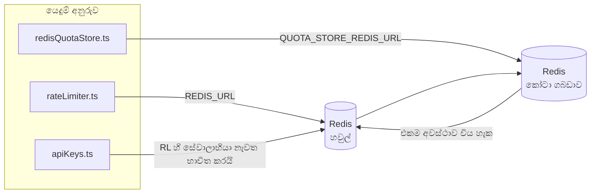

# Redis Production Configuration Guide (සිංහල)

🌐 **Languages:** 🇺🇸 [English](../../../../ops/REDIS_PRODUCTION_CONFIG.md) · 🇪🇹 [am](../../../am/docs/ops/REDIS_PRODUCTION_CONFIG.md) · 🇸🇦 [ar](../../../ar/docs/ops/REDIS_PRODUCTION_CONFIG.md) · 🇦🇿 [az](../../../az/docs/ops/REDIS_PRODUCTION_CONFIG.md) · 🇧🇬 [bg](../../../bg/docs/ops/REDIS_PRODUCTION_CONFIG.md) · 🇧🇩 [bn](../../../bn/docs/ops/REDIS_PRODUCTION_CONFIG.md) · 🇧🇦 [bs](../../../bs/docs/ops/REDIS_PRODUCTION_CONFIG.md) · 🇨🇿 [cs](../../../cs/docs/ops/REDIS_PRODUCTION_CONFIG.md) · 🇩🇰 [da](../../../da/docs/ops/REDIS_PRODUCTION_CONFIG.md) · 🇩🇪 [de](../../../de/docs/ops/REDIS_PRODUCTION_CONFIG.md) · 🇬🇷 [el](../../../el/docs/ops/REDIS_PRODUCTION_CONFIG.md) · 🇪🇸 [es](../../../es/docs/ops/REDIS_PRODUCTION_CONFIG.md) · 🇪🇪 [et](../../../et/docs/ops/REDIS_PRODUCTION_CONFIG.md) · 🇮🇷 [fa](../../../fa/docs/ops/REDIS_PRODUCTION_CONFIG.md) · 🇫🇮 [fi](../../../fi/docs/ops/REDIS_PRODUCTION_CONFIG.md) · 🇫🇷 [fr](../../../fr/docs/ops/REDIS_PRODUCTION_CONFIG.md) · 🇮🇪 [ga](../../../ga/docs/ops/REDIS_PRODUCTION_CONFIG.md) · 🇮🇳 [gu](../../../gu/docs/ops/REDIS_PRODUCTION_CONFIG.md) · 🇳🇬 [ha](../../../ha/docs/ops/REDIS_PRODUCTION_CONFIG.md) · 🇮🇱 [he](../../../he/docs/ops/REDIS_PRODUCTION_CONFIG.md) · 🇮🇳 [hi](../../../hi/docs/ops/REDIS_PRODUCTION_CONFIG.md) · 🇭🇷 [hr](../../../hr/docs/ops/REDIS_PRODUCTION_CONFIG.md) · 🇭🇺 [hu](../../../hu/docs/ops/REDIS_PRODUCTION_CONFIG.md) · 🇦🇲 [hy](../../../hy/docs/ops/REDIS_PRODUCTION_CONFIG.md) · 🇮🇩 [id](../../../id/docs/ops/REDIS_PRODUCTION_CONFIG.md) · 🇳🇬 [ig](../../../ig/docs/ops/REDIS_PRODUCTION_CONFIG.md) · 🇮🇹 [it](../../../it/docs/ops/REDIS_PRODUCTION_CONFIG.md) · 🇯🇵 [ja](../../../ja/docs/ops/REDIS_PRODUCTION_CONFIG.md) · 🇬🇪 [ka](../../../ka/docs/ops/REDIS_PRODUCTION_CONFIG.md) · 🇰🇭 [km](../../../km/docs/ops/REDIS_PRODUCTION_CONFIG.md) · 🇮🇳 [kn](../../../kn/docs/ops/REDIS_PRODUCTION_CONFIG.md) · 🇰🇷 [ko](../../../ko/docs/ops/REDIS_PRODUCTION_CONFIG.md) · 🇱🇹 [lt](../../../lt/docs/ops/REDIS_PRODUCTION_CONFIG.md) · 🇱🇻 [lv](../../../lv/docs/ops/REDIS_PRODUCTION_CONFIG.md) · 🇮🇳 [ml](../../../ml/docs/ops/REDIS_PRODUCTION_CONFIG.md) · 🇮🇳 [mr](../../../mr/docs/ops/REDIS_PRODUCTION_CONFIG.md) · 🇲🇾 [ms](../../../ms/docs/ops/REDIS_PRODUCTION_CONFIG.md) · 🇲🇹 [mt](../../../mt/docs/ops/REDIS_PRODUCTION_CONFIG.md) · 🇲🇲 [my](../../../my/docs/ops/REDIS_PRODUCTION_CONFIG.md) · 🇳🇵 [ne](../../../ne/docs/ops/REDIS_PRODUCTION_CONFIG.md) · 🇳🇱 [nl](../../../nl/docs/ops/REDIS_PRODUCTION_CONFIG.md) · 🇳🇴 [no](../../../no/docs/ops/REDIS_PRODUCTION_CONFIG.md) · 🇮🇳 [or](../../../or/docs/ops/REDIS_PRODUCTION_CONFIG.md) · 🇮🇳 [pa](../../../pa/docs/ops/REDIS_PRODUCTION_CONFIG.md) · 🇵🇭 [phi](../../../phi/docs/ops/REDIS_PRODUCTION_CONFIG.md) · 🇵🇱 [pl](../../../pl/docs/ops/REDIS_PRODUCTION_CONFIG.md) · 🇵🇹 [pt](../../../pt/docs/ops/REDIS_PRODUCTION_CONFIG.md) · 🇧🇷 [pt-BR](../../../pt-BR/docs/ops/REDIS_PRODUCTION_CONFIG.md) · 🇷🇴 [ro](../../../ro/docs/ops/REDIS_PRODUCTION_CONFIG.md) · 🇷🇺 [ru](../../../ru/docs/ops/REDIS_PRODUCTION_CONFIG.md) · 🇸🇰 [sk](../../../sk/docs/ops/REDIS_PRODUCTION_CONFIG.md) · 🇸🇮 [sl](../../../sl/docs/ops/REDIS_PRODUCTION_CONFIG.md) · 🇷🇸 [sr](../../../sr/docs/ops/REDIS_PRODUCTION_CONFIG.md) · 🇸🇪 [sv](../../../sv/docs/ops/REDIS_PRODUCTION_CONFIG.md) · 🇰🇪 [sw](../../../sw/docs/ops/REDIS_PRODUCTION_CONFIG.md) · 🇮🇳 [ta](../../../ta/docs/ops/REDIS_PRODUCTION_CONFIG.md) · 🇮🇳 [te](../../../te/docs/ops/REDIS_PRODUCTION_CONFIG.md) · 🇹🇭 [th](../../../th/docs/ops/REDIS_PRODUCTION_CONFIG.md) · 🇹🇷 [tr](../../../tr/docs/ops/REDIS_PRODUCTION_CONFIG.md) · 🇺🇦 [uk-UA](../../../uk-UA/docs/ops/REDIS_PRODUCTION_CONFIG.md) · 🇵🇰 [ur](../../../ur/docs/ops/REDIS_PRODUCTION_CONFIG.md) · 🇺🇿 [uz](../../../uz/docs/ops/REDIS_PRODUCTION_CONFIG.md) · 🇻🇳 [vi](../../../vi/docs/ops/REDIS_PRODUCTION_CONFIG.md) · 🇳🇬 [yo](../../../yo/docs/ops/REDIS_PRODUCTION_CONFIG.md) · 🇨🇳 [zh-CN](../../../zh-CN/docs/ops/REDIS_PRODUCTION_CONFIG.md) · 🇹🇼 [zh-TW](../../../zh-TW/docs/ops/REDIS_PRODUCTION_CONFIG.md)

---

## දළ විශ්ලේෂණය

Redis යනු ඇ **විකල්ප, මෘදු යැපීම** OmniRoute — හි Redis නොමැති විට යෙදුම අලංකාර ලෙස පිරිහී යයි (මතකයේ වැටීම්) නිෂ්පාදනයේදී, Redis සුසර කිරීම වෙනස් කාර්ය භාර හතරක් සඳහා ප්‍රමාදය අඩු කරයි:

| වැඩ බර             | රියදුරු                       | සේවාලාභී කර්මාන්ත ශාලාව                          | යතුරු රටාව                                       |
| ------------------ | ----------------------------- | ------------------------------------------------ | ------------------------------------------------ |
| අනුපාත සීමා කිරීම  | `rateLimiter.ts`              | `getRedisClient()` — කම්මැලි `ioredis` singleton | `<prefix>rl:*` Lua-පරමාණුක අනුපාත සීමා කවුළු     |
| සත්‍යාපන හැඹිලිය   | `apiKeys.ts`                  | `rateLimiter` හි සේවාදායකයා නැවත භාවිතා කරයි     | `<prefix>auth:api_key:<sha256>` සමඟ TTL          |
| කෝටා ගබඩාව         | `redisQuotaStore.ts`          | වෙනම `getRedisClient(url)` singleton             | `<prefix>quota:*` වින්‍යාස කළ හැකි එක්-උදාහරණයක් |
| උණුසුම් පරිපථ කඩනය | `redisCircuitBreakerStore.ts` | `circuitBreakerFactory.ts` හි වෙනම සේවාදායකයා    | `<prefix>warmup:cb:<connectionId>`               |

වැඩ බර හතරම එක් නාම අවකාශ උපසර්ගයක් බෙදා ගනී, එබැවින් OmniRoute තනි Redis අවස්ථාවක (උදා: `127.0.0.1:6379`) වෙනත් යෙදුම් සමඟ සහජීවනය විය හැක. [Key Namespacing](#key-namespacing) බලන්න.

---

## වත්මන් වින්‍යාසය (කේත පෙරනිමි)

| සැකසීම                          | වටිනාකම                                        | කොහෙද                                                                                 |
| ------------------------------- | ---------------------------------------------- | ------------------------------------------------------------------------------------- |
| `REDIS_URL` env var             | `redis://redis:6379` (රචනය), විකල්ප            | `rateLimiter.ts:5`, `.env.example`                                                    |
| `REDIS_KEY_PREFIX` env var      | `omniroute:` (පෙරනිමි)                         | `rateLimiter.ts`, `redisQuotaStore.ts`, `redisCircuitBreakerStore.ts`, `.env.example` |
| `QUOTA_STORE_REDIS_URL` env var | වෙනම, `REDIS_URL` වලින් වෙනස් විය හැක          | `quota/storeFactory.ts`                                                               |
| `QUOTA_STORE_DRIVER`            | `"sqlite"` (පෙරනිමි), `"redis"` විකල්ප         | `quota/storeFactory.ts`                                                               |
| ioredis `maxRetriesPerRequest`  | `3`                                            | `rateLimiter.ts` සේවාදායක නිර්මාණය                                                    |
| `enableReadyCheck`              | සකසා නැත (ioredis default: `true`)             | —                                                                                     |
| `lazyConnect`                   | සකසා නැත (ioredis default: `false`)            | —                                                                                     |
| `retryStrategy`                 | සකසා නැත (ioredis පෙරනිමිය: 200ms පදනම, ඝාතීය) | —                                                                                     |
| TLS / මුරපදය / DB දර්ශකය        | **වින්‍යාස කර නැත**                            | —                                                                                     |
| සෙන්ටිනල් / පොකුරු              | **වින්‍යාස කර නැත** — ස්වාධීන තනි-නෝඩය පමණි    | —                                                                                     |

---

## යතුරු නාමාවකාශකරණය

OmniRoute, ධාරකය මත ක්රියාත්මක වන අනෙකුත් ඕනෑම දෙයක් සමඟ Redis instance එකක් බෙදා ගනී. namespace එකක් නොමැතිව,
`auth:api_key:<sha256>` හෝ `rl:*` වැනි යතුරු, එම Redis භාවිත කරන වෙනත් යෙදුම්වල
යතුරු සමඟ ගැටිය හැක (මෙම instance එක වෙනත් සේවා සමඟ `127.0.0.1:6379` හි Redis ධාවනය කරයි).

**සෑම** OmniRoute යතුරකටම prefix එකක් එක් කිරීමට `REDIS_KEY_PREFIX` හිස් නොවන තන්තුවකට සකසන්න:

```bash
# .env — සියලුම OmniRoute යතුරු omniroute:rl:*, omniroute:auth:*, omniroute:quota:*, omniroute:warmup:cb:* බවට පත් වේ
REDIS_KEY_PREFIX=omniroute:
```

- **පෙරනිමිය:** `omniroute:` (`REDIS_KEY_PREFIX` සකසා නොමැති හෝ හිස් විට යොදනු ලැබේ).
- **යොදනු ලබන්නේ:** අනුපාත සීමාකාරකය + සත්යාපන හැඹිලිය (`keyPrefix` හරහා බෙදාගත් `ioredis` සේවාලාභියා) සහ
  කෝටා ගබඩාව (`KEY_PREFIX = "${REDIS_KEY_PREFIX}quota"`) සහ පෙර-උණුසුම් කිරීමේ පරිපථ බිඳිනය
  (`KEY_PREFIX = "${REDIS_KEY_PREFIX}warmup:cb:"`).
- Redis තුළ යතුරු දැනටමත් පවතින විට **prefix එක වෙනස් කිරීමෙන්** පැරණි යතුරු අනාථ වේ (ඒවා TTL / LRU හරහා
  කල් ඉකුත් වේ). වෙනස් කිරීම ආරක්ෂිතය; සංක්රමණයක් අවශ්ය නොවේ. එකම ව්යතිරේකය වන්නේ තහනම් ලෙස ලකුණු කළ සම්බන්ධතාවයක් සඳහා වන පෙර-උණුසුම් කිරීමේ
  පරිපථ-බිඳිනයේ යතුරකි: එය TTL එකක් නොමැතිව ස්ථිරව ගබඩා වන බැවින්,
  `redis-cli --scan --pattern '<old-prefix>warmup:cb:*'` මඟින් ඉතිරිව ඇති යතුරු ලැයිස්තුගත කර ඒවා මකා දමන්න.
- **ioredis `keyPrefix`** ලිවීම්වලදී prefix එක ස්වයංක්රීයව ඉදිරියට එක් කරන අතර කියවීම්වලදී එය ඉවත් කරයි,
  එබැවින් යෙදුම් කේතයට prefix එක කිසිවිටෙක නොපෙනේ.

---

## නිර්දේශිත නිෂ්පාදන සුසර කිරීම

### 1. සම්බන්ධතා සංචිතය / සේවාලාභී විකල්ප (ioredis `Redis` constructor)

වත්මන් කේතය අභිරුචි විකල්ප නොමැතිව තනි `new Redis(url)` නිර්මාණය කරයි. නිෂ්පාදන බහු-අනුරූ යෙදවීම් සඳහා, කේතය තුළ සේවාදායක කර්මාන්ත ශාලාවක් පසු කරන්න හෝ `getRedisClient()` ඔතා:

```typescript
const redis = new Redis(REDIS_URL, {
  maxRetriesPerRequest: null, // no retry limit; let retryStrategy decide
  enableReadyCheck: true, // verify server is ready before accepting calls
  lazyConnect: true, // don't connect on construction; wait for first call
  retryStrategy: (times) => {
    if (times > 10) return null; // give up after 10 retries → reconnect later
    return Math.min(times * 200, 5000); // 200ms, 400ms, …, 5s cap
  },
  enableAutoPipelining: true, // coalesce concurrent commands into one TCP write
  keepAlive: 10000, // TCP keep‑alive every 10s
});
```

**ප්රධාන වෙළඳාම්:**

- `maxRetriesPerRequest: null` + `retryStrategy` — නිෂ්පාදනය සඳහා වඩාත් කැමති බැවින් තාවකාලික Redis නැවත ආරම්භ කිරීම සෑම ඉල්ලීමක්ම වහාම අසාර්ථක නොවේ. `checkRateLimit()` හි මතකයේ ඇති පසුබෑම අසාර්ථක මාර්ගය අවශෝෂණය කරයි.
- `lazyConnect: true` — සේවාදායකය සම්බන්ධතා පිළිගැනීමට පෙර Redis මත ආරම්භක යැපීම වළක්වයි.
- `enableAutoPipelining: true` — සමගාමී අනුපාත-සීමා චෙක්පත් සඳහා වට-සංචාර අඩු කරයි; තනි සම්බන්ධතාවයක් මත > 50 RPS හි ප්රයෝජනවත් වේ.

### 2. Redis Server Configuration (`redis.conf`)

```
# Memory
maxmemory 80%                        # leave room for OS page cache
maxmemory-policy allkeys-lru         # evict stale auth cache entries under pressure

# Persistence (optional — OmniRoute is crash‑safe without it)
save 300 1                           # snapshot at least every 5 min if ≥1 key changed
appendonly no                        # AOF not needed; data is regeneratable
appendfsync no                       # no fsync overhead (RDB is sufficient)

# Networking
timeout 0                            # no idle disconnect
tcp-keepalive 300                    # 5 min keep‑alive
tcp-backlog 511                      # connection backlog for bursty load

# Performance
hz 10                                # default; 100 for latency‑sensitive
activedefrag yes                     # auto‑defragment when fragmentation >10%
```

**`maxmemory-policy allkeys-lru` සඳහා වෙළඳාම:** මතක පීඩනය යටතේ සත්‍යාපන හැඹිලි ඇතුළත් කිරීම් ඉවත් කළ හැකිය. මෙය ආරක්ෂිත — `setCachedApiKey` සෑම විටම අතපසු වූ විට නැවත ජනනය වන අතර SQLite පසුබැසීම බලයලත් වේ. අනුපාත-සීමාකරු Lua ස්ක්‍රිප්ට් නිර්මාණය මගින් කෙටි කාලීන කුඩා යතුරු නිර්මාණය කරයි.

### 3. Docker රචනා සැකසුම්

නිෂ්පාදන සංයුතිය (`docker-compose.prod.yml`) `redis:8.6.2-alpine` භාවිතා කරයි. එකතු කරන්න:

```yaml
redis:
  image: redis:8.6.2-alpine
  command:
    [
      "redis-server",
      "--maxmemory",
      "512mb",
      "--maxmemory-policy",
      "allkeys-lru",
      "--activedefrag",
      "yes",
      "--save",
      "300 1",
    ]
  healthcheck:
    test: ["CMD", "redis-cli", "ping"]
    interval: 10s
    timeout: 3s
    retries: 3
    start_period: 5s
```

### 4. බහු-උදාහරණ / පරිමාණ සලකා බැලීම්

**සියලුම අනුරූ සඳහා තනි Redis** — අනුපාත-සීමාකරු Lua ස්ක්‍රිප්ට් තනි බලයලත් යතුරු ඉඩක් මත රඳා පවතී. අනුපිටපත් පිටුපස ඇති බහු Redis අවස්ථාවන් පරමාණුකත්වය නැති වී අයවැය දෙගුණ කරයි. සියලුම යෙදුම් අනුරූ සඳහා තනි Redis (හෝ අසාර්ථක වූ Redis සෙන්ටිනල් පොකුරක්) භාවිතා කරන්න.

**සම්බන්ධතා ගණන:** සෑම යෙදුම් අනුරුවක්ම විවෘත වේ**2 TCP සම්බන්ධතා** Redis වෙත (අනුපාත සීමා කරන සේවාලාභියා + කෝටා ගබඩා සේවාදායකයා). → 20 සම්බන්ධතා අනුපිටපත් 10 කදී, පෙරනිමි Redis නිදසුනක 10k සම්බන්ධතා සිවිලිම තුළ.

### 5. අධීක්ෂණය

සෞඛ්‍ය පිරික්සුම් අන්ත ලක්ෂ්‍යය හරහා නිරාවරණය කරන්න:

```typescript
// src/app/api/monitoring/health/route.ts already calls rateLimiter functions
// Add Redis-specific checks:
//   1. PING latency via ioredis .ping()
//   2. Memory usage via INFO memory
//   3. Connection count via INFO clients
//   4. Hit rate for maxmemory-policy (evicted_keys / keyspace_hits)
```

නැරඹීමට ප්‍රධාන මිනුම්:

- **ඉවත් කළ යතුරු / තත්පර** — නොකඩවා ශුන්‍ය නොවේ නම්, `maxmemory` වැඩි කරන්න
- **අවහිර කළ ගනුදෙනුකරුවන්** — ශුන්‍ය නොවන මන්දගාමී Lua ස්ක්‍රිප්ට් හෝ ඉහළ මතභේදයක් යෝජනා කරයි
- **ප්‍රතික්ෂේප කළ සම්බන්ධතා** — සම්බන්ධතා සීමාව පහර; සම්බන්ධතා 20 දී දුර්ලභය

### 6. Redis-අනුකූල සේවාදායකයන්

මෙහි භාවිතා කරන ඕනෑම සේවාදායකයක් Lua ස්ක්‍රිප්ට් ධාවනය කළ යුතුය: අනුපාත සීමාව `EVAL` එකකි. Lua නොමැති සේවාදායකයක් මත, `checkRateLimit()` `[RATE_LIMITER] Redis eval failed, falling back to in-memory rate limiting` ලොග් කර එක් ක්‍රියාවලියකට ගණන් කරයි, එබැවින් සෑම අනුරුවක්ම තමාගේම සීමාව බලාත්මක කරයි. තෝරා ගැනීමේ හවුල් සැසි-සම්බන්ධතා ගබඩාව (`OMNIROUTE_SESSION_AFFINITY_STORE=redis`) `EVAL` සමඟින් කටු කියවා යාවත්කාලීන කරයි ; Lua නොමැතිව එය `[SESSION_AFFINITY] Redis error; falling back to SQLite.` ලොග් කරන අතර සෑම අනුරුවක්ම තමන්ගේම අල්ෙපෙනති තබා ගනී. අනෙකුත් වැඩ බර සරල විධාන භාවිතා කරයි (`SET ... EX`, `GET`, `DEL`, `MGET`, `EXPIRE`, `INCRBYFLOAT`, හෑෂ් සහ කට්ටල), සහ අර්ථකථන හැඹිලියේ Redis පසුපෙළ `FT.*` විධාන නොයවයි.

OmniRoute 3.8.52 සමඟ පරීක්ෂා කර ඇත: KiviDB 1.2.0 එහි Lua රූපය සමඟ (`kividb/kividb:v1.2.0-lua`). අනුපාත සීමකය (කවුන්ටර බෙදාගැනීමේ දෙවන ක්‍රියාවලිය ඇතුළුව), සත්‍යාපන හැඹිලිය, කෝටා ගබඩාව, උණුසුම් පරිපථ කඩනය, අර්ථකථන හැඹිලි ගබඩාව සහ චැට් හසුරුවන්නා හරහා `/v1/chat/completions` ඉල්ලීමක් Redis 8.10.3 හරහා ගමන් කරන චෙක්පත් 19න් 18ක් සමත් විය. වෙනස් වන එක: `INCRBYFLOAT` `0.1 + 0.2` ගබඩා කරන්නේ `0.30000000000000004` ලෙසයි එහිදී Redis ගබඩා කරන්නේ `0.3` ( [kividbio/kividb#387](https://github.com/kividbio/kividb/issues/387) ). කෝටා ගබඩාව දෙකම `parseFloat` සමඟ විග්‍රහ කරයි, නමුත් සංඛ්‍යා දෙක අවසාන ඉලක්කම් වලින් වෙනස් වේ, එබැවින් කෝටා මායිමකට හරියටම වැටෙන සංසන්දනය වෙනස් ආකාරයකින් පැමිණිය හැකිය. සැසි-සම්බන්ධතා ගබඩාව එම ධාවනයේ කොටසක් නොවීය. ( [සැකසීම](https://github.com/kividbio/kividb/blob/master/docs/integrations/omniroute.md), [ප්රතිඵල](https://github.com/kividbio/kividb/tree/master/benchmarks/omniroute-compat) )

---

## නිර්මාණ සැලැස්මේ රූපසටහන



---

## යොමු කිරීම්

| ගොනුව                              | අරමුණ                                                                   |
| ---------------------------------- | ----------------------------------------------------------------------- |
| `src/shared/utils/rateLimiter.ts`  | ප්‍රාථමික Redis සේවාලාභියා, Lua අනුපාත-සීමා ස්ක්‍රිප්ට්, මතකයේ පසුබැසීම |
| `src/lib/db/apiKeys.ts`            | සත්‍යාපන හැඹිලි — Redis→SQLite පසුබැසීම                                 |
| `src/lib/quota/redisQuotaStore.ts` | විකල්ප කෝටා ගබඩාව සඳහා Redis සේවාලාභියා වෙන් කරන්න                      |
| `src/lib/quota/storeFactory.ts`    | `sqlite` සහ `redis` කෝටා ධාවකයන් අතර මාරු වේ                            |
| `docker-compose.prod.yml`          | නිෂ්පාදන Redis බහාලුම් (රූපය `redis:8.6.2-alpine`)                      |
| `.env.example`                     | Redis env vars ලේඛනගත කිරීම                                             |
| `src/app/api/local/redis/`         | dev බහාලුම් වාද්‍ය වෘන්දය සඳහාAPI මාර්ග                                 |
| `bin/cli/commands/redis.mjs`       | dev බහාලුම් වාද්‍ය වෘන්දය සඳහාCLI විධාන                                 |
