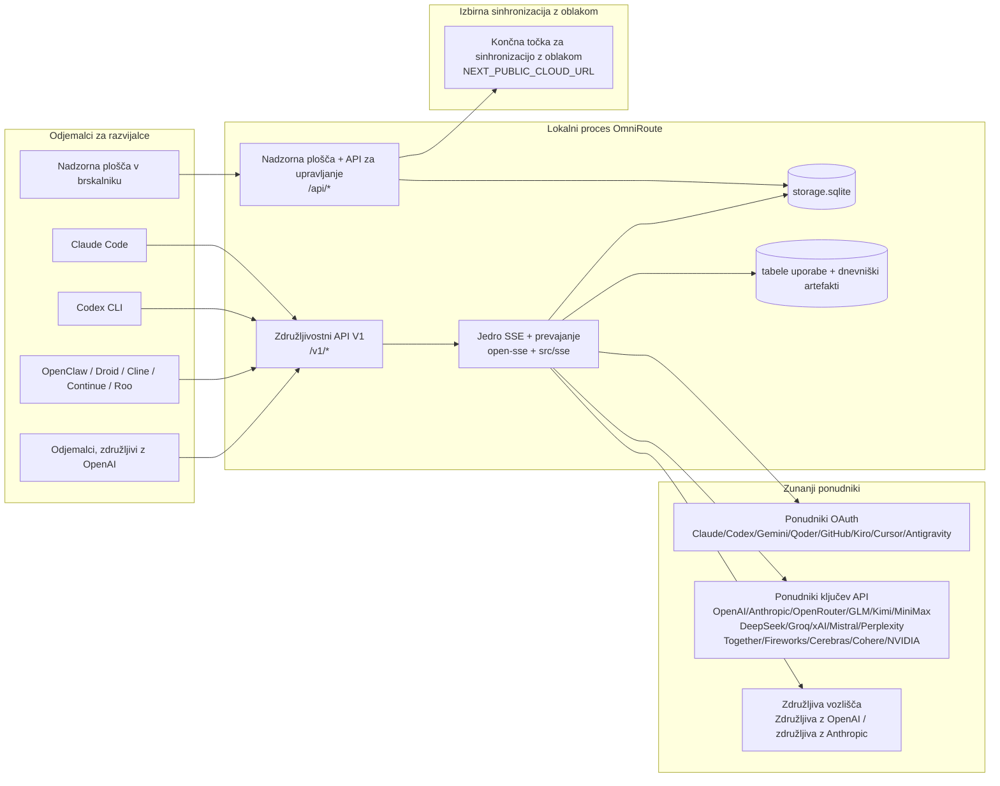
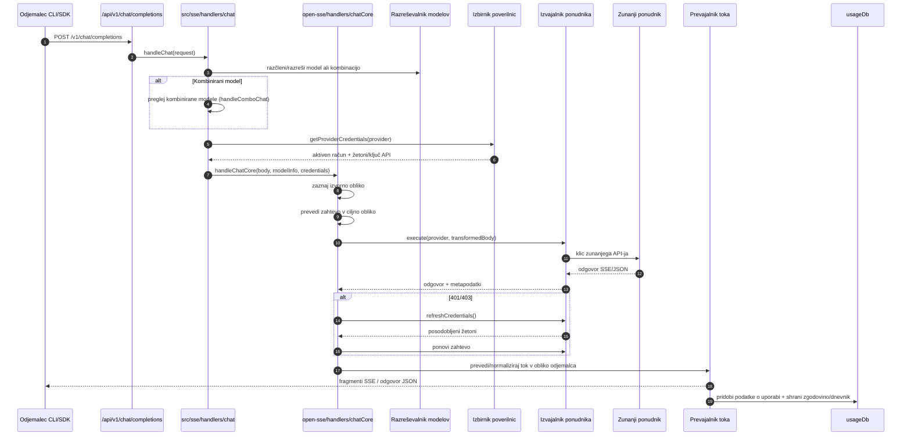
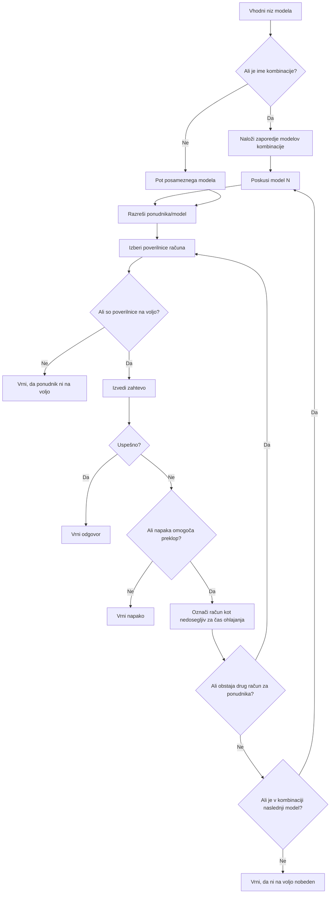
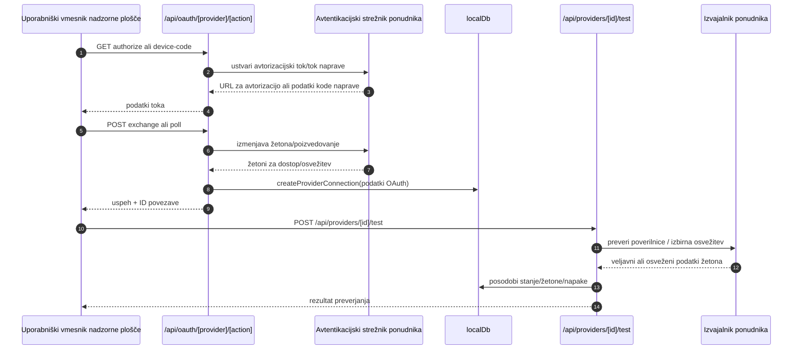
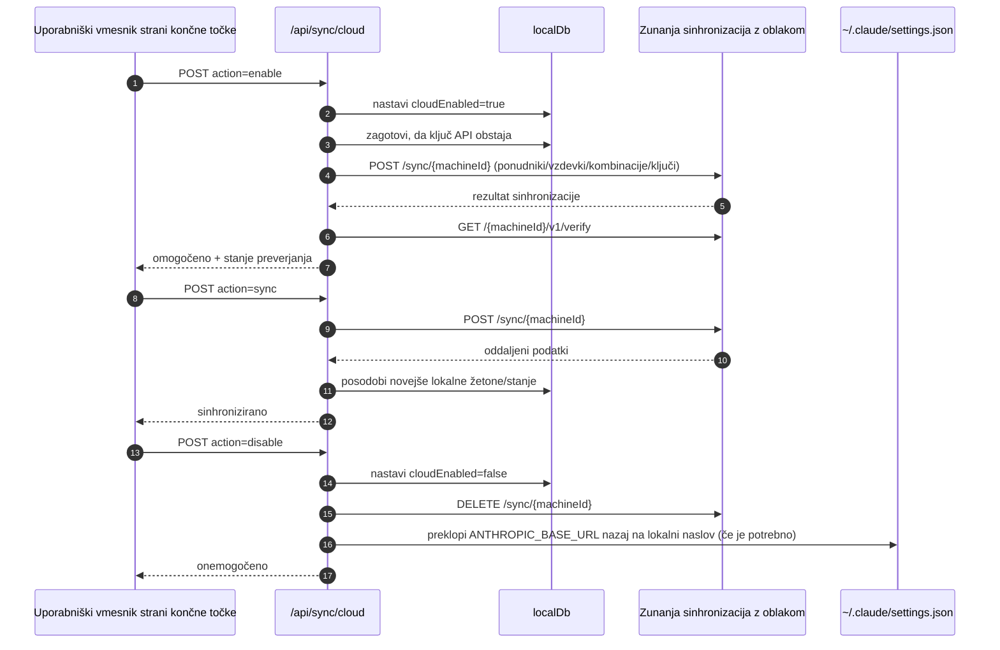
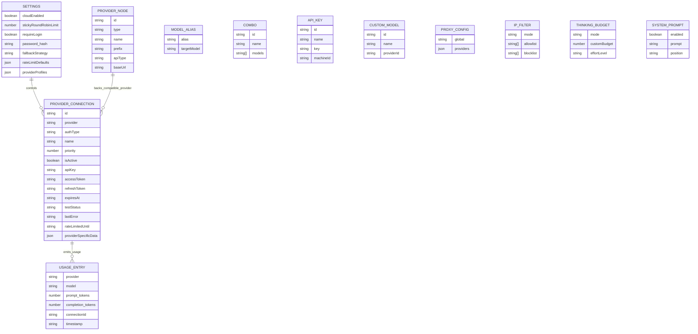
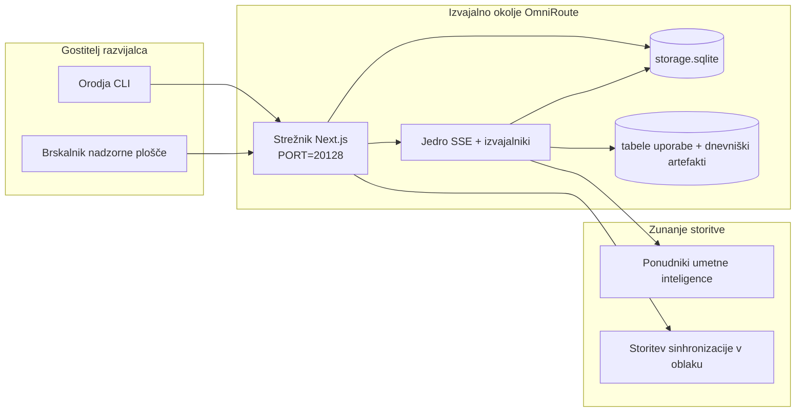

# OmniRoute Architecture (Slovenščina)

🌐 **Languages:** 🇺🇸 [English](../../../../architecture/ARCHITECTURE.md) · 🇪🇹 [am](../../../am/docs/architecture/ARCHITECTURE.md) · 🇸🇦 [ar](../../../ar/docs/architecture/ARCHITECTURE.md) · 🇦🇿 [az](../../../az/docs/architecture/ARCHITECTURE.md) · 🇧🇬 [bg](../../../bg/docs/architecture/ARCHITECTURE.md) · 🇧🇩 [bn](../../../bn/docs/architecture/ARCHITECTURE.md) · 🇧🇦 [bs](../../../bs/docs/architecture/ARCHITECTURE.md) · 🇨🇿 [cs](../../../cs/docs/architecture/ARCHITECTURE.md) · 🇩🇰 [da](../../../da/docs/architecture/ARCHITECTURE.md) · 🇩🇪 [de](../../../de/docs/architecture/ARCHITECTURE.md) · 🇬🇷 [el](../../../el/docs/architecture/ARCHITECTURE.md) · 🇪🇸 [es](../../../es/docs/architecture/ARCHITECTURE.md) · 🇪🇪 [et](../../../et/docs/architecture/ARCHITECTURE.md) · 🇮🇷 [fa](../../../fa/docs/architecture/ARCHITECTURE.md) · 🇫🇮 [fi](../../../fi/docs/architecture/ARCHITECTURE.md) · 🇫🇷 [fr](../../../fr/docs/architecture/ARCHITECTURE.md) · 🇮🇪 [ga](../../../ga/docs/architecture/ARCHITECTURE.md) · 🇮🇳 [gu](../../../gu/docs/architecture/ARCHITECTURE.md) · 🇳🇬 [ha](../../../ha/docs/architecture/ARCHITECTURE.md) · 🇮🇱 [he](../../../he/docs/architecture/ARCHITECTURE.md) · 🇮🇳 [hi](../../../hi/docs/architecture/ARCHITECTURE.md) · 🇭🇷 [hr](../../../hr/docs/architecture/ARCHITECTURE.md) · 🇭🇺 [hu](../../../hu/docs/architecture/ARCHITECTURE.md) · 🇦🇲 [hy](../../../hy/docs/architecture/ARCHITECTURE.md) · 🇮🇩 [id](../../../id/docs/architecture/ARCHITECTURE.md) · 🇳🇬 [ig](../../../ig/docs/architecture/ARCHITECTURE.md) · 🇮🇹 [it](../../../it/docs/architecture/ARCHITECTURE.md) · 🇯🇵 [ja](../../../ja/docs/architecture/ARCHITECTURE.md) · 🇬🇪 [ka](../../../ka/docs/architecture/ARCHITECTURE.md) · 🇰🇭 [km](../../../km/docs/architecture/ARCHITECTURE.md) · 🇮🇳 [kn](../../../kn/docs/architecture/ARCHITECTURE.md) · 🇰🇷 [ko](../../../ko/docs/architecture/ARCHITECTURE.md) · 🇱🇹 [lt](../../../lt/docs/architecture/ARCHITECTURE.md) · 🇱🇻 [lv](../../../lv/docs/architecture/ARCHITECTURE.md) · 🇮🇳 [ml](../../../ml/docs/architecture/ARCHITECTURE.md) · 🇮🇳 [mr](../../../mr/docs/architecture/ARCHITECTURE.md) · 🇲🇾 [ms](../../../ms/docs/architecture/ARCHITECTURE.md) · 🇲🇹 [mt](../../../mt/docs/architecture/ARCHITECTURE.md) · 🇲🇲 [my](../../../my/docs/architecture/ARCHITECTURE.md) · 🇳🇵 [ne](../../../ne/docs/architecture/ARCHITECTURE.md) · 🇳🇱 [nl](../../../nl/docs/architecture/ARCHITECTURE.md) · 🇳🇴 [no](../../../no/docs/architecture/ARCHITECTURE.md) · 🇮🇳 [or](../../../or/docs/architecture/ARCHITECTURE.md) · 🇮🇳 [pa](../../../pa/docs/architecture/ARCHITECTURE.md) · 🇵🇭 [phi](../../../phi/docs/architecture/ARCHITECTURE.md) · 🇵🇱 [pl](../../../pl/docs/architecture/ARCHITECTURE.md) · 🇵🇹 [pt](../../../pt/docs/architecture/ARCHITECTURE.md) · 🇧🇷 [pt-BR](../../../pt-BR/docs/architecture/ARCHITECTURE.md) · 🇷🇴 [ro](../../../ro/docs/architecture/ARCHITECTURE.md) · 🇷🇺 [ru](../../../ru/docs/architecture/ARCHITECTURE.md) · 🇱🇰 [si](../../../si/docs/architecture/ARCHITECTURE.md) · 🇸🇰 [sk](../../../sk/docs/architecture/ARCHITECTURE.md) · 🇷🇸 [sr](../../../sr/docs/architecture/ARCHITECTURE.md) · 🇸🇪 [sv](../../../sv/docs/architecture/ARCHITECTURE.md) · 🇰🇪 [sw](../../../sw/docs/architecture/ARCHITECTURE.md) · 🇮🇳 [ta](../../../ta/docs/architecture/ARCHITECTURE.md) · 🇮🇳 [te](../../../te/docs/architecture/ARCHITECTURE.md) · 🇹🇭 [th](../../../th/docs/architecture/ARCHITECTURE.md) · 🇹🇷 [tr](../../../tr/docs/architecture/ARCHITECTURE.md) · 🇺🇦 [uk-UA](../../../uk-UA/docs/architecture/ARCHITECTURE.md) · 🇵🇰 [ur](../../../ur/docs/architecture/ARCHITECTURE.md) · 🇺🇿 [uz](../../../uz/docs/architecture/ARCHITECTURE.md) · 🇻🇳 [vi](../../../vi/docs/architecture/ARCHITECTURE.md) · 🇳🇬 [yo](../../../yo/docs/architecture/ARCHITECTURE.md) · 🇨🇳 [zh-CN](../../../zh-CN/docs/architecture/ARCHITECTURE.md) · 🇹🇼 [zh-TW](../../../zh-TW/docs/architecture/ARCHITECTURE.md)

---

🌐 **Languages:** 🇺🇸 [English](../../../../architecture/ARCHITECTURE.md) · 🇪🇹 [am](../../../am/docs/architecture/ARCHITECTURE.md) · 🇸🇦 [ar](../../../ar/docs/architecture/ARCHITECTURE.md) · 🇦🇿 [az](../../../az/docs/architecture/ARCHITECTURE.md) · 🇧🇬 [bg](../../../bg/docs/architecture/ARCHITECTURE.md) · 🇧🇩 [bn](../../../bn/docs/architecture/ARCHITECTURE.md) · 🇧🇦 [bs](../../../bs/docs/architecture/ARCHITECTURE.md) · 🇨🇿 [cs](../../../cs/docs/architecture/ARCHITECTURE.md) · 🇩🇰 [da](../../../da/docs/architecture/ARCHITECTURE.md) · 🇩🇪 [de](../../../de/docs/architecture/ARCHITECTURE.md) · 🇬🇷 [el](../../../el/docs/architecture/ARCHITECTURE.md) · 🇪🇸 [es](../../../es/docs/architecture/ARCHITECTURE.md) · 🇪🇪 [et](../../../et/docs/architecture/ARCHITECTURE.md) · 🇮🇷 [fa](../../../fa/docs/architecture/ARCHITECTURE.md) · 🇫🇮 [fi](../../../fi/docs/architecture/ARCHITECTURE.md) · 🇫🇷 [fr](../../../fr/docs/architecture/ARCHITECTURE.md) · 🇮🇪 [ga](../../../ga/docs/architecture/ARCHITECTURE.md) · 🇮🇳 [gu](../../../gu/docs/architecture/ARCHITECTURE.md) · 🇳🇬 [ha](../../../ha/docs/architecture/ARCHITECTURE.md) · 🇮🇱 [he](../../../he/docs/architecture/ARCHITECTURE.md) · 🇮🇳 [hi](../../../hi/docs/architecture/ARCHITECTURE.md) · 🇭🇷 [hr](../../../hr/docs/architecture/ARCHITECTURE.md) · 🇭🇺 [hu](../../../hu/docs/architecture/ARCHITECTURE.md) · 🇦🇲 [hy](../../../hy/docs/architecture/ARCHITECTURE.md) · 🇮🇩 [id](../../../id/docs/architecture/ARCHITECTURE.md) · 🇳🇬 [ig](../../../ig/docs/architecture/ARCHITECTURE.md) · 🇮🇹 [it](../../../it/docs/architecture/ARCHITECTURE.md) · 🇯🇵 [ja](../../../ja/docs/architecture/ARCHITECTURE.md) · 🇬🇪 [ka](../../../ka/docs/architecture/ARCHITECTURE.md) · 🇰🇭 [km](../../../km/docs/architecture/ARCHITECTURE.md) · 🇮🇳 [kn](../../../kn/docs/architecture/ARCHITECTURE.md) · 🇰🇷 [ko](../../../ko/docs/architecture/ARCHITECTURE.md) · 🇱🇹 [lt](../../../lt/docs/architecture/ARCHITECTURE.md) · 🇱🇻 [lv](../../../lv/docs/architecture/ARCHITECTURE.md) · 🇮🇳 [ml](../../../ml/docs/architecture/ARCHITECTURE.md) · 🇮🇳 [mr](../../../mr/docs/architecture/ARCHITECTURE.md) · 🇲🇾 [ms](../../../ms/docs/architecture/ARCHITECTURE.md) · 🇲🇹 [mt](../../../mt/docs/architecture/ARCHITECTURE.md) · 🇲🇲 [my](../../../my/docs/architecture/ARCHITECTURE.md) · 🇳🇵 [ne](../../../ne/docs/architecture/ARCHITECTURE.md) · 🇳🇱 [nl](../../../nl/docs/architecture/ARCHITECTURE.md) · 🇳🇴 [no](../../../no/docs/architecture/ARCHITECTURE.md) · 🇮🇳 [or](../../../or/docs/architecture/ARCHITECTURE.md) · 🇮🇳 [pa](../../../pa/docs/architecture/ARCHITECTURE.md) · 🇵🇭 [phi](../../../phi/docs/architecture/ARCHITECTURE.md) · 🇵🇱 [pl](../../../pl/docs/architecture/ARCHITECTURE.md) · 🇵🇹 [pt](../../../pt/docs/architecture/ARCHITECTURE.md) · 🇧🇷 [pt-BR](../../../pt-BR/docs/architecture/ARCHITECTURE.md) · 🇷🇴 [ro](../../../ro/docs/architecture/ARCHITECTURE.md) · 🇷🇺 [ru](../../../ru/docs/architecture/ARCHITECTURE.md) · 🇱🇰 [si](../../../si/docs/architecture/ARCHITECTURE.md) · 🇸🇰 [sk](../../../sk/docs/architecture/ARCHITECTURE.md) · 🇷🇸 [sr](../../../sr/docs/architecture/ARCHITECTURE.md) · 🇸🇪 [sv](../../../sv/docs/architecture/ARCHITECTURE.md) · 🇰🇪 [sw](../../../sw/docs/architecture/ARCHITECTURE.md) · 🇮🇳 [ta](../../../ta/docs/architecture/ARCHITECTURE.md) · 🇮🇳 [te](../../../te/docs/architecture/ARCHITECTURE.md) · 🇹🇭 [th](../../../th/docs/architecture/ARCHITECTURE.md) · 🇹🇷 [tr](../../../tr/docs/architecture/ARCHITECTURE.md) · 🇺🇦 [uk-UA](../../../uk-UA/docs/architecture/ARCHITECTURE.md) · 🇵🇰 [ur](../../../ur/docs/architecture/ARCHITECTURE.md) · 🇺🇿 [uz](../../../uz/docs/architecture/ARCHITECTURE.md) · 🇻🇳 [vi](../../../vi/docs/architecture/ARCHITECTURE.md) · 🇳🇬 [yo](../../../yo/docs/architecture/ARCHITECTURE.md) · 🇨🇳 [zh-CN](../../../zh-CN/docs/architecture/ARCHITECTURE.md) · 🇹🇼 [zh-TW](../../../zh-TW/docs/architecture/ARCHITECTURE.md)

_Nazadnje posodobljeno: 2026-06-28_

## Povzetek

OmniRoute je lokalni usmerjevalni prehod AI in nadzorna plošča, zgrajena na Next.js. Zagotavlja eno končno točko, združljivo z OpenAI (`/v1/*`), in usmerja promet prek več ponudnikov navzgor s prevajanjem, nadomestnim delovanjem, osveževanjem žetonov in sledenjem uporabi.

Osnovne zmogljivosti:

- Površina API združljiva z OpenAI, za CLI/tools (394 ponudnikov, 159 izvajalskih modulov)
- prevod Request/response med formati ponudnika
- Nadomestni kombinirani model (zaporedje več modelov)
- Strukturirani kombinirani koraki (`provider + model + connection`) z vrstnim redom med izvajanjem `compositeTiers`
- Nadomestni način na ravni računa (več računov na ponudnika)
- Kvota pred tiskom in izbira računa P2C glede na kvote v glavni poti klepeta
- OAuth + API-key upravljanje povezav ponudnika (27 modulov ponudnika OAuth )
- Generiranje vdelave preko `/v1/embeddings` (18 ponudnikov)
- Generiranje slike prek `/v1/images/generations` (10 ponudnikov +, 20 modelov + )
- Prepis zvoka preko `/v1/audio/transcriptions` (18 ponudnikov)
- Pretvorba besedila v govor prek `/v1/audio/speech` (24 vgrajenih ponudnikov)
- Generiranje videa prek `/v1/videos/generations` (ComfyUI + SD WebUI)
- Generiranje glasbe prek `/v1/music/generations` (ComfyUI)
- Spletno iskanje preko `/v1/search` (20 ponudnikov)
- Moderacije prek `/v1/moderations`
- Prerazvrščanje prek `/v1/rerank`
- Razčlenjevanje oznake razmišljanja (`<think>...</think>`) za modele razmišljanja
- Odzivna sanacija za strogo združljivost OpenAI SDK
- Normalizacija vloge (sistem razvijalec →, uporabnik sistema →) za združljivost med ponudniki
- Strukturirana izhodna pretvorba (json_schema → Gemini responseSchema)
- Lokalna obstojnost za ponudnike, ključe, vzdevke, kombinacije, nastavitve, cene (122 modulov DB )
- Usage/cost sledenje in beleženje zahtev
- Izbirna sinhronizacija v oblaku za sinhronizacijo multi-device/state
- IP allowlist/blocklist za nadzor dostopa API
- Razmišljanje o upravljanju proračuna (passthrough/auto/custom/adaptive)
- Globalna sistemska takojšnja injekcija
- Sledenje seji in prstni odtis
- Izboljšano omejevanje stopnje na račun s profili, specifičnimi za ponudnika
- Vzorec odklopnika za odpornost ponudnika
- Zaščita črede proti grmenju z zaklepanjem mutexa
- Predpomnilnik za deduplikacijo zahtev na podlagi podpisa
- Domenska plast: stroškovna pravila, rezervna politika, politika zaklepanja
- Context Relay: povzetki predaje seje za kontinuiteto rotacije računa
- Vztrajnost stanja domene (zapisni predpomnilnik SQLite za nadomestne vrednosti, proračune, zaklepe, odklopnike)
- Mehanizem pravilnika za centralizirano vrednotenje zahtev (lockout → budget → backback)
- Zahtevajte telemetrijo z združevanjem zakasnitev p50/p95/p99
- Telemetrija kombiniranega cilja in zgodovinsko zdravje kombiniranega cilja prek `combo_execution_key` / `combo_step_id`
- Korelacija ID (X-Request-Id) za sledenje od konca do konca
- Beleženje revizije skladnosti z zavrnitvijo na ključ API
- Ogrodje Eval za zagotavljanje kakovosti LLM
- Zdravstvena nadzorna plošča s stanjem odklopnika ponudnika v realnem času
- MCP strežnik (110 orodij) s 3 transporti (stdio/SSE/Streamable HTTP)
- strežnik A2A (JSON-RPC 2.0 + SSE) z življenjskim ciklom spretnosti in opravil
- Pomnilniški sistem (ekstrakcija, vbrizgavanje, iskanje, povzemanje)
- Sistem veščin (register, izvajalec, peskovnik, vgrajene veščine)
- MITM proxy z upravljanjem potrdil in obdelavo DNS
- Vmesna programska oprema Prompt Injection Guard
- Prompt stiskalni cevovod z Caveman, RTK, zloženimi cevovodi, kompresijskimi kombinacijami, jezikovnimi paketi in analitiko
- register ACP (Agent Communication Protocol).
- Modularni ponudniki OAuth (22 posameznih modulov pod `src/lib/oauth/providers/`)
- Uninstall/full-uninstall skripte
- akcija popravljanja okolja OAuth
- most WebSocket za odjemalce WS, združljive z OpenAI (`/v1/ws`)
- Upravljanje žetonov sinhronizacije (issue/revoke, prenos konfiguracijskega svežnja z različico ETag)
- GLM Thinking (`glmt`) prednastavitev prvovrstnega ponudnika
- Hibridno štetje žetonov ( `/messages/count_tokens` na strani ponudnika z rezervno oceno)
- Samodejno sejanje vzdevka modela (30 + navzkrižnih normalizacij narečja proxy ob zagonu)
- Varno izhodno pridobivanje z zaščito SSRF, zasebnim blokiranjem URL in nastavljivim ponovnim poskusom
- Ponovni poskusi klepeta z zaznavanjem ohlajanja z nastavljivima `requestRetry` in `maxRetryIntervalSec`
- Preverjanje izvajalnega okolja z Zod ob zagonu
- Revizija skladnosti v2 s paginacijo, dogodki CRUD ponudnika in beleženjem preverjanja, ki ga blokira SSRF

Primarni model izvajalnega okolja:

- Poti aplikacij Next.js pod `src/app/api/*` izvajajo APIs nadzorne plošče in združljivost APIs
- Jedro SSE/routing v skupni rabi v `src/sse/*` + `open-sse/*` obravnava ponudnikovo izvajanje, prevajanje, pretakanje, nadomestno delovanje in uporabo

## Referenčni diagrami

Kanonični viri Mermaid z nadzorom različic za platformo v3.8.0 so v
[`docs/diagrams/`](../diagrams/README.md). Spodaj sta za lažjo orientacijo prikazana dva;
ostali so povezani iz vodnikov za posamezna področja.


> Vir: [diagrams/request-pipeline.mmd](../diagrams/request-pipeline.mmd)


> Vir: [diagrams/resilience-3layers.mmd](../diagrams/resilience-3layers.mmd) — povezava je na voljo tudi v
> [RESILIENCE_GUIDE.md](./RESILIENCE_GUIDE.md) in referenci za odpornost v `CLAUDE.md`.

## Obseg in meje

### V obsegu

- Lokalno izvajalno okolje prehoda
- API-ji za upravljanje nadzorne plošče
- Preverjanje pristnosti ponudnikov in osveževanje žetonov
- Pretvarjanje zahtev in pretočno pošiljanje SSE
- Lokalno stanje + trajno shranjevanje podatkov o uporabi
- Izbirna orkestracija sinhronizacije z oblakom

### Zunaj obsega

- Implementacija storitve v oblaku za `NEXT_PUBLIC_CLOUD_URL`
- SLA/nadzorna ravnina ponudnika zunaj lokalnega procesa
- Same zunanje izvršljive datoteke CLI (Claude CLI, Codex CLI itd.)

## Površina nadzorne plošče (trenutno)

Glavne strani v `src/app/(dashboard)/dashboard/`:

- `/dashboard` — hitri začetek in pregled ponudnikov
- `/dashboard/endpoint` — zavihki za posredovanje končnih točk, MCP, A2A in končne točke API-ja
- `/dashboard/providers` — povezave s ponudniki in poverilnice
- `/dashboard/combos` — strategije kombinacij, predloge, graditelj na osnovi korakov, pravila usmerjanja modelov in ročno trajno shranjeno razvrščanje
- `/dashboard/auto-combo` — mehanizem Auto Combo: uteži ocenjevanja, paketi načinov, prednastavitve navidezne tovarne in telemetrija
- `/dashboard/costs` — združevanje stroškov in preglednost cen
- `/dashboard/analytics` — analitika uporabe, vrednotenja in stanje ciljev kombinacij
- `/dashboard/limits` — nadzor kvot in omejitev hitrosti
- `/dashboard/cli-tools` — uvajanje v CLI, zaznavanje izvajalnega okolja in ustvarjanje konfiguracije
- `/dashboard/agents` — zaznani agenti ACP in registracija agentov po meri
- `/dashboard/cloud-agents` — opravila agentov, gostovanih v oblaku (Codex Cloud, Devin, Jules), in življenjski cikel opravil
- `/dashboard/skills` — register veščin A2A, izvajanje v peskovniku in katalog vgrajenih veščin
- `/dashboard/memory` — pregledovanje in pridobivanje trajnega pomnilnika pogovorov
- `/dashboard/webhooks` — naročnine na odhodne spletne kavlje, menjava skrivnosti in statistika ponovnih poskusov
- `/dashboard/batch` — oddaja paketnih opravil in spremljanje napredka
- `/dashboard/cache` — statistika predpomnjenja ob branju in predpomnjenja sklepanja ter nadzor izločanja
- `/dashboard/playground` — interaktivno okolje za klepet s katero koli konfigurirano kombinacijo ali modelom
- `/dashboard/changelog` — pregledovalnik dnevnika sprememb v aplikaciji (upodablja `CHANGELOG.md`)
- `/dashboard/system` — diagnostika izvajalnega okolja, informacije o različici in vmesnik za preverjanje okolja
- `/dashboard/onboarding` — čarovnik za začetno nastavitev novih namestitev
- `/dashboard/media` — okolje za preizkušanje slik, videoposnetkov in glasbe
- `/dashboard/search-tools` — preizkušanje ponudnikov iskanja in zgodovina
- `/dashboard/health` — čas delovanja, odklopniki, omejitve hitrosti in seje z nadzorovanimi kvotami
- `/dashboard/logs` — dnevniki zahtev, posredovanja, revizij in konzole
- `/dashboard/settings` — zavihki sistemskih nastavitev (splošno, usmerjanje, privzete nastavitve kombinacij itd.)
- `/dashboard/context/caveman` — pravila stiskanja Caveman, jezikovni paketi, predogled in izhodni način
- `/dashboard/context/rtk` — filtri izhodov ukazov RTK, predogled in varnostne nastavitve izvajalnega okolja
- `/dashboard/context/combos` — poimenovani cevovodi stiskanja, dodeljeni kombinacijam usmerjanja
- `/dashboard/translator` — pregled prevajalnika in predogled pretvorbe oblike zahtev
- `/dashboard/audit` — brskalnik dnevnika revizij skladnosti s straničenjem in strukturiranimi metapodatki
- `/dashboard/usage` — brskalnik uporabe po posameznih zahtevah, povezan z `usage_history`
- `/dashboard/compression` — analitika in statistika stiskanja ter dodeljevanje cevovodov
- `/dashboard/api-manager` — življenjski cikel ključev API in dovoljenja modelov

Plast uporabniškega vmesnika: vsaka stran se upodablja znotraj enega ogrodja — `src/app/(dashboard)/layout.tsx` →
`src/shared/components/layouts/DashboardLayout.tsx` → `DashboardShell.tsx` (`SidebarProvider`/`SidebarInset` iz kompleta,
OmniRouteova `Sidebar.tsx` in `Header.tsx`). Strani uvažajo svoje gradnike iz
`@/shared/components` (prilagoditvene plasti nad vključeno kopijo kompleta Keak CI UI Kit v
`packages/ui-kit`) ali iz podpot komponent kompleta (`@omniroute/ui-kit/table`, `…/page-header`), ikone pa
prek `<Icon>` (`ICON_MAP` → Lucide). Tema (privzeto `system`, svetla/temna) in oblikovni žetoni prihajajo
iz kompleta prek povezovalne plasti v `src/app/globals.css`. Podrobnosti: `docs/architecture/DESIGN_SYSTEM.md`.

## Visokonivojski kontekst sistema



## Osrednje izvajalne komponente

## 1) Sloj API-ja in usmerjanja (poti aplikacije Next.js)

Glavni imeniki:

- `src/app/api/v1/*` in `src/app/api/v1beta/*` za združljivostne API-je
- `src/app/api/*` za API-je za upravljanje/konfiguracijo
- Pravila za prepisovanje Next v `next.config.mjs` preslikajo `/v1/*` v `/api/v1/*`

Pomembne združljivostne poti:

- `src/app/api/v1/chat/completions/route.ts`
- `src/app/api/v1/messages/route.ts`
- `src/app/api/v1/responses/route.ts`
- `src/app/api/v1/models/route.ts` — vključuje modele po meri z `custom: true`
- `src/app/api/v1/embeddings/route.ts` — ustvarjanje vložitev (6 ponudnikov)
- `src/app/api/v1/images/generations/route.ts` — ustvarjanje slik (več kot 4 ponudniki, vključno z Antigravity/Nebius)
- `src/app/api/v1/messages/count_tokens/route.ts`
- `src/app/api/v1/providers/[provider]/chat/completions/route.ts` — namenski klepet za posameznega ponudnika
- `src/app/api/v1/providers/[provider]/embeddings/route.ts` — namenske vložitve za posameznega ponudnika
- `src/app/api/v1/providers/[provider]/images/generations/route.ts` — namenske slike za posameznega ponudnika
- `src/app/api/v1beta/models/route.ts`
- `src/app/api/v1beta/models/[...path]/route.ts`

Področja upravljanja:

- Preverjanje pristnosti/nastavitve: `src/app/api/auth/*`, `src/app/api/settings/*`
- Ponudniki/povezave: `src/app/api/providers*`
- Vozlišča ponudnikov: `src/app/api/provider-nodes*`
- Modeli po meri: `src/app/api/provider-models` (GET/POST/DELETE)
- Katalog modelov: `src/app/api/models/route.ts` (GET)
- Konfiguracija posredniškega strežnika: `src/app/api/settings/proxy` (GET/PUT/DELETE) + `src/app/api/settings/proxy/test` (POST)
- OAuth: `src/app/api/oauth/*`
- Ključi/vzdevki/kombinacije/cene: `src/app/api/keys*`, `src/app/api/models/alias`, `src/app/api/combos*`, `src/app/api/pricing`
- Uporaba: `src/app/api/usage/*`
- Sinhronizacija/oblak: `src/app/api/sync/*`, `src/app/api/cloud/*`
- Pomožna orodja za CLI: `src/app/api/cli-tools/*`
- Filter naslovov IP: `src/app/api/settings/ip-filter` (GET/PUT)
- Proračun razmišljanja: `src/app/api/settings/thinking-budget` (GET/PUT)
- Sistemski poziv: `src/app/api/settings/system-prompt` (GET/PUT)
- Stiskanje: `src/app/api/settings/compression`, `src/app/api/compression/*` in
  `src/app/api/context/*`
- Seje: `src/app/api/sessions` (GET)
- Omejitve hitrosti: `src/app/api/rate-limits` (GET)
- Odpornost: `src/app/api/resilience` (GET/PATCH) — čakalna vrsta zahtev, čas ohlajanja povezave, odklopnik ponudnika, konfiguracija čakanja na konec ohlajanja
- Ponastavitev odpornosti: `src/app/api/resilience/reset` (POST) — ponastavitev odklopnikov ponudnikov
- Statistika predpomnilnika: `src/app/api/cache/stats` (GET/DELETE)
- Telemetrija: `src/app/api/telemetry/summary` (GET)
- Proračun: `src/app/api/usage/budget` (GET/POST)
- Verige nadomestnih možnosti: `src/app/api/fallback/chains` (GET/POST/DELETE)
- Revizija skladnosti: `src/app/api/compliance/audit-log` (GET, s paginacijo + strukturiranimi metapodatki)
- Evalvacije: `src/app/api/evals` (GET/POST), `src/app/api/evals/[suiteId]` (GET)
- Pravilniki: `src/app/api/policies` (GET/POST)
- Žetoni za sinhronizacijo: `src/app/api/sync/tokens` (GET/POST), `src/app/api/sync/tokens/[id]` (GET/DELETE)
- Konfiguracijski sveženj: `src/app/api/sync/bundle` (GET, posnetek nastavitev/ponudnikov/kombinacij/ključev z različicami ETag)
- WebSocket: `src/app/api/v1/ws/route.ts` — obdelovalnik nadgradnje za odjemalce WS, združljive z OpenAI

## 2) SSE + Prevajalsko jedro

Moduli glavnega toka:

- Vnos: `src/sse/handlers/chat.ts`
- Osnovna orkestracija: `open-sse/handlers/chatCore.ts`
- Izvedbeni adapterji ponudnika: `open-sse/executors/*`
- Format konfiguracije detection/provider : `open-sse/services/provider.ts`
- Model parse/resolve: `src/sse/services/model.ts`, `open-sse/services/model.ts`
- Nadomestna logika računa: `open-sse/services/accountFallback.ts`
- Register prevodov: `open-sse/translator/index.ts`
- Transformacije toka: `open-sse/utils/stream.ts`, `open-sse/utils/streamHandler.ts`
- Uporaba extraction/normalization: `open-sse/utils/usageTracking.ts`
- Razčlenjevalnik miselnih oznak: `open-sse/utils/thinkTagParser.ts`
- Upravljavec za vdelavo: `open-sse/handlers/embeddings.ts`
- Register ponudnikov vdelave: `open-sse/config/embeddingRegistry.ts`
- Upravljalnik za ustvarjanje slik: `open-sse/handlers/imageGeneration.ts`
- Register ponudnikov slik: `open-sse/config/imageRegistry.ts`
- Odzivna sanacija: `open-sse/handlers/responseSanitizer.ts`
- Normalizacija vloge: `open-sse/services/roleNormalizer.ts`

Storitve (poslovna logika):

- Račun selection/scoring: `open-sse/services/accountSelector.ts`
- Upravljanje življenjskega cikla konteksta: `open-sse/services/contextManager.ts`
- uveljavitev filtra IP : `open-sse/services/ipFilter.ts`
- Sledenje seji: `open-sse/services/sessionManager.ts`
- Zahtevaj deduplikacijo: `open-sse/services/signatureCache.ts`
- Sistemska takojšnja injekcija: `open-sse/services/systemPrompt.ts`
- Razmišljanje o upravljanju proračuna: `open-sse/services/thinkingBudget.ts`
- Usmerjanje modela z nadomestnimi znaki: `open-sse/services/wildcardRouter.ts`
- Upravljanje omejitve hitrosti: `open-sse/services/rateLimitManager.ts`
- Odklopnik: `src/shared/utils/circuitBreaker.ts`
- Predaja konteksta: generiranje povzetka predaje `open-sse/services/contextHandoff.ts` — in vstavljanje za strategijo kontekstnega posredovanja
- Stiskanje: `open-sse/services/compression/*` — proaktivno stiskanje pred prevodom ponudnika; vključuje pravila Caveman, filtre RTK, zložene cevovode, kompresijske kombinacije, statistiko in validacijo
- Codex quota fetcher: `open-sse/services/codexQuotaFetcher.ts` — fetches Codex quota for context-relay handoff decisions
- Ponovni poskus z upoštevanjem ohlajanja: `src/sse/services/cooldownAwareRetry.ts` — ponovni poskusi ohlajanja na model z nastavljivim `requestRetry` / `maxRetryIntervalSec`
- Varno izhodno pridobivanje: `src/shared/network/safeOutboundFetch.ts` — varovano pridobivanje provider/model z SSRF guard, blokiranje zasebnih URL-jev, ponovni poskus in časovna omejitev
- Izhodni URL guard: `src/shared/network/outboundUrlGuard.ts` — gostitelj preverja ponudnika URLs; `src/shared/network/outboundUrlGuardPolicy.ts` izbere način iz `OMNIROUTE_ALLOW_LOCAL_PROVIDER_URLS`, `OMNIROUTE_ALLOW_PRIVATE_PROVIDER_URLS` in njihovih preklopov na nadzorni plošči (glejte `docs/reference/ENVIRONMENT.md`)
- Privzete nastavitve zahteve ponudnika: privzete nastavitve na ravni ponudnika `open-sse/services/providerRequestDefaults.ts` — `maxTokens` `temperature`, `thinkingBudgetTokens`
- konstante ponudnika GLM : `open-sse/config/glmProvider.ts` — skupni modeli GLM, kvota URLs, GLMT timeout/defaults
- Antigravity navzgor: `open-sse/config/antigravityUpstream.ts` — base URL in konstante poti odkrivanja
- konstante odjemalca Codex : `open-sse/config/codexClient.ts` — različice uporabniškega agenta in vrednosti različice odjemalca
- Seme vzdevka modela: `src/lib/modelAliasSeed.ts` — ob zagonu postavi 30 vzdevkov z navzkrižnim posredniškim narečjem +

Moduli domenske plasti:

- Cena rules/budgets: `src/domain/costRules.ts`
- Nadomestna politika: `src/domain/fallbackPolicy.ts`
- Rezervirana pogodba za kombinirano reševanje: `src/domain/comboResolver.ts`; usmerjanje v živo uporablja `open-sse/services/combo.ts`
- Politika zaklepanja: `src/domain/lockoutPolicy.ts`
- Pridržana pogodba o oceni politike: `src/domain/policyEngine.ts`; pot zahteve uveljavlja politiko ključa API prek `src/shared/utils/apiKeyPolicy.ts` in avtorizacijo razrešenega cilja prek `src/sse/handlers/chat/resolvedModelPolicy.ts`
- Katalog kod napak: `src/shared/constants/errorCodes.ts`
- Zahtevaj ID: `src/shared/utils/requestId.ts`
- Časovna omejitev pridobivanja: `src/shared/utils/fetchTimeout.ts`
- Zahtevaj telemetrijo: `src/shared/utils/requestTelemetry.ts`
- Compliance/audit: `src/lib/compliance/index.ts`
- Ocenjeni tekač: `src/lib/evals/evalRunner.ts`
- Vztrajnost stanja domene: `src/lib/db/domainState.ts` — SQLite CRUD za nadomestne verige, proračune, zgodovino stroškov, stanje zaklepanja, odklopnike

moduli ponudnika OAuth (27 posameznih datotek pod `src/lib/oauth/providers/`):

- Indeks registra: `src/lib/oauth/providers/index.ts`
- Posamezni ponudniki: `agy.ts`, `antigravity.ts`, `claude.ts`, `cline.ts`, `codebuddy-cn.ts`, `codebuddy-intl.ts`, `codex.ts`, `cursor.ts`, `devin-desktop.ts`, `ghe-copilot.ts`, `github.ts`, `gitlab-duo.ts`, `grok-cli-oauth.ts`, `grok-cli.ts`, `kilocode.ts`, `kimi-coding.ts`, `kiro.ts`, `muse-code.ts`, `openference.ts`, `qoder.ts`, `trae.ts`, `workbuddy.ts`, `xai-oauth.ts`, `zed-hosted.ts`, `zed.ts`
- Skupni pomočniki: `codebuddyDeviceAuth.ts` (CodeBuddy CN/intl device flow), `museCodeDeviceResponse.ts`
- Tanek ovoj: `src/lib/oauth/providers.ts` — ponovno izvozi iz posameznih modulov

## 5) Vgrajene storitve (v3.8.4)

OmniRoute lahko namesti, nadzoruje in usmerja v lokalno izvajajoče se procese orodja AI imenovane** vgrajene storitve** . Poslanih je pet: 9Router, CLIProxyAPI, Bifrost, Mux in Dario.

Arhitekturne plasti:

- **UI** (`/dashboard/providers/services`) stran z dvema zavihkoma — s kontrolniki življenjskega cikla, pretakanjem dnevnika v živo, upravljanjem ključev API in (za 9Router) vdelanim izvornim UI prek notranjega povratnega proxyja.
- **API** (`/api/services/{name}/*`) — 11 končnih točk za 9Router, 10 za CLIProxyAPI, po 8 za Bifrost / Mux / Dario, vse razvrščene**LOCAL_ONLY** (trdo pravilo #17). Skupna končna točka `GET /api/services/[name]/logs` SSE služi obema storitvama.
- **Nadzornik** (`src/lib/services/`) — generični razred `ServiceSupervisor` ovija `child_process.spawn`, vsebuje obročni medpomnilnik 5 MB za pretakanje dnevnika SSE, zanko zdravstvene sonde, zaklepanje atomskega delovanja in elegantno zaustavitev SIGTERM→SIGKILL. `bootstrap.ts` poveže vse konfigurirane storitve ob zagonu procesa.
- **Provider/executor** (`open-sse/executors/ninerouter.ts`) — 9Router je izpostavljen kot pravi ponudnik. Modeli imajo predpono `9router/{sub}/{model}` in se vsakih 5 minut sinhronizirajo s končne točke `/v1/models` 9Routerja.

Globok potop: `docs/frameworks/EMBEDDED-SERVICES.md`

## Glavni podsistemi (v3.8.0)

### A. Samodejni kombinirani motor

Auto Combo dinamično oceni in izbere cilje usmerjanja ob času zahteve, namesto da bi se zanašal na statično definicijo kombinacije. Poganja družino predpon modela `auto/*`.

- Vnos motorja: `open-sse/services/autoCombo/` (`autoComboEngine.ts`, `scoringEngine.ts`, `virtualFactory.ts`, `modePacks.ts`)
- Kombinirani vnos v živo: `open-sse/services/combo.ts` (`handleComboChat`, `resolveComboTargets`), ki ga kliče `src/sse/handlers/chat.ts`
- Armaturna plošča: `/dashboard/auto-combo`
- Telemetrija: tabela `auto_combo_decisions` SQLite

Ključne zmogljivosti:

- **22 strategij usmerjanja** (prioritetno, uteženo, najprej izpolni, krožno, P2C, naključno, najmanj uporabljeno, stroškovno optimizirano, s ponastavitvijo, ponastavitveno okno, najprej potek, višina, uteženo s kvoto, strogo naključno,** avto** , lkgp, kontekstno optimizirano, predpomnilnik optimizirano, kontekstno posredovanje,** fuzija** , cevovod, jev) — auto je dodatek naslova v v3.8.0; `fusion` (panel fan-out + sodnik sinteza, `open-sse/services/fusion.ts`) je nov v v3.8.36.
- **16-faktorsko točkovanje** : kvota, zdravje, inverzni stroški, inverzna zakasnitev, prileganje nalogi in še deset drugih. Kanonična tabela faktorjev in njihovih privzetih uteži živi v [`docs/routing/AUTO-COMBO.md`](../routing/AUTO-COMBO.md) —, če bi jo ponovili tukaj, bi ji dali drugo mesto, da bi zastarela.
- **Virtualna tovarna** materializira efemerne kombinacije, ko ne obstaja nobena ujemajoča se poimenovana kombinacija, pri čemer pridobi kandidate iz zdravih aktivnih povezav ponudnika.
- **Samodejne predpone** : `auto/coding`, `auto/cheap`, `auto/fast`, `auto/offline`, `auto/smart`, `auto/lkgp` — vsak podprt z nastavljenim profilom teže.
- **6 paketov načinov** : `ship-fast`, `cost-saver`, `quality-first`, `offline-friendly`, `reliability-first` in `chaos-mode` — prednastavljene konfiguracije teže, ki jih je mogoče priklicati z nadzorne plošče. (Ne zamenjujte z zgornjimi predponami `auto/*`, ki so različice časa zahteve.)

Za vse algoritemske podrobnosti (faktorske formule, uravnavanje teže) glejte [`docs/routing/AUTO-COMBO.md`](../routing/AUTO-COMBO.md).

### B. Agenti v oblaku

Cloud Agents ovija platforme kodnih agentov, ki jih gostijo tretje osebe (Codex Cloud, Devin, Jules), za enoten življenjski cikel opravil, podprt z DB. Vse končne točke opravil creation/inspection zahtevajo avtentikacijo upravljanja.

- Koren modula: `src/lib/cloudAgent/` (`baseAgent.ts`, `registry.ts`, `api.ts`, `types.ts`, `db.ts`, plus podimeniki na agenta pod `agents/`)
- Implementacije na agenta: `agents/codex/`, `agents/devin/`, `agents/jules/`
- Javne končne točke: `/api/v1/agents/tasks/*` (list/create/get/cancel)
- Končne točke upravljanja: `/api/cloud/*` (oskrba, status, serija)
- Armaturna plošča: `/dashboard/cloud-agents`
- Shranjevanje: miza `cloud_agent_tasks`

Za zagotavljanje posameznih agentov in podrobnosti OAuth glejte [`docs/frameworks/CLOUD_AGENT.md`](../frameworks/CLOUD_AGENT.md).

### C. Zaščitne ograje

Modul guardrails je plast vmesne programske opreme, ki jo je mogoče vroče znova naložiti in pregleduje zahteve in odgovore za PII, takojšnje vstavljanje in nevarno vsebino vida. Kršitve kratkega stika zahteve z HTTP** 503** plus strukturirana koda napake, ki klicateljem na nižji stopnji omogoča ponovni poskus ali razvejanje.

- Koren modula: `src/lib/guardrails/` (`base.ts`, `registry.ts`, `piiMasker.ts`, `promptInjection.ts`, `visionBridge.ts`, `visionBridgeHelpers.ts`)
- Vroče ponovno nalaganje: register spremlja spremembe konfiguracije in znova zgradi verigo na mestu
- Točke za ožičenje: vnos upravljalnika klepeta, upravljalnik za ustvarjanje slik, razkužilo odziva
- pogodba HTTP : kršitve se pojavljajo kot `503` z `error.code = "GUARDRAIL_VIOLATION"`

Za avtorstvo nabora pravil in nastavitev praga glejte [`docs/security/GUARDRAILS.md`](../security/GUARDRAILS.md).

### D. Plast domene

Imenski prostor `src/domain/` vsebuje domenske storitve in rezervirane pogodbe ocenjevanja. To ni ena obvezna vstopna točka pravilnika za vsako zahtevo.

Pot klepeta v živo kliče `enforceApiKeyPolicy()` iz `src/shared/utils/apiKeyPolicy.ts`; avtorizacija razrešenih modelov in kombiniranih članov je implementirana v `src/sse/handlers/chat/resolvedModelPolicy.ts`. Samostojni vnos v `src/app/api/v1/chat/completions/route.ts` prav tako uveljavlja politiko ključa API pred pošiljanjem. Kombinirana ločljivost teče skozi `open-sse/services/combo.ts`.

`src/domain/policyEngine.ts`, `src/domain/comboResolver.ts` in `src/lib/container.ts` ostanejo preizkušene pogodbe, ne pa ožičenje te poti zahteve. Vsebnik registrira mehanizem pravilnika, vendar ga pot pregledane proizvodne zahteve ne reši. Samo spreminjanje teh pogodb ne spremeni politike klepeta v živo ali kombiniranega usmerjanja; njihova povezava ali odstranitev zahteva ločeno oblikovalsko odločitev.

- Reserved policy engine: `src/domain/policyEngine.ts` — lockout → proračun → rezervna ocena
- Pravila stroškov: `src/domain/costRules.ts`
- Nadomestna politika: `src/domain/fallbackPolicy.ts`
- Politika zaklepanja: `src/domain/lockoutPolicy.ts`
- Usmerjanje na podlagi oznak: `src/domain/tagRouter.ts`
- Rezerviran kombinirani razreševalec: `src/domain/comboResolver.ts` — samostojna izbirna pogodba; kombinirano usmerjanje v živo je implementirano v `open-sse/services/combo.ts`
- združevalec pravil Connection/model : `src/domain/connectionModelRules.ts`
- Posnetki razpoložljivosti modela: `src/domain/modelAvailability.ts`
- Sledenje poteku veljavnosti ponudnika: `src/domain/providerExpiration.ts`
- Predpomnilnik kvote: `src/domain/quotaCache.ts`. Ponudniki dodajajo in odstranjujejo kvotna okna (OpenAI je opustil 5-urno okno Codex za nekatere načrte), tako da branje uporabe ponudnikovega vmesnika potrdi kot popolno (`quotasComplete`, glejte `src/lib/usage/usageReading.ts`) je celoten nabor oken računa: okno, ki je bilo prej znano, a ga ni, je umaknjeno, v predpomnilniku, v `quota_snapshots` se rehidrira ponovni zagon (priložen zapis o upokojitvi), v obstoječem stanje kvote Codex in v vedrih nasičenosti Claude. Delni dokazi (glave odgovorov, zastarele kopije) posodobijo samo okna, ki jih nosijo.
- Stanje razgradnje: `src/domain/degradation.ts`
- Revizija konfiguracije: `src/domain/configAudit.ts`
- Graditelj metapodatkov odziva OmniRoute : `src/domain/omnirouteResponseMeta.ts`
- Ocenjevalni podsistem: `src/domain/assessment/` — periodična ocenjevalna opravila

### E. Avtorizacijski cevovod

Avtorizacijski cevovod razvrsti vsako dohodno zahtevo in pred odpošiljanjem uporabi ustrezno verigo pravilnikov.

- Vhod v cevovod: `src/server/authz/pipeline.ts`
- Klasifikator zahtev: `src/server/authz/classify.ts` — loči javne združljive poti od upravljalnih poti
- Javni popis poti: `src/shared/constants/publicApiRoutes.ts`
- Politike: sestavljivi predikati `src/server/authz/policies/` — (`requireApiKey`, `requireManagement`, `requireFreshAuth` itd.)
- Pripomočki za glavo: `src/server/authz/headers.ts`
- Pomočnik pri trditvah: `src/server/authz/assertAuth.ts`
- Kontekst zahteve: `src/server/authz/context.ts`

Javne in upravljavske poti so trda meja: agent/cooldown APIs in mutacije ponudnika zahtevajo avtorizacijo upravljanja (HTTP 401, če manjka).

Za celotna pravila za razvrščanje poti glejte [`docs/architecture/AUTHZ_GUIDE.md`](./AUTHZ_GUIDE.md).

### F. Workflow FSM in Task-Aware Router

Usmerjevalnik, ki ga poganja končni avtomat, je nadgrajen nad kombinirano izbiro za usmerjanje prometa na podlagi zaznane stopnje delovnega toka (načrtovanje, izvedba, pregled) in afinitete opravila v ozadju.

- Potek dela FSM: `open-sse/services/workflowFSM.ts`
- Usmerjevalnik, ki upošteva naloge: `open-sse/services/taskAwareRouter.ts`
- Detektor opravil v ozadju: `open-sse/services/backgroundTaskDetector.ts`
- Klasifikator namena: `open-sse/services/intentClassifier.ts`

Prehodi FSM se vključijo v točkovanje Auto Combo, pri čemer se usmerijo k cenejšim modelom za naloge background/automation in k močnejšim modelom za interaktivne obrate planning/review.

### G. Odpornost, specifična za ponudnika

Več ponudnikov pošilja namenske module odpornosti in prikrite module, ki se namestijo na plasti globalnega odklopnika/ohlajanja povezave/zaklepanja modela:

- motor Antigravity 429: `open-sse/services/antigravity429Engine.ts` (zasuka identiteto, počisti glave odgovorov, poganja sledenje credits/version prek `antigravityCredits.ts`, `antigravityHeaderScrub.ts`, `antigravityHeaders.ts`, `antigravityIdentity.ts`, `antigravityVersion.ts`)
- Antigravity 429 guard: `open-sse/services/antigravity429Guard.ts` (proračun na zahtevo 429 navzgor v vseh gostiteljih, `ANTIGRAVITY_MAX_429_ATTEMPTS`; na identično ponovno pošiljanje zavrnjenega telesa se odgovori lokalno; `src/sse/handlers/chat.ts` ne zažene znova takšne zahteve prek ponovnega poskusa, ki se zaveda ohlajanja)
- Politika kvot ModelScope : `open-sse/services/modelscopePolicy.ts`
- koda Claude CCH (rokovanje združljivostnega kanala): `open-sse/services/claudeCodeCCH.ts`, plus `claudeCodeCompatible.ts`, `claudeCodeConstraints.ts`, `claudeCodeExtraRemap.ts`, `claudeCodeToolRemapper.ts`
- Oblikovanje prstnega odtisa kode Claude : `open-sse/services/claudeCodeFingerprint.ts`
- Claude Zakrivanje kode: `open-sse/services/claudeCodeObfuscation.ts`

Za celoten prikriti priročnik in operativna navodila glejte `docs/security/STEALTH_GUIDE.md` (git; ni prevedeno v `/docs`).

### H. Webhooks, Reasoning Cache, Read Cache

- **Webhooks** — odhodno pošiljanje za dogodke provider/account/task.
  - Odpremnik: `src/lib/webhookDispatcher.ts`
  - Shramba: tabela `webhooks` SQLite (prek `src/lib/db/webhooks.ts`)
  - Nadzorna plošča: `/dashboard/webhooks` (naročnine, skrivnosti, zgodovina ponovnih poskusov)
  - Za taksonomijo dogodkov in semantiko ponovnih poskusov glejte [`docs/frameworks/WEBHOOKS.md`](../frameworks/WEBHOOKS.md).
- **Reasoning Cache** bloki sklepanja —, ki jih je mogoče ponovno predvajati, za ponudnike, ki oddajajo žetone razmišljanja (Claude, GLMT itd.), tako da lahko zaporedni obrati preskočijo ponovno razmišljanje.
  - plast DB : `src/lib/db/reasoningCache.ts`
  - Storitvena plast: `open-sse/services/reasoningCache.ts`
  - Za semantiko ponovnega predvajanja glejte [`docs/routing/REASONING_REPLAY.md`](../routing/REASONING_REPLAY.md).
- **Preberite predpomnilnik** predpomnilnik kratkotrajnih odzivov — ki je ključan s podpisom in se uporablja za strnitev enakih ponovnih poskusov iz pokvarjenega navzgornjega SDKs.
  - plast DB : `src/lib/db/readCache.ts`
  - Končna točka statistike: `GET /api/cache/stats`, nadzorna plošča na `/dashboard/cache`

## 3) Plast trajnega shranjevanja

Primarna podatkovna zbirka stanja (SQLite):

- Osnovna infrastruktura: `src/lib/db/core.ts` (better-sqlite3, migracije, WAL)
- Dostop do podatkovne zbirke: neposredno uvozite posamezne module `src/lib/db/*` (stari zbirni modul `localDb.ts` je bil odstranjen)
- datoteka: `${DATA_DIR}/storage.sqlite` (ali `$XDG_CONFIG_HOME/omniroute/storage.sqlite`, kadar je nastavljen, sicer `~/.omniroute/storage.sqlite`)
- entitete (tabele + imenski prostori KV): providerConnections, providerNodes, modelAliases, combos, apiKeys, settings, pricing, **customModels**, **proxyConfig**, **ipFilter**, **thinkingBudget**, **systemPrompt**

Trajno shranjevanje podatkov o uporabi:

- fasada: `src/lib/usageDb.ts` (razčlenjeni moduli v `src/lib/usage/*`)
- Tabele SQLite v `storage.sqlite`: `usage_history`, `call_logs`, `proxy_logs`
- izbirni datotečni artefakti ostanejo zaradi združljivosti/razhroščevanja (`${DATA_DIR}/log.txt`, `${DATA_DIR}/call_logs/`, `<repo>/logs/...`)
- podedovane datoteke JSON se ob zagonu z migracijami prenesejo v SQLite, če so prisotne

Podatkovna zbirka stanja domen (SQLite):

- `src/lib/db/domainState.ts` — operacije CRUD za stanje domen
- Tabele (ustvarjene v `src/lib/db/core.ts`): `domain_fallback_chains`, `domain_budgets`, `domain_cost_history`, `domain_lockout_state`, `domain_circuit_breakers`
- Vzorec predpomnilnika s sprotnim zapisovanjem: zemljevidi v pomnilniku so med izvajanjem avtoritativni; spremembe se sinhrono zapisujejo v SQLite; stanje se ob hladnem zagonu obnovi iz podatkovne zbirke

## 4) Površine avtentikacije in varnosti

- Avtentikacija nadzorne plošče s piškotki: `src/proxy.ts`, `src/app/api/auth/login/route.ts`
- Ustvarjanje/preverjanje ključev API: `src/shared/utils/apiKey.ts`
- Skrivnosti ponudnikov, shranjene v vnosih `providerConnections`
- Podpora za odhodni posredniški strežnik prek `open-sse/utils/proxyFetch.ts` (okoljske spremenljivke) in `open-sse/utils/networkProxy.ts` (nastavljivo za posameznega ponudnika ali globalno)
- Zaščita pred SSRF / preverjanje odhodnih URL-jev: `src/shared/network/outboundUrlGuard.ts` — preverjanje gostiteljev pri klicih ponudnikov in ciljih spletnih kavljev; način določa `src/shared/network/outboundUrlGuardPolicy.ts` (zastavice v `docs/reference/ENVIRONMENT.md`)
- Preverjanje izvajalnega okolja: `src/lib/env/runtimeEnv.ts` — shema Zod za vse okoljske spremenljivke, pri čemer so težave prikazane kot napake/opozorila ob zagonu
- Žetoni za sinhronizacijo: `src/lib/db/syncTokens.ts` — žetoni z omejenim obsegom za končne točke za prenos konfiguracijskega svežnja; podprti s tabelo SQLite `sync_tokens` (migracija `024_create_sync_tokens.sql`)
- Avtentikacija rokovanja WebSocket: `src/lib/ws/handshake.ts` — preverja zahteve za nadgradnjo WS s ključem API ali sejnim piškotkom
- Avtentikacija WebSocket za nadzorno ploščo v živo: `src/server/ws/liveServer.ts` — spremljevalni proces (vrata `LIVE_WS_PORT`) sprejme sejni piškotek nadzorne plošče ali ključ API Bearer z upravljavskim obsegom (`manage`/`admin`); ključi, namenjeni samo sklepanju, so zavrnjeni. Njegova notranja končna točka izdajatelja `POST /__omniroute_event` sprejme vrstnike iz povratne zanke samo, če ni prisotna nobena glava posredniškega prehoda (`x-forwarded-*`, `x-real-ip`, `forwarded`, `via`)

## 5) Sinhronizacija z oblakom

- Inicializacija razporejevalnika: `src/lib/initCloudSync.ts`, `src/shared/services/initializeCloudSync.ts`, `src/shared/services/modelSyncScheduler.ts`
- Periodično opravilo: `src/shared/services/cloudSyncScheduler.ts`
- Periodično opravilo: `src/shared/services/modelSyncScheduler.ts`
- Nadzorna pot: `src/app/api/sync/cloud/route.ts`

## Življenjski cikel zahteve (`/v1/chat/completions`)



## Potek kombinacije in preklopa na nadomestni račun



Odločitve o preklopu določa `open-sse/services/accountFallback.ts` na podlagi kod stanja in hevristike sporočil o napakah. Usmerjanje kombinacij doda še eno varovalo: napake 400, omejene na ponudnika, kot so blokiranje vsebine pri nadrejeni storitvi in neuspešna preverjanja veljavnosti vlog, se obravnavajo kot napake, lokalne posameznemu modelu, tako da se lahko naslednji cilji kombinacije še vedno izvedejo.

## Življenjski cikel nastavitve OAuth in osveževanja žetonov



Osveževanje med prometom v živo se izvaja znotraj `open-sse/handlers/chatCore.ts` prek izvajalnikove metode `refreshCredentials()`.

## Življenjski cikel sinhronizacije z oblakom (omogočanje/sinhronizacija/onemogočanje)



Ko je oblak omogočen, periodično sinhronizacijo sproža `CloudSyncScheduler`.

## Podatkovni model in zemljevid shranjevanja



Datoteke fizične hrambe:

- primarna izvajalna podatkovna zbirka: `${DATA_DIR}/storage.sqlite`
- vrstice dnevnika zahtev: `${DATA_DIR}/log.txt` (artefakt za združljivost/razhroščevanje)
- arhivi strukturiranih koristnih vsebin klicev: `${DATA_DIR}/call_logs/`
- izbirne seje razhroščevanja prevajalnika/zahtev: `<repo>/logs/...`

## Topologija namestitve



## Preslikava modulov (ključna za odločanje)

### Moduli poti in API-jev

- `src/app/api/v1/*`, `src/app/api/v1beta/*`: API-ji za združljivost
- `src/app/api/v1/providers/[provider]/*`: namenske poti za posamezne ponudnike (klepet, vdelave, slike)
- `src/app/api/providers*`: ustvarjanje, branje, posodabljanje in brisanje ponudnikov, preverjanje veljavnosti ter preizkušanje
- `src/app/api/provider-nodes*`: upravljanje združljivih vozlišč po meri
- `src/app/api/provider-models`: upravljanje modelov po meri (CRUD)
- `src/app/api/models/route.ts`: API kataloga modelov (vzdevki + modeli po meri)
- `src/app/api/oauth/*`: tokovi OAuth/kode naprave
- `src/app/api/keys*`: življenjski cikel lokalnih ključev API
- `src/app/api/models/alias`: upravljanje vzdevkov
- `src/app/api/combos*`: upravljanje rezervnih kombinacij
- `src/app/api/pricing`: preglasitve cen za izračun stroškov
- `src/app/api/settings/proxy`: konfiguracija posredniškega strežnika (GET/PUT/DELETE)
- `src/app/api/settings/proxy/test`: preizkus izhodne povezljivosti prek posredniškega strežnika (POST)
- `src/app/api/usage/*`: API-ji za uporabo in dnevnike
- `src/app/api/sync/*` + `src/app/api/cloud/*`: sinhronizacija z oblakom in pomožna orodja za komunikacijo z oblakom
- `src/app/api/cli-tools/*`: lokalni zapisovalniki/preverjevalniki konfiguracije CLI
- `src/app/api/settings/ip-filter`: seznam dovoljenih/blokiranih naslovov IP (GET/PUT)
- `src/app/api/settings/thinking-budget`: konfiguracija proračuna žetonov za razmišljanje (GET/PUT)
- `src/app/api/settings/system-prompt`: globalni sistemski poziv (GET/PUT)
- `src/app/api/settings/compression`: globalne nastavitve stiskanja (GET/PUT)
- `src/app/api/compression/*`: predogled stiskanja, metapodatki pravil in jezikovni paketi
- `src/app/api/context/caveman/config`: vzdevek nastavitev Caveman (GET/PUT)
- `src/app/api/context/rtk/*`: konfiguracija RTK, katalog filtrov, končna točka za preizkušanje in obnovitev neobdelanega izhoda
- `src/app/api/context/combos*`: CRUD kombinacij stiskanja in dodelitve usmerjevalnim kombinacijam
- `src/app/api/context/analytics`: vzdevek analitike stiskanja
- `src/app/api/sessions`: seznam aktivnih sej (GET)
- `src/app/api/rate-limits`: stanje omejitev hitrosti za posamezen račun (GET)
- `src/app/api/sync/tokens`: CRUD žetonov za sinhronizacijo (GET/POST)
- `src/app/api/sync/tokens/[id]`: pridobivanje/brisanje žetona za sinhronizacijo (GET/DELETE)
- `src/app/api/sync/bundle`: prenos konfiguracijskega paketa (GET, določanje različic z ETag)
- `src/app/api/v1/ws`: obravnavalnik nadgradnje WebSocket za odjemalce WS, združljive z OpenAI

### Jedro usmerjanja in izvajanja

- `src/sse/handlers/chat.ts`: razčlenjevanje zahteve, obravnavanje kombinacij, zanka izbire računa
- `open-sse/handlers/chatCore.ts`: prevajanje, posredovanje izvajalniku, obravnavanje ponovnih poskusov/osveževanja, nastavitev toka
- `open-sse/executors/*`: delovanje omrežja in oblik zapisa, specifično za ponudnika

### Register prevajalnikov in pretvorniki oblik zapisa

- `open-sse/translator/index.ts`: register prevajalnikov in orkestracija
- Prevajalniki zahtev: `open-sse/translator/request/*` (9 modulov — `antigravity-to-openai`, `claude-to-gemini`, `claude-to-openai`, `gemini-to-openai`, `openai-responses`, `openai-to-claude`, `openai-to-cursor`, `openai-to-gemini`, `openai-to-kiro`)
- Prevajalniki odgovorov: `open-sse/translator/response/*` (11 modulov — `claude-to-openai`, `cursor-to-openai`, `gemini-to-claude`, `gemini-to-openai`, `kiro-to-openai`, `openai-responses`, `openai-to-antigravity`, `openai-to-claude`, `openai-to-gemini`, `openai-to-gemini-sse`, `responsesToolItem`)
- Pomožna orodja: `open-sse/translator/helpers/*` (12 modulov — `claudeHelper`, `geminiHelper`, `geminiToolsSanitizer`, `jsonUtil`, `markdownBoundary`, `maxTokensHelper`, `openaiHelper`, `responsesApiHelper`, `schemaCoercion`, `strictSystemHoist`, `toolCallHelper`, `toolCallShim`)
- Konstante oblik zapisa: `open-sse/translator/formats.ts`
- Inicializacija in register: `open-sse/translator/bootstrap.ts`, `open-sse/translator/registry.ts`
- Pomožna orodja za oblike slik: `open-sse/translator/image/`

### Trajno shranjevanje

- `src/lib/db/*`: trajna konfiguracija/stanje in domenska hramba v SQLite
- `src/lib/db/*`: določene module uvozite neposredno — brez zbirnega izvoza (stara plast za ponovni izvoz `localDb.ts` je bila odstranjena)
- `src/lib/usageDb.ts`: fasada za zgodovino uporabe/dnevnike klicev nad tabelami SQLite

## Pokritost ponudnika izvajalca (strateški vzorec)

Vsak ponudnik ima specializiranega izvajalca, ki razširja `BaseExecutor` (v `open-sse/executors/base.ts`), ki zagotavlja gradnjo URL, konstrukcijo glave, ponovni poskus z eksponentnim odmikom, kljuke za osvežitev poverilnic in metodo orkestracije `execute()`.

| Izvršitelj                | Ponudnik(-i)                                                                                                                                               | Posebno ravnanje                                                                   |
| ------------------------- | ---------------------------------------------------------------------------------------------------------------------------------------------------------- | ---------------------------------------------------------------------------------- |
| `DefaultExecutor`         | OpenAI, Claude, Gemini, Qwen, OpenRouter, GLM, Kimi, MiniMax, DeepSeek, Groq, xAI, Mistral, Perplexity, Together, Fireworks, Cerebras, Cohere, NVIDIA itd. | Dinamična konfiguracija URL/header na ponudnika                                    |
| `AntigravityExecutor`     | Google Antigravity                                                                                                                                         | project/session IDs po meri, Poskusi znova po razčlenjevanju, zamegljenost 429     |
| `AzureOpenAIExecutor`     | Azure OpenAI                                                                                                                                               | Usmerjanje na podlagi uvajanja, uveljavljanje poizvedbe različice api              |
| `BlackboxWebExecutor`     | Blackbox AI (spletni način)                                                                                                                                | Obratna spletna seja z emulacijo prstnih odtisov TLS                               |
| `ClaudeIdentityExecutor`  | Claude.ai (CCH pot)                                                                                                                                        | Cevovodi za preslikavo orodja Constraint +, oblikovanje prstnih odtisov            |
| `CliProxyApiExecutor`     | Ponudniki, združljivi s CLIProxyAPI                                                                                                                        | Avtorizacija po meri in obravnavanje protokola                                     |
| `CloudflareAiExecutor`    | Cloudflare Delavci AI                                                                                                                                      | Račun ID injection, sledenje uporabe na podlagi nevronov                           |
| `CodexExecutor`           | OpenAI Codex                                                                                                                                               | Vstavi sistemska navodila, prisili k razmišljanju                                  |
| `ChatGptWebCodexExecutor` | splet ChatGPT (Codex)                                                                                                                                      | Odzivi seje brskalnika most API s pripenjanjem thread/turn                         |
| `CommandCodeExecutor`     | Koda ukaza                                                                                                                                                 | OAuth + vrtenje glave na sejo                                                      |
| `CursorExecutor`          | Cursor IDE                                                                                                                                                 | protokol ConnectRPC, kodiranje Protobuf, podpisovanje zahteve prek kontrolne vsote |
| `DevinCliExecutor`        | Devin CLI                                                                                                                                                  | premostitev življenjskega cikla nalog Devin prek modula agenta v oblaku            |
| `GithubExecutor`          | GitHub Copilot                                                                                                                                             | Osvežitev žetona Copilot, glave, ki posnemajo kodo VSCode                          |
| `GitlabExecutor`          | GitLab Duo                                                                                                                                                 | GitLab OAuth + usmerjanje v obsegu projekta                                        |
| `GlmExecutor`             | Z.AI GLM (vključno s prednastavitvijo `glmt` )                                                                                                             | Razmišljanje o proračunu, prednastavljene konstante GLMT                           |
| `GrokWebExecutor`         | xAI Grok splet                                                                                                                                             | Obratna spletna seja, izbira načina (think/standard)                               |
| `KieExecutor`             | KIE                                                                                                                                                        | Izdaja žetonov po meri z vrtljivimi sidrišči seje                                  |
| `KiroExecutor`            | AWS CodeWhisperer/Kiro                                                                                                                                     | AWS EventStream dvojiški format → SSE pretvorba                                    |
| `MuseSparkWebExecutor`    | Muse Spark (splet)                                                                                                                                         | Obratna spletna seja s premostitvijo slike in sporočila                            |
| `NlpCloudExecutor`        | NLP Cloud                                                                                                                                                  | Oblika telesa zahteve, specifična za ponudnika                                     |
| `OpenCodeExecutor`        | OpenCode                                                                                                                                                   | AI nastavitev združljivega ponudnika SDK                                           |
| `PerplexityWebExecutor`   | Splet zmede                                                                                                                                                | Obrnitev spletne seje za nadaljevanje klepeta                                      |
| `PetalsExecutor`          | Porazdeljeno sklepanje o cvetnih lističih                                                                                                                  | Decentralizirano usmerjanje rojev                                                  |
| `PollinationsExecutor`    | Opraševanje AI                                                                                                                                             | Ključ API ni potreben, zahteve so omejene na hitrost                               |
| `QoderExecutor`           | Qoder AI                                                                                                                                                   | podpora PAT in OAuth, brezplačna stopnja za več modelov                            |
| `VertexExecutor`          | Google Vertex AI                                                                                                                                           | Preverjanje storitvenega računa, končne točke na podlagi regije                    |
| `DevinDesktopExecutor`    | Devin namizje                                                                                                                                              | Uvožen ključ API + Connect-protobuf pretakanje klepeta                             |

Vsi drugi ponudniki (vključno z vozlišči, združljivimi po meri) uporabljajo `DefaultExecutor`.

### Avtomatizirane sonde in računi spletnih sej

Testi modelov, preizkusi vse, kombinirani testi in ocene pošiljajo resnične zahteve za klepet. Ponudnik spletne seje deluje kot prijavljeni uporabnik, zato bi bila vsaka od teh zahtev shranjena kot pogovor v tem računu; avtomatizirane sonde, ki so zapustile takšne pogovore, so dobile račun začasno ukinjen (#14780). Cevovod za klepet torej zavrne vsak cilj, ki ga doseže avtomatizirana sonda in katerega ponudnik prevzame poverilnico spletne seje, ko je ciljni ponudnik razrešen in preden je izbrana poverilnica (`src/lib/providers/chatProbePolicy.ts`). Zavrnitev je `422` z `error.code` `chat_probe_not_isolated` in izvajalci sonde to poročajo kot preskok, ne kot napako.

Izvajalec, ki zažene vsak klepet v ponudnikovem lastnem načinu brez zgodovine, ga prijavi z `ChatProbeIsolatingExecutor` (`open-sse/executors/chatProbeIsolation.ts`); nato so sonde do tega ponudnika dovoljene. ChatGPT Web navaja `temporary-chat`. S preizkusom pripnite deklaracijo na njen mehanizem, tako da trditev ne more preživeti kode, ki jo naredi resnično.

## Matrika združljivosti ponudnikov

> **Opomba:** Spodnja matrika je reprezentativen vzorec 351 registriranih ponudnikov v
> OmniRoute v3.8.0. Za kanonični in stalno posodobljen seznam glejte
> [`docs/reference/PROVIDER_REFERENCE.md`](../reference/PROVIDER_REFERENCE.md) (samodejno ustvarjeno) ali vir
> resnice v `src/shared/constants/providers.ts` (preverjeno z Zod ob nalaganju).

| Ponudnik              | Oblika           | Preverjanje pristnosti  | Pretakanje       | Brez pretakanja | Osvežitev žetona | API za porabo         |
| --------------------- | ---------------- | ----------------------- | ---------------- | --------------- | ---------------- | --------------------- |
| Claude                | claude           | Ključ API / OAuth       | ✅               | ✅              | ✅               | ⚠️ Samo za skrbnike   |
| Gemini                | gemini           | Ključ API / OAuth       | ✅               | ✅              | ✅               | ⚠️ Cloud Console      |
| Antigravity           | antigravity      | OAuth                   | ✅               | ✅              | ✅               | ✅ Celoten API kvot   |
| OpenAI                | openai           | Ključ API               | ✅               | ✅              | ❌               | ❌                    |
| Codex                 | openai-responses | OAuth                   | ✅ obvezno       | ❌              | ✅               | ✅ Omejitve hitrosti  |
| ChatGPT Web (Codex)   | openai-responses | Seja brskalnika         | ✅ obvezno       | ❌              | ❌               | ❌                    |
| GitHub Copilot        | openai           | OAuth + žeton Copilot   | ✅               | ✅              | ✅               | ✅ Posnetki kvot      |
| Cursor                | cursor           | Kontrolna vsota po meri | ✅               | ✅              | ❌               | ❌                    |
| Kiro                  | kiro             | AWS SSO OIDC            | ✅ (EventStream) | ❌              | ✅               | ✅ Omejitve porabe    |
| Qoder                 | openai           | OAuth / PAT             | ✅               | ✅              | ✅               | ⚠️ Na zahtevo         |
| Kilo Code             | openai           | OAuth                   | ✅               | ✅              | ✅               | ❌                    |
| Cline                 | openai           | OAuth                   | ✅               | ✅              | ✅               | ❌                    |
| Kimi Coding           | openai           | OAuth                   | ✅               | ✅              | ✅               | ❌                    |
| OpenRouter            | openai           | Ključ API               | ✅               | ✅              | ❌               | ❌                    |
| GLM/Kimi/MiniMax      | claude           | Ključ API               | ✅               | ✅              | ❌               | ❌                    |
| DeepSeek              | openai           | Ključ API               | ✅               | ✅              | ❌               | ❌                    |
| Groq                  | openai           | Ključ API               | ✅               | ✅              | ❌               | ❌                    |
| xAI (Grok)            | openai           | Ključ API               | ✅               | ✅              | ❌               | ❌                    |
| Mistral               | openai           | Ključ API               | ✅               | ✅              | ❌               | ❌                    |
| Perplexity            | openai           | Ključ API               | ✅               | ✅              | ❌               | ❌                    |
| Together AI           | openai           | Ključ API               | ✅               | ✅              | ❌               | ❌                    |
| Fireworks AI          | openai           | Ključ API               | ✅               | ✅              | ❌               | ❌                    |
| Cerebras              | openai           | Ključ API               | ✅               | ✅              | ❌               | ❌                    |
| Cohere                | openai           | Ključ API               | ✅               | ✅              | ❌               | ❌                    |
| NVIDIA NIM            | openai           | Ključ API               | ✅               | ✅              | ❌               | ❌                    |
| Cloudflare AI         | openai           | Žeton API + ID računa   | ✅               | ✅              | ❌               | ❌                    |
| Pollinations          | openai           | Brez (brez ključa)      | ✅               | ✅              | ❌               | ❌                    |
| Scaleway AI           | openai           | Ključ API               | ✅               | ✅              | ❌               | ❌                    |
| LongCat               | openai           | Ključ API               | ✅               | ✅              | ❌               | ❌                    |
| Ollama Cloud          | openai           | Ključ API (izbirno)     | ✅               | ✅              | ❌               | ❌                    |
| HuggingFace           | openai           | Ključ API               | ✅               | ✅              | ❌               | ❌                    |
| Nebius                | openai           | Ključ API               | ✅               | ✅              | ❌               | ❌                    |
| SiliconFlow           | openai           | Ključ API               | ✅               | ✅              | ❌               | ❌                    |
| Hyperbolic            | openai           | Ključ API               | ✅               | ✅              | ❌               | ❌                    |
| Vertex AI             | gemini           | Storitveni račun        | ✅               | ✅              | ✅               | ⚠️ Cloud Console      |
| Command Code          | openai           | OAuth                   | ✅               | ✅              | ✅               | ⚠️ Na zahtevo         |
| Z.AI / GLM            | openai           | Ključ API / OAuth       | ✅               | ✅              | ❌               | ❌                    |
| GLMT (prednastavitev) | claude           | Ključ API               | ✅               | ✅              | ❌               | ⚠️ Na zahtevo         |
| Kimi Coding           | openai           | OAuth / ključ API       | ✅               | ✅              | ✅               | ❌                    |
| KIE                   | openai           | Ključ API               | ✅               | ✅              | ❌               | ❌                    |
| Devin Desktop         | openai           | Uvožen ključ API        | ✅ (Connect→SSE) | ✅              | ❌               | ⚠️ Na zahtevo         |
| GitLab Duo            | openai           | OAuth (GitLab)          | ✅               | ✅              | ✅               | ❌                    |
| Devin CLI             | openai           | Lokalna prijava CLI     | ✅               | ✅              | ❌               | ✅ API za opravila    |
| Codex Cloud           | openai-responses | OAuth                   | ✅               | ❌              | ✅               | ✅ Omejitve hitrosti  |
| Jules                 | openai           | OAuth                   | ✅               | ✅              | ✅               | ✅ API za opravila    |
| AgentRouter           | openai           | Ključ API               | ✅               | ✅              | ❌               | ❌                    |
| Grok-Web              | openai           | Sejni piškotek          | ✅               | ✅              | ❌               | ❌                    |
| Perplexity-Web        | openai           | Sejni piškotek          | ✅               | ✅              | ❌               | ❌                    |
| BlackBox-Web          | openai           | Sejni piškotek + TLS    | ✅               | ✅              | ❌               | ❌                    |
| Muse-Spark-Web        | openai           | Sejni piškotek          | ✅               | ✅              | ❌               | ❌                    |
| ModelScope            | openai           | Ključ API               | ✅               | ✅              | ❌               | ⚠️ Pravilnik o kvotah |
| BazaarLink            | openai           | Ključ API               | ✅               | ✅              | ❌               | ❌                    |
| Petals                | openai           | Brez                    | ✅               | ✅              | ❌               | ❌                    |
| Qoder                 | openai           | OAuth / PAT             | ✅               | ✅              | ✅               | ⚠️ Na zahtevo         |
| OpenCode (Go/Zen)     | openai           | OAuth                   | ✅               | ✅              | ✅               | ❌                    |
| CLIProxyAPI           | openai           | Po meri                 | ✅               | ✅              | ❌               | ❌                    |

## Pokritost prevajanja formatov

Zaznani izvorni formati vključujejo:

- `openai`
- `openai-responses`
- `claude`
- `gemini`

Ciljni formati vključujejo:

- Klepet OpenAI/Responses
- Claude
- Ovojnico Gemini/Antigravity
- Kiro
- Cursor

Prevajanje uporablja **OpenAI kot osrednji format** — vse pretvorbe potekajo prek formata OpenAI kot vmesnega koraka:

```
Izvorni format → OpenAI (osrednji format) → Ciljni format
```

Prevodi se izbirajo dinamično glede na strukturo izvorne koristne vsebine in ciljni format ponudnika.

Dodatne ravni obdelave v cevovodu prevajanja:

- **Čiščenje odgovorov** — Odstrani nestandardna polja iz odgovorov v formatu OpenAI (tako pretočnih kot nepretočnih), da zagotovi strogo skladnost s SDK-jem
- **Normalizacija vlog** — Pretvori `developer` → `system` za cilje, ki niso OpenAI; združi `system` → `user` za modele, ki zavračajo sistemsko vlogo (GLM, ERNIE)
- **Izločanje oznak za razmišljanje** — Razčleni bloke `<think>...</think>` iz vsebine v polje `reasoning_content`
- **Strukturirani izhod** — Pretvori OpenAI `response_format.json_schema` v Gemini `responseMimeType` + `responseSchema`

## Podprte končne točke API-ja

| Končna točka                                       | Format                                | Obdelovalnik                                                                                     |
| -------------------------------------------------- | ------------------------------------- | ------------------------------------------------------------------------------------------------ |
| `POST /v1/chat/completions`                        | Klepet OpenAI                         | `src/sse/handlers/chat.ts`                                                                       |
| `POST /v1/messages`                                | Sporočila Claude                      | Isti obdelovalnik (samodejno zaznano)                                                            |
| `POST /v1/responses`                               | OpenAI Responses                      | `open-sse/handlers/responsesHandler.ts`                                                          |
| `POST /v1/embeddings`                              | Vložitve OpenAI                       | `open-sse/handlers/embeddings.ts`                                                                |
| `GET /v1/embeddings`                               | Seznam modelov                        | Pot API-ja                                                                                       |
| `POST /v1/images/generations`                      | Slike OpenAI                          | `open-sse/handlers/imageGeneration.ts`                                                           |
| `GET /v1/images/generations`                       | Seznam modelov                        | Pot API-ja                                                                                       |
| `POST /v1/providers/{provider}/chat/completions`   | Klepet OpenAI                         | Namenska končna točka za posameznega ponudnika s preverjanjem modela                             |
| `POST /v1/providers/{provider}/embeddings`         | Vložitve OpenAI                       | Namenska končna točka za posameznega ponudnika s preverjanjem modela                             |
| `POST /v1/providers/{provider}/images/generations` | Slike OpenAI                          | Namenska končna točka za posameznega ponudnika s preverjanjem modela                             |
| `POST /v1/messages/count_tokens`                   | Štetje žetonov Claude                 | Pot API-ja                                                                                       |
| `GET /v1/models`                                   | Seznam modelov OpenAI                 | Pot API-ja (klepetalni + vektorski + slikovni + modeli po meri)                                  |
| `GET /api/models/catalog`                          | Katalog                               | Vsi modeli, razvrščeni po ponudniku in vrsti                                                     |
| `POST /v1beta/models/*:streamGenerateContent`      | Izvorni Gemini                        | Pot API-ja                                                                                       |
| `GET/PUT/DELETE /api/settings/proxy`               | Konfiguracija posredniškega strežnika | Konfiguracija omrežnega posredniškega strežnika                                                  |
| `POST /api/settings/proxy/test`                    | Povezljivost posredniškega strežnika  | Končna točka za preverjanje stanja/povezljivosti posredniškega strežnika                         |
| `GET/POST/DELETE /api/provider-models`             | Modeli ponudnikov                     | Metapodatki o modelih ponudnikov, ki podpirajo razpoložljive modele po meri in upravljane modele |

## Obvodni obdelovalnik

Obvodni obdelovalnik (`open-sse/utils/bypassHandler.ts`) prestreže znane »odvečne« zahteve odjemalca Claude CLI — ogrevalne pinge, pridobivanje naslovov in štetje žetonov — ter vrne **lažni odgovor**, ne da bi porabil žetone ponudnika v zaledju. To se sproži samo, kadar `User-Agent` vsebuje `claude-cli`.

## Beleženje zahtev in artefakti

Starejši datotečni zapisovalnik zahtev (`open-sse/utils/requestLogger.ts`) je ohranjen samo zaradi
združljivosti s starejšimi različicami. Trenutna izvajalna pogodba uporablja:

- `APP_LOG_TO_FILE=true` za aplikacijske in revizijske dnevnike, zapisane v `<repo>/logs/`
- zapise dnevnika klicev v zbirki SQLite v tabeli `call_logs`
- artefakte v `${DATA_DIR}/call_logs/YYYY-MM-DD/...`, ko je cevovod dnevnika klicev omogočen

## Načini odpovedi in odpornost

## 1) Razpoložljivost računa/ponudnika

- čas čakanja povezave ob ponovljivih napakah ponudnika v zaledju
- preklop na nadomestni račun pred neuspehom zahteve
- preklop na nadomestni kombinirani model, ko je trenutna pot modela/ponudnika izčrpana

## 2) Potek veljavnosti žetona

- predhodno preverjanje in osvežitev s ponovnim poskusom za ponudnike, ki omogočajo osveževanje
- ponovni poskus po osvežitvi ob odzivu 401/403 na osrednji poti

## 3) Varnost pretakanja

- krmilnik pretakanja, ki upošteva prekinitev povezave
- prevajalski tok z izpraznitvijo ob koncu toka in obravnavo `[DONE]`
- nadomestna ocena porabe, kadar manjkajo metapodatki ponudnika o porabi

## 4) Poslabšano delovanje sinhronizacije z oblakom

- napake pri sinhronizaciji so prikazane, vendar se lokalno izvajanje nadaljuje
- razporejevalnik vsebuje logiko, ki podpira ponovne poskuse, vendar periodično izvajanje trenutno privzeto kliče sinhronizacijo z enim samim poskusom

## 5) Celovitost podatkov

- migracije sheme SQLite in kavlji za samodejno nadgradnjo ob zagonu
- združljivostna pot za migracijo iz starejšega formata JSON → SQLite

## 6) SSRF / Izhodni URL Guard

- `BaseExecutor.assertOutboundUrlAllowed` (`open-sse/executors/base.ts`) uporablja `src/shared/network/outboundUrlGuard.ts` za zahteve za klepet, poslane prek `BaseExecutor.execute()`. V načinu samo za javnost (`OMNIROUTE_ALLOW_LOCAL_PROVIDER_URLS=false` z izklopljeno zasebno zastavico) blokira zasebne gostitelje in gostitelje povratne zanke ter 169.254.0.0/16; v vsakem drugem načinu blokira gostitelje metapodatkov v oblaku. Pred vsakim iskanjem DNS preveri ime gostitelja ali literal IP, kot je napisan. Vgrajeni lokalni ponudniki ga preskočijo.
- Poti odkrivanja in potrjevanja modela ponudnika uporabljajo `src/shared/network/safeOutboundFetch.ts`, ki uporabi zaščito pred vsako odhodno zahtevo
- Guard napake se pojavljajo kot `URL_GUARD_BLOCKED` z HTTP 503 (`getSafeOutboundFetchErrorStatus`; pot odkrivanja modela vrne 400), pristni bloki SSRF med preverjanjem pa se beležijo v revizijsko sled kot dogodki `provider.validation.ssrf_blocked`

## Opazljivost in operativni signali

Viri vpogleda v izvajanje:

- konzolni dnevniki iz `src/sse/utils/logger.ts`
- agregirani podatki o porabi za posamezno zahtevo v zbirki SQLite (`usage_history`, `call_logs`, `proxy_logs`)
- podrobni zajemi koristnih vsebin v štirih fazah v zbirki SQLite (`request_detail_logs`), kadar je `settings.detailed_logs_enabled=true`
- besedilni dnevnik stanja zahtev v `log.txt` (izbirno/zaradi združljivosti)
- izbirne datoteke aplikacijskih dnevnikov v `logs/`, kadar je `APP_LOG_TO_FILE=true`
- izbirni artefakti zahtev v `${DATA_DIR}/call_logs/`, kadar je cevovod dnevnika klicev omogočen
- končne točke nadzorne plošče za porabo (`/api/usage/*`), namenjene uporabniškemu vmesniku

Podrobni zajem koristne vsebine zahteve shrani do štiri faze koristne vsebine JSON za vsak usmerjeni klic:

- neobdelano zahtevo, prejeto od odjemalca
- prevedeno zahtevo, ki je bila dejansko poslana v zaledje
- odgovor ponudnika, rekonstruiran kot JSON; pretočni odgovori so strnjeni v končni povzetek skupaj z metapodatki toka
- končni odgovor odjemalcu, ki ga vrne OmniRoute; pretočni odgovori so shranjeni v enaki strnjeni obliki povzetka

## Varnostno občutljive meje

- Skrivnost JWT (`JWT_SECRET`) varuje preverjanje/podpisovanje sejnega piškotka nadzorne plošče
- Začetno geslo za prvo nastavitev (`INITIAL_PASSWORD`) mora biti izrecno konfigurirano za inicializacijo ob prvem zagonu
- Skrivnost HMAC za ključ API (`API_KEY_SECRET`) varuje obliko ustvarjenih lokalnih ključev API
- Skrivnosti ponudnikov (ključi API/žetoni) so shranjene v lokalni podatkovni zbirki in morajo biti zaščitene na ravni datotečnega sistema
- Končne točke za sinhronizacijo z oblakom temeljijo na preverjanju pristnosti s ključem API in semantiki ID-ja naprave

## Matrika okolij in izvajalnih okolij

Okoljske spremenljivke, ki jih koda dejansko uporablja:

- Aplikacija/preverjanje pristnosti: `JWT_SECRET`, `INITIAL_PASSWORD`
- Shramba: `DATA_DIR`
- Izbirna preglasitev osnovne lokacije shrambe (Linux/macOS, ko `DATA_DIR` ni nastavljena): `XDG_CONFIG_HOME`
- Varnostno zgoščevanje: `API_KEY_SECRET`, `MACHINE_ID_SALT`
- Beleženje: `APP_LOG_TO_FILE`, `APP_LOG_RETENTION_DAYS`, `CALL_LOG_RETENTION_DAYS`
- URL-ji za sinhronizacijo/oblak: `NEXT_PUBLIC_BASE_URL`, `NEXT_PUBLIC_CLOUD_URL`
- Izhodni posredniški strežnik: `HTTP_PROXY`, `HTTPS_PROXY`, `ALL_PROXY`, `NO_PROXY` in različice z malimi črkami
- Zastavice funkcionalnosti SOCKS5: `ENABLE_SOCKS5_PROXY`, `NEXT_PUBLIC_ENABLE_SOCKS5_PROXY`
- Pomožne spremenljivke platforme/izvajalnega okolja (ne gre za konfiguracijo, specifično za aplikacijo): `APPDATA`, `NODE_ENV`, `PORT`, `HOSTNAME`

## Znane arhitekturne opombe

1. `usageDb` in `localDb` uporabljata isti pravilnik za osnovni imenik (`DATA_DIR` -> `XDG_CONFIG_HOME/omniroute` -> `~/.omniroute`) z migracijo starejših datotek.
2. `/api/v1/route.ts` uporablja isti enotni gradnik kataloga kot `/api/v1/models` (`src/app/api/v1/models/catalog.ts`), da prepreči semantična odstopanja.
3. Beležnik zahtev ob omogočeni funkciji zapisuje celotne glave/telo; imenik z dnevniki obravnavajte kot občutljiv.
4. Delovanje oblaka je odvisno od pravilne vrednosti `NEXT_PUBLIC_BASE_URL` in dosegljivosti končne točke v oblaku.
5. Imenik `open-sse/` je objavljen kot **paket delovnega prostora npm `@omniroute/open-sse`**. Izvorna koda ga uvaža prek `@omniroute/open-sse/...` (razrešeno z možnostjo Next.js `transpilePackages`). Zaradi doslednosti poti datotek v tem dokumentu še vedno uporabljajo ime imenika `open-sse/`.
6. Grafikoni na nadzorni plošči uporabljajo **Recharts** (temelji na SVG) za dostopne, interaktivne analitične vizualizacije (stolpčni grafikoni uporabe modelov, tabele razčlenitve po ponudnikih s stopnjami uspešnosti).
7. Testi E2E uporabljajo **Playwright** (`tests/e2e/`) in se izvajajo z `npm run test:e2e`. Testi enot uporabljajo **izvajalnik testov Node.js** (`tests/unit/`) in se izvajajo z `npm run test:unit`. Izvorna koda v `src/` je napisana v jeziku **TypeScript** (`.ts`/`.tsx`); delovni prostor `open-sse/` ostaja v jeziku JavaScript (`.js`).
8. Stran z nastavitvami je razdeljena na 7 zavihkov: Splošno, Videz, UI, Varnost, Usmerjanje, Odpornost, Napredno. Stran Odpornost konfigurira samo čakalno vrsto zahtev, obdobje mirovanja povezave, odklopnik ponudnika in vedenje čakanja na iztek obdobja mirovanja; trenutno stanje izvajanja odklopnika je prikazano na strani Stanje.
9. Strategija **Context Relay** (`context-relay`) je razdeljena na dve plasti: `combo.ts` odloči, ali je treba ustvariti predajo, `chat.ts` pa predajo vstavi po razrešitvi računa. Podatki o predajah so shranjeni v tabeli SQLite `context_handoffs`. Ta razdelitev je namerna, saj samo `chat.ts` ve, ali se je dejanski račun spremenil.
10. **Uveljavljanje posredniškega strežnika** je zdaj celovito: `tokenHealthCheck.ts` razreši posredniški strežnik za vsako povezavo, `/api/providers/validate` uporablja `runWithProxyContext`, `proxyFetch.ts` pa uporablja `undici.fetch()`, da ohrani združljivost z razpošiljevalnikom v Node 22.
11. **Zaznavanje pravilnika izvajalnega okolja Node.js**: `/api/settings/require-login` vrne polji `nodeVersion` in `nodeCompatible`. Prijavna stran prikaže opozorilno pasico, kadar izvajalno okolje ni znotraj podprtih varnih različic Node.js.

## Kontrolni seznam za preverjanje delovanja

- Gradnja iz izvorne kode: `npm run build`
- Gradnja slike Docker: `docker build -t omniroute .`
- Zaženite storitev in preverite:
- `GET /api/settings`
- `GET /api/v1/models`
- Osnovni ciljni URL za CLI mora biti `http://<host>:20128/v1`, kadar je `PORT=20128`
