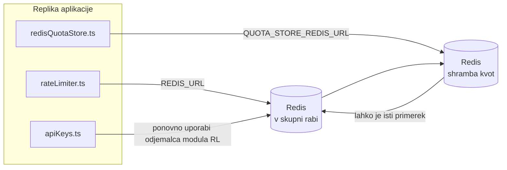

# Redis Production Configuration Guide (Slovenščina)

🌐 **Languages:** 🇺🇸 [English](../../../../ops/REDIS_PRODUCTION_CONFIG.md) · 🇪🇹 [am](../../../am/docs/ops/REDIS_PRODUCTION_CONFIG.md) · 🇸🇦 [ar](../../../ar/docs/ops/REDIS_PRODUCTION_CONFIG.md) · 🇦🇿 [az](../../../az/docs/ops/REDIS_PRODUCTION_CONFIG.md) · 🇧🇬 [bg](../../../bg/docs/ops/REDIS_PRODUCTION_CONFIG.md) · 🇧🇩 [bn](../../../bn/docs/ops/REDIS_PRODUCTION_CONFIG.md) · 🇧🇦 [bs](../../../bs/docs/ops/REDIS_PRODUCTION_CONFIG.md) · 🇨🇿 [cs](../../../cs/docs/ops/REDIS_PRODUCTION_CONFIG.md) · 🇩🇰 [da](../../../da/docs/ops/REDIS_PRODUCTION_CONFIG.md) · 🇩🇪 [de](../../../de/docs/ops/REDIS_PRODUCTION_CONFIG.md) · 🇬🇷 [el](../../../el/docs/ops/REDIS_PRODUCTION_CONFIG.md) · 🇪🇸 [es](../../../es/docs/ops/REDIS_PRODUCTION_CONFIG.md) · 🇪🇪 [et](../../../et/docs/ops/REDIS_PRODUCTION_CONFIG.md) · 🇮🇷 [fa](../../../fa/docs/ops/REDIS_PRODUCTION_CONFIG.md) · 🇫🇮 [fi](../../../fi/docs/ops/REDIS_PRODUCTION_CONFIG.md) · 🇫🇷 [fr](../../../fr/docs/ops/REDIS_PRODUCTION_CONFIG.md) · 🇮🇪 [ga](../../../ga/docs/ops/REDIS_PRODUCTION_CONFIG.md) · 🇮🇳 [gu](../../../gu/docs/ops/REDIS_PRODUCTION_CONFIG.md) · 🇳🇬 [ha](../../../ha/docs/ops/REDIS_PRODUCTION_CONFIG.md) · 🇮🇱 [he](../../../he/docs/ops/REDIS_PRODUCTION_CONFIG.md) · 🇮🇳 [hi](../../../hi/docs/ops/REDIS_PRODUCTION_CONFIG.md) · 🇭🇷 [hr](../../../hr/docs/ops/REDIS_PRODUCTION_CONFIG.md) · 🇭🇺 [hu](../../../hu/docs/ops/REDIS_PRODUCTION_CONFIG.md) · 🇦🇲 [hy](../../../hy/docs/ops/REDIS_PRODUCTION_CONFIG.md) · 🇮🇩 [id](../../../id/docs/ops/REDIS_PRODUCTION_CONFIG.md) · 🇳🇬 [ig](../../../ig/docs/ops/REDIS_PRODUCTION_CONFIG.md) · 🇮🇹 [it](../../../it/docs/ops/REDIS_PRODUCTION_CONFIG.md) · 🇯🇵 [ja](../../../ja/docs/ops/REDIS_PRODUCTION_CONFIG.md) · 🇬🇪 [ka](../../../ka/docs/ops/REDIS_PRODUCTION_CONFIG.md) · 🇰🇭 [km](../../../km/docs/ops/REDIS_PRODUCTION_CONFIG.md) · 🇮🇳 [kn](../../../kn/docs/ops/REDIS_PRODUCTION_CONFIG.md) · 🇰🇷 [ko](../../../ko/docs/ops/REDIS_PRODUCTION_CONFIG.md) · 🇱🇹 [lt](../../../lt/docs/ops/REDIS_PRODUCTION_CONFIG.md) · 🇱🇻 [lv](../../../lv/docs/ops/REDIS_PRODUCTION_CONFIG.md) · 🇮🇳 [ml](../../../ml/docs/ops/REDIS_PRODUCTION_CONFIG.md) · 🇮🇳 [mr](../../../mr/docs/ops/REDIS_PRODUCTION_CONFIG.md) · 🇲🇾 [ms](../../../ms/docs/ops/REDIS_PRODUCTION_CONFIG.md) · 🇲🇹 [mt](../../../mt/docs/ops/REDIS_PRODUCTION_CONFIG.md) · 🇲🇲 [my](../../../my/docs/ops/REDIS_PRODUCTION_CONFIG.md) · 🇳🇵 [ne](../../../ne/docs/ops/REDIS_PRODUCTION_CONFIG.md) · 🇳🇱 [nl](../../../nl/docs/ops/REDIS_PRODUCTION_CONFIG.md) · 🇳🇴 [no](../../../no/docs/ops/REDIS_PRODUCTION_CONFIG.md) · 🇮🇳 [or](../../../or/docs/ops/REDIS_PRODUCTION_CONFIG.md) · 🇮🇳 [pa](../../../pa/docs/ops/REDIS_PRODUCTION_CONFIG.md) · 🇵🇭 [phi](../../../phi/docs/ops/REDIS_PRODUCTION_CONFIG.md) · 🇵🇱 [pl](../../../pl/docs/ops/REDIS_PRODUCTION_CONFIG.md) · 🇵🇹 [pt](../../../pt/docs/ops/REDIS_PRODUCTION_CONFIG.md) · 🇧🇷 [pt-BR](../../../pt-BR/docs/ops/REDIS_PRODUCTION_CONFIG.md) · 🇷🇴 [ro](../../../ro/docs/ops/REDIS_PRODUCTION_CONFIG.md) · 🇷🇺 [ru](../../../ru/docs/ops/REDIS_PRODUCTION_CONFIG.md) · 🇱🇰 [si](../../../si/docs/ops/REDIS_PRODUCTION_CONFIG.md) · 🇸🇰 [sk](../../../sk/docs/ops/REDIS_PRODUCTION_CONFIG.md) · 🇷🇸 [sr](../../../sr/docs/ops/REDIS_PRODUCTION_CONFIG.md) · 🇸🇪 [sv](../../../sv/docs/ops/REDIS_PRODUCTION_CONFIG.md) · 🇰🇪 [sw](../../../sw/docs/ops/REDIS_PRODUCTION_CONFIG.md) · 🇮🇳 [ta](../../../ta/docs/ops/REDIS_PRODUCTION_CONFIG.md) · 🇮🇳 [te](../../../te/docs/ops/REDIS_PRODUCTION_CONFIG.md) · 🇹🇭 [th](../../../th/docs/ops/REDIS_PRODUCTION_CONFIG.md) · 🇹🇷 [tr](../../../tr/docs/ops/REDIS_PRODUCTION_CONFIG.md) · 🇺🇦 [uk-UA](../../../uk-UA/docs/ops/REDIS_PRODUCTION_CONFIG.md) · 🇵🇰 [ur](../../../ur/docs/ops/REDIS_PRODUCTION_CONFIG.md) · 🇺🇿 [uz](../../../uz/docs/ops/REDIS_PRODUCTION_CONFIG.md) · 🇻🇳 [vi](../../../vi/docs/ops/REDIS_PRODUCTION_CONFIG.md) · 🇳🇬 [yo](../../../yo/docs/ops/REDIS_PRODUCTION_CONFIG.md) · 🇨🇳 [zh-CN](../../../zh-CN/docs/ops/REDIS_PRODUCTION_CONFIG.md) · 🇹🇼 [zh-TW](../../../zh-TW/docs/ops/REDIS_PRODUCTION_CONFIG.md)

---

## Pregled

Redis je v OmniRoute **neobvezna, šibka odvisnost** — ko Redis ni na voljo, aplikacija še naprej deluje z zmanjšano zmogljivostjo (z nadomestnimi rešitvami v pomnilniku). V produkciji prilagoditev nastavitev Redis zmanjša zakasnitev pri štirih ločenih delovnih obremenitvah:

| Delovna obremenitev            | Gonilnik                      | Tovarna odjemalcev                                       | Vzorec ključev                                              |
| ------------------------------ | ----------------------------- | -------------------------------------------------------- | ----------------------------------------------------------- |
| Omejevanje hitrosti            | `rateLimiter.ts`              | `getRedisClient()` — leno inicializiran edinec `ioredis` | `<prefix>rl:*` Lua-atomska časovna okna omejevanja hitrosti |
| Predpomnilnik za avtentikacijo | `apiKeys.ts`                  | Ponovno uporabi odjemalca modula `rateLimiter`           | `<prefix>auth:api_key:<sha256>` s TTL                       |
| Shramba kvot                   | `redisQuotaStore.ts`          | Ločen edinec `getRedisClient(url)`                       | `<prefix>quota:*`, nastavljivo za posamezen primerek        |
| Odklopnik za ogrevanje         | `redisCircuitBreakerStore.ts` | Ločen odjemalec v `circuitBreakerFactory.ts`             | `<prefix>warmup:cb:<connectionId>`                          |

Vse štiri delovne obremenitve uporabljajo skupno predpono imenskega prostora, zato lahko OmniRoute sobiva z drugimi aplikacijami v enem primerku Redis (npr. `127.0.0.1:6379`). Glejte [Imenski prostori ključev](#imenski-prostori-ključev).

---

## Trenutna konfiguracija (privzete vrednosti v kodi)

| Nastavitev                                     | Vrednost                                                                   | Kje                                                                                   |
| ---------------------------------------------- | -------------------------------------------------------------------------- | ------------------------------------------------------------------------------------- |
| Okoljska spremenljivka `REDIS_URL`             | `redis://redis:6379` (compose), neobvezno                                  | `rateLimiter.ts:5`, `.env.example`                                                    |
| Okoljska spremenljivka `REDIS_KEY_PREFIX`      | `omniroute:` (privzeto)                                                    | `rateLimiter.ts`, `redisQuotaStore.ts`, `redisCircuitBreakerStore.ts`, `.env.example` |
| Okoljska spremenljivka `QUOTA_STORE_REDIS_URL` | ločena, lahko se razlikuje od `REDIS_URL`                                  | `quota/storeFactory.ts`                                                               |
| `QUOTA_STORE_DRIVER`                           | `"sqlite"` (privzeto), `"redis"` neobvezno                                 | `quota/storeFactory.ts`                                                               |
| `maxRetriesPerRequest` za ioredis              | `3`                                                                        | ustvarjanje odjemalca v `rateLimiter.ts`                                              |
| `enableReadyCheck`                             | ni nastavljeno (privzeta vrednost ioredis: `true`)                         | —                                                                                     |
| `lazyConnect`                                  | ni nastavljeno (privzeta vrednost ioredis: `false`)                        | —                                                                                     |
| `retryStrategy`                                | ni nastavljeno (privzeto za ioredis: osnova 200 ms, eksponentno)           | —                                                                                     |
| TLS / geslo / indeks podatkovne zbirke         | **ni konfigurirano**                                                       | —                                                                                     |
| Sentinel / Cluster                             | **ni konfigurirano** — podprt je samo samostojen primerek z enim vozliščem | —                                                                                     |

---

## Imenski prostori ključev

OmniRoute si primerek Redis deli z vsem drugim, kar se izvaja na gostitelju. Brez imenskega prostora bi lahko ključi, kot sta `auth:api_key:<sha256>` ali `rl:*`, prišli v navzkrižje s ključi drugih aplikacij, ki uporabljajo isti Redis (ta primerek izvaja Redis na `127.0.0.1:6379` skupaj z drugimi storitvami).

Nastavite `REDIS_KEY_PREFIX` na neprazen niz, da dodate predpono **vsakemu** ključu OmniRoute:

```bash
# .env — vsi ključi OmniRoute postanejo omniroute:rl:*, omniroute:auth:*, omniroute:quota:*, omniroute:warmup:cb:*
REDIS_KEY_PREFIX=omniroute:
```

- **Privzeto:** `omniroute:` (uporabi se, ko `REDIS_KEY_PREFIX` ni nastavljen ali je prazen).
- **Uporablja se za:** omejevalnik hitrosti + predpomnilnik za avtentikacijo (skupni odjemalec `ioredis` prek `keyPrefix`), shrambo kvot (`KEY_PREFIX = "${REDIS_KEY_PREFIX}quota"`) in odklopnik za ogrevanje (`KEY_PREFIX = "${REDIS_KEY_PREFIX}warmup:cb:"`).
- **Sprememba predpone**, ko ključi že obstajajo v Redis, osiroti stare ključe (potečejo prek TTL / LRU). Predpono je varno spremeniti; migracija ni potrebna. Edina izjema je ključ odklopnika za ogrevanje za povezavo, označeno kot prepovedano: ta se shrani brez TTL, zato preostale ključe izpišite z `redis-cli --scan --pattern '<old-prefix>warmup:cb:*'` in jih izbrišite.
- **`keyPrefix` v ioredis** samodejno doda predpono pri zapisovanju **in** jo odstrani pri branju, zato aplikacijska koda predpone nikoli ne vidi.

---

## Priporočena nastavitev proizvodnje

### 1. Področje povezav/Možnosti odjemalca (konstruktor ioredis `Redis` )

Trenutna koda ustvari en sam `new Redis(url)` brez možnosti po meri. Za produkcijske uvedbe z več replikami posredujte tovarno odjemalca v kodi ali zavijte `getRedisClient()`:

```typescript
const redis = new Redis(REDIS_URL, {
  maxRetriesPerRequest: null, // no retry limit; let retryStrategy decide
  enableReadyCheck: true, // verify server is ready before accepting calls
  lazyConnect: true, // don't connect on construction; wait for first call
  retryStrategy: (times) => {
    if (times > 10) return null; // give up after 10 retries → reconnect later
    return Math.min(times * 200, 5000); // 200ms, 400ms, …, 5s cap
  },
  enableAutoPipelining: true, // coalesce concurrent commands into one TCP write
  keepAlive: 10000, // TCP keep‑alive every 10s
});
```

**Ključni kompromisi:**

- `maxRetriesPerRequest: null` + `retryStrategy` — je prednostna za proizvodnjo, tako da prehodni ponovni zagoni Redis ne spodletijo takoj pri vsaki zahtevi. Nadomestna funkcija v pomnilniku v `checkRateLimit()` absorbira pot napake.
- `lazyConnect: true` — se izogne zagonski odvisnosti od delovanja Redis, preden začne strežnik sprejemati povezave.
- `enableAutoPipelining: true` — zmanjša povratna potovanja za sočasna preverjanja omejitev hitrosti; ugodno pri > 50 RPS na eni povezavi.

### 2. Konfiguracija strežnika Redis (`redis.conf`)

```
# Memory
maxmemory 80%                        # leave room for OS page cache
maxmemory-policy allkeys-lru         # evict stale auth cache entries under pressure

# Persistence (optional — OmniRoute is crash‑safe without it)
save 300 1                           # snapshot at least every 5 min if ≥1 key changed
appendonly no                        # AOF not needed; data is regeneratable
appendfsync no                       # no fsync overhead (RDB is sufficient)

# Networking
timeout 0                            # no idle disconnect
tcp-keepalive 300                    # 5 min keep‑alive
tcp-backlog 511                      # connection backlog for bursty load

# Performance
hz 10                                # default; 100 for latency‑sensitive
activedefrag yes                     # auto‑defragment when fragmentation >10%
```

**Kompromis za `maxmemory-policy allkeys-lru`:** Vnosi v predpomnilnik za preverjanje identitete so lahko izločeni zaradi pritiska pomnilnika. To je varno — `setCachedApiKey` se ob zgrešitvi vedno znova zapolni in nadomestni SQLite je verodostojen. Skript Lua za omejevanje hitrosti ustvari majhne ključe, ki so po zasnovi kratkotrajni.

### 3. Docker Compose Settings

Prod compose (`docker-compose.prod.yml`) uporablja `redis:8.6.2-alpine`. Dodaj:

```yaml
redis:
  image: redis:8.6.2-alpine
  command:
    [
      "redis-server",
      "--maxmemory",
      "512mb",
      "--maxmemory-policy",
      "allkeys-lru",
      "--activedefrag",
      "yes",
      "--save",
      "300 1",
    ]
  healthcheck:
    test: ["CMD", "redis-cli", "ping"]
    interval: 10s
    timeout: 3s
    retries: 3
    start_period: 5s
```

### 4. Premisleki glede več primerkov/skaliranja

**En sam Redis za vse replike** — skript Lua za omejevanje hitrosti je odvisen od enega avtoritativnega prostora ključev. Več primerkov Redis za replikami bi izgubilo atomičnost in podvojilo proračun. Uporabite en sam Redis (ali gručo Redis Sentinel s preklopom) za vse kopije aplikacij.

**Število povezav:** Vsaka replika aplikacije se odpre** 2 TCP priključka** v Redis (omejevalnik hitrosti odjemalec + kvota shranjevanje odjemalec). Pri 10 replikah → 20 povezav, kar je znotraj zgornje meje 10k povezav privzetega primerka Redis.

### 5. Spremljanje

Razkrij prek končne točke zdravstvenega pregleda:

```typescript
// src/app/api/monitoring/health/route.ts already calls rateLimiter functions
// Add Redis-specific checks:
//   1. PING latency via ioredis .ping()
//   2. Memory usage via INFO memory
//   3. Connection count via INFO clients
//   4. Hit rate for maxmemory-policy (evicted_keys / keyspace_hits)
```

Ključne meritve, ki si jih morate ogledati:

- **Izseljeni ključi/sek** — če je vztrajno različen od nič, povečajte `maxmemory`
- **Blokirane stranke** — ki ni nič, nakazuje počasne skripte Lua ali visoko konkurenco
- **Zavrnjene povezave** zadetek omejitve povezave — ; redko pri 20 povezavah

### 6. Strežniki, združljivi z Redisom

Vsak strežnik, uporabljen tukaj, mora izvajati skripte Lua: omejevalnik hitrosti je en `EVAL`. Na strežniku brez Lua `checkRateLimit()` beleži `[RATE_LIMITER] Redis eval failed, falling back to in-memory rate limiting` in šteje na proces, tako da vsaka replika sama uveljavi omejitev. Opt-in deljena trgovina afinitete seje (`OMNIROUTE_SESSION_AFFINITY_STORE=redis`) prav tako bere in posodablja zatiče z `EVAL`; brez Lua beleži `[SESSION_AFFINITY] Redis error; falling back to SQLite.` in vsaka replika hrani svoje zatiče. Druge delovne obremenitve uporabljajo navadne ukaze (`SET ... EX`, `GET`, `DEL`, `MGET`, `EXPIRE`, `INCRBYFLOAT`, zgoščene vrednosti in nabori), zaledje Redis semantičnega predpomnilnika pa ne pošilja ukazov `FT.*`.

Preizkušeno z OmniRoute 3.8.52: KiviDB 1.2.0 s sliko Lua (`kividb/kividb:v1.2.0-lua`). Omejevalnik hitrosti (vključno z drugim postopkom, ki si deli števce), predpomnilnik za preverjanje avtorizacije, shramba kvot, prekinjevalec tokokroga za ogrevanje, semantična shramba predpomnilnika in zahteva `/v1/chat/completions` prek upravljalnika klepeta so prestali 18 od 19 preverjanj, ki prehajajo na Redis 8.10.3. Tisti, ki se razlikuje: `INCRBYFLOAT` shrani `0.1 + 0.2` kot `0.30000000000000004`, kjer Redis shrani `0.3` ( [kividbio/kividb#387](https://github.com/kividbio/kividb/issues/387) ). Shramba kvot razčleni obe z `parseFloat`, vendar se številki razlikujeta v zadnjih števkah, tako da se lahko primerjava, ki pade točno na mejo kvote, izkaže drugače. Shramba afinitete seje ni bila del tega izvajanja. ( [nastavitev](https://github.com/kividbio/kividb/blob/master/docs/integrations/omniroute.md), [rezultati](https://github.com/kividbio/kividb/tree/master/benchmarks/omniroute-compat) )

---

## Arhitekturni diagram



---

## Reference

| Datoteka                           | Namen                                                                                        |
| ---------------------------------- | -------------------------------------------------------------------------------------------- |
| `src/shared/utils/rateLimiter.ts`  | Primarni odjemalec Redis, skript Lua za omejevanje hitrosti, nadomestna rešitev v pomnilniku |
| `src/lib/db/apiKeys.ts`            | Predpomnilnik za avtentikacijo — nadomestni prehod Redis→SQLite                              |
| `src/lib/quota/redisQuotaStore.ts` | Ločen odjemalec Redis za izbirno shrambo kvot                                                |
| `src/lib/quota/storeFactory.ts`    | Preklaplja med gonilnikoma za kvote `sqlite` in `redis`                                      |
| `docker-compose.prod.yml`          | Vsebnik Redis za produkcijo (slika `redis:8.6.2-alpine`)                                     |
| `.env.example`                     | Dokumentacija spremenljivk okolja za Redis                                                   |
| `src/app/api/local/redis/`         | Poti API za orkestracijo razvojnega vsebnika                                                 |
| `bin/cli/commands/redis.mjs`       | Ukazi CLI za orkestracijo razvojnega vsebnika                                                |
