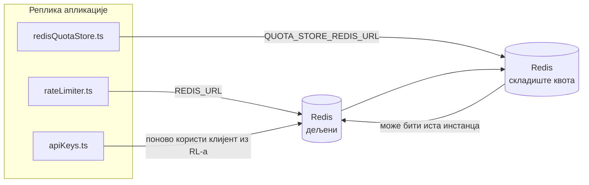

# Redis Production Configuration Guide (Српски)

🌐 **Languages:** 🇺🇸 [English](../../../../ops/REDIS_PRODUCTION_CONFIG.md) · 🇪🇹 [am](../../../am/docs/ops/REDIS_PRODUCTION_CONFIG.md) · 🇸🇦 [ar](../../../ar/docs/ops/REDIS_PRODUCTION_CONFIG.md) · 🇦🇿 [az](../../../az/docs/ops/REDIS_PRODUCTION_CONFIG.md) · 🇧🇬 [bg](../../../bg/docs/ops/REDIS_PRODUCTION_CONFIG.md) · 🇧🇩 [bn](../../../bn/docs/ops/REDIS_PRODUCTION_CONFIG.md) · 🇧🇦 [bs](../../../bs/docs/ops/REDIS_PRODUCTION_CONFIG.md) · 🇨🇿 [cs](../../../cs/docs/ops/REDIS_PRODUCTION_CONFIG.md) · 🇩🇰 [da](../../../da/docs/ops/REDIS_PRODUCTION_CONFIG.md) · 🇩🇪 [de](../../../de/docs/ops/REDIS_PRODUCTION_CONFIG.md) · 🇬🇷 [el](../../../el/docs/ops/REDIS_PRODUCTION_CONFIG.md) · 🇪🇸 [es](../../../es/docs/ops/REDIS_PRODUCTION_CONFIG.md) · 🇪🇪 [et](../../../et/docs/ops/REDIS_PRODUCTION_CONFIG.md) · 🇮🇷 [fa](../../../fa/docs/ops/REDIS_PRODUCTION_CONFIG.md) · 🇫🇮 [fi](../../../fi/docs/ops/REDIS_PRODUCTION_CONFIG.md) · 🇫🇷 [fr](../../../fr/docs/ops/REDIS_PRODUCTION_CONFIG.md) · 🇮🇪 [ga](../../../ga/docs/ops/REDIS_PRODUCTION_CONFIG.md) · 🇮🇳 [gu](../../../gu/docs/ops/REDIS_PRODUCTION_CONFIG.md) · 🇳🇬 [ha](../../../ha/docs/ops/REDIS_PRODUCTION_CONFIG.md) · 🇮🇱 [he](../../../he/docs/ops/REDIS_PRODUCTION_CONFIG.md) · 🇮🇳 [hi](../../../hi/docs/ops/REDIS_PRODUCTION_CONFIG.md) · 🇭🇷 [hr](../../../hr/docs/ops/REDIS_PRODUCTION_CONFIG.md) · 🇭🇺 [hu](../../../hu/docs/ops/REDIS_PRODUCTION_CONFIG.md) · 🇦🇲 [hy](../../../hy/docs/ops/REDIS_PRODUCTION_CONFIG.md) · 🇮🇩 [id](../../../id/docs/ops/REDIS_PRODUCTION_CONFIG.md) · 🇳🇬 [ig](../../../ig/docs/ops/REDIS_PRODUCTION_CONFIG.md) · 🇮🇹 [it](../../../it/docs/ops/REDIS_PRODUCTION_CONFIG.md) · 🇯🇵 [ja](../../../ja/docs/ops/REDIS_PRODUCTION_CONFIG.md) · 🇬🇪 [ka](../../../ka/docs/ops/REDIS_PRODUCTION_CONFIG.md) · 🇰🇭 [km](../../../km/docs/ops/REDIS_PRODUCTION_CONFIG.md) · 🇮🇳 [kn](../../../kn/docs/ops/REDIS_PRODUCTION_CONFIG.md) · 🇰🇷 [ko](../../../ko/docs/ops/REDIS_PRODUCTION_CONFIG.md) · 🇱🇹 [lt](../../../lt/docs/ops/REDIS_PRODUCTION_CONFIG.md) · 🇱🇻 [lv](../../../lv/docs/ops/REDIS_PRODUCTION_CONFIG.md) · 🇮🇳 [ml](../../../ml/docs/ops/REDIS_PRODUCTION_CONFIG.md) · 🇮🇳 [mr](../../../mr/docs/ops/REDIS_PRODUCTION_CONFIG.md) · 🇲🇾 [ms](../../../ms/docs/ops/REDIS_PRODUCTION_CONFIG.md) · 🇲🇹 [mt](../../../mt/docs/ops/REDIS_PRODUCTION_CONFIG.md) · 🇲🇲 [my](../../../my/docs/ops/REDIS_PRODUCTION_CONFIG.md) · 🇳🇵 [ne](../../../ne/docs/ops/REDIS_PRODUCTION_CONFIG.md) · 🇳🇱 [nl](../../../nl/docs/ops/REDIS_PRODUCTION_CONFIG.md) · 🇳🇴 [no](../../../no/docs/ops/REDIS_PRODUCTION_CONFIG.md) · 🇮🇳 [or](../../../or/docs/ops/REDIS_PRODUCTION_CONFIG.md) · 🇮🇳 [pa](../../../pa/docs/ops/REDIS_PRODUCTION_CONFIG.md) · 🇵🇭 [phi](../../../phi/docs/ops/REDIS_PRODUCTION_CONFIG.md) · 🇵🇱 [pl](../../../pl/docs/ops/REDIS_PRODUCTION_CONFIG.md) · 🇵🇹 [pt](../../../pt/docs/ops/REDIS_PRODUCTION_CONFIG.md) · 🇧🇷 [pt-BR](../../../pt-BR/docs/ops/REDIS_PRODUCTION_CONFIG.md) · 🇷🇴 [ro](../../../ro/docs/ops/REDIS_PRODUCTION_CONFIG.md) · 🇷🇺 [ru](../../../ru/docs/ops/REDIS_PRODUCTION_CONFIG.md) · 🇱🇰 [si](../../../si/docs/ops/REDIS_PRODUCTION_CONFIG.md) · 🇸🇰 [sk](../../../sk/docs/ops/REDIS_PRODUCTION_CONFIG.md) · 🇸🇮 [sl](../../../sl/docs/ops/REDIS_PRODUCTION_CONFIG.md) · 🇸🇪 [sv](../../../sv/docs/ops/REDIS_PRODUCTION_CONFIG.md) · 🇰🇪 [sw](../../../sw/docs/ops/REDIS_PRODUCTION_CONFIG.md) · 🇮🇳 [ta](../../../ta/docs/ops/REDIS_PRODUCTION_CONFIG.md) · 🇮🇳 [te](../../../te/docs/ops/REDIS_PRODUCTION_CONFIG.md) · 🇹🇭 [th](../../../th/docs/ops/REDIS_PRODUCTION_CONFIG.md) · 🇹🇷 [tr](../../../tr/docs/ops/REDIS_PRODUCTION_CONFIG.md) · 🇺🇦 [uk-UA](../../../uk-UA/docs/ops/REDIS_PRODUCTION_CONFIG.md) · 🇵🇰 [ur](../../../ur/docs/ops/REDIS_PRODUCTION_CONFIG.md) · 🇺🇿 [uz](../../../uz/docs/ops/REDIS_PRODUCTION_CONFIG.md) · 🇻🇳 [vi](../../../vi/docs/ops/REDIS_PRODUCTION_CONFIG.md) · 🇳🇬 [yo](../../../yo/docs/ops/REDIS_PRODUCTION_CONFIG.md) · 🇨🇳 [zh-CN](../../../zh-CN/docs/ops/REDIS_PRODUCTION_CONFIG.md) · 🇹🇼 [zh-TW](../../../zh-TW/docs/ops/REDIS_PRODUCTION_CONFIG.md)

---

## Преглед

Redis је ан **опциона, мека зависност** у OmniRoute — апликација се грациозно деградира (замена у меморији) када Redis није доступан. У производњи, подешавање Redis смањује кашњење за четири различита радна оптерећења:

| Оптерећење посла      | Возач                         | Цлиент Фацтори                                | Кеи Паттерн                                            |
| --------------------- | ----------------------------- | --------------------------------------------- | ------------------------------------------------------ |
| Ограничавање брзине   | `rateLimiter.ts`              | `getRedisClient()` — лењи `ioredis` синглетон | `<prefix>rl:*` Луа‑атомски оквири за ограничење брзине |
| Аутх кеш              | `apiKeys.ts`                  | Поново користи `rateLimiter` ов клијент       | `<prefix>auth:api_key:<sha256>` са TTL                 |
| Продавница квота      | `redisQuotaStore.ts`          | Одвојите `getRedisClient(url)` синглетон      | `<prefix>quota:*` конфигурабилна по инстанци           |
| Прекидач за загревање | `redisCircuitBreakerStore.ts` | Одвојени клијент у `circuitBreakerFactory.ts` | `<prefix>warmup:cb:<connectionId>`                     |

Сва четири радна оптерећења деле један префикс простора имена тако да OmniRoute може коегзистирати са другим апликацијама на једној Redis инстанци (нпр. `127.0.0.1:6379`). Погледајте [Размак између кључева](#key-namespacing).

---

## Тренутна конфигурација (подразумеване вредности кода)

| Подешавање                      | Валуе                                                              | Где                                                                                   |
| ------------------------------- | ------------------------------------------------------------------ | ------------------------------------------------------------------------------------- |
| `REDIS_URL` енв вар             | `redis://redis:6379` (састављање), опционо                         | `rateLimiter.ts:5`, `.env.example`                                                    |
| `REDIS_KEY_PREFIX` енв вар      | `omniroute:` (подразумевано)                                       | `rateLimiter.ts`, `redisQuotaStore.ts`, `redisCircuitBreakerStore.ts`, `.env.example` |
| `QUOTA_STORE_REDIS_URL` енв вар | одвојено, може се разликовати од `REDIS_URL`                       | `quota/storeFactory.ts`                                                               |
| `QUOTA_STORE_DRIVER`            | `"sqlite"` (подразумевано), `"redis"` опционо                      | `quota/storeFactory.ts`                                                               |
| иоредис `maxRetriesPerRequest`  | `3`                                                                | Креирање `rateLimiter.ts` клијента                                                    |
| `enableReadyCheck`              | није подешено (иоредис подразумевано: `true`)                      | —                                                                                     |
| `lazyConnect`                   | није подешено (иоредис подразумевано: `false`)                     | —                                                                                     |
| `retryStrategy`                 | није подешено (иоредис подразумевано: 200мс база, експоненцијално) | —                                                                                     |
| TLS / лозинка / DB индекс       | **није конфигурисано**                                             | —                                                                                     |
| Сентинел / Цлустер              | **није конфигурисано** Само — самостални један чвор                | —                                                                                     |

---

## Именски простор кључева

OmniRoute дели Redis инстанцу са свим осталим што је покренуто на хосту. Без именског простора,
кључеви као што су `auth:api_key:<sha256>` или `rl:*` могли би да се сукобе са кључевима других апликација
које користе исти Redis (ова инстанца покреће Redis на `127.0.0.1:6379` заједно са другим сервисима).

Подесите `REDIS_KEY_PREFIX` на непразну ниску како бисте додали префикс **сваком** OmniRoute кључу:

```bash
# .env — сви OmniRoute кључеви постају omniroute:rl:*, omniroute:auth:*, omniroute:quota:*, omniroute:warmup:cb:*
REDIS_KEY_PREFIX=omniroute:
```

- **Подразумевано:** `omniroute:` (примењује се када `REDIS_KEY_PREFIX` није постављен или је празан).
- **Примењује се на:** ограничавач брзине + кеш аутентификације (заједнички `ioredis` клијент преко `keyPrefix`) и
  складиште квота (`KEY_PREFIX = "${REDIS_KEY_PREFIX}quota"`) и аутоматски прекидач за загревање
  (`KEY_PREFIX = "${REDIS_KEY_PREFIX}warmup:cb:"`).
- **Промена префикса** када кључеви већ постоје у Redis-у оставља старе кључеве без референци (истичу
  путем TTL-а / LRU-а). Промена је безбедна; миграција није потребна. Једини изузетак је кључ аутоматског
  прекидача за загревање за везу означену као забрањену: чува се без TTL-а, па
  излистајте преостале кључеве помоћу `redis-cli --scan --pattern '<old-prefix>warmup:cb:*'` и избришите их.
- **ioredis `keyPrefix`** аутоматски додаје префикс при упису **и** уклања га при читању,
  тако да код апликације никада не види префикс.

---

## Препоручено подешавање производње

### 1. Група веза / опције клијента (иоредис `Redis` конструктор)

Тренутни код креира један `new Redis(url)` без прилагођених опција. За примену у производњи са више реплика, проследите фабрику клијента у коду или омотајте `getRedisClient()`:

```typescript
const redis = new Redis(REDIS_URL, {
  maxRetriesPerRequest: null, // no retry limit; let retryStrategy decide
  enableReadyCheck: true, // verify server is ready before accepting calls
  lazyConnect: true, // don't connect on construction; wait for first call
  retryStrategy: (times) => {
    if (times > 10) return null; // give up after 10 retries → reconnect later
    return Math.min(times * 200, 5000); // 200ms, 400ms, …, 5s cap
  },
  enableAutoPipelining: true, // coalesce concurrent commands into one TCP write
  keepAlive: 10000, // TCP keep‑alive every 10s
});
```

**Кључни компромиси:**

- `maxRetriesPerRequest: null` + `retryStrategy` — преферирани за производњу тако да пролазна Redis рестартовања не пропадају одмах сваки захтев. Замена у меморији у `checkRateLimit()` -у апсорбује путању грешке.
- `lazyConnect: true` — избегава зависност од покретања Redis а пре него што сервер почне да прихвата везе.
- `enableAutoPipelining: true` — смањује повратна путовања за истовремене провере ограничења брзине; корисно на > 50 RPS на једној вези.

### 2. Конфигурација Redis сервера (`redis.conf`)

```
# Memory
maxmemory 80%                        # leave room for OS page cache
maxmemory-policy allkeys-lru         # evict stale auth cache entries under pressure

# Persistence (optional — OmniRoute is crash‑safe without it)
save 300 1                           # snapshot at least every 5 min if ≥1 key changed
appendonly no                        # AOF not needed; data is regeneratable
appendfsync no                       # no fsync overhead (RDB is sufficient)

# Networking
timeout 0                            # no idle disconnect
tcp-keepalive 300                    # 5 min keep‑alive
tcp-backlog 511                      # connection backlog for bursty load

# Performance
hz 10                                # default; 100 for latency‑sensitive
activedefrag yes                     # auto‑defragment when fragmentation >10%
```

**Компромис за `maxmemory-policy allkeys-lru`:** Аутх кеш уноси могу бити избачени под притиском меморије. Ово је безбедно. — `setCachedApiKey` се увек поново попуњава приликом промашаја, а резервни SQLite је меродаван. Луа скрипта за ограничавање брзине креира мале кључеве који су по дизајну краткотрајни.

### 3. Docker Цомпосе Сеттингс

Прод цомпосе (`docker-compose.prod.yml`) користи `redis:8.6.2-alpine`. додати:

```yaml
redis:
  image: redis:8.6.2-alpine
  command:
    [
      "redis-server",
      "--maxmemory",
      "512mb",
      "--maxmemory-policy",
      "allkeys-lru",
      "--activedefrag",
      "yes",
      "--save",
      "300 1",
    ]
  healthcheck:
    test: ["CMD", "redis-cli", "ping"]
    interval: 10s
    timeout: 3s
    retries: 3
    start_period: 5s
```

### 4. Разматрања више инстанци / скалирања

**Један Redis за све реплике** — Луа скрипта за ограничавање брзине зависи од једног ауторитативног кључног простора. Вишеструке Redis инстанце иза реплика би изгубиле атомичност и удвостручиле буџет. Користите један Redis (или Redis Сентинел кластер са преласком на грешку) за све реплике апликације.

**Број веза:** Отвара се свака реплика апликације **2 TCP везе** у Redis (клијент лимитера брзине + клијент складишта квота). На 10 реплика → 20 конекција, у границама од 10к конекције подразумеване Redis инстанце.

### 5. Мониторинг

Изложите преко крајње тачке здравствене провере:

```typescript
// src/app/api/monitoring/health/route.ts already calls rateLimiter functions
// Add Redis-specific checks:
//   1. PING latency via ioredis .ping()
//   2. Memory usage via INFO memory
//   3. Connection count via INFO clients
//   4. Hit rate for maxmemory-policy (evicted_keys / keyspace_hits)
```

Кључни показатељи за гледање:

- **Избачени кључеви / сек** — ако је упорно различит од нуле, повећајте `maxmemory`
- **Блокирани клијенти** — различит од нуле сугерише споре Луа скрипте или велику конкуренцију
- **Одбијене везе** — ограничење везе погодило; ретко на 20 веза

### 6. Редис-компатибилни сервери

Сваки сервер који се користи овде мора да покреће Луа скрипте: лимитатор брзине је један `EVAL`. На серверу без Луа-е, `checkRateLimit()` евидентира `[RATE_LIMITER] Redis eval failed, falling back to in-memory rate limiting` и броји по процесу, тако да свака реплика сама примењује ограничење. Опт-ин дељена продавница афинитета сесије (`OMNIROUTE_SESSION_AFFINITY_STORE=redis`) такође чита и ажурира пинове помоћу `EVAL`; без Луа-е он евидентира `[SESSION_AFFINITY] Redis error; falling back to SQLite.` и свака реплика задржава своје пинове. Остала радна оптерећења користе обичне команде (`SET ... EX`, `GET`, `DEL`, `MGET`, `EXPIRE`, `INCRBYFLOAT`, хешеве и скупове), а позадински део Redis семантичког кеша не шаље `FT.*` команде.

Тестирано са OmniRoute 3.8.52: KiviDB 1.2.0 са Луа сликом (`kividb/kividb:v1.2.0-lua`). Ограничивач брзине (укључујући други процес који дели бројаче), кеш аутх, складиште квоте, прекидач кола за загревање, складиште семантичке кеш меморије и `/v1/chat/completions` захтев преко руковаоца ћаскања прошли су 18 од 19 провера које пролазе на Redis 8.10.3. Онај који се разликује: `INCRBYFLOAT` чува `0.1 + 0.2` као `0.30000000000000004` где Redis чува `0.3` ( [kividbio/kividb#387](https://github.com/kividbio/kividb/issues/387) ). Складиште квота анализира оба помоћу `parseFloat`, али се два броја разликују у последњим цифрама, тако да поређење које пада тачно на границу квоте може испасти другачије. Продавница афинитета сесије није била део тог покретања. ( [подешавање](https://github.com/kividbio/kividb/blob/master/docs/integrations/omniroute.md), [резултати](https://github.com/kividbio/kividb/tree/master/benchmarks/omniroute-compat) )

---

## Дијаграм архитектуре



---

## Референце

| Филе                               | Сврха                                                                             |
| ---------------------------------- | --------------------------------------------------------------------------------- |
| `src/shared/utils/rateLimiter.ts`  | Примарни Redis клијент, Луа скрипта за ограничење брзине, резервни део у меморији |
| `src/lib/db/apiKeys.ts`            | Аутх кеш — Redis→SQLite резервни                                                  |
| `src/lib/quota/redisQuotaStore.ts` | Одвојени Redis клијент за опционо складиште квота                                 |
| `src/lib/quota/storeFactory.ts`    | Пребацује између `sqlite` и `redis` управљачких програма квоте                    |
| `docker-compose.prod.yml`          | Прод Redis контејнер (слика `redis:8.6.2-alpine`)                                 |
| `.env.example`                     | Redis енв варс документација                                                      |
| `src/app/api/local/redis/`         | API руте за оркестрацију дев контејнера                                           |
| `bin/cli/commands/redis.mjs`       | CLI команде за оркестрацију дев контејнера                                        |
