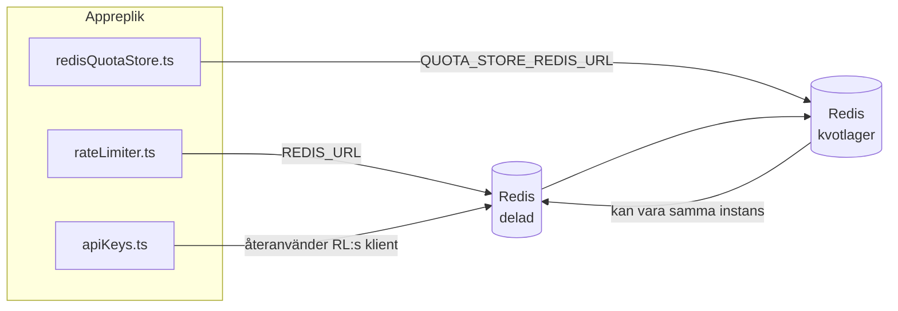

# Redis Production Configuration Guide (Svenska)

🌐 **Languages:** 🇺🇸 [English](../../../../ops/REDIS_PRODUCTION_CONFIG.md) · 🇪🇹 [am](../../../am/docs/ops/REDIS_PRODUCTION_CONFIG.md) · 🇸🇦 [ar](../../../ar/docs/ops/REDIS_PRODUCTION_CONFIG.md) · 🇦🇿 [az](../../../az/docs/ops/REDIS_PRODUCTION_CONFIG.md) · 🇧🇬 [bg](../../../bg/docs/ops/REDIS_PRODUCTION_CONFIG.md) · 🇧🇩 [bn](../../../bn/docs/ops/REDIS_PRODUCTION_CONFIG.md) · 🇧🇦 [bs](../../../bs/docs/ops/REDIS_PRODUCTION_CONFIG.md) · 🇨🇿 [cs](../../../cs/docs/ops/REDIS_PRODUCTION_CONFIG.md) · 🇩🇰 [da](../../../da/docs/ops/REDIS_PRODUCTION_CONFIG.md) · 🇩🇪 [de](../../../de/docs/ops/REDIS_PRODUCTION_CONFIG.md) · 🇬🇷 [el](../../../el/docs/ops/REDIS_PRODUCTION_CONFIG.md) · 🇪🇸 [es](../../../es/docs/ops/REDIS_PRODUCTION_CONFIG.md) · 🇪🇪 [et](../../../et/docs/ops/REDIS_PRODUCTION_CONFIG.md) · 🇮🇷 [fa](../../../fa/docs/ops/REDIS_PRODUCTION_CONFIG.md) · 🇫🇮 [fi](../../../fi/docs/ops/REDIS_PRODUCTION_CONFIG.md) · 🇫🇷 [fr](../../../fr/docs/ops/REDIS_PRODUCTION_CONFIG.md) · 🇮🇪 [ga](../../../ga/docs/ops/REDIS_PRODUCTION_CONFIG.md) · 🇮🇳 [gu](../../../gu/docs/ops/REDIS_PRODUCTION_CONFIG.md) · 🇳🇬 [ha](../../../ha/docs/ops/REDIS_PRODUCTION_CONFIG.md) · 🇮🇱 [he](../../../he/docs/ops/REDIS_PRODUCTION_CONFIG.md) · 🇮🇳 [hi](../../../hi/docs/ops/REDIS_PRODUCTION_CONFIG.md) · 🇭🇷 [hr](../../../hr/docs/ops/REDIS_PRODUCTION_CONFIG.md) · 🇭🇺 [hu](../../../hu/docs/ops/REDIS_PRODUCTION_CONFIG.md) · 🇦🇲 [hy](../../../hy/docs/ops/REDIS_PRODUCTION_CONFIG.md) · 🇮🇩 [id](../../../id/docs/ops/REDIS_PRODUCTION_CONFIG.md) · 🇳🇬 [ig](../../../ig/docs/ops/REDIS_PRODUCTION_CONFIG.md) · 🇮🇹 [it](../../../it/docs/ops/REDIS_PRODUCTION_CONFIG.md) · 🇯🇵 [ja](../../../ja/docs/ops/REDIS_PRODUCTION_CONFIG.md) · 🇬🇪 [ka](../../../ka/docs/ops/REDIS_PRODUCTION_CONFIG.md) · 🇰🇭 [km](../../../km/docs/ops/REDIS_PRODUCTION_CONFIG.md) · 🇮🇳 [kn](../../../kn/docs/ops/REDIS_PRODUCTION_CONFIG.md) · 🇰🇷 [ko](../../../ko/docs/ops/REDIS_PRODUCTION_CONFIG.md) · 🇱🇹 [lt](../../../lt/docs/ops/REDIS_PRODUCTION_CONFIG.md) · 🇱🇻 [lv](../../../lv/docs/ops/REDIS_PRODUCTION_CONFIG.md) · 🇮🇳 [ml](../../../ml/docs/ops/REDIS_PRODUCTION_CONFIG.md) · 🇮🇳 [mr](../../../mr/docs/ops/REDIS_PRODUCTION_CONFIG.md) · 🇲🇾 [ms](../../../ms/docs/ops/REDIS_PRODUCTION_CONFIG.md) · 🇲🇹 [mt](../../../mt/docs/ops/REDIS_PRODUCTION_CONFIG.md) · 🇲🇲 [my](../../../my/docs/ops/REDIS_PRODUCTION_CONFIG.md) · 🇳🇵 [ne](../../../ne/docs/ops/REDIS_PRODUCTION_CONFIG.md) · 🇳🇱 [nl](../../../nl/docs/ops/REDIS_PRODUCTION_CONFIG.md) · 🇳🇴 [no](../../../no/docs/ops/REDIS_PRODUCTION_CONFIG.md) · 🇮🇳 [or](../../../or/docs/ops/REDIS_PRODUCTION_CONFIG.md) · 🇮🇳 [pa](../../../pa/docs/ops/REDIS_PRODUCTION_CONFIG.md) · 🇵🇭 [phi](../../../phi/docs/ops/REDIS_PRODUCTION_CONFIG.md) · 🇵🇱 [pl](../../../pl/docs/ops/REDIS_PRODUCTION_CONFIG.md) · 🇵🇹 [pt](../../../pt/docs/ops/REDIS_PRODUCTION_CONFIG.md) · 🇧🇷 [pt-BR](../../../pt-BR/docs/ops/REDIS_PRODUCTION_CONFIG.md) · 🇷🇴 [ro](../../../ro/docs/ops/REDIS_PRODUCTION_CONFIG.md) · 🇷🇺 [ru](../../../ru/docs/ops/REDIS_PRODUCTION_CONFIG.md) · 🇱🇰 [si](../../../si/docs/ops/REDIS_PRODUCTION_CONFIG.md) · 🇸🇰 [sk](../../../sk/docs/ops/REDIS_PRODUCTION_CONFIG.md) · 🇸🇮 [sl](../../../sl/docs/ops/REDIS_PRODUCTION_CONFIG.md) · 🇷🇸 [sr](../../../sr/docs/ops/REDIS_PRODUCTION_CONFIG.md) · 🇰🇪 [sw](../../../sw/docs/ops/REDIS_PRODUCTION_CONFIG.md) · 🇮🇳 [ta](../../../ta/docs/ops/REDIS_PRODUCTION_CONFIG.md) · 🇮🇳 [te](../../../te/docs/ops/REDIS_PRODUCTION_CONFIG.md) · 🇹🇭 [th](../../../th/docs/ops/REDIS_PRODUCTION_CONFIG.md) · 🇹🇷 [tr](../../../tr/docs/ops/REDIS_PRODUCTION_CONFIG.md) · 🇺🇦 [uk-UA](../../../uk-UA/docs/ops/REDIS_PRODUCTION_CONFIG.md) · 🇵🇰 [ur](../../../ur/docs/ops/REDIS_PRODUCTION_CONFIG.md) · 🇺🇿 [uz](../../../uz/docs/ops/REDIS_PRODUCTION_CONFIG.md) · 🇻🇳 [vi](../../../vi/docs/ops/REDIS_PRODUCTION_CONFIG.md) · 🇳🇬 [yo](../../../yo/docs/ops/REDIS_PRODUCTION_CONFIG.md) · 🇨🇳 [zh-CN](../../../zh-CN/docs/ops/REDIS_PRODUCTION_CONFIG.md) · 🇹🇼 [zh-TW](../../../zh-TW/docs/ops/REDIS_PRODUCTION_CONFIG.md)

---

## Översikt

Redis är ett **valfritt, mjukt beroende** i OmniRoute — applikationen fortsätter fungera med reducerad funktionalitet (reservlösningar i minnet) när Redis inte är tillgängligt. I produktion minskar optimering av Redis latensen för fyra separata arbetsbelastningar:

| Arbetsbelastning             | Drivrutin                     | Klientfabrik                                     | Nyckelmönster                                                |
| ---------------------------- | ----------------------------- | ------------------------------------------------ | ------------------------------------------------------------ |
| Hastighetsbegränsning        | `rateLimiter.ts`              | `getRedisClient()` — lat singleton för `ioredis` | `<prefix>rl:*` Lua-atomära fönster för hastighetsbegränsning |
| Autentiseringscache          | `apiKeys.ts`                  | Återanvänder klienten från `rateLimiter`         | `<prefix>auth:api_key:<sha256>` med TTL                      |
| Kvotlagring                  | `redisQuotaStore.ts`          | Separat singleton för `getRedisClient(url)`      | `<prefix>quota:*` konfigurerbart per instans                 |
| Kretsbrytare för uppvärmning | `redisCircuitBreakerStore.ts` | Separat klient i `circuitBreakerFactory.ts`      | `<prefix>warmup:cb:<connectionId>`                           |

Alla fyra arbetsbelastningar delar ett namnområdesprefix så att OmniRoute kan samexistera med andra appar på en enda Redis-instans (t.ex. `127.0.0.1:6379`). Se [Namnområden för nycklar](#key-namespacing).

---

## Aktuell konfiguration (kodens standardvärden)

| Inställning                            | Värde                                                            | Var                                                                                   |
| -------------------------------------- | ---------------------------------------------------------------- | ------------------------------------------------------------------------------------- |
| Miljövariabeln `REDIS_URL`             | `redis://redis:6379` (compose), valfri                           | `rateLimiter.ts:5`, `.env.example`                                                    |
| Miljövariabeln `REDIS_KEY_PREFIX`      | `omniroute:` (standardvärde)                                     | `rateLimiter.ts`, `redisQuotaStore.ts`, `redisCircuitBreakerStore.ts`, `.env.example` |
| Miljövariabeln `QUOTA_STORE_REDIS_URL` | separat, kan skilja sig från `REDIS_URL`                         | `quota/storeFactory.ts`                                                               |
| `QUOTA_STORE_DRIVER`                   | `"sqlite"` (standardvärde), `"redis"` valfritt                   | `quota/storeFactory.ts`                                                               |
| ioredis `maxRetriesPerRequest`         | `3`                                                              | skapande av klient i `rateLimiter.ts`                                                 |
| `enableReadyCheck`                     | inte angivet (standardvärde i ioredis: `true`)                   | —                                                                                     |
| `lazyConnect`                          | inte angivet (standardvärde i ioredis: `false`)                  | —                                                                                     |
| `retryStrategy`                        | inte angivet (standardvärde i ioredis: 200 ms bas, exponentiell) | —                                                                                     |
| TLS/lösenord/databasindex              | **inte konfigurerat**                                            | —                                                                                     |
| Sentinel/Cluster                       | **inte konfigurerat** — endast fristående enskild nod            | —                                                                                     |

---

## Namnområden för nycklar

OmniRoute delar en Redis-instans med allt annat som körs på värden. Utan ett namnområde kan nycklar som `auth:api_key:<sha256>` eller `rl:*` kollidera med nycklar från andra applikationer som använder samma Redis (den här instansen kör Redis på `127.0.0.1:6379` tillsammans med andra tjänster).

Ange `REDIS_KEY_PREFIX` som en icke-tom sträng för att lägga till ett prefix till **varje** OmniRoute-nyckel:

```bash
# .env — alla OmniRoute-nycklar blir omniroute:rl:*, omniroute:auth:*, omniroute:quota:*, omniroute:warmup:cb:*
REDIS_KEY_PREFIX=omniroute:
```

- **Standardvärde:** `omniroute:` (används när `REDIS_KEY_PREFIX` inte har angetts eller är tomt).
- **Tillämpas på:** hastighetsbegränsaren + autentiseringscachen (delad `ioredis`-klient via `keyPrefix`), kvotlagringen (`KEY_PREFIX = "${REDIS_KEY_PREFIX}quota"`) och kretsbrytaren för uppvärmning (`KEY_PREFIX = "${REDIS_KEY_PREFIX}warmup:cb:"`).
- **Om prefixet ändras** när nycklar redan finns i Redis blir de gamla nycklarna övergivna (de upphör att gälla via TTL/LRU). Det är säkert att ändra prefixet och ingen migrering behövs. Det enda undantaget är en kretsbrytarnyckel för uppvärmning av en anslutning som markerats som förbjuden: den lagras utan TTL, så lista kvarvarande nycklar med `redis-cli --scan --pattern '<old-prefix>warmup:cb:*'` och ta bort dem.
- **ioredis `keyPrefix`** lägger automatiskt till prefixet vid skrivningar **och** tar bort det vid läsningar, så applikationskoden ser aldrig prefixet.

---

## Rekommenderad produktionsjustering

### 1. Anslutningspool/klientalternativ (ioredis `Redis` constructor)

Den aktuella koden skapar en enda `new Redis(url)` utan anpassade alternativ. För produktionsinstallationer med flera repliker, skicka en klientfabrik i koden eller wrap `getRedisClient()`:

```typescript
const redis = new Redis(REDIS_URL, {
  maxRetriesPerRequest: null, // no retry limit; let retryStrategy decide
  enableReadyCheck: true, // verify server is ready before accepting calls
  lazyConnect: true, // don't connect on construction; wait for first call
  retryStrategy: (times) => {
    if (times > 10) return null; // give up after 10 retries → reconnect later
    return Math.min(times * 200, 5000); // 200ms, 400ms, …, 5s cap
  },
  enableAutoPipelining: true, // coalesce concurrent commands into one TCP write
  keepAlive: 10000, // TCP keep‑alive every 10s
});
```

**Viktiga avvägningar:**

- `maxRetriesPerRequest: null` + `retryStrategy` — föredras för produktion så att transienta Redis -omstarter inte omedelbart misslyckas med varje begäran. Reserven i minnet i `checkRateLimit()` absorberar felsökvägen.
- `lazyConnect: true` — undviker ett uppstartsberoende av att Redis är uppe innan servern börjar acceptera anslutningar.
- `enableAutoPipelining: true` — minskar tur- och returresor för samtidiga räntegränskontroller; fördelaktigt vid > 50 RPS på en enda anslutning.

### 2. Redis serverkonfiguration (`redis.conf`)

```
# Memory
maxmemory 80%                        # leave room for OS page cache
maxmemory-policy allkeys-lru         # evict stale auth cache entries under pressure

# Persistence (optional — OmniRoute is crash‑safe without it)
save 300 1                           # snapshot at least every 5 min if ≥1 key changed
appendonly no                        # AOF not needed; data is regeneratable
appendfsync no                       # no fsync overhead (RDB is sufficient)

# Networking
timeout 0                            # no idle disconnect
tcp-keepalive 300                    # 5 min keep‑alive
tcp-backlog 511                      # connection backlog for bursty load

# Performance
hz 10                                # default; 100 for latency‑sensitive
activedefrag yes                     # auto‑defragment when fragmentation >10%
```

**Avvägning för `maxmemory-policy allkeys-lru`:** Auth-cacheposter kan vräkas under minnestryck. Detta är säkert — `setCachedApiKey` fylls alltid på igen vid miss, och SQLite reserv är auktoritativ. Hastighetsbegränsaren Lua-skriptet skapar små nycklar som är kortlivade genom design.

### 3. Docker Compose Settings

Prod compose (`docker-compose.prod.yml`) använder `redis:8.6.2-alpine`. Tillägga:

```yaml
redis:
  image: redis:8.6.2-alpine
  command:
    [
      "redis-server",
      "--maxmemory",
      "512mb",
      "--maxmemory-policy",
      "allkeys-lru",
      "--activedefrag",
      "yes",
      "--save",
      "300 1",
    ]
  healthcheck:
    test: ["CMD", "redis-cli", "ping"]
    interval: 10s
    timeout: 3s
    retries: 3
    start_period: 5s
```

### 4. Flerinstans-/skalningsöverväganden

**Single Redis för alla repliker** — hastighetsbegränsaren Lua-skriptet beror på ett enda auktoritativt nyckelutrymme. Flera Redis instanser bakom repliker skulle förlora atomicitet och fördubbla budgeten. Använd en enda Redis (eller Redis Sentinel-kluster med failover) för alla programrepliker.

**Antal anslutningar:** Varje programreplik öppnas** 2 TCP -anslutningar** till Redis (rate limiter client + quota store client). Vid 10 repliker → 20-anslutningar, väl inom en standard Redis instanss 10k anslutningstak.

### 5. Övervakning

Exponera via hälsokontrollslutpunkt:

```typescript
// src/app/api/monitoring/health/route.ts already calls rateLimiter functions
// Add Redis-specific checks:
//   1. PING latency via ioredis .ping()
//   2. Memory usage via INFO memory
//   3. Connection count via INFO clients
//   4. Hit rate for maxmemory-policy (evicted_keys / keyspace_hits)
```

Viktiga mätvärden att titta på:

- **Vräktade nycklar/sek** — om den ihållande inte är noll, öka `maxmemory`
- **Blockerade klienter** — icke-noll tyder på långsamma Lua-skript eller högt innehåll
- **Avvisade anslutningar** — anslutningsgräns träff; sällsynt vid 20 anslutningar

### 6. Redis-kompatibla servrar

Alla servrar som används här måste köra Lua-skript: hastighetsbegränsaren är en `EVAL`. På en server utan Lua loggar `checkRateLimit()` `[RATE_LIMITER] Redis eval failed, falling back to in-memory rate limiting` och räknar per process, så varje replik upprätthåller gränsen på egen hand. Opt-in shared session-affinity store (`OMNIROUTE_SESSION_AFFINITY_STORE=redis`) läser och uppdaterar också pins med `EVAL`; utan Lua loggar den `[SESSION_AFFINITY] Redis error; falling back to SQLite.` och varje replik behåller sina egna stift. De andra arbetsbelastningarna använder vanliga kommandon (`SET ... EX`, `GET`, `DEL`, `MGET`, `EXPIRE`, `INCRBYFLOAT`, hashes och sets), och den semantiska cachens Redis backend skickar inga `FT.*` kommandon.

Testad med OmniRoute 3.8.52: KiviDB 1.2.0 med dess Lua-bild (`kividb/kividb:v1.2.0-lua`). Hastighetsbegränsaren (inklusive en andra process som delar räknarna), auth-cache, kvotlager, uppvärmningsbrytare, semantisk cache-lagring och en `/v1/chat/completions` begäran via chathanteraren klarade 18 av de 19 kontrollerna som skickas vidare i Redis 8.10.3. Den som skiljer sig: `INCRBYFLOAT` lagrar `0.1 + 0.2` som `0.30000000000000004` där Redis lagrar `0.3` ( [kividbio/kividb#387](https://github.com/kividbio/kividb/issues/387) ). Kvotlagret parsar båda med `parseFloat`, men de två siffrorna skiljer sig åt i de sista siffrorna, så en jämförelse som faller exakt på en kvotgräns kan komma ut olika. Session-affinity-butiken var inte en del av den körningen. ( [inställning](https://github.com/kividbio/kividb/blob/master/docs/integrations/omniroute.md), [resultat](https://github.com/kividbio/kividb/tree/master/benchmarks/omniroute-compat) )

---

## Arkitekturdiagram



---

## Referenser

| Fil                                | Syfte                                                                             |
| ---------------------------------- | --------------------------------------------------------------------------------- |
| `src/shared/utils/rateLimiter.ts`  | Primär Redis-klient, Lua-skript för hastighetsbegränsning, reservlösning i minnet |
| `src/lib/db/apiKeys.ts`            | Autentiseringscache — reservlösning från Redis till SQLite                        |
| `src/lib/quota/redisQuotaStore.ts` | Separat Redis-klient för valfritt kvotlager                                       |
| `src/lib/quota/storeFactory.ts`    | Växlar mellan kvotdrivrutinerna `sqlite` och `redis`                              |
| `docker-compose.prod.yml`          | Redis-container för produktion (avbildning `redis:8.6.2-alpine`)                  |
| `.env.example`                     | Dokumentation för Redis-miljövariabler                                            |
| `src/app/api/local/redis/`         | API-rutter för orkestrering av utvecklingscontainrar                              |
| `bin/cli/commands/redis.mjs`       | CLI-kommandon för orkestrering av utvecklingscontainrar                           |
