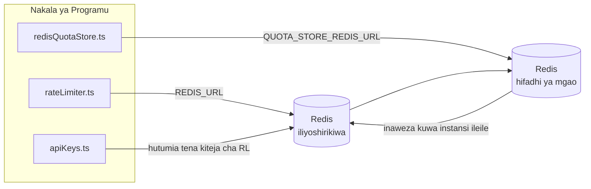

# Redis Production Configuration Guide (Kiswahili)

🌐 **Languages:** 🇺🇸 [English](../../../../ops/REDIS_PRODUCTION_CONFIG.md) · 🇪🇹 [am](../../../am/docs/ops/REDIS_PRODUCTION_CONFIG.md) · 🇸🇦 [ar](../../../ar/docs/ops/REDIS_PRODUCTION_CONFIG.md) · 🇦🇿 [az](../../../az/docs/ops/REDIS_PRODUCTION_CONFIG.md) · 🇧🇬 [bg](../../../bg/docs/ops/REDIS_PRODUCTION_CONFIG.md) · 🇧🇩 [bn](../../../bn/docs/ops/REDIS_PRODUCTION_CONFIG.md) · 🇧🇦 [bs](../../../bs/docs/ops/REDIS_PRODUCTION_CONFIG.md) · 🇨🇿 [cs](../../../cs/docs/ops/REDIS_PRODUCTION_CONFIG.md) · 🇩🇰 [da](../../../da/docs/ops/REDIS_PRODUCTION_CONFIG.md) · 🇩🇪 [de](../../../de/docs/ops/REDIS_PRODUCTION_CONFIG.md) · 🇬🇷 [el](../../../el/docs/ops/REDIS_PRODUCTION_CONFIG.md) · 🇪🇸 [es](../../../es/docs/ops/REDIS_PRODUCTION_CONFIG.md) · 🇪🇪 [et](../../../et/docs/ops/REDIS_PRODUCTION_CONFIG.md) · 🇮🇷 [fa](../../../fa/docs/ops/REDIS_PRODUCTION_CONFIG.md) · 🇫🇮 [fi](../../../fi/docs/ops/REDIS_PRODUCTION_CONFIG.md) · 🇫🇷 [fr](../../../fr/docs/ops/REDIS_PRODUCTION_CONFIG.md) · 🇮🇪 [ga](../../../ga/docs/ops/REDIS_PRODUCTION_CONFIG.md) · 🇮🇳 [gu](../../../gu/docs/ops/REDIS_PRODUCTION_CONFIG.md) · 🇳🇬 [ha](../../../ha/docs/ops/REDIS_PRODUCTION_CONFIG.md) · 🇮🇱 [he](../../../he/docs/ops/REDIS_PRODUCTION_CONFIG.md) · 🇮🇳 [hi](../../../hi/docs/ops/REDIS_PRODUCTION_CONFIG.md) · 🇭🇷 [hr](../../../hr/docs/ops/REDIS_PRODUCTION_CONFIG.md) · 🇭🇺 [hu](../../../hu/docs/ops/REDIS_PRODUCTION_CONFIG.md) · 🇦🇲 [hy](../../../hy/docs/ops/REDIS_PRODUCTION_CONFIG.md) · 🇮🇩 [id](../../../id/docs/ops/REDIS_PRODUCTION_CONFIG.md) · 🇳🇬 [ig](../../../ig/docs/ops/REDIS_PRODUCTION_CONFIG.md) · 🇮🇹 [it](../../../it/docs/ops/REDIS_PRODUCTION_CONFIG.md) · 🇯🇵 [ja](../../../ja/docs/ops/REDIS_PRODUCTION_CONFIG.md) · 🇬🇪 [ka](../../../ka/docs/ops/REDIS_PRODUCTION_CONFIG.md) · 🇰🇭 [km](../../../km/docs/ops/REDIS_PRODUCTION_CONFIG.md) · 🇮🇳 [kn](../../../kn/docs/ops/REDIS_PRODUCTION_CONFIG.md) · 🇰🇷 [ko](../../../ko/docs/ops/REDIS_PRODUCTION_CONFIG.md) · 🇱🇹 [lt](../../../lt/docs/ops/REDIS_PRODUCTION_CONFIG.md) · 🇱🇻 [lv](../../../lv/docs/ops/REDIS_PRODUCTION_CONFIG.md) · 🇮🇳 [ml](../../../ml/docs/ops/REDIS_PRODUCTION_CONFIG.md) · 🇮🇳 [mr](../../../mr/docs/ops/REDIS_PRODUCTION_CONFIG.md) · 🇲🇾 [ms](../../../ms/docs/ops/REDIS_PRODUCTION_CONFIG.md) · 🇲🇹 [mt](../../../mt/docs/ops/REDIS_PRODUCTION_CONFIG.md) · 🇲🇲 [my](../../../my/docs/ops/REDIS_PRODUCTION_CONFIG.md) · 🇳🇵 [ne](../../../ne/docs/ops/REDIS_PRODUCTION_CONFIG.md) · 🇳🇱 [nl](../../../nl/docs/ops/REDIS_PRODUCTION_CONFIG.md) · 🇳🇴 [no](../../../no/docs/ops/REDIS_PRODUCTION_CONFIG.md) · 🇮🇳 [or](../../../or/docs/ops/REDIS_PRODUCTION_CONFIG.md) · 🇮🇳 [pa](../../../pa/docs/ops/REDIS_PRODUCTION_CONFIG.md) · 🇵🇭 [phi](../../../phi/docs/ops/REDIS_PRODUCTION_CONFIG.md) · 🇵🇱 [pl](../../../pl/docs/ops/REDIS_PRODUCTION_CONFIG.md) · 🇵🇹 [pt](../../../pt/docs/ops/REDIS_PRODUCTION_CONFIG.md) · 🇧🇷 [pt-BR](../../../pt-BR/docs/ops/REDIS_PRODUCTION_CONFIG.md) · 🇷🇴 [ro](../../../ro/docs/ops/REDIS_PRODUCTION_CONFIG.md) · 🇷🇺 [ru](../../../ru/docs/ops/REDIS_PRODUCTION_CONFIG.md) · 🇱🇰 [si](../../../si/docs/ops/REDIS_PRODUCTION_CONFIG.md) · 🇸🇰 [sk](../../../sk/docs/ops/REDIS_PRODUCTION_CONFIG.md) · 🇸🇮 [sl](../../../sl/docs/ops/REDIS_PRODUCTION_CONFIG.md) · 🇷🇸 [sr](../../../sr/docs/ops/REDIS_PRODUCTION_CONFIG.md) · 🇸🇪 [sv](../../../sv/docs/ops/REDIS_PRODUCTION_CONFIG.md) · 🇮🇳 [ta](../../../ta/docs/ops/REDIS_PRODUCTION_CONFIG.md) · 🇮🇳 [te](../../../te/docs/ops/REDIS_PRODUCTION_CONFIG.md) · 🇹🇭 [th](../../../th/docs/ops/REDIS_PRODUCTION_CONFIG.md) · 🇹🇷 [tr](../../../tr/docs/ops/REDIS_PRODUCTION_CONFIG.md) · 🇺🇦 [uk-UA](../../../uk-UA/docs/ops/REDIS_PRODUCTION_CONFIG.md) · 🇵🇰 [ur](../../../ur/docs/ops/REDIS_PRODUCTION_CONFIG.md) · 🇺🇿 [uz](../../../uz/docs/ops/REDIS_PRODUCTION_CONFIG.md) · 🇻🇳 [vi](../../../vi/docs/ops/REDIS_PRODUCTION_CONFIG.md) · 🇳🇬 [yo](../../../yo/docs/ops/REDIS_PRODUCTION_CONFIG.md) · 🇨🇳 [zh-CN](../../../zh-CN/docs/ops/REDIS_PRODUCTION_CONFIG.md) · 🇹🇼 [zh-TW](../../../zh-TW/docs/ops/REDIS_PRODUCTION_CONFIG.md)

---

## Muhtasari

Redis ni **tegemezi la hiari, lisilo la lazima** katika OmniRoute — programu huendelea kufanya kazi kwa utaratibu mbadala (uhifadhi wa ndani ya kumbukumbu)
wakati Redis haipatikani. Katika mazingira ya uzalishaji, kusanidi Redis kwa ufanisi hupunguza muda wa kusubiri kwa aina nne tofauti za
mizigo ya kazi:

| Mzigo wa kazi                    | Kiendeshi                     | Kiwanda cha Kiteja                                                    | Muundo wa Ufunguo                                                   |
| -------------------------------- | ----------------------------- | --------------------------------------------------------------------- | ------------------------------------------------------------------- |
| Uzuiaji wa kiwango               | `rateLimiter.ts`              | `getRedisClient()` — singleton ya `ioredis` inayopakiwa inapohitajika | `<prefix>rl:*` madirisha ya kiwango yenye operesheni atomiki ya Lua |
| Akiba ya uthibitishaji           | `apiKeys.ts`                  | Hutumia tena kiteja cha `rateLimiter`                                 | `<prefix>auth:api_key:<sha256>` yenye TTL                           |
| Hifadhi ya mgao                  | `redisQuotaStore.ts`          | Singleton tofauti ya `getRedisClient(url)`                            | `<prefix>quota:*` inayoweza kusanidiwa kwa kila instansi            |
| Kivunja saketi cha upashaji joto | `redisCircuitBreakerStore.ts` | Kiteja tofauti katika `circuitBreakerFactory.ts`                      | `<prefix>warmup:cb:<connectionId>`                                  |

Mizigo yote minne ya kazi hutumia kiambishi awali kimoja cha nafasi ya majina ili OmniRoute iweze kutumika pamoja na programu nyingine kwenye
instansi moja ya Redis (k.m. `127.0.0.1:6379`). Tazama [Upangaji wa Nafasi za Majina za Funguo](#key-namespacing).

---

## Usanidi wa Sasa (Chaguomsingi za Msimbo)

| Mpangilio                                        | Thamani                                                                      | Mahali                                                                                |
| ------------------------------------------------ | ---------------------------------------------------------------------------- | ------------------------------------------------------------------------------------- |
| Kigezo cha mazingira cha `REDIS_URL`             | `redis://redis:6379` (compose), hiari                                        | `rateLimiter.ts:5`, `.env.example`                                                    |
| Kigezo cha mazingira cha `REDIS_KEY_PREFIX`      | `omniroute:` (chaguomsingi)                                                  | `rateLimiter.ts`, `redisQuotaStore.ts`, `redisCircuitBreakerStore.ts`, `.env.example` |
| Kigezo cha mazingira cha `QUOTA_STORE_REDIS_URL` | tofauti, kinaweza kutofautiana na `REDIS_URL`                                | `quota/storeFactory.ts`                                                               |
| `QUOTA_STORE_DRIVER`                             | `"sqlite"` (chaguomsingi), `"redis"` hiari                                   | `quota/storeFactory.ts`                                                               |
| `maxRetriesPerRequest` ya ioredis                | `3`                                                                          | uundaji wa kiteja katika `rateLimiter.ts`                                             |
| `enableReadyCheck`                               | haijawekwa (chaguomsingi la ioredis: `true`)                                 | —                                                                                     |
| `lazyConnect`                                    | haijawekwa (chaguomsingi la ioredis: `false`)                                | —                                                                                     |
| `retryStrategy`                                  | haijawekwa (chaguomsingi la ioredis: msingi wa 200ms, ongezeko la kielelezo) | —                                                                                     |
| TLS / nenosiri / faharasa ya DB                  | **havijasanidiwa**                                                           | —                                                                                     |
| Sentinel / Cluster                               | **havijasanidiwa** — nodi moja inayojitegemea pekee                          | —                                                                                     |

---

## Upangaji wa Nafasi za Majina za Funguo

OmniRoute hutumia instansi ya Redis kwa pamoja na huduma nyingine zozote zinazoendeshwa kwenye seva. Bila nafasi ya majina,
funguo kama `auth:api_key:<sha256>` au `rl:*` zinaweza kugongana na funguo za programu nyingine
zinazotumia Redis hiyo hiyo (instansi hii huendesha Redis kwenye `127.0.0.1:6379` pamoja na huduma nyingine).

Weka `REDIS_KEY_PREFIX` kuwa mfuatano usio tupu ili kuweka kiambishi awali kwa **kila** ufunguo wa OmniRoute:

```bash
# .env — funguo zote za OmniRoute zinakuwa omniroute:rl:*, omniroute:auth:*, omniroute:quota:*, omniroute:warmup:cb:*
REDIS_KEY_PREFIX=omniroute:
```

- **Chaguomsingi:** `omniroute:` (hutumika wakati `REDIS_KEY_PREFIX` haijawekwa au ni tupu).
- **Hutumika kwa:** kizuia kiwango + akiba ya uthibitishaji (kiteja cha pamoja cha `ioredis` kupitia `keyPrefix`) na
  hifadhi ya mgao (`KEY_PREFIX = "${REDIS_KEY_PREFIX}quota"`) pamoja na kivunja saketi cha upashaji joto
  (`KEY_PREFIX = "${REDIS_KEY_PREFIX}warmup:cb:"`).
- **Kubadilisha kiambishi awali** wakati funguo tayari zipo katika Redis huacha funguo za zamani bila kutumika (huisha
  kupitia TTL / LRU). Ni salama kubadilisha; hakuna uhamishaji unaohitajika. Isipokuwa moja ni ufunguo wa
  kivunja saketi cha upashaji joto kwa muunganisho uliowekwa alama kuwa umekatazwa: huhifadhiwa bila TTL, kwa hivyo
  orodhesha mabaki kwa kutumia `redis-cli --scan --pattern '<old-prefix>warmup:cb:*'` na uyafute.
- **`keyPrefix` ya ioredis** huongeza kiambishi awali kiotomatiki wakati wa kuandika **na** hukiondoa wakati wa kusoma,
  kwa hivyo msimbo wa programu hauoni kiambishi awali kamwe.

---

## Urekebishaji wa Uzalishaji Unaopendekezwa

### 1. Dimbwi la Kuunganisha/Chaguo za Mteja (kijenzi cha ioredis `Redis` )

Msimbo wa sasa huunda `new Redis(url)` moja bila chaguo maalum. Kwa uwekaji wa nakala nyingi za uzalishaji, pitisha kiwanda cha mteja kwenye msimbo au funga `getRedisClient()`:

```typescript
const redis = new Redis(REDIS_URL, {
  maxRetriesPerRequest: null, // no retry limit; let retryStrategy decide
  enableReadyCheck: true, // verify server is ready before accepting calls
  lazyConnect: true, // don't connect on construction; wait for first call
  retryStrategy: (times) => {
    if (times > 10) return null; // give up after 10 retries → reconnect later
    return Math.min(times * 200, 5000); // 200ms, 400ms, …, 5s cap
  },
  enableAutoPipelining: true, // coalesce concurrent commands into one TCP write
  keepAlive: 10000, // TCP keep‑alive every 10s
});
```

**Mabadilishano muhimu:**

- `maxRetriesPerRequest: null` + `retryStrategy` — inayopendelewa kwa uzalishaji kwa hivyo Redis ya muda inaanza tena isishindwe mara moja kila ombi. Njia mbadala ya kumbukumbu katika `checkRateLimit()` inachukua njia ya kutofaulu.
- `lazyConnect: true` — huepuka utegemezi wa kuanza kwa Redis kuwa juu kabla ya seva kuanza kukubali miunganisho.
- `enableAutoPipelining: true` — inapunguza safari za kwenda na kurudi kwa ukaguzi wa kikomo wa viwango; manufaa kwa > 50 RPS kwenye muunganisho mmoja.

### 2. Usanidi wa Seva ya Redis (`redis.conf`)

```
# Memory
maxmemory 80%                        # leave room for OS page cache
maxmemory-policy allkeys-lru         # evict stale auth cache entries under pressure

# Persistence (optional — OmniRoute is crash‑safe without it)
save 300 1                           # snapshot at least every 5 min if ≥1 key changed
appendonly no                        # AOF not needed; data is regeneratable
appendfsync no                       # no fsync overhead (RDB is sufficient)

# Networking
timeout 0                            # no idle disconnect
tcp-keepalive 300                    # 5 min keep‑alive
tcp-backlog 511                      # connection backlog for bursty load

# Performance
hz 10                                # default; 100 for latency‑sensitive
activedefrag yes                     # auto‑defragment when fragmentation >10%
```

**Kubadilishana kwa `maxmemory-policy allkeys-lru`:** Maingizo ya akiba ya Auth yanaweza kuondolewa chini ya shinikizo la kumbukumbu. Hii ni salama — `setCachedApiKey` kila mara hujaa tena unapokosa, na njia mbadala SQLite ni halali. Hati ya Lua yenye kikomo cha viwango huunda vitufe vidogo ambavyo vinaishi kwa muda mfupi kulingana na muundo.

### 3. Docker Tunga Mipangilio

Utungaji wa uzalishaji (`docker-compose.prod.yml`) hutumia `redis:8.6.2-alpine`. Ongeza:

```yaml
redis:
  image: redis:8.6.2-alpine
  command:
    [
      "redis-server",
      "--maxmemory",
      "512mb",
      "--maxmemory-policy",
      "allkeys-lru",
      "--activedefrag",
      "yes",
      "--save",
      "300 1",
    ]
  healthcheck:
    test: ["CMD", "redis-cli", "ping"]
    interval: 10s
    timeout: 3s
    retries: 3
    start_period: 5s
```

### 4. Mazingatio ya Matukio mengi / Kuongeza

**Redis moja kwa nakala zote** — hati ya Lua ya kikomo cha viwango inategemea nafasi moja ya ufunguo iliyoidhinishwa. Matukio mengi Redis nyuma ya nakala yanaweza kupoteza atomiki na bajeti mara mbili. Tumia Redis moja (au nguzo Redis Sentinel iliyo na failover) kwa nakala zote za programu.

**Idadi ya muunganisho:** Kila nakala ya programu inafungua** 2 TCP viunganisho** hadi Redis (kiteja cha kikomo cha kikomo cha mteja wa duka la + ). Katika miunganisho 10 → 20, ndani ya dari ya unganisho ya Redis ya 10k ya mfano.

### 5. Ufuatiliaji

Fichua kupitia sehemu ya mwisho ya ukaguzi wa afya:

```typescript
// src/app/api/monitoring/health/route.ts already calls rateLimiter functions
// Add Redis-specific checks:
//   1. PING latency via ioredis .ping()
//   2. Memory usage via INFO memory
//   3. Connection count via INFO clients
//   4. Hit rate for maxmemory-policy (evicted_keys / keyspace_hits)
```

Vipimo muhimu vya kutazama:

- **Vifunguo vilivyoondolewa / sekunde** — ikiwa si sifuri kila mara, ongeza `maxmemory`
- **Wateja waliozuiwa** — isiyo ya sifuri inapendekeza hati za Lua polepole au ubishi mkubwa
- **Miunganisho iliyokataliwa** kikomo cha uunganisho cha — ; nadra katika miunganisho 20

### 6. Seva zinazolingana na Redis

Seva yoyote inayotumika hapa lazima iendeshe hati za Lua: kikomo cha kiwango ni moja `EVAL`. Kwenye seva bila Lua, `checkRateLimit()` huweka `[RATE_LIMITER] Redis eval failed, falling back to in-memory rate limiting` na kuhesabu kwa kila mchakato, kwa hivyo kila nakala hutekelezea kikomo peke yake. Hifadhi ya mshikamano wa kipindi cha pamoja (`OMNIROUTE_SESSION_AFFINITY_STORE=redis`) pia husoma na kusasisha pini kwa `EVAL`; bila Lua huweka `[SESSION_AFFINITY] Redis error; falling back to SQLite.` na kila nakala huweka pini zake. Mizigo mingine ya kazi hutumia amri wazi (`SET ... EX`, `GET`, `DEL`, `MGET`, `EXPIRE`, `INCRBYFLOAT`, heshi na seti), na mazingira ya nyuma ya kache ya semantic ya Redis haitumi amri za `FT.*`.

Ilijaribiwa na OmniRoute 3.8.52: KiviDB 1.2.0 na picha yake ya Lua (`kividb/kividb:v1.2.0-lua`). Kidhibiti cha bei (pamoja na mchakato wa pili wa kushiriki vihesabio), akiba ya uthibitisho, hifadhi ya kiasi, kivunja mzunguko wa joto, hifadhi ya akiba ya semantic, na ombi la `/v1/chat/completions` kupitia kidhibiti cha gumzo lilipitisha hundi 18 kati ya 19 zinazopita Redis 8.10.3. Ile inayotofautiana: `INCRBYFLOAT` huhifadhi `0.1 + 0.2` kama `0.30000000000000004` ambapo Redis huhifadhi `0.3` ( [kividbio/kividb#387](https://github.com/kividbio/kividb/issues/387) ). Hifadhi ya kiasi huchanganua zote mbili na `parseFloat`, lakini nambari mbili hutofautiana katika tarakimu za mwisho, kwa hivyo ulinganisho unaoangukia kwenye mpaka wa mgawo unaweza kutoka kwa njia tofauti. Duka la ushirika wa kikao halikuwa sehemu ya uendeshaji huo. ( [kuweka](https://github.com/kividbio/kividb/blob/master/docs/integrations/omniroute.md), [matokeo](https://github.com/kividbio/kividb/tree/master/benchmarks/omniroute-compat) )

---

## Mchoro wa Usanifu



---

## Marejeleo

| Faili                              | Kusudi                                                                                    |
| ---------------------------------- | ----------------------------------------------------------------------------------------- |
| `src/shared/utils/rateLimiter.ts`  | Kiteja msingi cha Redis, hati ya Lua ya kudhibiti kiwango, mbadala wa kumbukumbu ya ndani |
| `src/lib/db/apiKeys.ts`            | Akiba ya uthibitishaji — mbadala wa Redis→SQLite                                          |
| `src/lib/quota/redisQuotaStore.ts` | Kiteja tofauti cha Redis kwa hifadhi ya hiari ya mgao                                     |
| `src/lib/quota/storeFactory.ts`    | Hubadilisha kati ya viendeshaji vya mgao vya `sqlite` na `redis`                          |
| `docker-compose.prod.yml`          | Kontena la Redis la mazingira ya uzalishaji (taswira `redis:8.6.2-alpine`)                |
| `.env.example`                     | Nyaraka za vigeu vya mazingira vya Redis                                                  |
| `src/app/api/local/redis/`         | Njia za API za uratibu wa kontena la usanidi                                              |
| `bin/cli/commands/redis.mjs`       | Amri za CLI za uratibu wa kontena la usanidi                                              |
