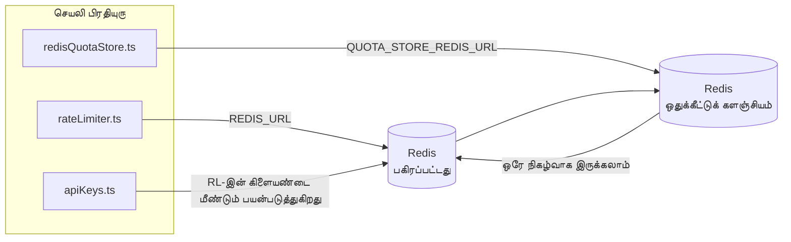

# Redis Production Configuration Guide (தமிழ்)

🌐 **Languages:** 🇺🇸 [English](../../../../ops/REDIS_PRODUCTION_CONFIG.md) · 🇪🇹 [am](../../../am/docs/ops/REDIS_PRODUCTION_CONFIG.md) · 🇸🇦 [ar](../../../ar/docs/ops/REDIS_PRODUCTION_CONFIG.md) · 🇦🇿 [az](../../../az/docs/ops/REDIS_PRODUCTION_CONFIG.md) · 🇧🇬 [bg](../../../bg/docs/ops/REDIS_PRODUCTION_CONFIG.md) · 🇧🇩 [bn](../../../bn/docs/ops/REDIS_PRODUCTION_CONFIG.md) · 🇧🇦 [bs](../../../bs/docs/ops/REDIS_PRODUCTION_CONFIG.md) · 🇨🇿 [cs](../../../cs/docs/ops/REDIS_PRODUCTION_CONFIG.md) · 🇩🇰 [da](../../../da/docs/ops/REDIS_PRODUCTION_CONFIG.md) · 🇩🇪 [de](../../../de/docs/ops/REDIS_PRODUCTION_CONFIG.md) · 🇬🇷 [el](../../../el/docs/ops/REDIS_PRODUCTION_CONFIG.md) · 🇪🇸 [es](../../../es/docs/ops/REDIS_PRODUCTION_CONFIG.md) · 🇪🇪 [et](../../../et/docs/ops/REDIS_PRODUCTION_CONFIG.md) · 🇮🇷 [fa](../../../fa/docs/ops/REDIS_PRODUCTION_CONFIG.md) · 🇫🇮 [fi](../../../fi/docs/ops/REDIS_PRODUCTION_CONFIG.md) · 🇫🇷 [fr](../../../fr/docs/ops/REDIS_PRODUCTION_CONFIG.md) · 🇮🇪 [ga](../../../ga/docs/ops/REDIS_PRODUCTION_CONFIG.md) · 🇮🇳 [gu](../../../gu/docs/ops/REDIS_PRODUCTION_CONFIG.md) · 🇳🇬 [ha](../../../ha/docs/ops/REDIS_PRODUCTION_CONFIG.md) · 🇮🇱 [he](../../../he/docs/ops/REDIS_PRODUCTION_CONFIG.md) · 🇮🇳 [hi](../../../hi/docs/ops/REDIS_PRODUCTION_CONFIG.md) · 🇭🇷 [hr](../../../hr/docs/ops/REDIS_PRODUCTION_CONFIG.md) · 🇭🇺 [hu](../../../hu/docs/ops/REDIS_PRODUCTION_CONFIG.md) · 🇦🇲 [hy](../../../hy/docs/ops/REDIS_PRODUCTION_CONFIG.md) · 🇮🇩 [id](../../../id/docs/ops/REDIS_PRODUCTION_CONFIG.md) · 🇳🇬 [ig](../../../ig/docs/ops/REDIS_PRODUCTION_CONFIG.md) · 🇮🇹 [it](../../../it/docs/ops/REDIS_PRODUCTION_CONFIG.md) · 🇯🇵 [ja](../../../ja/docs/ops/REDIS_PRODUCTION_CONFIG.md) · 🇬🇪 [ka](../../../ka/docs/ops/REDIS_PRODUCTION_CONFIG.md) · 🇰🇭 [km](../../../km/docs/ops/REDIS_PRODUCTION_CONFIG.md) · 🇮🇳 [kn](../../../kn/docs/ops/REDIS_PRODUCTION_CONFIG.md) · 🇰🇷 [ko](../../../ko/docs/ops/REDIS_PRODUCTION_CONFIG.md) · 🇱🇹 [lt](../../../lt/docs/ops/REDIS_PRODUCTION_CONFIG.md) · 🇱🇻 [lv](../../../lv/docs/ops/REDIS_PRODUCTION_CONFIG.md) · 🇮🇳 [ml](../../../ml/docs/ops/REDIS_PRODUCTION_CONFIG.md) · 🇮🇳 [mr](../../../mr/docs/ops/REDIS_PRODUCTION_CONFIG.md) · 🇲🇾 [ms](../../../ms/docs/ops/REDIS_PRODUCTION_CONFIG.md) · 🇲🇹 [mt](../../../mt/docs/ops/REDIS_PRODUCTION_CONFIG.md) · 🇲🇲 [my](../../../my/docs/ops/REDIS_PRODUCTION_CONFIG.md) · 🇳🇵 [ne](../../../ne/docs/ops/REDIS_PRODUCTION_CONFIG.md) · 🇳🇱 [nl](../../../nl/docs/ops/REDIS_PRODUCTION_CONFIG.md) · 🇳🇴 [no](../../../no/docs/ops/REDIS_PRODUCTION_CONFIG.md) · 🇮🇳 [or](../../../or/docs/ops/REDIS_PRODUCTION_CONFIG.md) · 🇮🇳 [pa](../../../pa/docs/ops/REDIS_PRODUCTION_CONFIG.md) · 🇵🇭 [phi](../../../phi/docs/ops/REDIS_PRODUCTION_CONFIG.md) · 🇵🇱 [pl](../../../pl/docs/ops/REDIS_PRODUCTION_CONFIG.md) · 🇵🇹 [pt](../../../pt/docs/ops/REDIS_PRODUCTION_CONFIG.md) · 🇧🇷 [pt-BR](../../../pt-BR/docs/ops/REDIS_PRODUCTION_CONFIG.md) · 🇷🇴 [ro](../../../ro/docs/ops/REDIS_PRODUCTION_CONFIG.md) · 🇷🇺 [ru](../../../ru/docs/ops/REDIS_PRODUCTION_CONFIG.md) · 🇱🇰 [si](../../../si/docs/ops/REDIS_PRODUCTION_CONFIG.md) · 🇸🇰 [sk](../../../sk/docs/ops/REDIS_PRODUCTION_CONFIG.md) · 🇸🇮 [sl](../../../sl/docs/ops/REDIS_PRODUCTION_CONFIG.md) · 🇷🇸 [sr](../../../sr/docs/ops/REDIS_PRODUCTION_CONFIG.md) · 🇸🇪 [sv](../../../sv/docs/ops/REDIS_PRODUCTION_CONFIG.md) · 🇰🇪 [sw](../../../sw/docs/ops/REDIS_PRODUCTION_CONFIG.md) · 🇮🇳 [te](../../../te/docs/ops/REDIS_PRODUCTION_CONFIG.md) · 🇹🇭 [th](../../../th/docs/ops/REDIS_PRODUCTION_CONFIG.md) · 🇹🇷 [tr](../../../tr/docs/ops/REDIS_PRODUCTION_CONFIG.md) · 🇺🇦 [uk-UA](../../../uk-UA/docs/ops/REDIS_PRODUCTION_CONFIG.md) · 🇵🇰 [ur](../../../ur/docs/ops/REDIS_PRODUCTION_CONFIG.md) · 🇺🇿 [uz](../../../uz/docs/ops/REDIS_PRODUCTION_CONFIG.md) · 🇻🇳 [vi](../../../vi/docs/ops/REDIS_PRODUCTION_CONFIG.md) · 🇳🇬 [yo](../../../yo/docs/ops/REDIS_PRODUCTION_CONFIG.md) · 🇨🇳 [zh-CN](../../../zh-CN/docs/ops/REDIS_PRODUCTION_CONFIG.md) · 🇹🇼 [zh-TW](../../../zh-TW/docs/ops/REDIS_PRODUCTION_CONFIG.md)

---

## மேலோட்டம்

Redis என்பது OmniRoute-இல் ஒரு **விருப்பத்திற்குரிய, மென்மையான சார்பு** ஆகும் — Redis கிடைக்காதபோது பயன்பாடு சீராகத் தரம் குறைந்து செயல்படும் (நினைவகத்திலுள்ள மாற்று ஏற்பாடுகளைப் பயன்படுத்தும்). உற்பத்திச் சூழலில், Redis-ஐச் சீரமைப்பது நான்கு தனித்துவமான பணிச்சுமைகளுக்கான தாமதத்தைக் குறைக்கிறது:

| பணிச்சுமை                      | இயக்கி                        | கிளையண்ட் உருவாக்கி                                              | விசை வடிவம்                                                |
| ------------------------------ | ----------------------------- | ---------------------------------------------------------------- | ---------------------------------------------------------- |
| வீத வரம்பிடல்                  | `rateLimiter.ts`              | `getRedisClient()` — தாமதமாகத் தொடங்கப்படும் `ioredis` singleton | `<prefix>rl:*` Lua‑அணுநிலை வீத வரம்புச் சாளரங்கள்          |
| அங்கீகாரத் தற்காலிகச் சேமிப்பு | `apiKeys.ts`                  | `rateLimiter`-இன் கிளையண்டை மீண்டும் பயன்படுத்துகிறது            | TTL உடன் `<prefix>auth:api_key:<sha256>`                   |
| ஒதுக்கீட்டுச் சேமிப்பகம்       | `redisQuotaStore.ts`          | தனியான `getRedisClient(url)` singleton                           | ஒவ்வொரு instance-க்கும் உள்ளமைக்கக்கூடிய `<prefix>quota:*` |
| தயார்நிலை circuit breaker      | `redisCircuitBreakerStore.ts` | `circuitBreakerFactory.ts`-இல் தனியான கிளையண்ட்                  | `<prefix>warmup:cb:<connectionId>`                         |

நான்கு பணிச்சுமைகளும் ஒரே namespace prefix-ஐப் பகிர்ந்துகொள்வதால், ஒரே Redis instance-இல் (எ.கா. `127.0.0.1:6379`) OmniRoute மற்ற பயன்பாடுகளுடன் இணைந்து இயங்க முடியும். [விசை namespace அமைப்பு](#key-namespacing) என்பதைப் பார்க்கவும்.

---

## தற்போதைய உள்ளமைவு (குறியீட்டு இயல்புநிலைகள்)

| அமைப்பு                            | மதிப்பு                                                                  | அமைவிடம்                                                                              |
| ---------------------------------- | ------------------------------------------------------------------------ | ------------------------------------------------------------------------------------- |
| `REDIS_URL` சூழல் மாறி             | `redis://redis:6379` (compose), விருப்பத்திற்குரியது                     | `rateLimiter.ts:5`, `.env.example`                                                    |
| `REDIS_KEY_PREFIX` சூழல் மாறி      | `omniroute:` (இயல்புநிலை)                                                | `rateLimiter.ts`, `redisQuotaStore.ts`, `redisCircuitBreakerStore.ts`, `.env.example` |
| `QUOTA_STORE_REDIS_URL` சூழல் மாறி | தனியானது, `REDIS_URL`-இலிருந்து வேறுபடலாம்                               | `quota/storeFactory.ts`                                                               |
| `QUOTA_STORE_DRIVER`               | `"sqlite"` (இயல்புநிலை), `"redis"` விருப்பத்திற்குரியது                  | `quota/storeFactory.ts`                                                               |
| ioredis `maxRetriesPerRequest`     | `3`                                                                      | `rateLimiter.ts` கிளையண்ட் உருவாக்கம்                                                 |
| `enableReadyCheck`                 | அமைக்கப்படவில்லை (ioredis இயல்புநிலை: `true`)                            | —                                                                                     |
| `lazyConnect`                      | அமைக்கப்படவில்லை (ioredis இயல்புநிலை: `false`)                           | —                                                                                     |
| `retryStrategy`                    | அமைக்கப்படவில்லை (ioredis இயல்புநிலை: 200ms அடிப்படை, அதிவேக அதிகரிப்பு) | —                                                                                     |
| TLS / கடவுச்சொல் / DB சுட்டெண்     | **உள்ளமைக்கப்படவில்லை**                                                  | —                                                                                     |
| Sentinel / Cluster                 | **உள்ளமைக்கப்படவில்லை** — தனித்த ஒற்றை-node மட்டும்                      | —                                                                                     |

---

## விசை namespace அமைப்பு

ஹோஸ்டில் இயங்கும் பிற சேவைகளுடன் OmniRoute ஒரு Redis instance-ஐப் பகிர்ந்துகொள்கிறது. namespace இல்லாமல், `auth:api_key:<sha256>` அல்லது `rl:*` போன்ற விசைகள் அதே Redis-ஐப் பயன்படுத்தும் பிற பயன்பாடுகளின் விசைகளுடன் மோதக்கூடும் (இந்த instance, பிற சேவைகளுடன் சேர்ந்து `127.0.0.1:6379`-இல் Redis-ஐ இயக்குகிறது).

OmniRoute-இன் **ஒவ்வொரு** விசைக்கும் prefix சேர்க்க, `REDIS_KEY_PREFIX`-ஐ வெறுமையற்ற string-ஆக அமைக்கவும்:

```bash
# .env — அனைத்து OmniRoute விசைகளும் omniroute:rl:*, omniroute:auth:*, omniroute:quota:*, omniroute:warmup:cb:* ஆகும்
REDIS_KEY_PREFIX=omniroute:
```

- **இயல்புநிலை:** `omniroute:` (`REDIS_KEY_PREFIX` அமைக்கப்படாதபோது அல்லது வெறுமையாக இருக்கும்போது பயன்படுத்தப்படும்).
- **பயன்படுத்தப்படுபவை:** வீத வரம்பி + அங்கீகாரத் தற்காலிகச் சேமிப்பு (`keyPrefix` வழியாகப் பகிரப்படும் `ioredis` கிளையண்ட்), ஒதுக்கீட்டுச் சேமிப்பகம் (`KEY_PREFIX = "${REDIS_KEY_PREFIX}quota"`) மற்றும் தயார்நிலை circuit breaker (`KEY_PREFIX = "${REDIS_KEY_PREFIX}warmup:cb:"`).
- Redis-இல் விசைகள் ஏற்கெனவே இருக்கும்போது **prefix-ஐ மாற்றுவது**, பழைய விசைகளைத் தொடர்பற்றவையாக விட்டுவிடும் (அவை TTL / LRU வழியாகக் காலாவதியாகும்). மாற்றுவது பாதுகாப்பானது; இடமாற்றம் தேவையில்லை. தடைசெய்யப்பட்டதாகக் குறிக்கப்பட்ட இணைப்புக்கான தயார்நிலை circuit-breaker விசை மட்டும் இதற்கு விதிவிலக்கு: அது TTL இல்லாமல் நிரந்தரமாகச் சேமிக்கப்படுகிறது; எனவே எஞ்சியவற்றை `redis-cli --scan --pattern '<old-prefix>warmup:cb:*'` மூலம் பட்டியலிட்டு அவற்றை நீக்கவும்.
- **ioredis `keyPrefix`**, எழுதும்போது prefix-ஐத் தானாக முன்சேர்ப்பதுடன், படிக்கும்போது அதை நீக்குவதால், பயன்பாட்டுக் குறியீடு prefix-ஐ ஒருபோதும் காணாது.

---

## பரிந்துரைக்கப்பட்ட தயாரிப்பு ட்யூனிங்

### 1. இணைப்புக் குளம் / கிளையண்ட் விருப்பங்கள் (ioredis `Redis` கன்ஸ்ட்ரக்டர்)

தற்போதைய குறியீடு தனிப்பயன் விருப்பங்கள் இல்லாமல் ஒற்றை `new Redis(url)` உருவாக்குகிறது. உற்பத்தி பல-பிரதி வரிசைப்படுத்தல்களுக்கு, ஒரு கிளையன்ட் தொழிற்சாலையை குறியீட்டில் அனுப்பவும் அல்லது `getRedisClient()` மடக்கு:

```typescript
const redis = new Redis(REDIS_URL, {
  maxRetriesPerRequest: null, // no retry limit; let retryStrategy decide
  enableReadyCheck: true, // verify server is ready before accepting calls
  lazyConnect: true, // don't connect on construction; wait for first call
  retryStrategy: (times) => {
    if (times > 10) return null; // give up after 10 retries → reconnect later
    return Math.min(times * 200, 5000); // 200ms, 400ms, …, 5s cap
  },
  enableAutoPipelining: true, // coalesce concurrent commands into one TCP write
  keepAlive: 10000, // TCP keep‑alive every 10s
});
```

**முக்கிய வர்த்தகம்:**

- `maxRetriesPerRequest: null` + `retryStrategy` — உற்பத்திக்கு விரும்பப்படுகிறது, எனவே நிலையற்ற Redis மறுதொடக்கங்கள் உடனடியாக ஒவ்வொரு கோரிக்கையையும் தோல்வியடையச் செய்யாது. `checkRateLimit()` இல் உள்ள நினைவக வீழ்ச்சி தோல்வி பாதையை உறிஞ்சுகிறது.
- `lazyConnect: true` —, சர்வர் இணைப்புகளை ஏற்கத் தொடங்கும் முன், Redis இல் தொடக்க சார்புநிலையைத் தவிர்க்கிறது.
- `enableAutoPipelining: true` — ஒரே நேரத்தில் விகித வரம்பு சரிபார்ப்புகளுக்கான சுற்று பயணங்களை குறைக்கிறது; ஒரு இணைப்பில் > 50 RPS இல் நன்மை பயக்கும்.

### 2. Redis சேவையக கட்டமைப்பு (`redis.conf`)

```
# Memory
maxmemory 80%                        # leave room for OS page cache
maxmemory-policy allkeys-lru         # evict stale auth cache entries under pressure

# Persistence (optional — OmniRoute is crash‑safe without it)
save 300 1                           # snapshot at least every 5 min if ≥1 key changed
appendonly no                        # AOF not needed; data is regeneratable
appendfsync no                       # no fsync overhead (RDB is sufficient)

# Networking
timeout 0                            # no idle disconnect
tcp-keepalive 300                    # 5 min keep‑alive
tcp-backlog 511                      # connection backlog for bursty load

# Performance
hz 10                                # default; 100 for latency‑sensitive
activedefrag yes                     # auto‑defragment when fragmentation >10%
```

**`maxmemory-policy allkeys-lru` க்கான வர்த்தகம்:** நினைவக அழுத்தத்தின் கீழ் அங்கீகார கேச் உள்ளீடுகள் வெளியேற்றப்படலாம். இது பாதுகாப்பான — `setCachedApiKey` எப்போதும் தவறவிடப்பட்டால் மீண்டும் நிரப்பப்படுகிறது, மேலும் SQLite ஃபால்பேக் அதிகாரப்பூர்வமானது. ரேட்-லிமிட்டர் லுவா ஸ்கிரிப்ட் சிறிய விசைகளை உருவாக்குகிறது.

### 3. Docker கம்போஸ் செட்டிங்ஸ்

ப்ராட் கம்போஸ் (`docker-compose.prod.yml`) `redis:8.6.2-alpine` ஐப் பயன்படுத்துகிறது. சேர்:

```yaml
redis:
  image: redis:8.6.2-alpine
  command:
    [
      "redis-server",
      "--maxmemory",
      "512mb",
      "--maxmemory-policy",
      "allkeys-lru",
      "--activedefrag",
      "yes",
      "--save",
      "300 1",
    ]
  healthcheck:
    test: ["CMD", "redis-cli", "ping"]
    interval: 10s
    timeout: 3s
    retries: 3
    start_period: 5s
```

### 4. பல நிகழ்வுகள் / அளவிடுதல் பரிசீலனைகள்

**அனைத்து பிரதிகளுக்கும் ஒற்றை Redis** — விகிதம்-வரம்பு லுவா ஸ்கிரிப்ட் ஒரு அதிகாரப்பூர்வ விசை இடத்தைப் பொறுத்தது. பிரதிகளுக்குப் பின்னால் உள்ள பல Redis நிகழ்வுகள் அணுசக்தியை இழந்து பட்ஜெட்டை இரட்டிப்பாக்கும். அனைத்து பயன்பாட்டு பிரதிகளுக்கும் ஒற்றை Redis (அல்லது தோல்வியுடன் கூடிய Redis சென்டினல் கிளஸ்டர்) பயன்படுத்தவும்.

**இணைப்பு எண்ணிக்கை:** ஒவ்வொரு பயன்பாட்டின் பிரதியும் திறக்கும்** 2 TCP இணைப்புகள்** Redis க்கு (விகித வரம்பு கிளையன்ட் + கோட்டா ஸ்டோர் கிளையன்ட்). 10 பிரதிகள் → 20 இணைப்புகளில், இயல்புநிலை Redis நிகழ்வின் 10k இணைப்பு உச்சவரம்புக்குள்.

### 5. கண்காணிப்பு

உடல்நலம் சரிபார்ப்பு இறுதிப் புள்ளி மூலம் வெளிப்படுத்துங்கள்:

```typescript
// src/app/api/monitoring/health/route.ts already calls rateLimiter functions
// Add Redis-specific checks:
//   1. PING latency via ioredis .ping()
//   2. Memory usage via INFO memory
//   3. Connection count via INFO clients
//   4. Hit rate for maxmemory-policy (evicted_keys / keyspace_hits)
```

பார்க்க வேண்டிய முக்கிய அளவீடுகள்:

- **வெளியேற்றப்பட்ட விசைகள் / நொடி** — தொடர்ந்து பூஜ்ஜியமாக இருந்தால், `maxmemory` அதிகரிக்கவும்
- **தடுக்கப்பட்ட வாடிக்கையாளர்கள்** — பூஜ்யம் அல்லாதது மெதுவான Lua ஸ்கிரிப்ட்கள் அல்லது அதிக சர்ச்சையை பரிந்துரைக்கிறது
- **நிராகரிக்கப்பட்ட இணைப்புகள்** — இணைப்பு வரம்பு வெற்றி; 20 இணைப்புகளில் அரிதானது

### 6. Redis-இணக்கமான சேவையகங்கள்

இங்கே பயன்படுத்தப்படும் எந்த சேவையகமும் லுவா ஸ்கிரிப்ட்களை இயக்க வேண்டும்: விகித வரம்பு ஒரு `EVAL` ஆகும். Lua இல்லாத சர்வரில், `checkRateLimit()` `[RATE_LIMITER] Redis eval failed, falling back to in-memory rate limiting` ஐ பதிவுசெய்து ஒரு செயல்முறைக்கு எண்ணுகிறது, எனவே ஒவ்வொரு பிரதியும் அதன் சொந்த வரம்பைச் செயல்படுத்துகிறது. ஆப்ட்-இன் ஷேர் செஷன்-அஃபினிட்டி ஸ்டோர் (`OMNIROUTE_SESSION_AFFINITY_STORE=redis`) `EVAL` உடன் பின்களைப் படித்து புதுப்பிக்கிறது; Lua இல்லாமல் அது `[SESSION_AFFINITY] Redis error; falling back to SQLite.` பதிவு செய்கிறது மற்றும் ஒவ்வொரு பிரதியும் அதன் சொந்த ஊசிகளை வைத்திருக்கும். மற்ற பணிச்சுமைகள் எளிய கட்டளைகளைப் பயன்படுத்துகின்றன (`SET ... EX`, `GET`, `DEL`, `MGET`, `EXPIRE`, `INCRBYFLOAT`, ஹாஷ்கள் மற்றும் தொகுப்புகள்), மற்றும் சொற்பொருள் தற்காலிக சேமிப்பின் Redis பின்தளம் `FT.*` கட்டளைகளை அனுப்பாது.

OmniRoute 3.8.52 உடன் சோதிக்கப்பட்டது: KiviDB 1.2.0 அதன் Lua படத்துடன் (`kividb/kividb:v1.2.0-lua`). ரேட் லிமிட்டர் (கவுன்டர்களைப் பகிர்வதற்கான இரண்டாவது செயல்முறை உட்பட), அங்கீகார கேச், கோட்டா ஸ்டோர், வார்ம்அப் சர்க்யூட் பிரேக்கர், செமாண்டிக் கேச் ஸ்டோர் மற்றும் அரட்டை கையாளுபவர் மூலம் ஒரு `/v1/chat/completions` கோரிக்கை ஆகியவை Redis 8.10.3 இல் அனுப்பப்பட்ட 19 காசோலைகளில் 18ஐ நிறைவேற்றியது. வேறுபட்டது: `INCRBYFLOAT` `0.1 + 0.2` `0.30000000000000004` ஆக சேமிக்கிறது, அங்கு Redis `0.3` ( [kividbio/kividb#387](https://github.com/kividbio/kividb/issues/387) ) ஐ சேமிக்கிறது. ஒதுக்கீட்டு ஸ்டோர் இரண்டையும் `parseFloat` உடன் பாகுபடுத்துகிறது, ஆனால் இரண்டு எண்களும் கடைசி இலக்கங்களில் வேறுபடுகின்றன, எனவே ஒதுக்கீட்டு எல்லையில் சரியாக வரும் ஒப்பீடு வித்தியாசமாக வெளிவரலாம். செஷன்-அஃபினிட்டி ஸ்டோர் அந்த ஓட்டத்தின் ஒரு பகுதியாக இல்லை. ( [அமைப்பு](https://github.com/kividbio/kividb/blob/master/docs/integrations/omniroute.md), [முடிவுகள்](https://github.com/kividbio/kividb/tree/master/benchmarks/omniroute-compat) )

---

## கட்டமைப்பு வரைபடம்



---

## மேற்கோள்கள்

| கோப்பு                             | நோக்கம்                                                                         |
| ---------------------------------- | ------------------------------------------------------------------------------- |
| `src/shared/utils/rateLimiter.ts`  | முதன்மை Redis கிளையண்ட், Lua விகித-வரம்பு ஸ்கிரிப்ட், நினைவகத்திலுள்ள மாற்றுவழி |
| `src/lib/db/apiKeys.ts`            | அங்கீகாரத் தற்காலிகச் சேமிப்பு — Redis→SQLite மாற்றுவழி                         |
| `src/lib/quota/redisQuotaStore.ts` | விருப்ப ஒதுக்கீட்டுக் களஞ்சியத்திற்கான தனி Redis கிளையண்ட்                      |
| `src/lib/quota/storeFactory.ts`    | `sqlite` மற்றும் `redis` ஒதுக்கீட்டு இயக்கிகளுக்கு இடையே மாறுகிறது              |
| `docker-compose.prod.yml`          | உற்பத்திச் சூழல் Redis கொள்கலன் (`redis:8.6.2-alpine` இமேஜ்)                    |
| `.env.example`                     | Redis சூழல் மாறிகள் பற்றிய ஆவணம்                                                |
| `src/app/api/local/redis/`         | உருவாக்கச் சூழல் கொள்கலன் ஒருங்கிணைப்பிற்கான API வழித்தடங்கள்                   |
| `bin/cli/commands/redis.mjs`       | உருவாக்கச் சூழல் கொள்கலன் ஒருங்கிணைப்பிற்கான CLI கட்டளைகள்                      |
