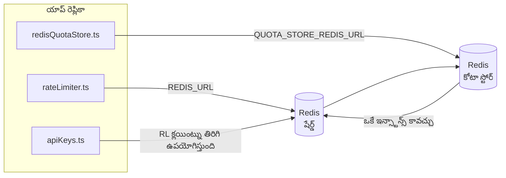

# Redis Production Configuration Guide (తెలుగు)

🌐 **Languages:** 🇺🇸 [English](../../../../ops/REDIS_PRODUCTION_CONFIG.md) · 🇪🇹 [am](../../../am/docs/ops/REDIS_PRODUCTION_CONFIG.md) · 🇸🇦 [ar](../../../ar/docs/ops/REDIS_PRODUCTION_CONFIG.md) · 🇦🇿 [az](../../../az/docs/ops/REDIS_PRODUCTION_CONFIG.md) · 🇧🇬 [bg](../../../bg/docs/ops/REDIS_PRODUCTION_CONFIG.md) · 🇧🇩 [bn](../../../bn/docs/ops/REDIS_PRODUCTION_CONFIG.md) · 🇧🇦 [bs](../../../bs/docs/ops/REDIS_PRODUCTION_CONFIG.md) · 🇨🇿 [cs](../../../cs/docs/ops/REDIS_PRODUCTION_CONFIG.md) · 🇩🇰 [da](../../../da/docs/ops/REDIS_PRODUCTION_CONFIG.md) · 🇩🇪 [de](../../../de/docs/ops/REDIS_PRODUCTION_CONFIG.md) · 🇬🇷 [el](../../../el/docs/ops/REDIS_PRODUCTION_CONFIG.md) · 🇪🇸 [es](../../../es/docs/ops/REDIS_PRODUCTION_CONFIG.md) · 🇪🇪 [et](../../../et/docs/ops/REDIS_PRODUCTION_CONFIG.md) · 🇮🇷 [fa](../../../fa/docs/ops/REDIS_PRODUCTION_CONFIG.md) · 🇫🇮 [fi](../../../fi/docs/ops/REDIS_PRODUCTION_CONFIG.md) · 🇫🇷 [fr](../../../fr/docs/ops/REDIS_PRODUCTION_CONFIG.md) · 🇮🇪 [ga](../../../ga/docs/ops/REDIS_PRODUCTION_CONFIG.md) · 🇮🇳 [gu](../../../gu/docs/ops/REDIS_PRODUCTION_CONFIG.md) · 🇳🇬 [ha](../../../ha/docs/ops/REDIS_PRODUCTION_CONFIG.md) · 🇮🇱 [he](../../../he/docs/ops/REDIS_PRODUCTION_CONFIG.md) · 🇮🇳 [hi](../../../hi/docs/ops/REDIS_PRODUCTION_CONFIG.md) · 🇭🇷 [hr](../../../hr/docs/ops/REDIS_PRODUCTION_CONFIG.md) · 🇭🇺 [hu](../../../hu/docs/ops/REDIS_PRODUCTION_CONFIG.md) · 🇦🇲 [hy](../../../hy/docs/ops/REDIS_PRODUCTION_CONFIG.md) · 🇮🇩 [id](../../../id/docs/ops/REDIS_PRODUCTION_CONFIG.md) · 🇳🇬 [ig](../../../ig/docs/ops/REDIS_PRODUCTION_CONFIG.md) · 🇮🇹 [it](../../../it/docs/ops/REDIS_PRODUCTION_CONFIG.md) · 🇯🇵 [ja](../../../ja/docs/ops/REDIS_PRODUCTION_CONFIG.md) · 🇬🇪 [ka](../../../ka/docs/ops/REDIS_PRODUCTION_CONFIG.md) · 🇰🇭 [km](../../../km/docs/ops/REDIS_PRODUCTION_CONFIG.md) · 🇮🇳 [kn](../../../kn/docs/ops/REDIS_PRODUCTION_CONFIG.md) · 🇰🇷 [ko](../../../ko/docs/ops/REDIS_PRODUCTION_CONFIG.md) · 🇱🇹 [lt](../../../lt/docs/ops/REDIS_PRODUCTION_CONFIG.md) · 🇱🇻 [lv](../../../lv/docs/ops/REDIS_PRODUCTION_CONFIG.md) · 🇮🇳 [ml](../../../ml/docs/ops/REDIS_PRODUCTION_CONFIG.md) · 🇮🇳 [mr](../../../mr/docs/ops/REDIS_PRODUCTION_CONFIG.md) · 🇲🇾 [ms](../../../ms/docs/ops/REDIS_PRODUCTION_CONFIG.md) · 🇲🇹 [mt](../../../mt/docs/ops/REDIS_PRODUCTION_CONFIG.md) · 🇲🇲 [my](../../../my/docs/ops/REDIS_PRODUCTION_CONFIG.md) · 🇳🇵 [ne](../../../ne/docs/ops/REDIS_PRODUCTION_CONFIG.md) · 🇳🇱 [nl](../../../nl/docs/ops/REDIS_PRODUCTION_CONFIG.md) · 🇳🇴 [no](../../../no/docs/ops/REDIS_PRODUCTION_CONFIG.md) · 🇮🇳 [or](../../../or/docs/ops/REDIS_PRODUCTION_CONFIG.md) · 🇮🇳 [pa](../../../pa/docs/ops/REDIS_PRODUCTION_CONFIG.md) · 🇵🇭 [phi](../../../phi/docs/ops/REDIS_PRODUCTION_CONFIG.md) · 🇵🇱 [pl](../../../pl/docs/ops/REDIS_PRODUCTION_CONFIG.md) · 🇵🇹 [pt](../../../pt/docs/ops/REDIS_PRODUCTION_CONFIG.md) · 🇧🇷 [pt-BR](../../../pt-BR/docs/ops/REDIS_PRODUCTION_CONFIG.md) · 🇷🇴 [ro](../../../ro/docs/ops/REDIS_PRODUCTION_CONFIG.md) · 🇷🇺 [ru](../../../ru/docs/ops/REDIS_PRODUCTION_CONFIG.md) · 🇱🇰 [si](../../../si/docs/ops/REDIS_PRODUCTION_CONFIG.md) · 🇸🇰 [sk](../../../sk/docs/ops/REDIS_PRODUCTION_CONFIG.md) · 🇸🇮 [sl](../../../sl/docs/ops/REDIS_PRODUCTION_CONFIG.md) · 🇷🇸 [sr](../../../sr/docs/ops/REDIS_PRODUCTION_CONFIG.md) · 🇸🇪 [sv](../../../sv/docs/ops/REDIS_PRODUCTION_CONFIG.md) · 🇰🇪 [sw](../../../sw/docs/ops/REDIS_PRODUCTION_CONFIG.md) · 🇮🇳 [ta](../../../ta/docs/ops/REDIS_PRODUCTION_CONFIG.md) · 🇹🇭 [th](../../../th/docs/ops/REDIS_PRODUCTION_CONFIG.md) · 🇹🇷 [tr](../../../tr/docs/ops/REDIS_PRODUCTION_CONFIG.md) · 🇺🇦 [uk-UA](../../../uk-UA/docs/ops/REDIS_PRODUCTION_CONFIG.md) · 🇵🇰 [ur](../../../ur/docs/ops/REDIS_PRODUCTION_CONFIG.md) · 🇺🇿 [uz](../../../uz/docs/ops/REDIS_PRODUCTION_CONFIG.md) · 🇻🇳 [vi](../../../vi/docs/ops/REDIS_PRODUCTION_CONFIG.md) · 🇳🇬 [yo](../../../yo/docs/ops/REDIS_PRODUCTION_CONFIG.md) · 🇨🇳 [zh-CN](../../../zh-CN/docs/ops/REDIS_PRODUCTION_CONFIG.md) · 🇹🇼 [zh-TW](../../../zh-TW/docs/ops/REDIS_PRODUCTION_CONFIG.md)

---

## అవలోకనం

Redis అనేది ఒక **ఐచ్ఛికం, మృదువైన ఆధారపడటం** OmniRoute — లో Redis అందుబాటులో లేనప్పుడు అప్లికేషన్ సునాయాసంగా (ఇన్-మెమరీ ఫాల్బ్యాక్లు) క్షీణిస్తుంది. ఉత్పత్తిలో, ట్యూనింగ్ Redis నాలుగు విభిన్న పనిభారాల కోసం జాప్యాన్ని తగ్గిస్తుంది:

| పనిభారం                   | డ్రైవర్                       | క్లయింట్ ఫ్యాక్టరీ                              | కీ సరళి                                             |
| ------------------------- | ----------------------------- | ----------------------------------------------- | --------------------------------------------------- |
| రేటు పరిమితి              | `rateLimiter.ts`              | `getRedisClient()` — సోమరి `ioredis` సింగిల్టన్ | `<prefix>rl:*` Lua-అటామిక్ రేట్ పరిమితి విండోస్     |
| ప్రామాణీకరణ కాష్          | `apiKeys.ts`                  | `rateLimiter` క్లయింట్ని మళ్లీ ఉపయోగిస్తుంది    | TTL తో`<prefix>auth:api_key:<sha256>`               |
| కోటా స్టోర్               | `redisQuotaStore.ts`          | ప్రత్యేక `getRedisClient(url)` సింగిల్టన్       | ప్రతి-ఉదాహరణకు`<prefix>quota:*` కాన్ఫిగర్ చేయదగినది |
| వార్మప్ సర్క్యూట్ బ్రేకర్ | `redisCircuitBreakerStore.ts` | `circuitBreakerFactory.ts` లో ప్రత్యేక క్లయింట్ | `<prefix>warmup:cb:<connectionId>`                  |

మొత్తం నాలుగు వర్క్లోడ్లు ఒక నేమ్స్పేస్ ప్రిఫిక్స్ను పంచుకుంటాయి కాబట్టి OmniRoute ఇతర యాప్లతో ఒకే Redis సందర్భంలో (ఉదా `127.0.0.1:6379`) సహజీవనం చేయగలదు. [కీ నేమ్స్పేసింగ్](#key-namespacing) చూడండి.

---

## ప్రస్తుత కాన్ఫిగరేషన్ (కోడ్ డిఫాల్ట్లు)

| సెట్టింగ్                       | విలువ                                                           | ఎక్కడ                                                                                 |
| ------------------------------- | --------------------------------------------------------------- | ------------------------------------------------------------------------------------- |
| `REDIS_URL` env var             | `redis://redis:6379` (కంపోజ్), ఐచ్ఛికం                          | `rateLimiter.ts:5`, `.env.example`                                                    |
| `REDIS_KEY_PREFIX` env var      | `omniroute:` (డిఫాల్ట్)                                         | `rateLimiter.ts`, `redisQuotaStore.ts`, `redisCircuitBreakerStore.ts`, `.env.example` |
| `QUOTA_STORE_REDIS_URL` env var | వేరు, `REDIS_URL` నుండి భిన్నంగా ఉండవచ్చు                       | `quota/storeFactory.ts`                                                               |
| `QUOTA_STORE_DRIVER`            | `"sqlite"` (డిఫాల్ట్), `"redis"` ఐచ్ఛికం                        | `quota/storeFactory.ts`                                                               |
| ioredis `maxRetriesPerRequest`  | `3`                                                             | `rateLimiter.ts` క్లయింట్ సృష్టి                                                      |
| `enableReadyCheck`              | సెట్ చేయబడలేదు (ioredis డిఫాల్ట్: `true`)                       | —                                                                                     |
| `lazyConnect`                   | సెట్ చేయబడలేదు (ioredis డిఫాల్ట్: `false`)                      | —                                                                                     |
| `retryStrategy`                 | సెట్ చేయబడలేదు (ioredis డిఫాల్ట్: 200ms బేస్, ఎక్స్పోనెన్షియల్) | —                                                                                     |
| TLS / పాస్వర్డ్ / DB సూచిక      | **కాన్ఫిగర్ చేయబడలేదు**                                         | —                                                                                     |
| సెంటినెల్ / క్లస్టర్            | **కాన్ఫిగర్ చేయబడలేదు** — స్వతంత్ర సింగిల్-నోడ్ మాత్రమే         | —                                                                                     |

---

## కీ నేమ్స్పేసింగ్

OmniRoute, హోస్ట్పై రన్ అయ్యే ఇతర వాటితో Redis ఇన్స్టాన్స్ను పంచుకుంటుంది. నేమ్స్పేస్ లేకుండా,
`auth:api_key:<sha256>` లేదా `rl:*` వంటి కీలు అదే Redisను ఉపయోగించే ఇతర అప్లికేషన్ల కీలతో
ఘర్షణ పడవచ్చు (ఈ ఇన్స్టాన్స్ ఇతర సర్వీస్లతో పాటు `127.0.0.1:6379`పై Redisను రన్ చేస్తుంది).

**ప్రతి** OmniRoute కీకి ప్రిఫిక్స్ను జోడించడానికి `REDIS_KEY_PREFIX`ను ఖాళీ కాని స్ట్రింగ్కు సెట్ చేయండి:

```bash
# .env — అన్ని OmniRoute కీలు omniroute:rl:*, omniroute:auth:*, omniroute:quota:*, omniroute:warmup:cb:*గా మారతాయి
REDIS_KEY_PREFIX=omniroute:
```

- **డిఫాల్ట్:** `omniroute:` (`REDIS_KEY_PREFIX` సెట్ చేయనప్పుడు లేదా ఖాళీగా ఉన్నప్పుడు వర్తింపజేయబడుతుంది).
- **దీనికి వర్తిస్తుంది:** రేట్ లిమిటర్ + ప్రామాణీకరణ క్యాష్ (`keyPrefix` ద్వారా పంచుకున్న `ioredis` క్లయింట్) మరియు
  కోటా స్టోర్ (`KEY_PREFIX = "${REDIS_KEY_PREFIX}quota"`) మరియు వార్మప్ సర్క్యూట్ బ్రేకర్
  (`KEY_PREFIX = "${REDIS_KEY_PREFIX}warmup:cb:"`).
- Redisలో కీలు ఇప్పటికే ఉన్నప్పుడు **ప్రిఫిక్స్ను మార్చడం** పాత కీలను అనాథలుగా వదిలివేస్తుంది (అవి
  TTL / LRU ద్వారా గడువు ముగుస్తాయి). మార్చడం సురక్షితం; మైగ్రేషన్ అవసరం లేదు. ఒక మినహాయింపు ఏమిటంటే,
  నిషేధించబడినదిగా గుర్తించిన కనెక్షన్కు సంబంధించిన వార్మప్ సర్క్యూట్-బ్రేకర్ కీ: అది TTL లేకుండా శాశ్వతంగా నిల్వ చేయబడుతుంది, కాబట్టి
  మిగిలిపోయిన వాటిని `redis-cli --scan --pattern '<old-prefix>warmup:cb:*'`తో జాబితా చేసి తొలగించండి.
- **ioredis `keyPrefix`** రైట్స్ సమయంలో ప్రిఫిక్స్ను స్వయంచాలకంగా ముందుంచి, రీడ్స్ సమయంలో దాన్ని తొలగిస్తుంది,
  కాబట్టి అప్లికేషన్ కోడ్కు ప్రిఫిక్స్ ఎప్పుడూ కనిపించదు.

---

## సిఫార్సు చేయబడిన ఉత్పత్తి ట్యూనింగ్

### 1. కనెక్షన్ పూల్ / క్లయింట్ ఎంపికలు (ioredis `Redis` కన్స్ట్రక్టర్)

ప్రస్తుత కోడ్ అనుకూల ఎంపికలు లేకుండా ఒకే `new Redis(url)` సృష్టిస్తుంది. ఉత్పత్తి బహుళ-ప్రతిరూప విస్తరణల కోసం, కోడ్లో క్లయింట్ ఫ్యాక్టరీని పాస్ చేయండి లేదా `getRedisClient()` చుట్టండి:

```typescript
const redis = new Redis(REDIS_URL, {
  maxRetriesPerRequest: null, // no retry limit; let retryStrategy decide
  enableReadyCheck: true, // verify server is ready before accepting calls
  lazyConnect: true, // don't connect on construction; wait for first call
  retryStrategy: (times) => {
    if (times > 10) return null; // give up after 10 retries → reconnect later
    return Math.min(times * 200, 5000); // 200ms, 400ms, …, 5s cap
  },
  enableAutoPipelining: true, // coalesce concurrent commands into one TCP write
  keepAlive: 10000, // TCP keep‑alive every 10s
});
```

**కీలక లావాదేవీలు:**

- `maxRetriesPerRequest: null` + `retryStrategy` — ఉత్పత్తికి ప్రాధాన్యతనిస్తుంది కాబట్టి తాత్కాలిక Redis పునఃప్రారంభాలు ప్రతి అభ్యర్థనను వెంటనే విఫలం చేయవు. `checkRateLimit()` లో ఇన్-మెమరీ ఫాల్బ్యాక్ వైఫల్య మార్గాన్ని గ్రహిస్తుంది.
- `lazyConnect: true` — సర్వర్ కనెక్షన్లను అంగీకరించడం ప్రారంభించే ముందు Redis పై స్టార్టప్ డిపెండెన్సీని నివారిస్తుంది.
- `enableAutoPipelining: true` — ఏకకాల రేట్-పరిమితి తనిఖీల కోసం రౌండ్-ట్రిప్లను తగ్గిస్తుంది; ఒకే కనెక్షన్పై > 50 RPS వద్ద ప్రయోజనకరంగా ఉంటుంది.

### 2. Redis సర్వర్ కాన్ఫిగరేషన్ (`redis.conf`)

```
# Memory
maxmemory 80%                        # leave room for OS page cache
maxmemory-policy allkeys-lru         # evict stale auth cache entries under pressure

# Persistence (optional — OmniRoute is crash‑safe without it)
save 300 1                           # snapshot at least every 5 min if ≥1 key changed
appendonly no                        # AOF not needed; data is regeneratable
appendfsync no                       # no fsync overhead (RDB is sufficient)

# Networking
timeout 0                            # no idle disconnect
tcp-keepalive 300                    # 5 min keep‑alive
tcp-backlog 511                      # connection backlog for bursty load

# Performance
hz 10                                # default; 100 for latency‑sensitive
activedefrag yes                     # auto‑defragment when fragmentation >10%
```

**`maxmemory-policy allkeys-lru` కోసం ట్రేడ్-ఆఫ్:** మెమరీ ఒత్తిడిలో ప్రామాణీకరణ కాష్ నమోదులు తొలగించబడవచ్చు. ఇది సురక్షితమైన — `setCachedApiKey` ఎల్లప్పుడూ మిస్ అయినప్పుడు తిరిగి-జనాదరణ పొందుతుంది మరియు SQLite ఫాల్బ్యాక్ అధికారికంగా ఉంటుంది. రేట్-లిమిటర్ లువా స్క్రిప్ట్ డిజైన్ ద్వారా స్వల్పకాలిక చిన్న కీలను సృష్టిస్తుంది.

### 3. Docker కంపోజ్ సెట్టింగ్లు

ఉత్పత్తి కంపోజ్ (`docker-compose.prod.yml`) `redis:8.6.2-alpine` ఉపయోగిస్తుంది. జోడించు:

```yaml
redis:
  image: redis:8.6.2-alpine
  command:
    [
      "redis-server",
      "--maxmemory",
      "512mb",
      "--maxmemory-policy",
      "allkeys-lru",
      "--activedefrag",
      "yes",
      "--save",
      "300 1",
    ]
  healthcheck:
    test: ["CMD", "redis-cli", "ping"]
    interval: 10s
    timeout: 3s
    retries: 3
    start_period: 5s
```

### 4. మల్టీ-ఇన్స్టాన్స్ / స్కేలింగ్ పరిగణనలు

**అన్ని ప్రతిరూపాలకు ఒకే Redis** — రేటు-పరిమితి Lua స్క్రిప్ట్ ఒకే అధికారిక కీ స్థలంపై ఆధారపడి ఉంటుంది. ప్రతిరూపాల వెనుక ఉన్న బహుళ Redis ఉదంతాలు అణుశక్తిని కోల్పోతాయి మరియు బడ్జెట్ను రెట్టింపు చేస్తాయి. అన్ని అప్లికేషన్ ప్రతిరూపాల కోసం ఒకే Redis (లేదా ఫెయిల్ఓవర్తో Redis సెంటినెల్ క్లస్టర్) ఉపయోగించండి.

**కనెక్షన్ కౌంట్:** ప్రతి అప్లికేషన్ ప్రతిరూపం తెరవబడుతుంది**2 TCP కనెక్షన్లు** Redis కి (రేట్ లిమిటర్ క్లయింట్ + కోటా స్టోర్ క్లయింట్). 10 ప్రతిరూపాల వద్ద → 20 కనెక్షన్లు, అలాగే డిఫాల్ట్ Redis ఉదాహరణ యొక్క 10k కనెక్షన్ సీలింగ్లో.

### 5. పర్యవేక్షణ

ఆరోగ్య తనిఖీ ముగింపు పాయింట్ ద్వారా బహిర్గతం చేయండి:

```typescript
// src/app/api/monitoring/health/route.ts already calls rateLimiter functions
// Add Redis-specific checks:
//   1. PING latency via ioredis .ping()
//   2. Memory usage via INFO memory
//   3. Connection count via INFO clients
//   4. Hit rate for maxmemory-policy (evicted_keys / keyspace_hits)
```

చూడవలసిన ముఖ్య కొలమానాలు:

- **తొలగించబడిన కీలు / సెక** — స్థిరంగా సున్నా కాకపోతే, `maxmemory` పెంచండి
- **బ్లాక్ చేయబడిన క్లయింట్లు** — నాన్-జీరో స్లో లువా స్క్రిప్ట్లను లేదా అధిక వివాదాన్ని సూచిస్తుంది
- **తిరస్కరించబడిన కనెక్షన్లు** — కనెక్షన్ పరిమితి హిట్; అరుదుగా 20 కనెక్షన్లు ఉన్నాయి

### 6. Redis-అనుకూల సర్వర్లు

ఇక్కడ ఉపయోగించిన ఏదైనా సర్వర్ తప్పనిసరిగా Lua స్క్రిప్ట్లను అమలు చేయాలి: రేటు పరిమితి ఒక `EVAL`. Lua లేని సర్వర్లో, `checkRateLimit()` `[RATE_LIMITER] Redis eval failed, falling back to in-memory rate limiting` లాగ్ చేస్తుంది మరియు ఒక్కో ప్రక్రియకు గణనలను చేస్తుంది, కాబట్టి ప్రతి ప్రతిరూపం దాని స్వంత పరిమితిని అమలు చేస్తుంది. ఆప్ట్-ఇన్ షేర్డ్ సెషన్-అఫినిటీ స్టోర్ (`OMNIROUTE_SESSION_AFFINITY_STORE=redis`) కూడా `EVAL` తో పిన్లను చదివి అప్డేట్ చేస్తుంది ; లువా లేకుండా ఇది `[SESSION_AFFINITY] Redis error; falling back to SQLite.` లాగ్ చేస్తుంది మరియు ప్రతి ప్రతిరూపం దాని స్వంత పిన్లను ఉంచుతుంది. ఇతర వర్క్లోడ్లు సాదా ఆదేశాలను ఉపయోగిస్తాయి (`SET ... EX`, `GET`, `DEL`, `MGET`, `EXPIRE`, `INCRBYFLOAT`, హాష్లు మరియు సెట్లు), మరియు సెమాంటిక్ కాష్ యొక్క Redis బ్యాకెండ్ `FT.*` ఆదేశాలను పంపదు.

OmniRoute 3.8.52తో పరీక్షించబడింది: KiviDB 1.2.0 దాని Lua చిత్రంతో (`kividb/kividb:v1.2.0-lua`). రేట్ లిమిటర్ (కౌంటర్లను భాగస్వామ్యం చేసే రెండవ ప్రక్రియతో సహా), ప్రామాణీకరణ కాష్, కోటా స్టోర్, వార్మప్ సర్క్యూట్ బ్రేకర్, సెమాంటిక్ కాష్ స్టోర్ మరియు చాట్ హ్యాండ్లర్ ద్వారా `/v1/chat/completions` అభ్యర్థన Redis 8.10.3లో ఉన్న 19 చెక్లలో 18ని ఆమోదించింది. విభిన్నమైనది: `INCRBYFLOAT` `0.1 + 0.2` `0.30000000000000004` గా నిల్వ చేస్తుంది, ఇక్కడ Redis `0.3` ( [kividbio/kividb#387](https://github.com/kividbio/kividb/issues/387) )ని నిల్వ చేస్తుంది. కోటా స్టోర్ రెండింటినీ `parseFloat` తో అన్వయిస్తుంది , కానీ రెండు సంఖ్యలు చివరి అంకెలలో తేడా ఉంటాయి, కాబట్టి ఖచ్చితంగా కోటా సరిహద్దుపై వచ్చే పోలిక భిన్నంగా రావచ్చు. సెషన్-అఫినిటీ స్టోర్ ఆ రన్లో భాగం కాదు. ( [సెటప్](https://github.com/kividbio/kividb/blob/master/docs/integrations/omniroute.md), [ఫలితాలు](https://github.com/kividbio/kividb/tree/master/benchmarks/omniroute-compat) )

---

## ఆర్కిటెక్చర్ రేఖాచిత్రం



---

## సూచనలు

| ఫైల్                               | ప్రయోజనం                                                                   |
| ---------------------------------- | -------------------------------------------------------------------------- |
| `src/shared/utils/rateLimiter.ts`  | ప్రాథమిక Redis క్లయింట్, Lua రేటు-పరిమితి స్క్రిప్ట్, ఇన్-మెమరీ ఫాల్బ్యాక్ |
| `src/lib/db/apiKeys.ts`            | ప్రామాణీకరణ కాష్ — Redis→SQLite ఫాల్బ్యాక్                                 |
| `src/lib/quota/redisQuotaStore.ts` | ఐచ్ఛిక కోటా స్టోర్ కోసం ప్రత్యేక Redis క్లయింట్                            |
| `src/lib/quota/storeFactory.ts`    | `sqlite` మరియు `redis` కోటా డ్రైవర్ల మధ్య స్విచ్లు                         |
| `docker-compose.prod.yml`          | ఉత్పత్తి Redis కంటైనర్ (చిత్రం `redis:8.6.2-alpine`)                       |
| `.env.example`                     | Redis env vars డాక్యుమెంటేషన్                                              |
| `src/app/api/local/redis/`         | దేవ్ కంటైనర్ ఆర్కెస్ట్రేషన్ కోసంAPI మార్గాలు                               |
| `bin/cli/commands/redis.mjs`       | దేవ్ కంటైనర్ ఆర్కెస్ట్రేషన్ కోసంCLI ఆదేశాలు                                |
