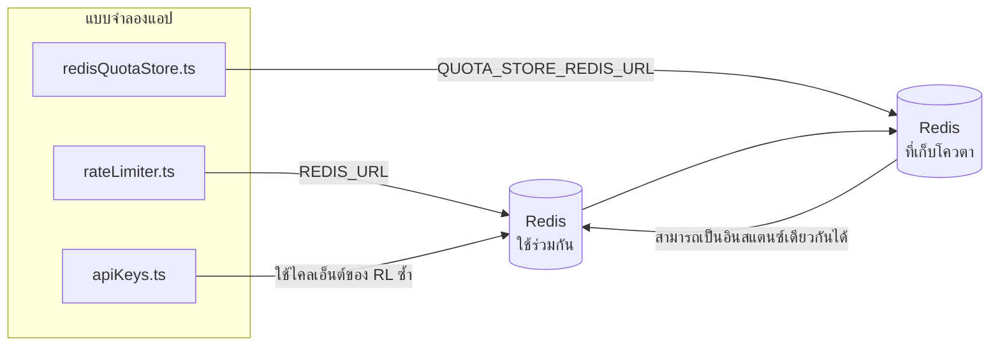

# Redis Production Configuration Guide (ไทย)

🌐 **Languages:** 🇺🇸 [English](../../../../ops/REDIS_PRODUCTION_CONFIG.md) · 🇪🇹 [am](../../../am/docs/ops/REDIS_PRODUCTION_CONFIG.md) · 🇸🇦 [ar](../../../ar/docs/ops/REDIS_PRODUCTION_CONFIG.md) · 🇦🇿 [az](../../../az/docs/ops/REDIS_PRODUCTION_CONFIG.md) · 🇧🇬 [bg](../../../bg/docs/ops/REDIS_PRODUCTION_CONFIG.md) · 🇧🇩 [bn](../../../bn/docs/ops/REDIS_PRODUCTION_CONFIG.md) · 🇧🇦 [bs](../../../bs/docs/ops/REDIS_PRODUCTION_CONFIG.md) · 🇨🇿 [cs](../../../cs/docs/ops/REDIS_PRODUCTION_CONFIG.md) · 🇩🇰 [da](../../../da/docs/ops/REDIS_PRODUCTION_CONFIG.md) · 🇩🇪 [de](../../../de/docs/ops/REDIS_PRODUCTION_CONFIG.md) · 🇬🇷 [el](../../../el/docs/ops/REDIS_PRODUCTION_CONFIG.md) · 🇪🇸 [es](../../../es/docs/ops/REDIS_PRODUCTION_CONFIG.md) · 🇪🇪 [et](../../../et/docs/ops/REDIS_PRODUCTION_CONFIG.md) · 🇮🇷 [fa](../../../fa/docs/ops/REDIS_PRODUCTION_CONFIG.md) · 🇫🇮 [fi](../../../fi/docs/ops/REDIS_PRODUCTION_CONFIG.md) · 🇫🇷 [fr](../../../fr/docs/ops/REDIS_PRODUCTION_CONFIG.md) · 🇮🇪 [ga](../../../ga/docs/ops/REDIS_PRODUCTION_CONFIG.md) · 🇮🇳 [gu](../../../gu/docs/ops/REDIS_PRODUCTION_CONFIG.md) · 🇳🇬 [ha](../../../ha/docs/ops/REDIS_PRODUCTION_CONFIG.md) · 🇮🇱 [he](../../../he/docs/ops/REDIS_PRODUCTION_CONFIG.md) · 🇮🇳 [hi](../../../hi/docs/ops/REDIS_PRODUCTION_CONFIG.md) · 🇭🇷 [hr](../../../hr/docs/ops/REDIS_PRODUCTION_CONFIG.md) · 🇭🇺 [hu](../../../hu/docs/ops/REDIS_PRODUCTION_CONFIG.md) · 🇦🇲 [hy](../../../hy/docs/ops/REDIS_PRODUCTION_CONFIG.md) · 🇮🇩 [id](../../../id/docs/ops/REDIS_PRODUCTION_CONFIG.md) · 🇳🇬 [ig](../../../ig/docs/ops/REDIS_PRODUCTION_CONFIG.md) · 🇮🇹 [it](../../../it/docs/ops/REDIS_PRODUCTION_CONFIG.md) · 🇯🇵 [ja](../../../ja/docs/ops/REDIS_PRODUCTION_CONFIG.md) · 🇬🇪 [ka](../../../ka/docs/ops/REDIS_PRODUCTION_CONFIG.md) · 🇰🇭 [km](../../../km/docs/ops/REDIS_PRODUCTION_CONFIG.md) · 🇮🇳 [kn](../../../kn/docs/ops/REDIS_PRODUCTION_CONFIG.md) · 🇰🇷 [ko](../../../ko/docs/ops/REDIS_PRODUCTION_CONFIG.md) · 🇱🇹 [lt](../../../lt/docs/ops/REDIS_PRODUCTION_CONFIG.md) · 🇱🇻 [lv](../../../lv/docs/ops/REDIS_PRODUCTION_CONFIG.md) · 🇮🇳 [ml](../../../ml/docs/ops/REDIS_PRODUCTION_CONFIG.md) · 🇮🇳 [mr](../../../mr/docs/ops/REDIS_PRODUCTION_CONFIG.md) · 🇲🇾 [ms](../../../ms/docs/ops/REDIS_PRODUCTION_CONFIG.md) · 🇲🇹 [mt](../../../mt/docs/ops/REDIS_PRODUCTION_CONFIG.md) · 🇲🇲 [my](../../../my/docs/ops/REDIS_PRODUCTION_CONFIG.md) · 🇳🇵 [ne](../../../ne/docs/ops/REDIS_PRODUCTION_CONFIG.md) · 🇳🇱 [nl](../../../nl/docs/ops/REDIS_PRODUCTION_CONFIG.md) · 🇳🇴 [no](../../../no/docs/ops/REDIS_PRODUCTION_CONFIG.md) · 🇮🇳 [or](../../../or/docs/ops/REDIS_PRODUCTION_CONFIG.md) · 🇮🇳 [pa](../../../pa/docs/ops/REDIS_PRODUCTION_CONFIG.md) · 🇵🇭 [phi](../../../phi/docs/ops/REDIS_PRODUCTION_CONFIG.md) · 🇵🇱 [pl](../../../pl/docs/ops/REDIS_PRODUCTION_CONFIG.md) · 🇵🇹 [pt](../../../pt/docs/ops/REDIS_PRODUCTION_CONFIG.md) · 🇧🇷 [pt-BR](../../../pt-BR/docs/ops/REDIS_PRODUCTION_CONFIG.md) · 🇷🇴 [ro](../../../ro/docs/ops/REDIS_PRODUCTION_CONFIG.md) · 🇷🇺 [ru](../../../ru/docs/ops/REDIS_PRODUCTION_CONFIG.md) · 🇱🇰 [si](../../../si/docs/ops/REDIS_PRODUCTION_CONFIG.md) · 🇸🇰 [sk](../../../sk/docs/ops/REDIS_PRODUCTION_CONFIG.md) · 🇸🇮 [sl](../../../sl/docs/ops/REDIS_PRODUCTION_CONFIG.md) · 🇷🇸 [sr](../../../sr/docs/ops/REDIS_PRODUCTION_CONFIG.md) · 🇸🇪 [sv](../../../sv/docs/ops/REDIS_PRODUCTION_CONFIG.md) · 🇰🇪 [sw](../../../sw/docs/ops/REDIS_PRODUCTION_CONFIG.md) · 🇮🇳 [ta](../../../ta/docs/ops/REDIS_PRODUCTION_CONFIG.md) · 🇮🇳 [te](../../../te/docs/ops/REDIS_PRODUCTION_CONFIG.md) · 🇹🇷 [tr](../../../tr/docs/ops/REDIS_PRODUCTION_CONFIG.md) · 🇺🇦 [uk-UA](../../../uk-UA/docs/ops/REDIS_PRODUCTION_CONFIG.md) · 🇵🇰 [ur](../../../ur/docs/ops/REDIS_PRODUCTION_CONFIG.md) · 🇺🇿 [uz](../../../uz/docs/ops/REDIS_PRODUCTION_CONFIG.md) · 🇻🇳 [vi](../../../vi/docs/ops/REDIS_PRODUCTION_CONFIG.md) · 🇳🇬 [yo](../../../yo/docs/ops/REDIS_PRODUCTION_CONFIG.md) · 🇨🇳 [zh-CN](../../../zh-CN/docs/ops/REDIS_PRODUCTION_CONFIG.md) · 🇹🇼 [zh-TW](../../../zh-TW/docs/ops/REDIS_PRODUCTION_CONFIG.md)

---

## ภาพรวม

Redis เป็น **dependency แบบไม่บังคับและไม่ตายตัว** ใน OmniRoute — แอปพลิเคชันจะลดระดับการทำงานอย่างราบรื่น (fallback
ไปใช้หน่วยความจำภายใน) เมื่อ Redis ไม่พร้อมใช้งาน ในระบบ production การปรับแต่ง Redis ช่วยลด latency สำหรับ workload
ที่แตกต่างกันสี่ประเภท:

| Workload                      | ตัวขับเคลื่อน                 | Client Factory                                       | รูปแบบคีย์                                       |
| ----------------------------- | ----------------------------- | ---------------------------------------------------- | ------------------------------------------------ |
| การจำกัดอัตรา                 | `rateLimiter.ts`              | singleton `ioredis` แบบ lazy ผ่าน `getRedisClient()` | หน้าต่างจำกัดอัตราแบบ Lua‑atomic `<prefix>rl:*`  |
| แคชการยืนยันตัวตน             | `apiKeys.ts`                  | ใช้ client ของ `rateLimiter` ซ้ำ                     | `<prefix>auth:api_key:<sha256>` พร้อม TTL        |
| ที่เก็บโควตา                  | `redisQuotaStore.ts`          | singleton `getRedisClient(url)` แยกต่างหาก           | `<prefix>quota:*` ที่กำหนดค่าแยกต่อ instance ได้ |
| circuit breaker สำหรับ warmup | `redisCircuitBreakerStore.ts` | client แยกต่างหากใน `circuitBreakerFactory.ts`       | `<prefix>warmup:cb:<connectionId>`               |

workload ทั้งสี่ประเภทใช้ prefix ของ namespace เดียวกัน เพื่อให้ OmniRoute สามารถทำงานร่วมกับแอปอื่นบน
Redis instance เดียวกันได้ (เช่น `127.0.0.1:6379`) ดู [การกำหนด Namespace ให้คีย์](#การกำหนด-namespace-ให้คีย์)

---

## การกำหนดค่าปัจจุบัน (ค่าเริ่มต้นในโค้ด)

| การตั้งค่า                         | ค่า                                                                     | ตำแหน่ง                                                                               |
| ---------------------------------- | ----------------------------------------------------------------------- | ------------------------------------------------------------------------------------- |
| ตัวแปร env `REDIS_URL`             | `redis://redis:6379` (compose), ไม่บังคับ                               | `rateLimiter.ts:5`, `.env.example`                                                    |
| ตัวแปร env `REDIS_KEY_PREFIX`      | `omniroute:` (ค่าเริ่มต้น)                                              | `rateLimiter.ts`, `redisQuotaStore.ts`, `redisCircuitBreakerStore.ts`, `.env.example` |
| ตัวแปร env `QUOTA_STORE_REDIS_URL` | แยกต่างหากและอาจแตกต่างจาก `REDIS_URL`                                  | `quota/storeFactory.ts`                                                               |
| `QUOTA_STORE_DRIVER`               | `"sqlite"` (ค่าเริ่มต้น), `"redis"` เป็นตัวเลือก                        | `quota/storeFactory.ts`                                                               |
| `maxRetriesPerRequest` ของ ioredis | `3`                                                                     | การสร้าง client ใน `rateLimiter.ts`                                                   |
| `enableReadyCheck`                 | ไม่ได้ตั้งค่า (ค่าเริ่มต้นของ ioredis: `true`)                          | —                                                                                     |
| `lazyConnect`                      | ไม่ได้ตั้งค่า (ค่าเริ่มต้นของ ioredis: `false`)                         | —                                                                                     |
| `retryStrategy`                    | ไม่ได้ตั้งค่า (ค่าเริ่มต้นของ ioredis: ฐาน 200ms, เพิ่มแบบ exponential) | —                                                                                     |
| TLS / รหัสผ่าน / ดัชนี DB          | **ไม่ได้กำหนดค่า**                                                      | —                                                                                     |
| Sentinel / Cluster                 | **ไม่ได้กำหนดค่า** — รองรับเฉพาะ standalone แบบ single-node             | —                                                                                     |

---

## การกำหนด Namespace ให้คีย์

OmniRoute ใช้ Redis instance ร่วมกับบริการอื่นใดก็ตามที่ทำงานอยู่บนโฮสต์ หากไม่มี namespace
คีย์อย่าง `auth:api_key:<sha256>` หรือ `rl:*` อาจชนกับคีย์จากแอปพลิเคชันอื่น
ที่ใช้ Redis เดียวกัน (instance นี้เรียกใช้ Redis บน `127.0.0.1:6379` ร่วมกับบริการอื่น)

ตั้งค่า `REDIS_KEY_PREFIX` เป็นสตริงที่ไม่ว่าง เพื่อเพิ่ม prefix ให้กับคีย์ **ทุกคีย์** ของ OmniRoute:

```bash
# .env — คีย์ OmniRoute ทั้งหมดจะกลายเป็น omniroute:rl:*, omniroute:auth:*, omniroute:quota:*, omniroute:warmup:cb:*
REDIS_KEY_PREFIX=omniroute:
```

- **ค่าเริ่มต้น:** `omniroute:` (นำไปใช้เมื่อไม่ได้ตั้งค่า `REDIS_KEY_PREFIX` หรือค่าที่ตั้งไว้ว่างเปล่า)
- **นำไปใช้กับ:** ตัวจำกัดอัตรา + แคชการยืนยันตัวตน (ใช้ client `ioredis` ร่วมกันผ่าน `keyPrefix`) และ
  ที่เก็บโควตา (`KEY_PREFIX = "${REDIS_KEY_PREFIX}quota"`) รวมถึง circuit breaker สำหรับ warmup
  (`KEY_PREFIX = "${REDIS_KEY_PREFIX}warmup:cb:"`)
- **การเปลี่ยน prefix** ขณะที่มีคีย์อยู่ใน Redis แล้ว จะทำให้คีย์เก่าถูกทิ้งไว้โดยไม่มีการอ้างอิง (คีย์จะหมดอายุ
  ผ่าน TTL / LRU) สามารถเปลี่ยนได้อย่างปลอดภัยและไม่จำเป็นต้องย้ายข้อมูล ข้อยกเว้นหนึ่งประการคือคีย์ของ
  circuit breaker สำหรับ warmup ของการเชื่อมต่อที่ถูกทำเครื่องหมายว่าห้ามใช้งาน ซึ่งจะถูกเก็บไว้โดยไม่มี TTL ดังนั้น
  ให้แสดงรายการคีย์ตกค้างด้วย `redis-cli --scan --pattern '<old-prefix>warmup:cb:*'` แล้วลบคีย์เหล่านั้น
- **`keyPrefix` ของ ioredis** จะเพิ่ม prefix ไว้ข้างหน้าโดยอัตโนมัติเมื่อเขียนข้อมูล **และ** ตัด prefix ออกเมื่ออ่านข้อมูล
  ดังนั้นโค้ดของแอปพลิเคชันจะไม่เห็น prefix เลย

---

## การปรับแต่งการผลิตที่แนะนำ

### 1. ตัวเลือกพูลการเชื่อมต่อ / ไคลเอนต์ (ตัวสร้าง ioredis `Redis` )

รหัสปัจจุบันสร้าง `new Redis(url)` เดียวโดยไม่มีตัวเลือกที่กำหนดเอง สำหรับการปรับใช้หลายสำเนาที่ใช้งานจริง ให้ส่งโรงงานลูกค้าในโค้ดหรือตัด `getRedisClient()`:

```typescript
const redis = new Redis(REDIS_URL, {
  maxRetriesPerRequest: null, // no retry limit; let retryStrategy decide
  enableReadyCheck: true, // verify server is ready before accepting calls
  lazyConnect: true, // don't connect on construction; wait for first call
  retryStrategy: (times) => {
    if (times > 10) return null; // give up after 10 retries → reconnect later
    return Math.min(times * 200, 5000); // 200ms, 400ms, …, 5s cap
  },
  enableAutoPipelining: true, // coalesce concurrent commands into one TCP write
  keepAlive: 10000, // TCP keep‑alive every 10s
});
```

**ข้อเสียเปรียบที่สำคัญ:**

- `maxRetriesPerRequest: null` + `retryStrategy` — ต้องการสำหรับการผลิต ดังนั้นการรีสตาร์ท Redis ชั่วคราวจะไม่ล้มเหลวทุกคำขอในทันที ทางเลือกในหน่วยความจำใน `checkRateLimit()` จะดูดซับเส้นทางที่ล้มเหลว
- `lazyConnect: true` — หลีกเลี่ยงการพึ่งพาการเริ่มต้นระบบบน Redis ก่อนที่เซิร์ฟเวอร์จะเริ่มยอมรับการเชื่อมต่อ
- `enableAutoPipelining: true` — ลดการเดินทางไปกลับสำหรับการตรวจสอบขีดจำกัดอัตราพร้อมกัน มีประโยชน์ที่ > 50 RPS ในการเชื่อมต่อเดียว

### 2. การกำหนดค่าเซิร์ฟเวอร์ Redis (`redis.conf`)

```
# Memory
maxmemory 80%                        # leave room for OS page cache
maxmemory-policy allkeys-lru         # evict stale auth cache entries under pressure

# Persistence (optional — OmniRoute is crash‑safe without it)
save 300 1                           # snapshot at least every 5 min if ≥1 key changed
appendonly no                        # AOF not needed; data is regeneratable
appendfsync no                       # no fsync overhead (RDB is sufficient)

# Networking
timeout 0                            # no idle disconnect
tcp-keepalive 300                    # 5 min keep‑alive
tcp-backlog 511                      # connection backlog for bursty load

# Performance
hz 10                                # default; 100 for latency‑sensitive
activedefrag yes                     # auto‑defragment when fragmentation >10%
```

**การแลกเปลี่ยนสำหรับ `maxmemory-policy allkeys-lru`:** รายการแคชการรับรองความถูกต้องอาจถูกไล่ออกภายใต้แรงกดดันของหน่วยความจำ นี่เป็นวิธีที่ปลอดภัย — `setCachedApiKey` จะเติมข้อมูลซ้ำเสมอหากพลาด และ SQLite ทางเลือกสำรองนั้นเชื่อถือได้ สคริปต์ Lua ที่จำกัดอัตราจะสร้างคีย์ขนาดเล็กที่มีอายุการใช้งานสั้นตามการออกแบบ

### 3. การตั้งค่าการเขียน Docker

prod compose (`docker-compose.prod.yml`) ใช้ `redis:8.6.2-alpine` เพิ่ม:

```yaml
redis:
  image: redis:8.6.2-alpine
  command:
    [
      "redis-server",
      "--maxmemory",
      "512mb",
      "--maxmemory-policy",
      "allkeys-lru",
      "--activedefrag",
      "yes",
      "--save",
      "300 1",
    ]
  healthcheck:
    test: ["CMD", "redis-cli", "ping"]
    interval: 10s
    timeout: 3s
    retries: 3
    start_period: 5s
```

### 4. ข้อควรพิจารณาหลายอินสแตนซ์/การปรับขนาด

**Redis เดียวสำหรับเรพลิกาทั้งหมด** — สคริปต์ Lua ที่จำกัดอัตราจะขึ้นอยู่กับพื้นที่คีย์ที่เชื่อถือได้เพียงพื้นที่เดียว อินสแตนซ์ Redis หลายรายการที่อยู่ด้านหลังแบบจำลองจะสูญเสียอะตอมมิกซิตีและเพิ่มงบประมาณเป็นสองเท่า ใช้ Redis เดียว (หรือคลัสเตอร์ Redis Sentinel ที่มีข้อผิดพลาด) สำหรับการจำลองแอปพลิเคชันทั้งหมด

**จำนวนการเชื่อมต่อ:** แต่ละแอปพลิเคชันจำลองจะเปิดขึ้น** การเชื่อมต่อ 2 TCP** ถึง Redis (ไคลเอ็นต์ตัวจำกัดอัตรา ไคลเอ็นต์ร้านค้าโควต้า + ) ที่ 10 เรพลิกา → 20 การเชื่อมต่อ ซึ่งอยู่ภายในเพดานการเชื่อมต่อ 10,000 ของอินสแตนซ์ Redis เริ่มต้น

### 5. การติดตามผล

เปิดเผยผ่านจุดสิ้นสุดการตรวจสุขภาพ:

```typescript
// src/app/api/monitoring/health/route.ts already calls rateLimiter functions
// Add Redis-specific checks:
//   1. PING latency via ioredis .ping()
//   2. Memory usage via INFO memory
//   3. Connection count via INFO clients
//   4. Hit rate for maxmemory-policy (evicted_keys / keyspace_hits)
```

ตัวชี้วัดหลักที่น่าจับตามอง:

- **ถอดกุญแจ / วินาที** — หากไม่เป็นศูนย์อย่างต่อเนื่อง ให้เพิ่ม `maxmemory`
- **ลูกค้าที่ถูกบล็อก** — ที่ไม่ใช่ศูนย์แนะนำสคริปต์ Lua ที่ช้าหรือมีความขัดแย้งสูง
- **การเชื่อมต่อที่ถูกปฏิเสธ** ขีดจำกัดการเชื่อมต่อ — ถึงขีดจำกัด; หายากที่ 20 การเชื่อมต่อ

### 6. เซิร์ฟเวอร์ที่รองรับ Redis

เซิร์ฟเวอร์ใดๆ ที่ใช้ที่นี่จะต้องเรียกใช้สคริปต์ Lua: ตัวจำกัดอัตราคือหนึ่ง `EVAL` บนเซิร์ฟเวอร์ที่ไม่มี Lua `checkRateLimit()` จะบันทึก `[RATE_LIMITER] Redis eval failed, falling back to in-memory rate limiting` และจำนวนต่อกระบวนการ ดังนั้นแต่ละเรพลิกาจึงบังคับใช้ขีดจำกัดในตัวมันเอง ร้านค้าความสัมพันธ์เซสชันที่ใช้ร่วมกันที่เลือกใช้ (`OMNIROUTE_SESSION_AFFINITY_STORE=redis`) ยังอ่านและอัปเดตพินด้วย `EVAL`; หากไม่มี Lua มันจะบันทึก `[SESSION_AFFINITY] Redis error; falling back to SQLite.` และแต่ละแบบจำลองจะเก็บพินของตัวเองไว้ ปริมาณงานอื่นๆ ใช้คำสั่งธรรมดา (`SET ... EX`, `GET`, `DEL`, `MGET`, `EXPIRE`, `INCRBYFLOAT`, แฮชและชุด) และแบ็คเอนด์ Redis ของ semantic cache จะไม่ส่งคำสั่ง `FT.*`

ทดสอบกับ OmniRoute 3.8.52: KiviDB 1.2.0 ด้วยอิมเมจ Lua (`kividb/kividb:v1.2.0-lua`) ตัวจำกัดอัตรา (รวมถึงกระบวนการที่สองที่แชร์ตัวนับ), แคชการรับรองความถูกต้อง, การจัดเก็บโควต้า, เซอร์กิตเบรกเกอร์อุ่นเครื่อง, ที่เก็บแคชความหมาย และคำขอ `/v1/chat/completions` ผ่านตัวจัดการแชท ผ่านการตรวจสอบ 18 รายการจาก 19 รายการที่ส่งผ่าน Redis 8.10.3 สิ่งที่แตกต่าง: `INCRBYFLOAT` เก็บ `0.1 + 0.2` เป็น `0.30000000000000004` โดยที่ Redis เก็บ `0.3` ( [kividbio/kividb#387](https://github.com/kividbio/kividb/issues/387) ) ที่เก็บโควต้าจะแยกวิเคราะห์ทั้งคู่ด้วย `parseFloat` แต่ตัวเลขทั้งสองต่างกันในหลักสุดท้าย ดังนั้นการเปรียบเทียบที่ตรงกับขอบเขตโควต้าทั้งหมดอาจแตกต่างกันได้ ที่เก็บเซสชันที่สัมพันธ์กันไม่ได้เป็นส่วนหนึ่งของการรันนั้น ( [การตั้งค่า](https://github.com/kividbio/kividb/blob/master/docs/integrations/omniroute.md) [ผลลัพธ์](https://github.com/kividbio/kividb/tree/master/benchmarks/omniroute-compat) )

---

## แผนภาพสถาปัตยกรรม



---

## เอกสารอ้างอิง

| ไฟล์                               | วัตถุประสงค์                                                               |
| ---------------------------------- | -------------------------------------------------------------------------- |
| `src/shared/utils/rateLimiter.ts`  | ไคลเอ็นต์ Redis หลัก, สคริปต์ Lua สำหรับจำกัดอัตรา, ระบบสำรองในหน่วยความจำ |
| `src/lib/db/apiKeys.ts`            | แคชการยืนยันตัวตน — สำรองจาก Redis ไปยัง SQLite                            |
| `src/lib/quota/redisQuotaStore.ts` | ไคลเอ็นต์ Redis แยกต่างหากสำหรับที่เก็บโควตาเสริม                          |
| `src/lib/quota/storeFactory.ts`    | สลับไดรเวอร์โควตาระหว่าง `sqlite` และ `redis`                              |
| `docker-compose.prod.yml`          | คอนเทนเนอร์ Redis สำหรับระบบใช้งานจริง (อิมเมจ `redis:8.6.2-alpine`)       |
| `.env.example`                     | เอกสารตัวแปรสภาพแวดล้อมของ Redis                                           |
| `src/app/api/local/redis/`         | เส้นทาง API สำหรับการควบคุมคอนเทนเนอร์ในสภาพแวดล้อมการพัฒนา                |
| `bin/cli/commands/redis.mjs`       | คำสั่ง CLI สำหรับการควบคุมคอนเทนเนอร์ในสภาพแวดล้อมการพัฒนา                 |
