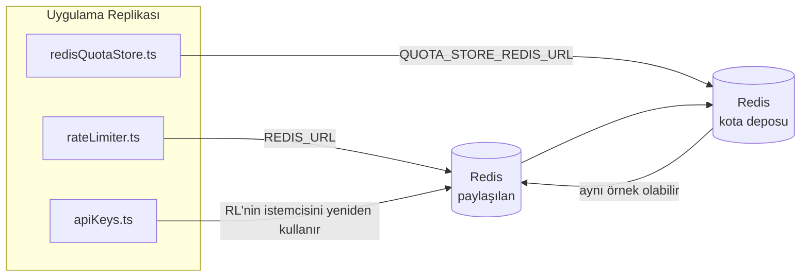

# Redis Production Configuration Guide (Türkçe)

🌐 **Languages:** 🇺🇸 [English](../../../../ops/REDIS_PRODUCTION_CONFIG.md) · 🇪🇹 [am](../../../am/docs/ops/REDIS_PRODUCTION_CONFIG.md) · 🇸🇦 [ar](../../../ar/docs/ops/REDIS_PRODUCTION_CONFIG.md) · 🇦🇿 [az](../../../az/docs/ops/REDIS_PRODUCTION_CONFIG.md) · 🇧🇬 [bg](../../../bg/docs/ops/REDIS_PRODUCTION_CONFIG.md) · 🇧🇩 [bn](../../../bn/docs/ops/REDIS_PRODUCTION_CONFIG.md) · 🇧🇦 [bs](../../../bs/docs/ops/REDIS_PRODUCTION_CONFIG.md) · 🇨🇿 [cs](../../../cs/docs/ops/REDIS_PRODUCTION_CONFIG.md) · 🇩🇰 [da](../../../da/docs/ops/REDIS_PRODUCTION_CONFIG.md) · 🇩🇪 [de](../../../de/docs/ops/REDIS_PRODUCTION_CONFIG.md) · 🇬🇷 [el](../../../el/docs/ops/REDIS_PRODUCTION_CONFIG.md) · 🇪🇸 [es](../../../es/docs/ops/REDIS_PRODUCTION_CONFIG.md) · 🇪🇪 [et](../../../et/docs/ops/REDIS_PRODUCTION_CONFIG.md) · 🇮🇷 [fa](../../../fa/docs/ops/REDIS_PRODUCTION_CONFIG.md) · 🇫🇮 [fi](../../../fi/docs/ops/REDIS_PRODUCTION_CONFIG.md) · 🇫🇷 [fr](../../../fr/docs/ops/REDIS_PRODUCTION_CONFIG.md) · 🇮🇪 [ga](../../../ga/docs/ops/REDIS_PRODUCTION_CONFIG.md) · 🇮🇳 [gu](../../../gu/docs/ops/REDIS_PRODUCTION_CONFIG.md) · 🇳🇬 [ha](../../../ha/docs/ops/REDIS_PRODUCTION_CONFIG.md) · 🇮🇱 [he](../../../he/docs/ops/REDIS_PRODUCTION_CONFIG.md) · 🇮🇳 [hi](../../../hi/docs/ops/REDIS_PRODUCTION_CONFIG.md) · 🇭🇷 [hr](../../../hr/docs/ops/REDIS_PRODUCTION_CONFIG.md) · 🇭🇺 [hu](../../../hu/docs/ops/REDIS_PRODUCTION_CONFIG.md) · 🇦🇲 [hy](../../../hy/docs/ops/REDIS_PRODUCTION_CONFIG.md) · 🇮🇩 [id](../../../id/docs/ops/REDIS_PRODUCTION_CONFIG.md) · 🇳🇬 [ig](../../../ig/docs/ops/REDIS_PRODUCTION_CONFIG.md) · 🇮🇹 [it](../../../it/docs/ops/REDIS_PRODUCTION_CONFIG.md) · 🇯🇵 [ja](../../../ja/docs/ops/REDIS_PRODUCTION_CONFIG.md) · 🇬🇪 [ka](../../../ka/docs/ops/REDIS_PRODUCTION_CONFIG.md) · 🇰🇭 [km](../../../km/docs/ops/REDIS_PRODUCTION_CONFIG.md) · 🇮🇳 [kn](../../../kn/docs/ops/REDIS_PRODUCTION_CONFIG.md) · 🇰🇷 [ko](../../../ko/docs/ops/REDIS_PRODUCTION_CONFIG.md) · 🇱🇹 [lt](../../../lt/docs/ops/REDIS_PRODUCTION_CONFIG.md) · 🇱🇻 [lv](../../../lv/docs/ops/REDIS_PRODUCTION_CONFIG.md) · 🇮🇳 [ml](../../../ml/docs/ops/REDIS_PRODUCTION_CONFIG.md) · 🇮🇳 [mr](../../../mr/docs/ops/REDIS_PRODUCTION_CONFIG.md) · 🇲🇾 [ms](../../../ms/docs/ops/REDIS_PRODUCTION_CONFIG.md) · 🇲🇹 [mt](../../../mt/docs/ops/REDIS_PRODUCTION_CONFIG.md) · 🇲🇲 [my](../../../my/docs/ops/REDIS_PRODUCTION_CONFIG.md) · 🇳🇵 [ne](../../../ne/docs/ops/REDIS_PRODUCTION_CONFIG.md) · 🇳🇱 [nl](../../../nl/docs/ops/REDIS_PRODUCTION_CONFIG.md) · 🇳🇴 [no](../../../no/docs/ops/REDIS_PRODUCTION_CONFIG.md) · 🇮🇳 [or](../../../or/docs/ops/REDIS_PRODUCTION_CONFIG.md) · 🇮🇳 [pa](../../../pa/docs/ops/REDIS_PRODUCTION_CONFIG.md) · 🇵🇭 [phi](../../../phi/docs/ops/REDIS_PRODUCTION_CONFIG.md) · 🇵🇱 [pl](../../../pl/docs/ops/REDIS_PRODUCTION_CONFIG.md) · 🇵🇹 [pt](../../../pt/docs/ops/REDIS_PRODUCTION_CONFIG.md) · 🇧🇷 [pt-BR](../../../pt-BR/docs/ops/REDIS_PRODUCTION_CONFIG.md) · 🇷🇴 [ro](../../../ro/docs/ops/REDIS_PRODUCTION_CONFIG.md) · 🇷🇺 [ru](../../../ru/docs/ops/REDIS_PRODUCTION_CONFIG.md) · 🇱🇰 [si](../../../si/docs/ops/REDIS_PRODUCTION_CONFIG.md) · 🇸🇰 [sk](../../../sk/docs/ops/REDIS_PRODUCTION_CONFIG.md) · 🇸🇮 [sl](../../../sl/docs/ops/REDIS_PRODUCTION_CONFIG.md) · 🇷🇸 [sr](../../../sr/docs/ops/REDIS_PRODUCTION_CONFIG.md) · 🇸🇪 [sv](../../../sv/docs/ops/REDIS_PRODUCTION_CONFIG.md) · 🇰🇪 [sw](../../../sw/docs/ops/REDIS_PRODUCTION_CONFIG.md) · 🇮🇳 [ta](../../../ta/docs/ops/REDIS_PRODUCTION_CONFIG.md) · 🇮🇳 [te](../../../te/docs/ops/REDIS_PRODUCTION_CONFIG.md) · 🇹🇭 [th](../../../th/docs/ops/REDIS_PRODUCTION_CONFIG.md) · 🇺🇦 [uk-UA](../../../uk-UA/docs/ops/REDIS_PRODUCTION_CONFIG.md) · 🇵🇰 [ur](../../../ur/docs/ops/REDIS_PRODUCTION_CONFIG.md) · 🇺🇿 [uz](../../../uz/docs/ops/REDIS_PRODUCTION_CONFIG.md) · 🇻🇳 [vi](../../../vi/docs/ops/REDIS_PRODUCTION_CONFIG.md) · 🇳🇬 [yo](../../../yo/docs/ops/REDIS_PRODUCTION_CONFIG.md) · 🇨🇳 [zh-CN](../../../zh-CN/docs/ops/REDIS_PRODUCTION_CONFIG.md) · 🇹🇼 [zh-TW](../../../zh-TW/docs/ops/REDIS_PRODUCTION_CONFIG.md)

---

## Genel Bakış

Redis, OmniRoute'ta **isteğe bağlı, zorunlu olmayan bir bağımlılıktır** — Redis kullanılamadığında uygulama
sorunsuz biçimde daha düşük kapasiteli çalışma moduna geçer (bellek içi geri dönüşler). Üretim ortamında Redis'i ayarlamak, dört farklı
iş yükü için gecikmeyi azaltır:

| İş Yükü                    | Sürücü                        | İstemci Fabrikası                                             | Anahtar Kalıbı                                       |
| -------------------------- | ----------------------------- | ------------------------------------------------------------- | ---------------------------------------------------- |
| Hız sınırlama              | `rateLimiter.ts`              | `getRedisClient()` — tembel başlatılan tekil `ioredis` örneği | `<prefix>rl:*` Lua ile atomik hız sınırı pencereleri |
| Kimlik doğrulama önbelleği | `apiKeys.ts`                  | `rateLimiter` istemcisini yeniden kullanır                    | TTL ile `<prefix>auth:api_key:<sha256>`              |
| Kota deposu                | `redisQuotaStore.ts`          | Ayrı `getRedisClient(url)` tekil örneği                       | `<prefix>quota:*`, örnek başına yapılandırılabilir   |
| Isınma devre kesicisi      | `redisCircuitBreakerStore.ts` | `circuitBreakerFactory.ts` içinde ayrı istemci                | `<prefix>warmup:cb:<connectionId>`                   |

OmniRoute'un tek bir Redis örneğinde (ör. `127.0.0.1:6379`) diğer uygulamalarla birlikte
çalışabilmesi için dört iş yükünün tamamı aynı ad alanı önekini paylaşır. Bkz. [Anahtar Ad Alanları](#key-namespacing).

---

## Geçerli Yapılandırma (Kod Varsayılanları)

| Ayar                                    | Değer                                                    | Konum                                                                                 |
| --------------------------------------- | -------------------------------------------------------- | ------------------------------------------------------------------------------------- |
| `REDIS_URL` ortam değişkeni             | `redis://redis:6379` (compose), isteğe bağlı             | `rateLimiter.ts:5`, `.env.example`                                                    |
| `REDIS_KEY_PREFIX` ortam değişkeni      | `omniroute:` (varsayılan)                                | `rateLimiter.ts`, `redisQuotaStore.ts`, `redisCircuitBreakerStore.ts`, `.env.example` |
| `QUOTA_STORE_REDIS_URL` ortam değişkeni | ayrı olabilir, `REDIS_URL` değerinden farklı olabilir    | `quota/storeFactory.ts`                                                               |
| `QUOTA_STORE_DRIVER`                    | `"sqlite"` (varsayılan), `"redis"` isteğe bağlı          | `quota/storeFactory.ts`                                                               |
| ioredis `maxRetriesPerRequest`          | `3`                                                      | `rateLimiter.ts` istemci oluşturma işlemi                                             |
| `enableReadyCheck`                      | ayarlanmamış (ioredis varsayılanı: `true`)               | —                                                                                     |
| `lazyConnect`                           | ayarlanmamış (ioredis varsayılanı: `false`)              | —                                                                                     |
| `retryStrategy`                         | ayarlanmamış (ioredis varsayılanı: 200ms tabanlı, üstel) | —                                                                                     |
| TLS / parola / DB dizini                | **yapılandırılmamış**                                    | —                                                                                     |
| Sentinel / Cluster                      | **yapılandırılmamış** — yalnızca bağımsız tek düğüm      | —                                                                                     |

---

## Anahtar Ad Alanları

OmniRoute, bir Redis örneğini ana makinede çalışan diğer hizmetlerle paylaşır. Bir ad alanı olmadan
`auth:api_key:<sha256>` veya `rl:*` gibi anahtarlar, aynı Redis'i kullanan diğer uygulamaların
anahtarlarıyla çakışabilir (bu örnek, diğer hizmetlerle birlikte `127.0.0.1:6379` üzerinde Redis çalıştırır).

**Her** OmniRoute anahtarına önek eklemek için `REDIS_KEY_PREFIX` değerini boş olmayan bir dize olarak ayarlayın:

```bash
# .env — tüm OmniRoute anahtarları omniroute:rl:*, omniroute:auth:*, omniroute:quota:*, omniroute:warmup:cb:* olur
REDIS_KEY_PREFIX=omniroute:
```

- **Varsayılan:** `omniroute:` (`REDIS_KEY_PREFIX` ayarlanmamış veya boş olduğunda uygulanır).
- **Uygulandığı yerler:** hız sınırlayıcı + kimlik doğrulama önbelleği (`keyPrefix` aracılığıyla paylaşılan `ioredis` istemcisi),
  kota deposu (`KEY_PREFIX = "${REDIS_KEY_PREFIX}quota"`) ve ısınma devre kesicisi
  (`KEY_PREFIX = "${REDIS_KEY_PREFIX}warmup:cb:"`).
- Redis'te anahtarlar zaten mevcutken **öneki değiştirmek**, eski anahtarları sahipsiz bırakır (TTL / LRU
  aracılığıyla süreleri dolar). Değiştirmek güvenlidir; geçiş gerekmez. Bunun tek istisnası, yasaklı olarak
  işaretlenmiş bir bağlantıya ait ısınma devre kesicisi anahtarıdır: bu anahtar TTL olmadan kalıcı hâle getirilir; bu nedenle
  kalanları `redis-cli --scan --pattern '<old-prefix>warmup:cb:*'` ile listeleyip silin.
- **ioredis `keyPrefix`**, yazma işlemlerinde öneki otomatik olarak ekler **ve** okuma işlemlerinde kaldırır;
  dolayısıyla uygulama kodu öneki hiçbir zaman görmez.

---

## Önerilen Prodüksiyon Ayarlaması

### 1. Bağlantı Havuzu / İstemci Seçenekleri (ioredis `Redis` yapıcısı)

Geçerli kod, hiçbir özel seçenek içermeyen tek bir `new Redis(url)` oluşturur. Üretim çoklu çoğaltma dağıtımları için, kodu bir istemci fabrikasına iletin veya `getRedisClient()` sarın:

```typescript
const redis = new Redis(REDIS_URL, {
  maxRetriesPerRequest: null, // no retry limit; let retryStrategy decide
  enableReadyCheck: true, // verify server is ready before accepting calls
  lazyConnect: true, // don't connect on construction; wait for first call
  retryStrategy: (times) => {
    if (times > 10) return null; // give up after 10 retries → reconnect later
    return Math.min(times * 200, 5000); // 200ms, 400ms, …, 5s cap
  },
  enableAutoPipelining: true, // coalesce concurrent commands into one TCP write
  keepAlive: 10000, // TCP keep‑alive every 10s
});
```

**Anahtar takaslar:**

- Üretim için `maxRetriesPerRequest: null` + `retryStrategy` — tercih edilir, böylece geçici Redis yeniden başlatmaları her isteğin hemen başarısızlığa uğramasına neden olmaz. `checkRateLimit()` bellek içi geri dönüş, hata yolunu emer.
- `lazyConnect: true` — sunucu bağlantıları kabul etmeye başlamadan önce Redis çalışır durumda olmasına ilişkin başlangıç bağımlılığını önler.
- `enableAutoPipelining: true` — eşzamanlı hız sınırı kontrolleri için gidiş-dönüş seferlerini azaltır; Tek bağlantıda > 50 RPS avantajlı.

### Redis Sunucu Yapılandırması (`redis.conf`)

```
# Memory
maxmemory 80%                        # leave room for OS page cache
maxmemory-policy allkeys-lru         # evict stale auth cache entries under pressure

# Persistence (optional — OmniRoute is crash‑safe without it)
save 300 1                           # snapshot at least every 5 min if ≥1 key changed
appendonly no                        # AOF not needed; data is regeneratable
appendfsync no                       # no fsync overhead (RDB is sufficient)

# Networking
timeout 0                            # no idle disconnect
tcp-keepalive 300                    # 5 min keep‑alive
tcp-backlog 511                      # connection backlog for bursty load

# Performance
hz 10                                # default; 100 for latency‑sensitive
activedefrag yes                     # auto‑defragment when fragmentation >10%
```

**`maxmemory-policy allkeys-lru` için takas:** Kimlik doğrulama önbellek girişleri, bellek baskısı altında çıkarılabilir. Bu güvenlidir — `setCachedApiKey` her zaman kaçırıldığında yeniden doldurulur ve SQLite geri dönüşü yetkilidir. Hız sınırlayıcı Lua komut dosyası, tasarım gereği kısa ömürlü olan küçük anahtarlar oluşturur.

### 3. Docker Oluşturma Ayarları

Prod compose (`docker-compose.prod.yml`) `redis:8.6.2-alpine` kullanır. Eklemek:

```yaml
redis:
  image: redis:8.6.2-alpine
  command:
    [
      "redis-server",
      "--maxmemory",
      "512mb",
      "--maxmemory-policy",
      "allkeys-lru",
      "--activedefrag",
      "yes",
      "--save",
      "300 1",
    ]
  healthcheck:
    test: ["CMD", "redis-cli", "ping"]
    interval: 10s
    timeout: 3s
    retries: 3
    start_period: 5s
```

### 4. Çoklu Örnek / Ölçeklendirmeyle İlgili Hususlar

**Tüm kopyalar için tek Redis** — hız sınırlayıcı Lua betiği tek bir yetkili anahtar alanına bağlıdır. Replikaların arkasındaki birden fazla Redis örneği atomikliği kaybeder ve bütçeyi ikiye katlar. Tüm uygulama replikaları için tek bir Redis (veya yük devretme özelliğine sahip Redis Sentinel kümesi) kullanın.

**Bağlantı sayısı:** Her uygulama kopyası açılır** 2 TCP bağlantısı** Redis (hız sınırlayıcı istemcisi + kota depolama istemcisi). 10 kopya → 20 bağlantıda, varsayılan Redis bulut sunucusunun 10.000 bağlantı tavanı dahilindedir.

### 5. İzleme

Durum denetimi uç noktası aracılığıyla kullanıma sunma:

```typescript
// src/app/api/monitoring/health/route.ts already calls rateLimiter functions
// Add Redis-specific checks:
//   1. PING latency via ioredis .ping()
//   2. Memory usage via INFO memory
//   3. Connection count via INFO clients
//   4. Hit rate for maxmemory-policy (evicted_keys / keyspace_hits)
```

İzlenecek temel metrikler:

- **Çıkarılan anahtarlar/sn** — ısrarla sıfır değilse `maxmemory` artırın
- **Engellenen istemciler** sıfır olmayan — yavaş Lua komut dosyalarına veya yüksek çekişmeye işaret eder
- **Reddedilen bağlantılar** — bağlantı sınırına ulaşıldı; 20 bağlantıda nadir

### 6. Redis Uyumlu Sunucular

Burada kullanılan herhangi bir sunucunun Lua komut dosyalarını çalıştırması gerekir: hız sınırlayıcı bir `EVAL`. Lua'sız bir sunucuda `checkRateLimit()`, `[RATE_LIMITER] Redis eval failed, falling back to in-memory rate limiting` günlüğe kaydeder ve işlem başına sayım yapar; böylece her kopya, sınırı kendi başına uygular. İsteğe bağlı paylaşılan oturum benzeşimi deposu (`OMNIROUTE_SESSION_AFFINITY_STORE=redis`) ayrıca `EVAL` ile pinleri okur ve günceller; Lua olmadan `[SESSION_AFFINITY] Redis error; falling back to SQLite.` günlüğe kaydeder ve her kopya kendi pinlerini tutar. Diğer iş yükleri düz komutlar kullanır (`SET ... EX`, `GET`, `DEL`, `MGET`, `EXPIRE`, `INCRBYFLOAT`, hash'ler ve setler) ve anlamsal önbelleğin Redis arka ucu hiçbir `FT.*` komutu göndermez.

OmniRoute 3.8.52: KiviDB 1.2.0 ile Lua görüntüsü (`kividb/kividb:v1.2.0-lua`) ile test edilmiştir. Hız sınırlayıcı (sayaçları paylaşan ikinci bir işlem dahil), kimlik doğrulama önbelleği, kota deposu, ısınma devre kesicisi, anlamsal önbellek deposu ve sohbet işleyicisi aracılığıyla yapılan `/v1/chat/completions` isteği, Redis 8.10.3'te geçen 19 denetimden 18'ini geçti. Farklı olan: `INCRBYFLOAT` `0.1 + 0.2` `0.30000000000000004` olarak saklar; burada Redis `0.3` saklar ( [kividbio/kividb#387](https://github.com/kividbio/kividb/issues/387) ). Kota deposu her ikisini de `parseFloat` ile ayrıştırır, ancak iki sayı son basamaklarda farklılık gösterir, dolayısıyla tam olarak kota sınırına düşen bir karşılaştırma farklı şekilde ortaya çıkabilir. Oturum benzeşimi deposu bu çalıştırmanın bir parçası değildi. ( [kurulum](https://github.com/kividbio/kividb/blob/master/docs/integrations/omniroute.md), [sonuçlar](https://github.com/kividbio/kividb/tree/master/benchmarks/omniroute-compat) )

---

## Mimari Diyagramı



---

## Referanslar

| Dosya                              | Amaç                                                                      |
| ---------------------------------- | ------------------------------------------------------------------------- |
| `src/shared/utils/rateLimiter.ts`  | Birincil Redis istemcisi, Lua hız sınırlama betiği, bellek içi geri dönüş |
| `src/lib/db/apiKeys.ts`            | Kimlik doğrulama önbelleği — Redis→SQLite geri dönüşü                     |
| `src/lib/quota/redisQuotaStore.ts` | İsteğe bağlı kota deposu için ayrı Redis istemcisi                        |
| `src/lib/quota/storeFactory.ts`    | `sqlite` ve `redis` kota sürücüleri arasında geçiş yapar                  |
| `docker-compose.prod.yml`          | Üretim Redis konteyneri (`redis:8.6.2-alpine` imajı)                      |
| `.env.example`                     | Redis ortam değişkenleri dokümantasyonu                                   |
| `src/app/api/local/redis/`         | Geliştirme konteyneri orkestrasyonu için API rotaları                     |
| `bin/cli/commands/redis.mjs`       | Geliştirme konteyneri orkestrasyonu için CLI komutları                    |
