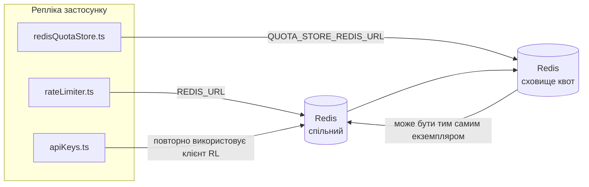

# Redis Production Configuration Guide (Українська)

🌐 **Languages:** 🇺🇸 [English](../../../../ops/REDIS_PRODUCTION_CONFIG.md) · 🇪🇹 [am](../../../am/docs/ops/REDIS_PRODUCTION_CONFIG.md) · 🇸🇦 [ar](../../../ar/docs/ops/REDIS_PRODUCTION_CONFIG.md) · 🇦🇿 [az](../../../az/docs/ops/REDIS_PRODUCTION_CONFIG.md) · 🇧🇬 [bg](../../../bg/docs/ops/REDIS_PRODUCTION_CONFIG.md) · 🇧🇩 [bn](../../../bn/docs/ops/REDIS_PRODUCTION_CONFIG.md) · 🇧🇦 [bs](../../../bs/docs/ops/REDIS_PRODUCTION_CONFIG.md) · 🇨🇿 [cs](../../../cs/docs/ops/REDIS_PRODUCTION_CONFIG.md) · 🇩🇰 [da](../../../da/docs/ops/REDIS_PRODUCTION_CONFIG.md) · 🇩🇪 [de](../../../de/docs/ops/REDIS_PRODUCTION_CONFIG.md) · 🇬🇷 [el](../../../el/docs/ops/REDIS_PRODUCTION_CONFIG.md) · 🇪🇸 [es](../../../es/docs/ops/REDIS_PRODUCTION_CONFIG.md) · 🇪🇪 [et](../../../et/docs/ops/REDIS_PRODUCTION_CONFIG.md) · 🇮🇷 [fa](../../../fa/docs/ops/REDIS_PRODUCTION_CONFIG.md) · 🇫🇮 [fi](../../../fi/docs/ops/REDIS_PRODUCTION_CONFIG.md) · 🇫🇷 [fr](../../../fr/docs/ops/REDIS_PRODUCTION_CONFIG.md) · 🇮🇪 [ga](../../../ga/docs/ops/REDIS_PRODUCTION_CONFIG.md) · 🇮🇳 [gu](../../../gu/docs/ops/REDIS_PRODUCTION_CONFIG.md) · 🇳🇬 [ha](../../../ha/docs/ops/REDIS_PRODUCTION_CONFIG.md) · 🇮🇱 [he](../../../he/docs/ops/REDIS_PRODUCTION_CONFIG.md) · 🇮🇳 [hi](../../../hi/docs/ops/REDIS_PRODUCTION_CONFIG.md) · 🇭🇷 [hr](../../../hr/docs/ops/REDIS_PRODUCTION_CONFIG.md) · 🇭🇺 [hu](../../../hu/docs/ops/REDIS_PRODUCTION_CONFIG.md) · 🇦🇲 [hy](../../../hy/docs/ops/REDIS_PRODUCTION_CONFIG.md) · 🇮🇩 [id](../../../id/docs/ops/REDIS_PRODUCTION_CONFIG.md) · 🇳🇬 [ig](../../../ig/docs/ops/REDIS_PRODUCTION_CONFIG.md) · 🇮🇹 [it](../../../it/docs/ops/REDIS_PRODUCTION_CONFIG.md) · 🇯🇵 [ja](../../../ja/docs/ops/REDIS_PRODUCTION_CONFIG.md) · 🇬🇪 [ka](../../../ka/docs/ops/REDIS_PRODUCTION_CONFIG.md) · 🇰🇭 [km](../../../km/docs/ops/REDIS_PRODUCTION_CONFIG.md) · 🇮🇳 [kn](../../../kn/docs/ops/REDIS_PRODUCTION_CONFIG.md) · 🇰🇷 [ko](../../../ko/docs/ops/REDIS_PRODUCTION_CONFIG.md) · 🇱🇹 [lt](../../../lt/docs/ops/REDIS_PRODUCTION_CONFIG.md) · 🇱🇻 [lv](../../../lv/docs/ops/REDIS_PRODUCTION_CONFIG.md) · 🇮🇳 [ml](../../../ml/docs/ops/REDIS_PRODUCTION_CONFIG.md) · 🇮🇳 [mr](../../../mr/docs/ops/REDIS_PRODUCTION_CONFIG.md) · 🇲🇾 [ms](../../../ms/docs/ops/REDIS_PRODUCTION_CONFIG.md) · 🇲🇹 [mt](../../../mt/docs/ops/REDIS_PRODUCTION_CONFIG.md) · 🇲🇲 [my](../../../my/docs/ops/REDIS_PRODUCTION_CONFIG.md) · 🇳🇵 [ne](../../../ne/docs/ops/REDIS_PRODUCTION_CONFIG.md) · 🇳🇱 [nl](../../../nl/docs/ops/REDIS_PRODUCTION_CONFIG.md) · 🇳🇴 [no](../../../no/docs/ops/REDIS_PRODUCTION_CONFIG.md) · 🇮🇳 [or](../../../or/docs/ops/REDIS_PRODUCTION_CONFIG.md) · 🇮🇳 [pa](../../../pa/docs/ops/REDIS_PRODUCTION_CONFIG.md) · 🇵🇭 [phi](../../../phi/docs/ops/REDIS_PRODUCTION_CONFIG.md) · 🇵🇱 [pl](../../../pl/docs/ops/REDIS_PRODUCTION_CONFIG.md) · 🇵🇹 [pt](../../../pt/docs/ops/REDIS_PRODUCTION_CONFIG.md) · 🇧🇷 [pt-BR](../../../pt-BR/docs/ops/REDIS_PRODUCTION_CONFIG.md) · 🇷🇴 [ro](../../../ro/docs/ops/REDIS_PRODUCTION_CONFIG.md) · 🇷🇺 [ru](../../../ru/docs/ops/REDIS_PRODUCTION_CONFIG.md) · 🇱🇰 [si](../../../si/docs/ops/REDIS_PRODUCTION_CONFIG.md) · 🇸🇰 [sk](../../../sk/docs/ops/REDIS_PRODUCTION_CONFIG.md) · 🇸🇮 [sl](../../../sl/docs/ops/REDIS_PRODUCTION_CONFIG.md) · 🇷🇸 [sr](../../../sr/docs/ops/REDIS_PRODUCTION_CONFIG.md) · 🇸🇪 [sv](../../../sv/docs/ops/REDIS_PRODUCTION_CONFIG.md) · 🇰🇪 [sw](../../../sw/docs/ops/REDIS_PRODUCTION_CONFIG.md) · 🇮🇳 [ta](../../../ta/docs/ops/REDIS_PRODUCTION_CONFIG.md) · 🇮🇳 [te](../../../te/docs/ops/REDIS_PRODUCTION_CONFIG.md) · 🇹🇭 [th](../../../th/docs/ops/REDIS_PRODUCTION_CONFIG.md) · 🇹🇷 [tr](../../../tr/docs/ops/REDIS_PRODUCTION_CONFIG.md) · 🇵🇰 [ur](../../../ur/docs/ops/REDIS_PRODUCTION_CONFIG.md) · 🇺🇿 [uz](../../../uz/docs/ops/REDIS_PRODUCTION_CONFIG.md) · 🇻🇳 [vi](../../../vi/docs/ops/REDIS_PRODUCTION_CONFIG.md) · 🇳🇬 [yo](../../../yo/docs/ops/REDIS_PRODUCTION_CONFIG.md) · 🇨🇳 [zh-CN](../../../zh-CN/docs/ops/REDIS_PRODUCTION_CONFIG.md) · 🇹🇼 [zh-TW](../../../zh-TW/docs/ops/REDIS_PRODUCTION_CONFIG.md)

---

## Огляд

Redis є **необов’язковою, м’якою залежністю** в OmniRoute — коли Redis недоступний, застосунок продовжує працювати з обмеженою функціональністю (використовуючи резервні механізми в пам’яті). У виробничому середовищі налаштування Redis зменшує затримку для чотирьох окремих робочих навантажень:

| Робоче навантаження              | Драйвер                       | Фабрика клієнта                                                | Шаблон ключа                                                |
| -------------------------------- | ----------------------------- | -------------------------------------------------------------- | ----------------------------------------------------------- |
| Обмеження частоти запитів        | `rateLimiter.ts`              | `getRedisClient()` — ліниво ініціалізований синглтон `ioredis` | `<prefix>rl:*` Lua‑атомарні вікна обмеження частоти запитів |
| Кеш автентифікації               | `apiKeys.ts`                  | Повторно використовує клієнт із `rateLimiter`                  | `<prefix>auth:api_key:<sha256>` з TTL                       |
| Сховище квот                     | `redisQuotaStore.ts`          | Окремий синглтон `getRedisClient(url)`                         | `<prefix>quota:*`, налаштовується для кожного екземпляра    |
| Автоматичний вимикач прогрівання | `redisCircuitBreakerStore.ts` | Окремий клієнт у `circuitBreakerFactory.ts`                    | `<prefix>warmup:cb:<connectionId>`                          |

Усі чотири робочі навантаження використовують спільний префікс простору імен, завдяки чому OmniRoute може співіснувати з іншими застосунками в одному екземплярі Redis (наприклад, `127.0.0.1:6379`). Див. [Простір імен ключів](#key-namespacing).

---

## Поточна конфігурація (типові значення в коді)

| Налаштування                              | Значення                                                                     | Де                                                                                    |
| ----------------------------------------- | ---------------------------------------------------------------------------- | ------------------------------------------------------------------------------------- |
| Змінна середовища `REDIS_URL`             | `redis://redis:6379` (compose), необов’язкова                                | `rateLimiter.ts:5`, `.env.example`                                                    |
| Змінна середовища `REDIS_KEY_PREFIX`      | `omniroute:` (типове значення)                                               | `rateLimiter.ts`, `redisQuotaStore.ts`, `redisCircuitBreakerStore.ts`, `.env.example` |
| Змінна середовища `QUOTA_STORE_REDIS_URL` | окрема, може відрізнятися від `REDIS_URL`                                    | `quota/storeFactory.ts`                                                               |
| `QUOTA_STORE_DRIVER`                      | `"sqlite"` (типове значення), `"redis"` — необов’язкове                      | `quota/storeFactory.ts`                                                               |
| `maxRetriesPerRequest` в ioredis          | `3`                                                                          | створення клієнта в `rateLimiter.ts`                                                  |
| `enableReadyCheck`                        | не задано (типове значення ioredis: `true`)                                  | —                                                                                     |
| `lazyConnect`                             | не задано (типове значення ioredis: `false`)                                 | —                                                                                     |
| `retryStrategy`                           | не задано (типове значення ioredis: базові 200 мс, експоненційне збільшення) | —                                                                                     |
| TLS / пароль / індекс БД                  | **не налаштовано**                                                           | —                                                                                     |
| Sentinel / Cluster                        | **не налаштовано** — підтримується лише автономний одновузловий режим        | —                                                                                     |

---

## Простір імен ключів

OmniRoute спільно використовує екземпляр Redis з усіма іншими сервісами, що працюють на хості. Без простору імен ключі на кшталт `auth:api_key:<sha256>` або `rl:*` можуть конфліктувати з ключами інших застосунків, які використовують той самий Redis (цей екземпляр запускає Redis на `127.0.0.1:6379` разом з іншими сервісами).

Задайте для `REDIS_KEY_PREFIX` непорожній рядок, щоб додати префікс до **кожного** ключа OmniRoute:

```bash
# .env — усі ключі OmniRoute матимуть вигляд omniroute:rl:*, omniroute:auth:*, omniroute:quota:*, omniroute:warmup:cb:*
REDIS_KEY_PREFIX=omniroute:
```

- **Типове значення:** `omniroute:` (застосовується, якщо `REDIS_KEY_PREFIX` не задано або має порожнє значення).
- **Застосовується до:** обмежувача частоти запитів і кешу автентифікації (спільний клієнт `ioredis` через `keyPrefix`), сховища квот (`KEY_PREFIX = "${REDIS_KEY_PREFIX}quota"`) та автоматичного вимикача прогрівання (`KEY_PREFIX = "${REDIS_KEY_PREFIX}warmup:cb:"`).
- **Зміна префікса**, коли ключі вже існують у Redis, залишає старі ключі без прив’язки (вони видаляються після завершення TTL / за алгоритмом LRU). Префікс можна безпечно змінювати; міграція не потрібна. Єдиний виняток — ключ автоматичного вимикача прогрівання для з’єднання, позначеного як заборонене: він зберігається без TTL, тому знайдіть залишки за допомогою `redis-cli --scan --pattern '<old-prefix>warmup:cb:*'` і видаліть їх.
- **`keyPrefix` в ioredis** автоматично додає префікс під час запису **та** видаляє його під час читання, тому код застосунку ніколи не бачить префікс.

---

## Рекомендована настройка виробництва

### 1. Пул підключень/Параметри клієнта (конструктор ioredis `Redis` )

Поточний код створює єдиний `new Redis(url)` без спеціальних параметрів. Для виробничих розгортань з декількома копіями передайте клієнтську фабрику в коді або оберніть `getRedisClient()`:

```typescript
const redis = new Redis(REDIS_URL, {
  maxRetriesPerRequest: null, // no retry limit; let retryStrategy decide
  enableReadyCheck: true, // verify server is ready before accepting calls
  lazyConnect: true, // don't connect on construction; wait for first call
  retryStrategy: (times) => {
    if (times > 10) return null; // give up after 10 retries → reconnect later
    return Math.min(times * 200, 5000); // 200ms, 400ms, …, 5s cap
  },
  enableAutoPipelining: true, // coalesce concurrent commands into one TCP write
  keepAlive: 10000, // TCP keep‑alive every 10s
});
```

**Ключові компроміси:**

- `maxRetriesPerRequest: null` + `retryStrategy` — надає перевагу для виробництва, тому тимчасові перезапуски Redis не призводять до негайної помилки кожного запиту. Резервне копіювання в пам’яті в `checkRateLimit()` поглинає шлях відмови.
- `lazyConnect: true` — уникає залежності запуску від того, що Redis працює до того, як сервер почне приймати з’єднання.
- `enableAutoPipelining: true` — зменшує зворотні передачі для одночасних перевірок обмеження швидкості; вигідно при > 50 RPS на одне підключення.

### 2. Конфігурація сервера Redis (`redis.conf`)

```
# Memory
maxmemory 80%                        # leave room for OS page cache
maxmemory-policy allkeys-lru         # evict stale auth cache entries under pressure

# Persistence (optional — OmniRoute is crash‑safe without it)
save 300 1                           # snapshot at least every 5 min if ≥1 key changed
appendonly no                        # AOF not needed; data is regeneratable
appendfsync no                       # no fsync overhead (RDB is sufficient)

# Networking
timeout 0                            # no idle disconnect
tcp-keepalive 300                    # 5 min keep‑alive
tcp-backlog 511                      # connection backlog for bursty load

# Performance
hz 10                                # default; 100 for latency‑sensitive
activedefrag yes                     # auto‑defragment when fragmentation >10%
```

**Компроміс для `maxmemory-policy allkeys-lru`:** Записи кешу автентифікації можуть бути видалені через тиск пам’яті. Це безпечно. — `setCachedApiKey` завжди повторно заповнюється в разі промаху, а резервний SQLite є авторитетним. Сценарій Lua з обмеженням швидкості створює невеликі ключі, які недовговічні за задумом.

### 3. Налаштування створення Docker

Prod compose (`docker-compose.prod.yml`) використовує `redis:8.6.2-alpine`. додати:

```yaml
redis:
  image: redis:8.6.2-alpine
  command:
    [
      "redis-server",
      "--maxmemory",
      "512mb",
      "--maxmemory-policy",
      "allkeys-lru",
      "--activedefrag",
      "yes",
      "--save",
      "300 1",
    ]
  healthcheck:
    test: ["CMD", "redis-cli", "ping"]
    interval: 10s
    timeout: 3s
    retries: 3
    start_period: 5s
```

### 4. Кілька екземплярів / міркування щодо масштабування

**Єдиний Redis для всіх реплік** — сценарій Lua обмеження швидкості залежить від одного авторитетного простору ключів. Кілька екземплярів Redis за репліками втратять атомарність і подвоїть бюджет. Використовуйте один Redis (або кластер Redis Sentinel із відновленням після відмови) для всіх реплік програм.

**Кількість підключень:** Кожна копія програми відкривається** 2 з'єднання TCP** до Redis (клієнт обмеження швидкості + клієнт сховища квот). При 10 репліках → 20 з’єднань, що в межах максимальної кількості з’єднань екземпляра Redis за замовчуванням у 10 тис.

### 5. Моніторинг

Виявляти через кінцеву точку перевірки працездатності:

```typescript
// src/app/api/monitoring/health/route.ts already calls rateLimiter functions
// Add Redis-specific checks:
//   1. PING latency via ioredis .ping()
//   2. Memory usage via INFO memory
//   3. Connection count via INFO clients
//   4. Hit rate for maxmemory-policy (evicted_keys / keyspace_hits)
```

Ключові показники, на які варто звернути увагу:

- **Вигнані ключі / сек** — якщо постійно не дорівнює нулю, збільшити `maxmemory`
- **Заблоковані клієнти** — відмінний від нуля передбачає повільні сценарії Lua або високу конкуренцію
- **Відхилені підключення** — обмеження з'єднання досягнуто; рідко при 20 підключеннях

### 6. Redis-сумісні сервери

Будь-який сервер, який тут використовується, повинен запускати сценарії Lua: обмежувач швидкості становить один `EVAL`. На сервері без Lua `checkRateLimit()` реєструє `[RATE_LIMITER] Redis eval failed, falling back to in-memory rate limiting` і підраховує для кожного процесу, тому кожна репліка встановлює обмеження самостійно. Спільне сховище спорідненості сеансу (`OMNIROUTE_SESSION_AFFINITY_STORE=redis`) також зчитує та оновлює піни за допомогою `EVAL`; без Lua він реєструє `[SESSION_AFFINITY] Redis error; falling back to SQLite.`, і кожна репліка зберігає власні шпильки. Інші робочі навантаження використовують прості команди (`SET ... EX`, `GET`, `DEL`, `MGET`, `EXPIRE`, `INCRBYFLOAT`, хеші та набори), а серверна частина Redis семантичного кешу не надсилає команди `FT.*`.

Перевірено за допомогою OmniRoute 3.8.52: KiviDB 1.2.0 із зображенням Lua (`kividb/kividb:v1.2.0-lua`). Обмежувач швидкості (включаючи другий процес, який спільно використовує лічильники), кеш автентифікації, сховище квот, автоматичний вимикач розігріву, сховище семантичного кешу та запит `/v1/chat/completions` через обробник чату пройшли 18 із 19 перевірок, які проходять у Redis 8.10.3. Той, який відрізняється: `INCRBYFLOAT` зберігає `0.1 + 0.2` як `0.30000000000000004` де Redis зберігає `0.3` ( [kividbio/kividb#387](https://github.com/kividbio/kividb/issues/387) ). Сховище квот аналізує обидва за допомогою `parseFloat`, але ці два числа відрізняються останніми цифрами, тому порівняння, яке потрапляє точно на межу квоти, може вийти по-різному. Сховище афінності сеансу не було частиною цього запуску. ( [налаштування](https://github.com/kividbio/kividb/blob/master/docs/integrations/omniroute.md), [результати](https://github.com/kividbio/kividb/tree/master/benchmarks/omniroute-compat) )

---

## Діаграма архітектури



---

## Посилання

| Файл                               | Призначення                                                                              |
| ---------------------------------- | ---------------------------------------------------------------------------------------- |
| `src/shared/utils/rateLimiter.ts`  | Основний клієнт Redis, Lua-скрипт обмеження частоти запитів, резервний варіант у пам’яті |
| `src/lib/db/apiKeys.ts`            | Кеш автентифікації — Redis→SQLite як резервний варіант                                   |
| `src/lib/quota/redisQuotaStore.ts` | Окремий клієнт Redis для необов’язкового сховища квот                                    |
| `src/lib/quota/storeFactory.ts`    | Перемикає драйвери квот між `sqlite` і `redis`                                           |
| `docker-compose.prod.yml`          | Контейнер Redis для продакшену (образ `redis:8.6.2-alpine`)                              |
| `.env.example`                     | Документація змінних середовища Redis                                                    |
| `src/app/api/local/redis/`         | Маршрути API для оркестрації контейнера середовища розробки                              |
| `bin/cli/commands/redis.mjs`       | Команди CLI для оркестрації контейнера середовища розробки                               |
