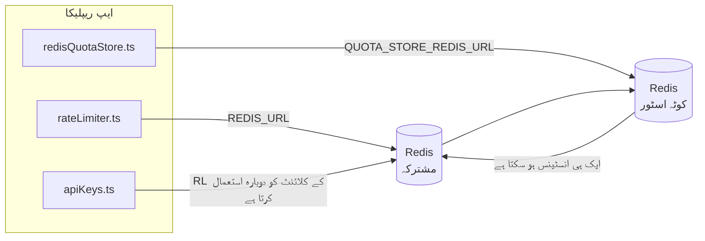

# Redis Production Configuration Guide (اردو)

🌐 **Languages:** 🇺🇸 [English](../../../../ops/REDIS_PRODUCTION_CONFIG.md) · 🇪🇹 [am](../../../am/docs/ops/REDIS_PRODUCTION_CONFIG.md) · 🇸🇦 [ar](../../../ar/docs/ops/REDIS_PRODUCTION_CONFIG.md) · 🇦🇿 [az](../../../az/docs/ops/REDIS_PRODUCTION_CONFIG.md) · 🇧🇬 [bg](../../../bg/docs/ops/REDIS_PRODUCTION_CONFIG.md) · 🇧🇩 [bn](../../../bn/docs/ops/REDIS_PRODUCTION_CONFIG.md) · 🇧🇦 [bs](../../../bs/docs/ops/REDIS_PRODUCTION_CONFIG.md) · 🇨🇿 [cs](../../../cs/docs/ops/REDIS_PRODUCTION_CONFIG.md) · 🇩🇰 [da](../../../da/docs/ops/REDIS_PRODUCTION_CONFIG.md) · 🇩🇪 [de](../../../de/docs/ops/REDIS_PRODUCTION_CONFIG.md) · 🇬🇷 [el](../../../el/docs/ops/REDIS_PRODUCTION_CONFIG.md) · 🇪🇸 [es](../../../es/docs/ops/REDIS_PRODUCTION_CONFIG.md) · 🇪🇪 [et](../../../et/docs/ops/REDIS_PRODUCTION_CONFIG.md) · 🇮🇷 [fa](../../../fa/docs/ops/REDIS_PRODUCTION_CONFIG.md) · 🇫🇮 [fi](../../../fi/docs/ops/REDIS_PRODUCTION_CONFIG.md) · 🇫🇷 [fr](../../../fr/docs/ops/REDIS_PRODUCTION_CONFIG.md) · 🇮🇪 [ga](../../../ga/docs/ops/REDIS_PRODUCTION_CONFIG.md) · 🇮🇳 [gu](../../../gu/docs/ops/REDIS_PRODUCTION_CONFIG.md) · 🇳🇬 [ha](../../../ha/docs/ops/REDIS_PRODUCTION_CONFIG.md) · 🇮🇱 [he](../../../he/docs/ops/REDIS_PRODUCTION_CONFIG.md) · 🇮🇳 [hi](../../../hi/docs/ops/REDIS_PRODUCTION_CONFIG.md) · 🇭🇷 [hr](../../../hr/docs/ops/REDIS_PRODUCTION_CONFIG.md) · 🇭🇺 [hu](../../../hu/docs/ops/REDIS_PRODUCTION_CONFIG.md) · 🇦🇲 [hy](../../../hy/docs/ops/REDIS_PRODUCTION_CONFIG.md) · 🇮🇩 [id](../../../id/docs/ops/REDIS_PRODUCTION_CONFIG.md) · 🇳🇬 [ig](../../../ig/docs/ops/REDIS_PRODUCTION_CONFIG.md) · 🇮🇹 [it](../../../it/docs/ops/REDIS_PRODUCTION_CONFIG.md) · 🇯🇵 [ja](../../../ja/docs/ops/REDIS_PRODUCTION_CONFIG.md) · 🇬🇪 [ka](../../../ka/docs/ops/REDIS_PRODUCTION_CONFIG.md) · 🇰🇭 [km](../../../km/docs/ops/REDIS_PRODUCTION_CONFIG.md) · 🇮🇳 [kn](../../../kn/docs/ops/REDIS_PRODUCTION_CONFIG.md) · 🇰🇷 [ko](../../../ko/docs/ops/REDIS_PRODUCTION_CONFIG.md) · 🇱🇹 [lt](../../../lt/docs/ops/REDIS_PRODUCTION_CONFIG.md) · 🇱🇻 [lv](../../../lv/docs/ops/REDIS_PRODUCTION_CONFIG.md) · 🇮🇳 [ml](../../../ml/docs/ops/REDIS_PRODUCTION_CONFIG.md) · 🇮🇳 [mr](../../../mr/docs/ops/REDIS_PRODUCTION_CONFIG.md) · 🇲🇾 [ms](../../../ms/docs/ops/REDIS_PRODUCTION_CONFIG.md) · 🇲🇹 [mt](../../../mt/docs/ops/REDIS_PRODUCTION_CONFIG.md) · 🇲🇲 [my](../../../my/docs/ops/REDIS_PRODUCTION_CONFIG.md) · 🇳🇵 [ne](../../../ne/docs/ops/REDIS_PRODUCTION_CONFIG.md) · 🇳🇱 [nl](../../../nl/docs/ops/REDIS_PRODUCTION_CONFIG.md) · 🇳🇴 [no](../../../no/docs/ops/REDIS_PRODUCTION_CONFIG.md) · 🇮🇳 [or](../../../or/docs/ops/REDIS_PRODUCTION_CONFIG.md) · 🇮🇳 [pa](../../../pa/docs/ops/REDIS_PRODUCTION_CONFIG.md) · 🇵🇭 [phi](../../../phi/docs/ops/REDIS_PRODUCTION_CONFIG.md) · 🇵🇱 [pl](../../../pl/docs/ops/REDIS_PRODUCTION_CONFIG.md) · 🇵🇹 [pt](../../../pt/docs/ops/REDIS_PRODUCTION_CONFIG.md) · 🇧🇷 [pt-BR](../../../pt-BR/docs/ops/REDIS_PRODUCTION_CONFIG.md) · 🇷🇴 [ro](../../../ro/docs/ops/REDIS_PRODUCTION_CONFIG.md) · 🇷🇺 [ru](../../../ru/docs/ops/REDIS_PRODUCTION_CONFIG.md) · 🇱🇰 [si](../../../si/docs/ops/REDIS_PRODUCTION_CONFIG.md) · 🇸🇰 [sk](../../../sk/docs/ops/REDIS_PRODUCTION_CONFIG.md) · 🇸🇮 [sl](../../../sl/docs/ops/REDIS_PRODUCTION_CONFIG.md) · 🇷🇸 [sr](../../../sr/docs/ops/REDIS_PRODUCTION_CONFIG.md) · 🇸🇪 [sv](../../../sv/docs/ops/REDIS_PRODUCTION_CONFIG.md) · 🇰🇪 [sw](../../../sw/docs/ops/REDIS_PRODUCTION_CONFIG.md) · 🇮🇳 [ta](../../../ta/docs/ops/REDIS_PRODUCTION_CONFIG.md) · 🇮🇳 [te](../../../te/docs/ops/REDIS_PRODUCTION_CONFIG.md) · 🇹🇭 [th](../../../th/docs/ops/REDIS_PRODUCTION_CONFIG.md) · 🇹🇷 [tr](../../../tr/docs/ops/REDIS_PRODUCTION_CONFIG.md) · 🇺🇦 [uk-UA](../../../uk-UA/docs/ops/REDIS_PRODUCTION_CONFIG.md) · 🇺🇿 [uz](../../../uz/docs/ops/REDIS_PRODUCTION_CONFIG.md) · 🇻🇳 [vi](../../../vi/docs/ops/REDIS_PRODUCTION_CONFIG.md) · 🇳🇬 [yo](../../../yo/docs/ops/REDIS_PRODUCTION_CONFIG.md) · 🇨🇳 [zh-CN](../../../zh-CN/docs/ops/REDIS_PRODUCTION_CONFIG.md) · 🇹🇼 [zh-TW](../../../zh-TW/docs/ops/REDIS_PRODUCTION_CONFIG.md)

---

## جائزہ

Redis، OmniRoute میں ایک **اختیاری، نرم انحصار** ہے — Redis دستیاب نہ ہونے پر ایپلیکیشن بخوبی کم فعالیت والے موڈ میں منتقل ہو جاتی ہے (ان میموری
متبادل)۔ پروڈکشن میں Redis کی ٹیوننگ چار مختلف
ورک لوڈز کے لیے تاخیر کم کرتی ہے:

| ورک لوڈ            | ڈرائیور                       | کلائنٹ فیکٹری                                       | کلید کا پیٹرن                                    |
| ------------------ | ----------------------------- | --------------------------------------------------- | ------------------------------------------------ |
| شرح کی تحدید       | `rateLimiter.ts`              | `getRedisClient()` — سست آغاز والا `ioredis` سنگلٹن | `<prefix>rl:*` Lua‑اٹامک شرح تحدید ونڈوز         |
| توثیقی کیش         | `apiKeys.ts`                  | `rateLimiter` کا کلائنٹ دوبارہ استعمال کرتا ہے      | `<prefix>auth:api_key:<sha256>` بمع TTL          |
| کوٹہ اسٹور         | `redisQuotaStore.ts`          | علیحدہ `getRedisClient(url)` سنگلٹن                 | `<prefix>quota:*`، ہر انسٹینس کے لیے قابلِ ترتیب |
| وارم اپ سرکٹ بریکر | `redisCircuitBreakerStore.ts` | `circuitBreakerFactory.ts` میں علیحدہ کلائنٹ        | `<prefix>warmup:cb:<connectionId>`               |

چاروں ورک لوڈز ایک ہی نیم اسپیس پری فکس استعمال کرتے ہیں، تاکہ OmniRoute ایک ہی Redis انسٹینس پر دیگر ایپس کے ساتھ
موجود رہ سکے (مثلاً `127.0.0.1:6379`)۔ [کلیدی نیم اسپیسنگ](#key-namespacing) دیکھیں۔

---

## موجودہ کنفیگریشن (کوڈ ڈیفالٹس)

| ترتیب                                   | قدر                                                   | مقام                                                                                  |
| --------------------------------------- | ----------------------------------------------------- | ------------------------------------------------------------------------------------- |
| `REDIS_URL` ماحولیاتی متغیر             | `redis://redis:6379` (compose)، اختیاری               | `rateLimiter.ts:5`, `.env.example`                                                    |
| `REDIS_KEY_PREFIX` ماحولیاتی متغیر      | `omniroute:` (ڈیفالٹ)                                 | `rateLimiter.ts`, `redisQuotaStore.ts`, `redisCircuitBreakerStore.ts`, `.env.example` |
| `QUOTA_STORE_REDIS_URL` ماحولیاتی متغیر | علیحدہ، `REDIS_URL` سے مختلف ہو سکتا ہے               | `quota/storeFactory.ts`                                                               |
| `QUOTA_STORE_DRIVER`                    | `"sqlite"` (ڈیفالٹ)، `"redis"` اختیاری                | `quota/storeFactory.ts`                                                               |
| ioredis `maxRetriesPerRequest`          | `3`                                                   | `rateLimiter.ts` میں کلائنٹ کی تخلیق                                                  |
| `enableReadyCheck`                      | مقرر نہیں (ioredis ڈیفالٹ: `true`)                    | —                                                                                     |
| `lazyConnect`                           | مقرر نہیں (ioredis ڈیفالٹ: `false`)                   | —                                                                                     |
| `retryStrategy`                         | مقرر نہیں (ioredis ڈیفالٹ: 200ms بنیادی، ایکسپونینشل) | —                                                                                     |
| TLS / پاس ورڈ / DB انڈیکس               | **کنفیگر نہیں کیے گئے**                               | —                                                                                     |
| Sentinel / Cluster                      | **کنفیگر نہیں کیے گئے** — صرف اسٹینڈ الون سنگل نوڈ    | —                                                                                     |

---

## کلیدی نیم اسپیسنگ

OmniRoute میزبان پر چلنے والی دیگر سروسز کے ساتھ ایک Redis انسٹینس شیئر کرتا ہے۔ نیم اسپیس کے بغیر،
`auth:api_key:<sha256>` یا `rl:*` جیسی کلیدیں اسی Redis کو استعمال کرنے والی دیگر ایپلیکیشنز کی
کلیدوں سے متصادم ہو سکتی ہیں (یہ انسٹینس دیگر سروسز کے ساتھ `127.0.0.1:6379` پر Redis چلاتا ہے)۔

OmniRoute کی **ہر** کلید کے شروع میں پری فکس شامل کرنے کے لیے `REDIS_KEY_PREFIX` کو کسی غیر خالی اسٹرنگ پر مقرر کریں:

```bash
# .env — OmniRoute کی تمام کلیدیں omniroute:rl:*, omniroute:auth:*, omniroute:quota:*, omniroute:warmup:cb:* بن جاتی ہیں
REDIS_KEY_PREFIX=omniroute:
```

- **ڈیفالٹ:** `omniroute:` (`REDIS_KEY_PREFIX` غیر مقرر یا خالی ہونے پر لاگو ہوتا ہے)۔
- **جن پر لاگو ہوتا ہے:** شرح محدد + توثیقی کیش (`keyPrefix` کے ذریعے مشترکہ `ioredis` کلائنٹ) اور
  کوٹہ اسٹور (`KEY_PREFIX = "${REDIS_KEY_PREFIX}quota"`) اور وارم اپ سرکٹ بریکر
  (`KEY_PREFIX = "${REDIS_KEY_PREFIX}warmup:cb:"`)۔
- Redis میں کلیدیں پہلے سے موجود ہونے کی صورت میں **پری فکس تبدیل کرنے** سے پرانی کلیدیں لاوارث ہو جاتی ہیں (وہ
  TTL / LRU کے ذریعے زائد المیعاد ہو جاتی ہیں)۔ اسے تبدیل کرنا محفوظ ہے؛ کسی منتقلی کی ضرورت نہیں۔ واحد استثنا کسی ایسے کنکشن کی وارم اپ
  سرکٹ بریکر کلید ہے جسے ممنوع نشان زد کیا گیا ہو: اسے TTL کے بغیر مستقل محفوظ کیا جاتا ہے، لہٰذا باقی رہ جانے والی کلیدوں کی فہرست
  `redis-cli --scan --pattern '<old-prefix>warmup:cb:*'` سے حاصل کریں اور انہیں حذف کر دیں۔
- **ioredis `keyPrefix`** تحریر کے وقت خودکار طور پر پری فکس شامل کرتا ہے **اور** پڑھنے کے وقت اسے ہٹا دیتا ہے،
  اس لیے ایپلیکیشن کوڈ کو کبھی پری فکس نظر نہیں آتا۔

---

## تجویز کردہ پروڈکشن ٹیوننگ

### 1. کنکشن پول / کلائنٹ کے اختیارات (ioredis `Redis` کنسٹرکٹر)

موجودہ کوڈ ایک واحد `new Redis(url)` بناتا ہے بغیر کسی حسب ضرورت اختیارات کے۔ پروڈکشن ملٹی ریپلیکا کی تعیناتیوں کے لیے، کوڈ میں کلائنٹ فیکٹری کو پاس کریں یا `getRedisClient()` لپیٹیں:

```typescript
const redis = new Redis(REDIS_URL, {
  maxRetriesPerRequest: null, // no retry limit; let retryStrategy decide
  enableReadyCheck: true, // verify server is ready before accepting calls
  lazyConnect: true, // don't connect on construction; wait for first call
  retryStrategy: (times) => {
    if (times > 10) return null; // give up after 10 retries → reconnect later
    return Math.min(times * 200, 5000); // 200ms, 400ms, …, 5s cap
  },
  enableAutoPipelining: true, // coalesce concurrent commands into one TCP write
  keepAlive: 10000, // TCP keep‑alive every 10s
});
```

**کلیدی تجارت:**

- `maxRetriesPerRequest: null` + `retryStrategy` — پروڈکشن کے لیے ترجیح دی گئی ہے لہذا عارضی Redis دوبارہ شروع ہر درخواست کو فوری طور پر ناکام نہیں کرتا ہے۔ `checkRateLimit()` میں ان میموری فال بیک ناکامی کے راستے کو جذب کر لیتا ہے۔
- `lazyConnect: true` — سرور کے کنکشن قبول کرنا شروع کرنے سے پہلے Redis اوپر ہونے پر ابتدائی انحصار سے گریز کرتا ہے۔
- `enableAutoPipelining: true` — سمورتی شرح کی حد کی جانچ کے لیے راؤنڈ ٹرپس کو کم کرتا ہے۔ ایک ہی کنکشن پر > 50 RPS پر فائدہ مند۔

### 2. Redis سرور کنفیگریشن (`redis.conf`)

```
# Memory
maxmemory 80%                        # leave room for OS page cache
maxmemory-policy allkeys-lru         # evict stale auth cache entries under pressure

# Persistence (optional — OmniRoute is crash‑safe without it)
save 300 1                           # snapshot at least every 5 min if ≥1 key changed
appendonly no                        # AOF not needed; data is regeneratable
appendfsync no                       # no fsync overhead (RDB is sufficient)

# Networking
timeout 0                            # no idle disconnect
tcp-keepalive 300                    # 5 min keep‑alive
tcp-backlog 511                      # connection backlog for bursty load

# Performance
hz 10                                # default; 100 for latency‑sensitive
activedefrag yes                     # auto‑defragment when fragmentation >10%
```

**`maxmemory-policy allkeys-lru` کے لیے تجارت:** میموری کے دباؤ کے تحت Auth کیشے کے اندراجات کو بے دخل کیا جا سکتا ہے۔ یہ محفوظ ہے — `setCachedApiKey` ہمیشہ مس ہونے پر دوبارہ آباد ہوتا ہے، اور SQLite فال بیک مستند ہے۔ شرح محدود کرنے والا Lua اسکرپٹ چھوٹی چابیاں بناتا ہے جو کہ ڈیزائن کے لحاظ سے قلیل مدتی ہوتی ہیں۔

### 3. Docker کمپوز سیٹنگز

پروڈ کمپوز (`docker-compose.prod.yml`) `redis:8.6.2-alpine` استعمال کرتا ہے۔ شامل کریں:

```yaml
redis:
  image: redis:8.6.2-alpine
  command:
    [
      "redis-server",
      "--maxmemory",
      "512mb",
      "--maxmemory-policy",
      "allkeys-lru",
      "--activedefrag",
      "yes",
      "--save",
      "300 1",
    ]
  healthcheck:
    test: ["CMD", "redis-cli", "ping"]
    interval: 10s
    timeout: 3s
    retries: 3
    start_period: 5s
```

### 4. ملٹی-انسٹینس / اسکیلنگ کے تحفظات

**تمام نقلوں کے لیے سنگل Redis** — شرح محدود Lua اسکرپٹ ایک واحد مستند کلیدی جگہ پر منحصر ہے۔ نقل کے پیچھے متعدد Redis مثالیں جوہری صلاحیت کھو دیں گی اور بجٹ کو دوگنا کر دے گا۔ تمام ایپلیکیشن کی نقلوں کے لیے ایک واحد Redis (یا فیل اوور کے ساتھ Redis سینٹینیل کلسٹر) استعمال کریں۔

**کنکشن کی تعداد:** ہر درخواست کی نقل کھلتی ہے۔** 2 TCP کنکشن** Redis کو (ریٹ محدود کرنے والا کلائنٹ + کوٹا اسٹور کلائنٹ)۔ 10 replicas → 20 کنکشنز پر، پہلے سے طے شدہ Redis مثال کی 10k کنکشن کی حد کے اندر۔

### 5. نگرانی

ہیلتھ چیک اینڈ پوائنٹ کے ذریعے ظاہر کریں:

```typescript
// src/app/api/monitoring/health/route.ts already calls rateLimiter functions
// Add Redis-specific checks:
//   1. PING latency via ioredis .ping()
//   2. Memory usage via INFO memory
//   3. Connection count via INFO clients
//   4. Hit rate for maxmemory-policy (evicted_keys / keyspace_hits)
```

دیکھنے کے لیے کلیدی میٹرکس:

- **بے دخل شدہ چابیاں / سیکنڈ** — اگر مسلسل غیر صفر ہے، `maxmemory` بڑھائیں۔
- **بلاک شدہ کلائنٹس** — غیر صفر سست Lua اسکرپٹس یا زیادہ تنازعات کی تجویز کرتا ہے۔
- **کنکشن مسترد کر دیے گئے۔** — کنکشن کی حد ہٹ گئی؛ 20 کنکشن پر نایاب

### 6. Redis-Compatible سرورز

یہاں استعمال ہونے والے کسی بھی سرور کو Lua اسکرپٹس چلانا چاہیے: ریٹ محدود کرنے والا ایک `EVAL` ہے۔ Lua کے بغیر سرور پر، `checkRateLimit()` `[RATE_LIMITER] Redis eval failed, falling back to in-memory rate limiting` کو لاگ کرتا ہے اور ہر عمل کو شمار کرتا ہے، لہذا ہر ایک نقل اپنے طور پر حد کو نافذ کرتی ہے۔ آپٹ ان شیئرڈ سیشن ایفینیٹی اسٹور (`OMNIROUTE_SESSION_AFFINITY_STORE=redis`) `EVAL` کے ساتھ پنوں کو بھی پڑھتا اور اپ ڈیٹ کرتا ہے۔ Lua کے بغیر یہ `[SESSION_AFFINITY] Redis error; falling back to SQLite.` لاگ کرتا ہے اور ہر ایک نقل اپنی اپنی پن رکھتی ہے۔ دوسرے کام کے بوجھ سادہ کمانڈز استعمال کرتے ہیں (`SET ... EX`, `GET`, `DEL`, `MGET`, `EXPIRE`, `INCRBYFLOAT`, ہیشز اور سیٹ) اور سیمنٹک کیشے کا Redis بیک اینڈ کوئی `FT.*` کمانڈ نہیں بھیجتا ہے۔

اس کی Lua امیج (`kividb/kividb:v1.2.0-lua`) کے ساتھ OmniRoute 3.8.52: KiviDB 1.2.0 کے ساتھ تجربہ کیا گیا۔ ریٹ محدود کرنے والا (بشمول کاؤنٹرز کو شیئر کرنے کا دوسرا عمل)، auth کیش، کوٹا اسٹور، وارم اپ سرکٹ بریکر، سیمنٹک کیش اسٹور، اور چیٹ ہینڈلر کے ذریعے `/v1/chat/completions` درخواست نے 19 میں سے 18 چیک پاس کیے جو Redis 8.10.3 پر پاس ہوتے ہیں۔ ایک جو مختلف ہے: `INCRBYFLOAT` `0.1 + 0.2` `0.30000000000000004` کے طور پر اسٹور کرتا ہے جہاں Redis `0.3` اسٹور کرتا ہے ( [kividbio/kividb#387](https://github.com/kividbio/kividb/issues/387) )۔ کوٹہ اسٹور دونوں کو `parseFloat` کے ساتھ پارس کرتا ہے، لیکن آخری ہندسوں میں دونوں نمبر مختلف ہوتے ہیں، اس لیے ایک موازنہ جو بالکل کوٹہ کی حد پر آتا ہے مختلف طریقے سے سامنے آسکتا ہے۔ سیشن وابستگی اسٹور اس رن کا حصہ نہیں تھا۔ ( [سیٹ اپ](https://github.com/kividbio/kividb/blob/master/docs/integrations/omniroute.md) ، [نتائج](https://github.com/kividbio/kividb/tree/master/benchmarks/omniroute-compat) )

---

## آرکیٹیکچر ڈایاگرام



---

## حوالہ جات

| فائل                               | مقصد                                                        |
| ---------------------------------- | ----------------------------------------------------------- |
| `src/shared/utils/rateLimiter.ts`  | بنیادی Redis کلائنٹ، Lua ریٹ لمٹ اسکرپٹ، اِن میموری فال بیک |
| `src/lib/db/apiKeys.ts`            | توثیقی کیش — Redis→SQLite فال بیک                           |
| `src/lib/quota/redisQuotaStore.ts` | اختیاری کوٹہ اسٹور کے لیے علیحدہ Redis کلائنٹ               |
| `src/lib/quota/storeFactory.ts`    | `sqlite` اور `redis` کوٹہ ڈرائیورز کے درمیان سوئچ کرتا ہے   |
| `docker-compose.prod.yml`          | پروڈکشن Redis کنٹینر (امیج `redis:8.6.2-alpine`)            |
| `.env.example`                     | Redis انوائرمنٹ ویری ایبلز کی دستاویزات                     |
| `src/app/api/local/redis/`         | ڈیولپمنٹ کنٹینر آرکیسٹریشن کے لیے API روٹس                  |
| `bin/cli/commands/redis.mjs`       | ڈیولپمنٹ کنٹینر آرکیسٹریشن کے لیے CLI کمانڈز                |
