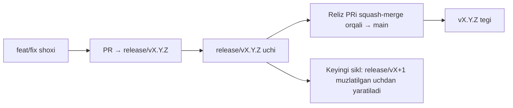

# Branching & Release Model (Oʻzbekcha)

🌐 **Languages:** 🇺🇸 [English](../../../../ops/BRANCHING_MODEL.md) · 🇪🇹 [am](../../../am/docs/ops/BRANCHING_MODEL.md) · 🇸🇦 [ar](../../../ar/docs/ops/BRANCHING_MODEL.md) · 🇦🇿 [az](../../../az/docs/ops/BRANCHING_MODEL.md) · 🇧🇬 [bg](../../../bg/docs/ops/BRANCHING_MODEL.md) · 🇧🇩 [bn](../../../bn/docs/ops/BRANCHING_MODEL.md) · 🇧🇦 [bs](../../../bs/docs/ops/BRANCHING_MODEL.md) · 🇨🇿 [cs](../../../cs/docs/ops/BRANCHING_MODEL.md) · 🇩🇰 [da](../../../da/docs/ops/BRANCHING_MODEL.md) · 🇩🇪 [de](../../../de/docs/ops/BRANCHING_MODEL.md) · 🇬🇷 [el](../../../el/docs/ops/BRANCHING_MODEL.md) · 🇪🇸 [es](../../../es/docs/ops/BRANCHING_MODEL.md) · 🇪🇪 [et](../../../et/docs/ops/BRANCHING_MODEL.md) · 🇮🇷 [fa](../../../fa/docs/ops/BRANCHING_MODEL.md) · 🇫🇮 [fi](../../../fi/docs/ops/BRANCHING_MODEL.md) · 🇫🇷 [fr](../../../fr/docs/ops/BRANCHING_MODEL.md) · 🇮🇪 [ga](../../../ga/docs/ops/BRANCHING_MODEL.md) · 🇮🇳 [gu](../../../gu/docs/ops/BRANCHING_MODEL.md) · 🇳🇬 [ha](../../../ha/docs/ops/BRANCHING_MODEL.md) · 🇮🇱 [he](../../../he/docs/ops/BRANCHING_MODEL.md) · 🇮🇳 [hi](../../../hi/docs/ops/BRANCHING_MODEL.md) · 🇭🇷 [hr](../../../hr/docs/ops/BRANCHING_MODEL.md) · 🇭🇺 [hu](../../../hu/docs/ops/BRANCHING_MODEL.md) · 🇦🇲 [hy](../../../hy/docs/ops/BRANCHING_MODEL.md) · 🇮🇩 [id](../../../id/docs/ops/BRANCHING_MODEL.md) · 🇳🇬 [ig](../../../ig/docs/ops/BRANCHING_MODEL.md) · 🇮🇹 [it](../../../it/docs/ops/BRANCHING_MODEL.md) · 🇯🇵 [ja](../../../ja/docs/ops/BRANCHING_MODEL.md) · 🇬🇪 [ka](../../../ka/docs/ops/BRANCHING_MODEL.md) · 🇰🇭 [km](../../../km/docs/ops/BRANCHING_MODEL.md) · 🇮🇳 [kn](../../../kn/docs/ops/BRANCHING_MODEL.md) · 🇰🇷 [ko](../../../ko/docs/ops/BRANCHING_MODEL.md) · 🇱🇹 [lt](../../../lt/docs/ops/BRANCHING_MODEL.md) · 🇱🇻 [lv](../../../lv/docs/ops/BRANCHING_MODEL.md) · 🇮🇳 [ml](../../../ml/docs/ops/BRANCHING_MODEL.md) · 🇮🇳 [mr](../../../mr/docs/ops/BRANCHING_MODEL.md) · 🇲🇾 [ms](../../../ms/docs/ops/BRANCHING_MODEL.md) · 🇲🇹 [mt](../../../mt/docs/ops/BRANCHING_MODEL.md) · 🇲🇲 [my](../../../my/docs/ops/BRANCHING_MODEL.md) · 🇳🇵 [ne](../../../ne/docs/ops/BRANCHING_MODEL.md) · 🇳🇱 [nl](../../../nl/docs/ops/BRANCHING_MODEL.md) · 🇳🇴 [no](../../../no/docs/ops/BRANCHING_MODEL.md) · 🇮🇳 [or](../../../or/docs/ops/BRANCHING_MODEL.md) · 🇮🇳 [pa](../../../pa/docs/ops/BRANCHING_MODEL.md) · 🇵🇭 [phi](../../../phi/docs/ops/BRANCHING_MODEL.md) · 🇵🇱 [pl](../../../pl/docs/ops/BRANCHING_MODEL.md) · 🇵🇹 [pt](../../../pt/docs/ops/BRANCHING_MODEL.md) · 🇧🇷 [pt-BR](../../../pt-BR/docs/ops/BRANCHING_MODEL.md) · 🇷🇴 [ro](../../../ro/docs/ops/BRANCHING_MODEL.md) · 🇷🇺 [ru](../../../ru/docs/ops/BRANCHING_MODEL.md) · 🇱🇰 [si](../../../si/docs/ops/BRANCHING_MODEL.md) · 🇸🇰 [sk](../../../sk/docs/ops/BRANCHING_MODEL.md) · 🇸🇮 [sl](../../../sl/docs/ops/BRANCHING_MODEL.md) · 🇷🇸 [sr](../../../sr/docs/ops/BRANCHING_MODEL.md) · 🇸🇪 [sv](../../../sv/docs/ops/BRANCHING_MODEL.md) · 🇰🇪 [sw](../../../sw/docs/ops/BRANCHING_MODEL.md) · 🇮🇳 [ta](../../../ta/docs/ops/BRANCHING_MODEL.md) · 🇮🇳 [te](../../../te/docs/ops/BRANCHING_MODEL.md) · 🇹🇭 [th](../../../th/docs/ops/BRANCHING_MODEL.md) · 🇹🇷 [tr](../../../tr/docs/ops/BRANCHING_MODEL.md) · 🇺🇦 [uk-UA](../../../uk-UA/docs/ops/BRANCHING_MODEL.md) · 🇵🇰 [ur](../../../ur/docs/ops/BRANCHING_MODEL.md) · 🇻🇳 [vi](../../../vi/docs/ops/BRANCHING_MODEL.md) · 🇳🇬 [yo](../../../yo/docs/ops/BRANCHING_MODEL.md) · 🇨🇳 [zh-CN](../../../zh-CN/docs/ops/BRANCHING_MODEL.md) · 🇹🇼 [zh-TW](../../../zh-TW/docs/ops/BRANCHING_MODEL.md)

---

OmniRoute a dan foydalanadi** parallel sikl** chiqarish modeli: faol sikl uchun ajratilgan `release/vX.Y.Z` filiali, chop etilgan qator uchun `main` va bu sikl jo‘natilganda o‘zgarmas `vX.Y.Z` tegi. Ko'rish commits on `release/*` _and_ on `main` — kutilmoqda aralashish emas.

Maintainer tafsilotlari `CLAUDE.md` (Qattiq qoida #21) va [RELEASE_CHECKLIST.md](./RELEASE_CHECKLIST.md) da yashaydi. Bu sahifa umumiy ishtirokchilarga qaratilgan xulosadir.

## Qisqacha

| Ref              | Vazifasi                                                                                                      |
| ---------------- | ------------------------------------------------------------------------------------------------------------- |
| `release/vX.Y.Z` | **Faol sikl** — ushbu versiya uchun kundalik ishlab chiqish va PRlarni birlashtirish                          |
| `main`           | **Eʼlon qilingan yoʻnalish** — reliz chiqarilganda siklni squash-merge orqali qabul qiladi                    |
| `vX.Y.Z` (teg)   | **Chiqarish belgisi** — reliz vaqtida yaratiladigan, “nima chiqarilganini” koʻrsatuvchi oʻzgarmas koʻrsatkich |



## PRim qaysi shoxga yoʻnaltirilishi kerak?

**Faol `release/vX.Y.Z` shoxini tanlang — `main`ni emas.**

1. Eng yuqori ochiq `release/v*` shoxini toping (yozish vaqtida misol:
   `release/v3.8.49`).
2. Shu uchdan shox yarating (`git fetch` + unga checkout / rebase qiling).
3. PRni **base = shu `release/vX.Y.Z`** bilan oching.

`main` kundalik integratsiya shoxi emas. `main`ga qarshi ochilgan PRlar
odatda birlashtirishdan oldin boshqa shoxga qayta yoʻnaltirilishi kerak.

## Muzlatish (parallel sikllar)

Chiqarish moslashtirilayotganda, `release-freeze` deb nomlangan marker muammosi ochiladi. Bu** rivojlanishini to'xtatmaydi** :

- Muzlatilgan `release/vX.Y.Z` o'sha kema uchun bo'shatish kapitaniga tegishli.
- Keyingi tsiklning `release/vX+1` muzlatilgan uchidan kesiladi, shuning uchun hissa qo'shuvchilar qo'nish ishlarini davom ettiradilar.
- Muzlatilgan filialni nishonga olgan ochiq PRs bo'lishi kerak** qayta yo'naltirilgan** faol (eng yuqori) `release/v*` filialiga.

Siz xohlagan filialni birlashtirish mumkin deb hisoblashdan oldin ochiq muzlatish mavjudligini tekshiring:

```bash
gh issue list --repo diegosouzapw/OmniRoute --label release-freeze --state open
```

Birlashtirish mexanikasi (egasi `queue` label → Mergify) [MERGE_TRAIN.md](./MERGE_TRAIN.md) da hujjatlashtirilgan.

> **19.11.2026: Birlashtirish navbati tugatildi** (egasining qarori). `.mergify.yml` endi navbatni belgilamaydi va tortish so'rovini birlashtiruvchi yoki qayta yozuvchi Birlashtirish buyruqlarini rad etadi. Relizlar PRs qo'lda "Faol relizda yashil eshiklarni talab qilish" (`Gate / CI` + `Gate / Quality`) ombori qoidalari ostida omni navbat jonli rejimda ishlamaguncha va undan keyin omni navbat orqali birlashtiriladi ( [OMNI_QUEUE.md](./OMNI_QUEUE.md) ). `queue` yorlig'i endi hech narsani birlashtirmaydi.

## Nega ham shox, ham teg kerak?

| Artefakt         | Amal qilish muddati | Maqsadi                                                                                             |
| ---------------- | ------------------- | --------------------------------------------------------------------------------------------------- |
| `release/vX.Y.Z` | Jarayondagi sikl    | Tekshirilgan PRlarni jamlaydi, CI holatini yashil saqlaydi va PRlar uchun asos boʻlib xizmat qiladi |
| `vX.Y.Z` tegi    | Doimiy              | npm / GitHub Releasesʼga chiqarilgan aniq bitlarni belgilaydi                                       |

Shox — ustaxona, teg esa muhrlangan paketdir. `main`ga squash-merge qilingach,
keyingi sikl oldingi reliz PRi tugashini kutmasdan `release/vX+1`da davom etadi.

## Tegishli hujjatlar

- [CONTRIBUTING.md](../../CONTRIBUTING.md) — sozlash, testlar, PR nazorat roʻyxati
- [RELEASE_CHECKLIST.md](./RELEASE_CHECKLIST.md) — chiqarishdan oldingi tekshiruv
- [MERGE_TRAIN.md](./MERGE_TRAIN.md) — birlashtirish navbati va zaxira birlashtirish zanjiri
- [RELEASE_GREEN.md](./RELEASE_GREEN.md) — reliz uchini yashil holatda saqlash
