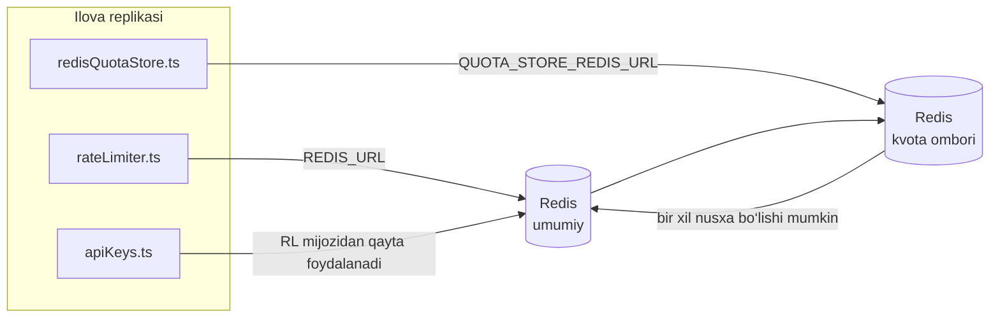

# Redis Production Configuration Guide (Oʻzbekcha)

🌐 **Languages:** 🇺🇸 [English](../../../../ops/REDIS_PRODUCTION_CONFIG.md) · 🇪🇹 [am](../../../am/docs/ops/REDIS_PRODUCTION_CONFIG.md) · 🇸🇦 [ar](../../../ar/docs/ops/REDIS_PRODUCTION_CONFIG.md) · 🇦🇿 [az](../../../az/docs/ops/REDIS_PRODUCTION_CONFIG.md) · 🇧🇬 [bg](../../../bg/docs/ops/REDIS_PRODUCTION_CONFIG.md) · 🇧🇩 [bn](../../../bn/docs/ops/REDIS_PRODUCTION_CONFIG.md) · 🇧🇦 [bs](../../../bs/docs/ops/REDIS_PRODUCTION_CONFIG.md) · 🇨🇿 [cs](../../../cs/docs/ops/REDIS_PRODUCTION_CONFIG.md) · 🇩🇰 [da](../../../da/docs/ops/REDIS_PRODUCTION_CONFIG.md) · 🇩🇪 [de](../../../de/docs/ops/REDIS_PRODUCTION_CONFIG.md) · 🇬🇷 [el](../../../el/docs/ops/REDIS_PRODUCTION_CONFIG.md) · 🇪🇸 [es](../../../es/docs/ops/REDIS_PRODUCTION_CONFIG.md) · 🇪🇪 [et](../../../et/docs/ops/REDIS_PRODUCTION_CONFIG.md) · 🇮🇷 [fa](../../../fa/docs/ops/REDIS_PRODUCTION_CONFIG.md) · 🇫🇮 [fi](../../../fi/docs/ops/REDIS_PRODUCTION_CONFIG.md) · 🇫🇷 [fr](../../../fr/docs/ops/REDIS_PRODUCTION_CONFIG.md) · 🇮🇪 [ga](../../../ga/docs/ops/REDIS_PRODUCTION_CONFIG.md) · 🇮🇳 [gu](../../../gu/docs/ops/REDIS_PRODUCTION_CONFIG.md) · 🇳🇬 [ha](../../../ha/docs/ops/REDIS_PRODUCTION_CONFIG.md) · 🇮🇱 [he](../../../he/docs/ops/REDIS_PRODUCTION_CONFIG.md) · 🇮🇳 [hi](../../../hi/docs/ops/REDIS_PRODUCTION_CONFIG.md) · 🇭🇷 [hr](../../../hr/docs/ops/REDIS_PRODUCTION_CONFIG.md) · 🇭🇺 [hu](../../../hu/docs/ops/REDIS_PRODUCTION_CONFIG.md) · 🇦🇲 [hy](../../../hy/docs/ops/REDIS_PRODUCTION_CONFIG.md) · 🇮🇩 [id](../../../id/docs/ops/REDIS_PRODUCTION_CONFIG.md) · 🇳🇬 [ig](../../../ig/docs/ops/REDIS_PRODUCTION_CONFIG.md) · 🇮🇹 [it](../../../it/docs/ops/REDIS_PRODUCTION_CONFIG.md) · 🇯🇵 [ja](../../../ja/docs/ops/REDIS_PRODUCTION_CONFIG.md) · 🇬🇪 [ka](../../../ka/docs/ops/REDIS_PRODUCTION_CONFIG.md) · 🇰🇭 [km](../../../km/docs/ops/REDIS_PRODUCTION_CONFIG.md) · 🇮🇳 [kn](../../../kn/docs/ops/REDIS_PRODUCTION_CONFIG.md) · 🇰🇷 [ko](../../../ko/docs/ops/REDIS_PRODUCTION_CONFIG.md) · 🇱🇹 [lt](../../../lt/docs/ops/REDIS_PRODUCTION_CONFIG.md) · 🇱🇻 [lv](../../../lv/docs/ops/REDIS_PRODUCTION_CONFIG.md) · 🇮🇳 [ml](../../../ml/docs/ops/REDIS_PRODUCTION_CONFIG.md) · 🇮🇳 [mr](../../../mr/docs/ops/REDIS_PRODUCTION_CONFIG.md) · 🇲🇾 [ms](../../../ms/docs/ops/REDIS_PRODUCTION_CONFIG.md) · 🇲🇹 [mt](../../../mt/docs/ops/REDIS_PRODUCTION_CONFIG.md) · 🇲🇲 [my](../../../my/docs/ops/REDIS_PRODUCTION_CONFIG.md) · 🇳🇵 [ne](../../../ne/docs/ops/REDIS_PRODUCTION_CONFIG.md) · 🇳🇱 [nl](../../../nl/docs/ops/REDIS_PRODUCTION_CONFIG.md) · 🇳🇴 [no](../../../no/docs/ops/REDIS_PRODUCTION_CONFIG.md) · 🇮🇳 [or](../../../or/docs/ops/REDIS_PRODUCTION_CONFIG.md) · 🇮🇳 [pa](../../../pa/docs/ops/REDIS_PRODUCTION_CONFIG.md) · 🇵🇭 [phi](../../../phi/docs/ops/REDIS_PRODUCTION_CONFIG.md) · 🇵🇱 [pl](../../../pl/docs/ops/REDIS_PRODUCTION_CONFIG.md) · 🇵🇹 [pt](../../../pt/docs/ops/REDIS_PRODUCTION_CONFIG.md) · 🇧🇷 [pt-BR](../../../pt-BR/docs/ops/REDIS_PRODUCTION_CONFIG.md) · 🇷🇴 [ro](../../../ro/docs/ops/REDIS_PRODUCTION_CONFIG.md) · 🇷🇺 [ru](../../../ru/docs/ops/REDIS_PRODUCTION_CONFIG.md) · 🇱🇰 [si](../../../si/docs/ops/REDIS_PRODUCTION_CONFIG.md) · 🇸🇰 [sk](../../../sk/docs/ops/REDIS_PRODUCTION_CONFIG.md) · 🇸🇮 [sl](../../../sl/docs/ops/REDIS_PRODUCTION_CONFIG.md) · 🇷🇸 [sr](../../../sr/docs/ops/REDIS_PRODUCTION_CONFIG.md) · 🇸🇪 [sv](../../../sv/docs/ops/REDIS_PRODUCTION_CONFIG.md) · 🇰🇪 [sw](../../../sw/docs/ops/REDIS_PRODUCTION_CONFIG.md) · 🇮🇳 [ta](../../../ta/docs/ops/REDIS_PRODUCTION_CONFIG.md) · 🇮🇳 [te](../../../te/docs/ops/REDIS_PRODUCTION_CONFIG.md) · 🇹🇭 [th](../../../th/docs/ops/REDIS_PRODUCTION_CONFIG.md) · 🇹🇷 [tr](../../../tr/docs/ops/REDIS_PRODUCTION_CONFIG.md) · 🇺🇦 [uk-UA](../../../uk-UA/docs/ops/REDIS_PRODUCTION_CONFIG.md) · 🇵🇰 [ur](../../../ur/docs/ops/REDIS_PRODUCTION_CONFIG.md) · 🇻🇳 [vi](../../../vi/docs/ops/REDIS_PRODUCTION_CONFIG.md) · 🇳🇬 [yo](../../../yo/docs/ops/REDIS_PRODUCTION_CONFIG.md) · 🇨🇳 [zh-CN](../../../zh-CN/docs/ops/REDIS_PRODUCTION_CONFIG.md) · 🇹🇼 [zh-TW](../../../zh-TW/docs/ops/REDIS_PRODUCTION_CONFIG.md)

---

## Umumiy koʻrinish

Redis OmniRoute’da **ixtiyoriy, qatʼiy boʻlmagan bogʻliqlik** hisoblanadi — Redis mavjud boʻlmaganda ilova imkoniyatlarini muammosiz kamaytiradi (xotiradagi
zaxira mexanizmlaridan foydalanadi). Ishlab chiqarish muhitida Redis’ni sozlash toʻrtta alohida
ish yuklamasi uchun kechikishni kamaytiradi:

| Ish yuklamasi                               | Drayver                       | Klient fabrikasi                                                        | Kalit namunasi                                               |
| ------------------------------------------- | ----------------------------- | ----------------------------------------------------------------------- | ------------------------------------------------------------ |
| Soʻrovlar tezligini cheklash                | `rateLimiter.ts`              | `getRedisClient()` — kechiktirib yaratiladigan yagona `ioredis` nusxasi | `<prefix>rl:*` Lua yordamida atomar tezlik cheklovi oynalari |
| Autentifikatsiya keshi                      | `apiKeys.ts`                  | `rateLimiter` klientidan qayta foydalanadi                              | TTL bilan `<prefix>auth:api_key:<sha256>`                    |
| Kvota ombori                                | `redisQuotaStore.ts`          | Alohida `getRedisClient(url)` yagona nusxasi                            | Har bir nusxa uchun sozlanadigan `<prefix>quota:*`           |
| Dastlabki ishga tushirish avtomatik uzgichi | `redisCircuitBreakerStore.ts` | `circuitBreakerFactory.ts` ichidagi alohida klient                      | `<prefix>warmup:cb:<connectionId>`                           |

Barcha toʻrtta ish yuklamasi bitta nomlar makoni prefiksidan foydalanadi, shu sababli OmniRoute bitta
Redis nusxasida (masalan, `127.0.0.1:6379`) boshqa ilovalar bilan birga ishlashi mumkin. [Kalitlarning nomlar makoni](#key-namespacing) boʻlimiga qarang.

---

## Joriy konfiguratsiya (koddagi standart qiymatlar)

| Sozlama                                     | Qiymat                                                        | Joylashuvi                                                                            |
| ------------------------------------------- | ------------------------------------------------------------- | ------------------------------------------------------------------------------------- |
| `REDIS_URL` muhit oʻzgaruvchisi             | `redis://redis:6379` (compose), ixtiyoriy                     | `rateLimiter.ts:5`, `.env.example`                                                    |
| `REDIS_KEY_PREFIX` muhit oʻzgaruvchisi      | `omniroute:` (standart)                                       | `rateLimiter.ts`, `redisQuotaStore.ts`, `redisCircuitBreakerStore.ts`, `.env.example` |
| `QUOTA_STORE_REDIS_URL` muhit oʻzgaruvchisi | alohida, `REDIS_URL` dan farq qilishi mumkin                  | `quota/storeFactory.ts`                                                               |
| `QUOTA_STORE_DRIVER`                        | `"sqlite"` (standart), `"redis"` ixtiyoriy                    | `quota/storeFactory.ts`                                                               |
| ioredis `maxRetriesPerRequest`              | `3`                                                           | `rateLimiter.ts` klientini yaratish                                                   |
| `enableReadyCheck`                          | oʻrnatilmagan (ioredis standarti: `true`)                     | —                                                                                     |
| `lazyConnect`                               | oʻrnatilmagan (ioredis standarti: `false`)                    | —                                                                                     |
| `retryStrategy`                             | oʻrnatilmagan (ioredis standarti: 200ms asosiy, eksponensial) | —                                                                                     |
| TLS / parol / DB indeksi                    | **sozlanmagan**                                               | —                                                                                     |
| Sentinel / Cluster                          | **sozlanmagan** — faqat mustaqil bitta tugun                  | —                                                                                     |

---

## Kalitlarning nomlar makoni

OmniRoute Redis nusxasini xostda ishlaydigan boshqa xizmatlar bilan ulashadi. Nomlar makonisiz
`auth:api_key:<sha256>` yoki `rl:*` kabi kalitlar ayni Redis’dan foydalanadigan boshqa ilovalar
kalitlari bilan toʻqnashishi mumkin (bu nusxa Redis’ni boshqa xizmatlar bilan birga `127.0.0.1:6379` manzilida ishga tushiradi).

**Har bir** OmniRoute kalitiga prefiks qoʻshish uchun `REDIS_KEY_PREFIX` ni boʻsh boʻlmagan satrga oʻrnating:

```bash
# .env — barcha OmniRoute kalitlari omniroute:rl:*, omniroute:auth:*, omniroute:quota:*, omniroute:warmup:cb:* koʻrinishiga keladi
REDIS_KEY_PREFIX=omniroute:
```

- **Standart qiymat:** `omniroute:` (`REDIS_KEY_PREFIX` oʻrnatilmagan yoki boʻsh boʻlsa qoʻllanadi).
- **Quyidagilarga qoʻllanadi:** tezlik cheklagichi + autentifikatsiya keshi (`keyPrefix` orqali umumiy `ioredis` klienti), shuningdek
  kvota ombori (`KEY_PREFIX = "${REDIS_KEY_PREFIX}quota"`) va dastlabki ishga tushirish avtomatik uzgichi
  (`KEY_PREFIX = "${REDIS_KEY_PREFIX}warmup:cb:"`).
- Redis’da kalitlar mavjud boʻlgan paytda **prefiksni oʻzgartirish** eski kalitlarni ajralib qolgan holatga keltiradi (ularning muddati
  TTL / LRU orqali tugaydi). Oʻzgartirish xavfsiz; migratsiya talab qilinmaydi. Bitta istisno — taqiqlangan deb belgilangan ulanish uchun dastlabki ishga tushirish
  avtomatik uzgichi kaliti: u TTL’siz saqlanadi, shuning uchun qolib ketgan kalitlarni `redis-cli --scan --pattern '<old-prefix>warmup:cb:*'` yordamida
  roʻyxatlang va oʻchirib tashlang.
- **ioredis `keyPrefix`** yozish paytida prefiksni avtomatik ravishda qoʻshadi **va** oʻqish paytida uni olib tashlaydi,
  shu sababli ilova kodi prefiksni hech qachon koʻrmaydi.

---

## Tavsiya etilgan ishlab chiqarishni sozlash

### 1. Ulanish hovuzi/mijoz variantlari (ioredis `Redis` konstruktori)

Joriy kod hech qanday maxsus parametrlarsiz bitta `new Redis(url)` yaratadi. Ko'p nusxali ishlab chiqarish uchun mijoz zavodini kodda o'tkazing yoki `getRedisClient()` o'rang:

```typescript
const redis = new Redis(REDIS_URL, {
  maxRetriesPerRequest: null, // no retry limit; let retryStrategy decide
  enableReadyCheck: true, // verify server is ready before accepting calls
  lazyConnect: true, // don't connect on construction; wait for first call
  retryStrategy: (times) => {
    if (times > 10) return null; // give up after 10 retries → reconnect later
    return Math.min(times * 200, 5000); // 200ms, 400ms, …, 5s cap
  },
  enableAutoPipelining: true, // coalesce concurrent commands into one TCP write
  keepAlive: 10000, // TCP keep‑alive every 10s
});
```

**Asosiy kelishuvlar:**

- `maxRetriesPerRequest: null` + `retryStrategy` — ishlab chiqarish uchun afzal, shuning uchun vaqtinchalik Redis qayta ishga tushirishlar har bir so‘rovni darhol bajarib qo‘ymaydi. `checkRateLimit()` -dagi xotiraning qayta tiklanishi muvaffaqiyatsizlik yo'lini o'zlashtiradi.
- `lazyConnect: true` — server ulanishlarni qabul qila boshlaguncha Redis ishga tushishiga bog‘liqlikdan qochadi.
- `enableAutoPipelining: true` — bir vaqtning o'zida tarif chegarasini tekshirish uchun aylanma sayohatlarni kamaytiradi; bitta ulanishda > 50 RPS da foydali.

### 2. Redis Server konfiguratsiyasi (`redis.conf`)

```
# Memory
maxmemory 80%                        # leave room for OS page cache
maxmemory-policy allkeys-lru         # evict stale auth cache entries under pressure

# Persistence (optional — OmniRoute is crash‑safe without it)
save 300 1                           # snapshot at least every 5 min if ≥1 key changed
appendonly no                        # AOF not needed; data is regeneratable
appendfsync no                       # no fsync overhead (RDB is sufficient)

# Networking
timeout 0                            # no idle disconnect
tcp-keepalive 300                    # 5 min keep‑alive
tcp-backlog 511                      # connection backlog for bursty load

# Performance
hz 10                                # default; 100 for latency‑sensitive
activedefrag yes                     # auto‑defragment when fragmentation >10%
```

**`maxmemory-policy allkeys-lru` uchun savdo:** Auth kesh yozuvlari xotira bosimi ostida o'chirilishi mumkin. Bu xavfsiz — `setCachedApiKey` har doim o'tkazib yuborilganda qayta to'ldiriladi va SQLite qaytarilishi vakolatli. Tezlikni cheklovchi Lua skripti dizayn bo'yicha qisqa muddatli kichik kalitlarni yaratadi.

### 3. Docker Compose Settings

Prod compose (`docker-compose.prod.yml`) `redis:8.6.2-alpine` dan foydalanadi. Qo'shish:

```yaml
redis:
  image: redis:8.6.2-alpine
  command:
    [
      "redis-server",
      "--maxmemory",
      "512mb",
      "--maxmemory-policy",
      "allkeys-lru",
      "--activedefrag",
      "yes",
      "--save",
      "300 1",
    ]
  healthcheck:
    test: ["CMD", "redis-cli", "ping"]
    interval: 10s
    timeout: 3s
    retries: 3
    start_period: 5s
```

### 4. Ko'p misollar / masshtabni hisobga olish

**Barcha nusxalar uchun yagona Redis** — tezligini cheklovchi Lua skripti bitta vakolatli kalit maydoniga bog'liq. Replikatsiyalar ortidagi bir nechta Redis misollari atomiklikni yo'qotadi va byudjetni ikki baravar oshiradi. Barcha ilova replikalari uchun bitta Redis (yoki uzilishli Redis Sentinel klasteri) dan foydalaning.

**Ulanish soni:** Har bir ilova nusxasi ochiladi** 2 TCP ulanish** Redis ga (stavkani cheklovchi mijoz + kvota do‘kon mijozi). 10 nusxada → 20 ta ulanish, birlamchi Redis misolining 10k ulanish shipi ichida.

### 5. Monitoring

Sog'liqni saqlashni tekshirish so'nggi nuqtasi orqali ta'sir qiling:

```typescript
// src/app/api/monitoring/health/route.ts already calls rateLimiter functions
// Add Redis-specific checks:
//   1. PING latency via ioredis .ping()
//   2. Memory usage via INFO memory
//   3. Connection count via INFO clients
//   4. Hit rate for maxmemory-policy (evicted_keys / keyspace_hits)
```

Ko'rish uchun asosiy ko'rsatkichlar:

- **Chiqarilgan kalitlar / sek** — doimiy ravishda nol bo'lmasa, `maxmemory` ni oshiring
- **Bloklangan mijozlar** — noldan tashqari sekin Lua skriptlarini yoki yuqori tortishuvlarni taklif qiladi
- **Rad etilgan ulanishlar** — ulanish chegarasi urish; 20 ta ulanishda kamdan-kam uchraydi

### 6. Redis-ga mos keladigan serverlar

Bu yerda ishlatiladigan har qanday server Lua skriptlarini ishga tushirishi kerak: tarif cheklovi bir `EVAL`. Lua bo'lmagan serverda `checkRateLimit()` `[RATE_LIMITER] Redis eval failed, falling back to in-memory rate limiting` jurnaliga kiradi va har bir jarayonni hisoblaydi, shuning uchun har bir replika o'z-o'zidan cheklovni amalga oshiradi. Qo'shilgan umumiy seansga yaqinlik do'koni (`OMNIROUTE_SESSION_AFFINITY_STORE=redis`) shuningdek, `EVAL` bilan pinlarni o'qiydi va yangilaydi; Luasiz u `[SESSION_AFFINITY] Redis error; falling back to SQLite.` jurnaliga kiradi va har bir replika o'z pinlarini saqlaydi. Boshqa ish yuklari oddiy buyruqlardan foydalanadi (`SET ... EX`, `GET`, `DEL`, `MGET`, `EXPIRE`, `INCRBYFLOAT`, xeshlar va to'plamlar) va semantik keshning Redis backend `FT.*` buyruqlarini yubormaydi.

OmniRoute 3.8.52 bilan sinovdan oʻtgan: KiviDB 1.2.0 Lua tasviri (`kividb/kividb:v1.2.0-lua`). Tezlikni cheklovchi (shu jumladan hisoblagichlarni almashishning ikkinchi jarayoni), autentifikatsiya keshi, kvotalar doʻkoni, isitish oʻchirgichi, semantik kesh doʻkoni va chat boshqaruvchisi orqali `/v1/chat/completions` soʻrovi Redis 8.10.3 da oʻtgan 19 ta tekshiruvdan 18 tasidan oʻtdi. Bir-biridan farq qiladigan narsa: `INCRBYFLOAT` `0.1 + 0.2` `0.30000000000000004` sifatida saqlaydi, bu erda Redis `0.3` saqlaydi ( [kividbio/kividb#387](https://github.com/kividbio/kividb/issues/387) ). Kvota do'koni ikkalasini ham `parseFloat` bilan tahlil qiladi, lekin ikkita raqam oxirgi raqamlarda farqlanadi, shuning uchun aniq kvotalar chegarasiga to'g'ri keladigan taqqoslash boshqacha chiqishi mumkin. Seans-affinity do'koni bu ishga tushmagan. ( [o'rnatish](https://github.com/kividbio/kividb/blob/master/docs/integrations/omniroute.md), [natijalar](https://github.com/kividbio/kividb/tree/master/benchmarks/omniroute-compat) )

---

## Arxitektura diagrammasi



---

## Manbalar

| Fayl                               | Maqsad                                                                          |
| ---------------------------------- | ------------------------------------------------------------------------------- |
| `src/shared/utils/rateLimiter.ts`  | Asosiy Redis mijozi, Lua tezlikni cheklash skripti, xotiradagi zaxira mexanizmi |
| `src/lib/db/apiKeys.ts`            | Autentifikatsiya keshi — Redis→SQLite zaxira mexanizmi                          |
| `src/lib/quota/redisQuotaStore.ts` | Ixtiyoriy kvota ombori uchun alohida Redis mijozi                               |
| `src/lib/quota/storeFactory.ts`    | `sqlite` va `redis` kvota drayverlari o‘rtasida almashadi                       |
| `docker-compose.prod.yml`          | Ishlab chiqarish muhiti Redis konteyneri (`redis:8.6.2-alpine` tasviri)         |
| `.env.example`                     | Redis muhit o‘zgaruvchilari hujjatlari                                          |
| `src/app/api/local/redis/`         | Dasturlash muhiti konteynerini boshqarish uchun API marshrutlari                |
| `bin/cli/commands/redis.mjs`       | Dasturlash muhiti konteynerini boshqarish uchun CLI buyruqlari                  |
