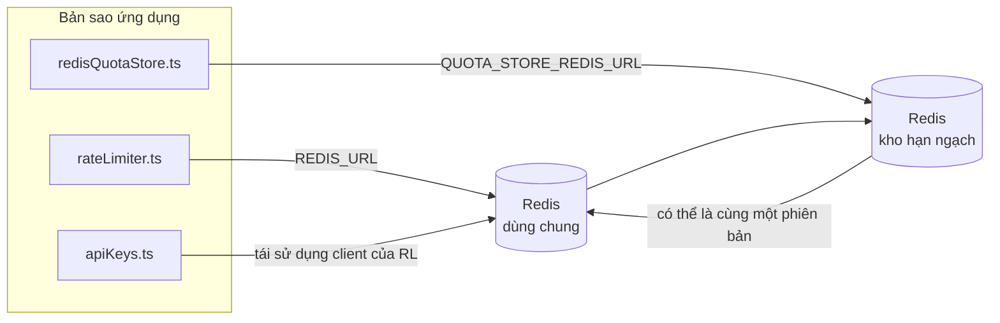

# Redis Production Configuration Guide (Tiếng Việt)

🌐 **Languages:** 🇺🇸 [English](../../../../ops/REDIS_PRODUCTION_CONFIG.md) · 🇪🇹 [am](../../../am/docs/ops/REDIS_PRODUCTION_CONFIG.md) · 🇸🇦 [ar](../../../ar/docs/ops/REDIS_PRODUCTION_CONFIG.md) · 🇦🇿 [az](../../../az/docs/ops/REDIS_PRODUCTION_CONFIG.md) · 🇧🇬 [bg](../../../bg/docs/ops/REDIS_PRODUCTION_CONFIG.md) · 🇧🇩 [bn](../../../bn/docs/ops/REDIS_PRODUCTION_CONFIG.md) · 🇧🇦 [bs](../../../bs/docs/ops/REDIS_PRODUCTION_CONFIG.md) · 🇨🇿 [cs](../../../cs/docs/ops/REDIS_PRODUCTION_CONFIG.md) · 🇩🇰 [da](../../../da/docs/ops/REDIS_PRODUCTION_CONFIG.md) · 🇩🇪 [de](../../../de/docs/ops/REDIS_PRODUCTION_CONFIG.md) · 🇬🇷 [el](../../../el/docs/ops/REDIS_PRODUCTION_CONFIG.md) · 🇪🇸 [es](../../../es/docs/ops/REDIS_PRODUCTION_CONFIG.md) · 🇪🇪 [et](../../../et/docs/ops/REDIS_PRODUCTION_CONFIG.md) · 🇮🇷 [fa](../../../fa/docs/ops/REDIS_PRODUCTION_CONFIG.md) · 🇫🇮 [fi](../../../fi/docs/ops/REDIS_PRODUCTION_CONFIG.md) · 🇫🇷 [fr](../../../fr/docs/ops/REDIS_PRODUCTION_CONFIG.md) · 🇮🇪 [ga](../../../ga/docs/ops/REDIS_PRODUCTION_CONFIG.md) · 🇮🇳 [gu](../../../gu/docs/ops/REDIS_PRODUCTION_CONFIG.md) · 🇳🇬 [ha](../../../ha/docs/ops/REDIS_PRODUCTION_CONFIG.md) · 🇮🇱 [he](../../../he/docs/ops/REDIS_PRODUCTION_CONFIG.md) · 🇮🇳 [hi](../../../hi/docs/ops/REDIS_PRODUCTION_CONFIG.md) · 🇭🇷 [hr](../../../hr/docs/ops/REDIS_PRODUCTION_CONFIG.md) · 🇭🇺 [hu](../../../hu/docs/ops/REDIS_PRODUCTION_CONFIG.md) · 🇦🇲 [hy](../../../hy/docs/ops/REDIS_PRODUCTION_CONFIG.md) · 🇮🇩 [id](../../../id/docs/ops/REDIS_PRODUCTION_CONFIG.md) · 🇳🇬 [ig](../../../ig/docs/ops/REDIS_PRODUCTION_CONFIG.md) · 🇮🇹 [it](../../../it/docs/ops/REDIS_PRODUCTION_CONFIG.md) · 🇯🇵 [ja](../../../ja/docs/ops/REDIS_PRODUCTION_CONFIG.md) · 🇬🇪 [ka](../../../ka/docs/ops/REDIS_PRODUCTION_CONFIG.md) · 🇰🇭 [km](../../../km/docs/ops/REDIS_PRODUCTION_CONFIG.md) · 🇮🇳 [kn](../../../kn/docs/ops/REDIS_PRODUCTION_CONFIG.md) · 🇰🇷 [ko](../../../ko/docs/ops/REDIS_PRODUCTION_CONFIG.md) · 🇱🇹 [lt](../../../lt/docs/ops/REDIS_PRODUCTION_CONFIG.md) · 🇱🇻 [lv](../../../lv/docs/ops/REDIS_PRODUCTION_CONFIG.md) · 🇮🇳 [ml](../../../ml/docs/ops/REDIS_PRODUCTION_CONFIG.md) · 🇮🇳 [mr](../../../mr/docs/ops/REDIS_PRODUCTION_CONFIG.md) · 🇲🇾 [ms](../../../ms/docs/ops/REDIS_PRODUCTION_CONFIG.md) · 🇲🇹 [mt](../../../mt/docs/ops/REDIS_PRODUCTION_CONFIG.md) · 🇲🇲 [my](../../../my/docs/ops/REDIS_PRODUCTION_CONFIG.md) · 🇳🇵 [ne](../../../ne/docs/ops/REDIS_PRODUCTION_CONFIG.md) · 🇳🇱 [nl](../../../nl/docs/ops/REDIS_PRODUCTION_CONFIG.md) · 🇳🇴 [no](../../../no/docs/ops/REDIS_PRODUCTION_CONFIG.md) · 🇮🇳 [or](../../../or/docs/ops/REDIS_PRODUCTION_CONFIG.md) · 🇮🇳 [pa](../../../pa/docs/ops/REDIS_PRODUCTION_CONFIG.md) · 🇵🇭 [phi](../../../phi/docs/ops/REDIS_PRODUCTION_CONFIG.md) · 🇵🇱 [pl](../../../pl/docs/ops/REDIS_PRODUCTION_CONFIG.md) · 🇵🇹 [pt](../../../pt/docs/ops/REDIS_PRODUCTION_CONFIG.md) · 🇧🇷 [pt-BR](../../../pt-BR/docs/ops/REDIS_PRODUCTION_CONFIG.md) · 🇷🇴 [ro](../../../ro/docs/ops/REDIS_PRODUCTION_CONFIG.md) · 🇷🇺 [ru](../../../ru/docs/ops/REDIS_PRODUCTION_CONFIG.md) · 🇱🇰 [si](../../../si/docs/ops/REDIS_PRODUCTION_CONFIG.md) · 🇸🇰 [sk](../../../sk/docs/ops/REDIS_PRODUCTION_CONFIG.md) · 🇸🇮 [sl](../../../sl/docs/ops/REDIS_PRODUCTION_CONFIG.md) · 🇷🇸 [sr](../../../sr/docs/ops/REDIS_PRODUCTION_CONFIG.md) · 🇸🇪 [sv](../../../sv/docs/ops/REDIS_PRODUCTION_CONFIG.md) · 🇰🇪 [sw](../../../sw/docs/ops/REDIS_PRODUCTION_CONFIG.md) · 🇮🇳 [ta](../../../ta/docs/ops/REDIS_PRODUCTION_CONFIG.md) · 🇮🇳 [te](../../../te/docs/ops/REDIS_PRODUCTION_CONFIG.md) · 🇹🇭 [th](../../../th/docs/ops/REDIS_PRODUCTION_CONFIG.md) · 🇹🇷 [tr](../../../tr/docs/ops/REDIS_PRODUCTION_CONFIG.md) · 🇺🇦 [uk-UA](../../../uk-UA/docs/ops/REDIS_PRODUCTION_CONFIG.md) · 🇵🇰 [ur](../../../ur/docs/ops/REDIS_PRODUCTION_CONFIG.md) · 🇺🇿 [uz](../../../uz/docs/ops/REDIS_PRODUCTION_CONFIG.md) · 🇳🇬 [yo](../../../yo/docs/ops/REDIS_PRODUCTION_CONFIG.md) · 🇨🇳 [zh-CN](../../../zh-CN/docs/ops/REDIS_PRODUCTION_CONFIG.md) · 🇹🇼 [zh-TW](../../../zh-TW/docs/ops/REDIS_PRODUCTION_CONFIG.md)

---

## Tổng quan

Redis là một **phần phụ thuộc tùy chọn, không bắt buộc** trong OmniRoute — ứng dụng vẫn tiếp tục hoạt động với chức năng suy giảm hợp lý (dùng bộ nhớ trong
làm phương án dự phòng) khi Redis không khả dụng. Trong môi trường production, việc tinh chỉnh Redis giúp giảm độ trễ cho bốn
khối lượng công việc riêng biệt:

| Khối lượng công việc      | Thành phần điều khiển         | Factory tạo client                                       | Mẫu khóa                                                     |
| ------------------------- | ----------------------------- | -------------------------------------------------------- | ------------------------------------------------------------ |
| Giới hạn tốc độ           | `rateLimiter.ts`              | Singleton `ioredis` khởi tạo lười qua `getRedisClient()` | Các cửa sổ giới hạn tốc độ nguyên tử bằng Lua `<prefix>rl:*` |
| Bộ nhớ đệm xác thực       | `apiKeys.ts`                  | Tái sử dụng client của `rateLimiter`                     | `<prefix>auth:api_key:<sha256>` với TTL                      |
| Kho hạn ngạch             | `redisQuotaStore.ts`          | Singleton `getRedisClient(url)` riêng biệt               | `<prefix>quota:*` có thể cấu hình theo từng instance         |
| Circuit breaker khởi động | `redisCircuitBreakerStore.ts` | Client riêng biệt trong `circuitBreakerFactory.ts`       | `<prefix>warmup:cb:<connectionId>`                           |

Cả bốn khối lượng công việc đều dùng chung một tiền tố namespace để OmniRoute có thể cùng tồn tại với các ứng dụng khác trên
một instance Redis duy nhất (ví dụ: `127.0.0.1:6379`). Xem [Phân vùng tên khóa](#key-namespacing).

---

## Cấu hình hiện tại (Giá trị mặc định trong mã)

| Thiết lập                               | Giá trị                                                             | Vị trí                                                                                |
| --------------------------------------- | ------------------------------------------------------------------- | ------------------------------------------------------------------------------------- |
| Biến môi trường `REDIS_URL`             | `redis://redis:6379` (compose), tùy chọn                            | `rateLimiter.ts:5`, `.env.example`                                                    |
| Biến môi trường `REDIS_KEY_PREFIX`      | `omniroute:` (mặc định)                                             | `rateLimiter.ts`, `redisQuotaStore.ts`, `redisCircuitBreakerStore.ts`, `.env.example` |
| Biến môi trường `QUOTA_STORE_REDIS_URL` | riêng biệt, có thể khác với `REDIS_URL`                             | `quota/storeFactory.ts`                                                               |
| `QUOTA_STORE_DRIVER`                    | `"sqlite"` (mặc định), tùy chọn `"redis"`                           | `quota/storeFactory.ts`                                                               |
| `maxRetriesPerRequest` của ioredis      | `3`                                                                 | quá trình tạo client trong `rateLimiter.ts`                                           |
| `enableReadyCheck`                      | chưa đặt (mặc định của ioredis: `true`)                             | —                                                                                     |
| `lazyConnect`                           | chưa đặt (mặc định của ioredis: `false`)                            | —                                                                                     |
| `retryStrategy`                         | chưa đặt (mặc định của ioredis: cơ sở 200ms, tăng theo cấp số nhân) | —                                                                                     |
| TLS / mật khẩu / chỉ mục DB             | **chưa được cấu hình**                                              | —                                                                                     |
| Sentinel / Cluster                      | **chưa được cấu hình** — chỉ hỗ trợ một nút độc lập                 | —                                                                                     |

---

## Phân vùng tên khóa

OmniRoute dùng chung một instance Redis với mọi dịch vụ khác đang chạy trên máy chủ. Nếu không có namespace,
các khóa như `auth:api_key:<sha256>` hoặc `rl:*` có thể xung đột với khóa của các ứng dụng khác
đang sử dụng cùng Redis (instance này chạy Redis tại `127.0.0.1:6379` cùng với các dịch vụ khác).

Đặt `REDIS_KEY_PREFIX` thành một chuỗi không rỗng để thêm tiền tố vào **mọi** khóa OmniRoute:

```bash
# .env — tất cả khóa OmniRoute trở thành omniroute:rl:*, omniroute:auth:*, omniroute:quota:*, omniroute:warmup:cb:*
REDIS_KEY_PREFIX=omniroute:
```

- **Mặc định:** `omniroute:` (được áp dụng khi `REDIS_KEY_PREFIX` chưa được đặt hoặc để trống).
- **Áp dụng cho:** bộ giới hạn tốc độ + bộ nhớ đệm xác thực (dùng chung client `ioredis` thông qua `keyPrefix`) và
  kho hạn ngạch (`KEY_PREFIX = "${REDIS_KEY_PREFIX}quota"`) cùng circuit breaker khởi động
  (`KEY_PREFIX = "${REDIS_KEY_PREFIX}warmup:cb:"`).
- **Việc thay đổi tiền tố** khi các khóa đã tồn tại trong Redis sẽ khiến các khóa cũ không còn được tham chiếu (chúng sẽ hết hạn
  thông qua TTL / LRU). Có thể thay đổi an toàn; không cần di chuyển dữ liệu. Ngoại lệ duy nhất là khóa circuit breaker
  khởi động của một kết nối được đánh dấu là bị cấm: khóa này được lưu trữ mà không có TTL, vì vậy
  hãy liệt kê các khóa còn sót lại bằng `redis-cli --scan --pattern '<old-prefix>warmup:cb:*'` rồi xóa chúng.
- **`keyPrefix` của ioredis** tự động thêm tiền tố khi ghi **và** loại bỏ tiền tố khi đọc,
  vì vậy mã ứng dụng không bao giờ thấy tiền tố này.

---

## Điều chỉnh sản xuất được đề xuất

### 1. Tùy chọn nhóm kết nối / máy khách (ioredis `Redis` constructor)

Mã hiện tại tạo một `new Redis(url)` duy nhất không có tùy chọn tùy chỉnh. Để triển khai nhiều bản sao sản xuất, hãy chuyển nhà máy khách trong mã hoặc gói `getRedisClient()`:

```typescript
const redis = new Redis(REDIS_URL, {
  maxRetriesPerRequest: null, // no retry limit; let retryStrategy decide
  enableReadyCheck: true, // verify server is ready before accepting calls
  lazyConnect: true, // don't connect on construction; wait for first call
  retryStrategy: (times) => {
    if (times > 10) return null; // give up after 10 retries → reconnect later
    return Math.min(times * 200, 5000); // 200ms, 400ms, …, 5s cap
  },
  enableAutoPipelining: true, // coalesce concurrent commands into one TCP write
  keepAlive: 10000, // TCP keep‑alive every 10s
});
```

**Sự đánh đổi chính:**

- `maxRetriesPerRequest: null` + `retryStrategy` — được ưu tiên cho sản xuất để việc khởi động lại Redis tạm thời không làm thất bại ngay lập tức mọi yêu cầu. Dự phòng trong bộ nhớ trong `checkRateLimit()` sẽ hấp thụ đường dẫn lỗi.
- `lazyConnect: true` — tránh sự phụ thuộc khởi động vào Redis trước khi máy chủ bắt đầu chấp nhận kết nối.
- `enableAutoPipelining: true` — giảm các chuyến đi khứ hồi để kiểm tra giới hạn tỷ lệ đồng thời; có lợi ở > 50 RPS trên một kết nối.

### 2. Cấu hình máy chủ Redis (`redis.conf`)

```
# Memory
maxmemory 80%                        # leave room for OS page cache
maxmemory-policy allkeys-lru         # evict stale auth cache entries under pressure

# Persistence (optional — OmniRoute is crash‑safe without it)
save 300 1                           # snapshot at least every 5 min if ≥1 key changed
appendonly no                        # AOF not needed; data is regeneratable
appendfsync no                       # no fsync overhead (RDB is sufficient)

# Networking
timeout 0                            # no idle disconnect
tcp-keepalive 300                    # 5 min keep‑alive
tcp-backlog 511                      # connection backlog for bursty load

# Performance
hz 10                                # default; 100 for latency‑sensitive
activedefrag yes                     # auto‑defragment when fragmentation >10%
```

**Sự đánh đổi cho `maxmemory-policy allkeys-lru`:** Các mục trong bộ đệm xác thực có thể bị xóa dưới áp lực bộ nhớ. Đây là — `setCachedApiKey` an toàn luôn được điền lại khi bị bỏ lỡ và dự phòng SQLite là có thẩm quyền. Tập lệnh Lua giới hạn tốc độ tạo ra các khóa nhỏ có thời gian tồn tại ngắn theo thiết kế.

### 3. Cài đặt soạn thảo Docker

Sản phẩm soạn thảo (`docker-compose.prod.yml`) sử dụng `redis:8.6.2-alpine`. Thêm vào:

```yaml
redis:
  image: redis:8.6.2-alpine
  command:
    [
      "redis-server",
      "--maxmemory",
      "512mb",
      "--maxmemory-policy",
      "allkeys-lru",
      "--activedefrag",
      "yes",
      "--save",
      "300 1",
    ]
  healthcheck:
    test: ["CMD", "redis-cli", "ping"]
    interval: 10s
    timeout: 3s
    retries: 3
    start_period: 5s
```

### 4. Cân nhắc về đa phiên bản / Mở rộng quy mô

**Redis đơn cho tất cả các bản sao** — tập lệnh Lua giới hạn tốc độ phụ thuộc vào một không gian khóa có thẩm quyền duy nhất. Nhiều phiên bản Redis đằng sau các bản sao sẽ mất tính nguyên tử và tăng gấp đôi ngân sách. Sử dụng một Redis (hoặc cụm Redis Sentinel có chuyển đổi dự phòng) cho tất cả các bản sao ứng dụng.

**Số lượng kết nối:** Mỗi bản sao ứng dụng sẽ mở ra** 2 kết nối TCP** đến Redis (máy khách giới hạn tốc độ máy khách lưu trữ hạn ngạch + ). Ở 10 bản sao → 20 kết nối, nằm trong giới hạn kết nối 10k của phiên bản Redis mặc định.

### 5. Giám sát

Tiếp xúc thông qua điểm cuối kiểm tra sức khỏe:

```typescript
// src/app/api/monitoring/health/route.ts already calls rateLimiter functions
// Add Redis-specific checks:
//   1. PING latency via ioredis .ping()
//   2. Memory usage via INFO memory
//   3. Connection count via INFO clients
//   4. Hit rate for maxmemory-policy (evicted_keys / keyspace_hits)
```

Các số liệu chính cần theo dõi:

- **Phím bị loại bỏ / giây** — nếu liên tục khác 0, hãy tăng `maxmemory`
- **Khách hàng bị chặn** — khác 0 gợi ý tập lệnh Lua chậm hoặc có tính cạnh tranh cao
- **Kết nối bị từ chối** đạt giới hạn kết nối — ; hiếm ở 20 kết nối

### 6. Máy chủ tương thích với Redis

Bất kỳ máy chủ nào được sử dụng ở đây đều phải chạy tập lệnh Lua: giới hạn tốc độ là một `EVAL`. Trên máy chủ không có Lua, `checkRateLimit()` ghi lại `[RATE_LIMITER] Redis eval failed, falling back to in-memory rate limiting` và tính trên mỗi quy trình, do đó, mỗi bản sao sẽ tự thực thi giới hạn. Cửa hàng sở thích phiên chia sẻ chọn tham gia (`OMNIROUTE_SESSION_AFFINITY_STORE=redis`) cũng đọc và cập nhật các ghim bằng `EVAL`; không có Lua, nó sẽ ghi `[SESSION_AFFINITY] Redis error; falling back to SQLite.` và mỗi bản sao giữ các chân riêng của nó. Các khối lượng công việc khác sử dụng các lệnh đơn giản (`SET ... EX`, `GET`, `DEL`, `MGET`, `EXPIRE`, `INCRBYFLOAT`, băm và bộ) và phần phụ trợ Redis của bộ nhớ đệm ngữ nghĩa không gửi lệnh `FT.*`.

Đã thử nghiệm với OmniRoute 3.8.52: KiviDB 1.2.0 với hình ảnh Lua của nó (`kividb/kividb:v1.2.0-lua`). Bộ giới hạn tốc độ (bao gồm quy trình thứ hai chia sẻ bộ đếm), bộ đệm xác thực, bộ lưu trữ hạn ngạch, bộ ngắt mạch khởi động, bộ nhớ đệm ngữ nghĩa và yêu cầu `/v1/chat/completions` thông qua trình xử lý trò chuyện đã vượt qua 18 trong số 19 bước kiểm tra vượt qua Redis 8.10.3. Một cái khác: `INCRBYFLOAT` lưu trữ `0.1 + 0.2` dưới dạng `0.30000000000000004` trong đó Redis lưu trữ `0.3` ( [kividbio/kividb#387](https://github.com/kividbio/kividb/issues/387) ). Kho hạn ngạch phân tích cả hai bằng `parseFloat`, nhưng hai số khác nhau ở các chữ số cuối, do đó, phép so sánh nằm chính xác trên ranh giới hạn ngạch có thể cho ra kết quả khác nhau. Cửa hàng sở thích phiên không phải là một phần của hoạt động đó. ( [thiết lập](https://github.com/kividbio/kividb/blob/master/docs/integrations/omniroute.md), [kết quả](https://github.com/kividbio/kividb/tree/master/benchmarks/omniroute-compat) )

---

## Sơ đồ kiến trúc



---

## Tài liệu tham khảo

| Tệp                                | Mục đích                                                                          |
| ---------------------------------- | --------------------------------------------------------------------------------- |
| `src/shared/utils/rateLimiter.ts`  | Client Redis chính, tập lệnh giới hạn tốc độ Lua, phương án dự phòng trong bộ nhớ |
| `src/lib/db/apiKeys.ts`            | Bộ nhớ đệm xác thực — dự phòng Redis→SQLite                                       |
| `src/lib/quota/redisQuotaStore.ts` | Client Redis riêng cho kho hạn ngạch tùy chọn                                     |
| `src/lib/quota/storeFactory.ts`    | Chuyển đổi giữa các trình điều khiển hạn ngạch `sqlite` và `redis`                |
| `docker-compose.prod.yml`          | Container Redis cho môi trường production (image `redis:8.6.2-alpine`)            |
| `.env.example`                     | Tài liệu về các biến môi trường Redis                                             |
| `src/app/api/local/redis/`         | Các tuyến API để điều phối container phát triển                                   |
| `bin/cli/commands/redis.mjs`       | Các lệnh CLI để điều phối container phát triển                                    |
