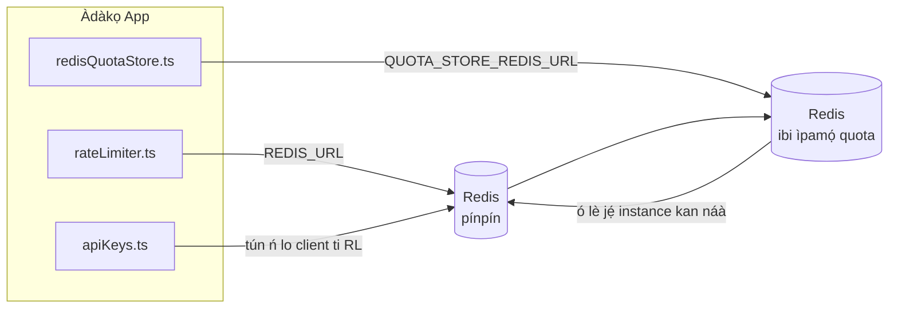

# Redis Production Configuration Guide (Yorùbá)

🌐 **Languages:** 🇺🇸 [English](../../../../ops/REDIS_PRODUCTION_CONFIG.md) · 🇪🇹 [am](../../../am/docs/ops/REDIS_PRODUCTION_CONFIG.md) · 🇸🇦 [ar](../../../ar/docs/ops/REDIS_PRODUCTION_CONFIG.md) · 🇦🇿 [az](../../../az/docs/ops/REDIS_PRODUCTION_CONFIG.md) · 🇧🇬 [bg](../../../bg/docs/ops/REDIS_PRODUCTION_CONFIG.md) · 🇧🇩 [bn](../../../bn/docs/ops/REDIS_PRODUCTION_CONFIG.md) · 🇧🇦 [bs](../../../bs/docs/ops/REDIS_PRODUCTION_CONFIG.md) · 🇨🇿 [cs](../../../cs/docs/ops/REDIS_PRODUCTION_CONFIG.md) · 🇩🇰 [da](../../../da/docs/ops/REDIS_PRODUCTION_CONFIG.md) · 🇩🇪 [de](../../../de/docs/ops/REDIS_PRODUCTION_CONFIG.md) · 🇬🇷 [el](../../../el/docs/ops/REDIS_PRODUCTION_CONFIG.md) · 🇪🇸 [es](../../../es/docs/ops/REDIS_PRODUCTION_CONFIG.md) · 🇪🇪 [et](../../../et/docs/ops/REDIS_PRODUCTION_CONFIG.md) · 🇮🇷 [fa](../../../fa/docs/ops/REDIS_PRODUCTION_CONFIG.md) · 🇫🇮 [fi](../../../fi/docs/ops/REDIS_PRODUCTION_CONFIG.md) · 🇫🇷 [fr](../../../fr/docs/ops/REDIS_PRODUCTION_CONFIG.md) · 🇮🇪 [ga](../../../ga/docs/ops/REDIS_PRODUCTION_CONFIG.md) · 🇮🇳 [gu](../../../gu/docs/ops/REDIS_PRODUCTION_CONFIG.md) · 🇳🇬 [ha](../../../ha/docs/ops/REDIS_PRODUCTION_CONFIG.md) · 🇮🇱 [he](../../../he/docs/ops/REDIS_PRODUCTION_CONFIG.md) · 🇮🇳 [hi](../../../hi/docs/ops/REDIS_PRODUCTION_CONFIG.md) · 🇭🇷 [hr](../../../hr/docs/ops/REDIS_PRODUCTION_CONFIG.md) · 🇭🇺 [hu](../../../hu/docs/ops/REDIS_PRODUCTION_CONFIG.md) · 🇦🇲 [hy](../../../hy/docs/ops/REDIS_PRODUCTION_CONFIG.md) · 🇮🇩 [id](../../../id/docs/ops/REDIS_PRODUCTION_CONFIG.md) · 🇳🇬 [ig](../../../ig/docs/ops/REDIS_PRODUCTION_CONFIG.md) · 🇮🇹 [it](../../../it/docs/ops/REDIS_PRODUCTION_CONFIG.md) · 🇯🇵 [ja](../../../ja/docs/ops/REDIS_PRODUCTION_CONFIG.md) · 🇬🇪 [ka](../../../ka/docs/ops/REDIS_PRODUCTION_CONFIG.md) · 🇰🇭 [km](../../../km/docs/ops/REDIS_PRODUCTION_CONFIG.md) · 🇮🇳 [kn](../../../kn/docs/ops/REDIS_PRODUCTION_CONFIG.md) · 🇰🇷 [ko](../../../ko/docs/ops/REDIS_PRODUCTION_CONFIG.md) · 🇱🇹 [lt](../../../lt/docs/ops/REDIS_PRODUCTION_CONFIG.md) · 🇱🇻 [lv](../../../lv/docs/ops/REDIS_PRODUCTION_CONFIG.md) · 🇮🇳 [ml](../../../ml/docs/ops/REDIS_PRODUCTION_CONFIG.md) · 🇮🇳 [mr](../../../mr/docs/ops/REDIS_PRODUCTION_CONFIG.md) · 🇲🇾 [ms](../../../ms/docs/ops/REDIS_PRODUCTION_CONFIG.md) · 🇲🇹 [mt](../../../mt/docs/ops/REDIS_PRODUCTION_CONFIG.md) · 🇲🇲 [my](../../../my/docs/ops/REDIS_PRODUCTION_CONFIG.md) · 🇳🇵 [ne](../../../ne/docs/ops/REDIS_PRODUCTION_CONFIG.md) · 🇳🇱 [nl](../../../nl/docs/ops/REDIS_PRODUCTION_CONFIG.md) · 🇳🇴 [no](../../../no/docs/ops/REDIS_PRODUCTION_CONFIG.md) · 🇮🇳 [or](../../../or/docs/ops/REDIS_PRODUCTION_CONFIG.md) · 🇮🇳 [pa](../../../pa/docs/ops/REDIS_PRODUCTION_CONFIG.md) · 🇵🇭 [phi](../../../phi/docs/ops/REDIS_PRODUCTION_CONFIG.md) · 🇵🇱 [pl](../../../pl/docs/ops/REDIS_PRODUCTION_CONFIG.md) · 🇵🇹 [pt](../../../pt/docs/ops/REDIS_PRODUCTION_CONFIG.md) · 🇧🇷 [pt-BR](../../../pt-BR/docs/ops/REDIS_PRODUCTION_CONFIG.md) · 🇷🇴 [ro](../../../ro/docs/ops/REDIS_PRODUCTION_CONFIG.md) · 🇷🇺 [ru](../../../ru/docs/ops/REDIS_PRODUCTION_CONFIG.md) · 🇱🇰 [si](../../../si/docs/ops/REDIS_PRODUCTION_CONFIG.md) · 🇸🇰 [sk](../../../sk/docs/ops/REDIS_PRODUCTION_CONFIG.md) · 🇸🇮 [sl](../../../sl/docs/ops/REDIS_PRODUCTION_CONFIG.md) · 🇷🇸 [sr](../../../sr/docs/ops/REDIS_PRODUCTION_CONFIG.md) · 🇸🇪 [sv](../../../sv/docs/ops/REDIS_PRODUCTION_CONFIG.md) · 🇰🇪 [sw](../../../sw/docs/ops/REDIS_PRODUCTION_CONFIG.md) · 🇮🇳 [ta](../../../ta/docs/ops/REDIS_PRODUCTION_CONFIG.md) · 🇮🇳 [te](../../../te/docs/ops/REDIS_PRODUCTION_CONFIG.md) · 🇹🇭 [th](../../../th/docs/ops/REDIS_PRODUCTION_CONFIG.md) · 🇹🇷 [tr](../../../tr/docs/ops/REDIS_PRODUCTION_CONFIG.md) · 🇺🇦 [uk-UA](../../../uk-UA/docs/ops/REDIS_PRODUCTION_CONFIG.md) · 🇵🇰 [ur](../../../ur/docs/ops/REDIS_PRODUCTION_CONFIG.md) · 🇺🇿 [uz](../../../uz/docs/ops/REDIS_PRODUCTION_CONFIG.md) · 🇻🇳 [vi](../../../vi/docs/ops/REDIS_PRODUCTION_CONFIG.md) · 🇨🇳 [zh-CN](../../../zh-CN/docs/ops/REDIS_PRODUCTION_CONFIG.md) · 🇹🇼 [zh-TW](../../../zh-TW/docs/ops/REDIS_PRODUCTION_CONFIG.md)

---

## Akopọ

Redis jẹ ẹya **iyan, asọ ti gbára** ni OmniRoute — ohun elo naa dinku oore-ọfẹ (awọn idapada ninu iranti) nigbati Redis ko si. Ninu iṣelọpọ, yiyi Redis dinku lairi fun awọn iṣẹ ṣiṣe pato mẹrin:

| Agbara iṣẹ         | Awakọ                         | Onibara Factory                              | Ilana bọtini                                  |
| ------------------ | ----------------------------- | -------------------------------------------- | --------------------------------------------- |
| Idiwọn oṣuwọn      | `rateLimiter.ts`              | `getRedisClient()` — ọlẹ `ioredis` singleton | `<prefix>rl:*` Lua-atomic oṣuwọn opin windows |
| Kaṣe ijẹrisi       | `apiKeys.ts`                  | Tun lo onibara `rateLimiter`                 | `<prefix>auth:api_key:<sha256>` pẹlu TTL      |
| Quota itaja        | `redisQuotaStore.ts`          | Lọtọ `getRedisClient(url)` singleton         | `<prefix>quota:*` atunto fun apẹẹrẹ           |
| Gbona Circuit fifọ | `redisCircuitBreakerStore.ts` | Onibara lọtọ ni `circuitBreakerFactory.ts`   | `<prefix>warmup:cb:<connectionId>`            |

Gbogbo awọn ẹru iṣẹ mẹrin pin ipin ami-iṣaaju-orukọ kan ki OmniRoute le ṣe papọ pẹlu awọn ohun elo miiran lori apẹẹrẹ Redis kan (fun apẹẹrẹ `127.0.0.1:6379`). Wo [Ifilelẹ awọn orukọ bọtini](#key-namespacing).

---

## Iṣeto lọwọlọwọ (Awọn aiyipada koodu)

| Eto                             | Iye                                                 | Nibo                                                                                  |
| ------------------------------- | --------------------------------------------------- | ------------------------------------------------------------------------------------- |
| `REDIS_URL` env var             | `redis://redis:6379` (akojọ), iyan                  | `rateLimiter.ts:5`, `.env.example`                                                    |
| `REDIS_KEY_PREFIX` env var      | `omniroute:` (aiyipada)                             | `rateLimiter.ts`, `redisQuotaStore.ts`, `redisCircuitBreakerStore.ts`, `.env.example` |
| `QUOTA_STORE_REDIS_URL` env var | lọtọ, le yato lati `REDIS_URL`                      | `quota/storeFactory.ts`                                                               |
| `QUOTA_STORE_DRIVER`            | `"sqlite"` (aiyipada), `"redis"` iyan               | `quota/storeFactory.ts`                                                               |
| ioredis `maxRetriesPerRequest`  | `3`                                                 | `rateLimiter.ts` ni ose ẹda                                                           |
| `enableReadyCheck`              | ko ṣeto (aiyipada ioredis: `true`)                  | —                                                                                     |
| `lazyConnect`                   | ko ṣeto (aiyipada ioredis: `false`)                 | —                                                                                     |
| `retryStrategy`                 | ko seto (aiyipada ioredis: 200ms mimọ, exponential) | —                                                                                     |
| TLS / ọrọigbaniwọle / atọka DB  | **ko tunto**                                        | —                                                                                     |
| Sentinel / iṣupọ                | **ko tunto** — adaduro nikan-ipade nikan            | —                                                                                     |

---

## Ṣíṣe Namespace fún Àwọn Key

OmniRoute ń pín instance Redis kan pẹ̀lú ohunkóhun mìíràn tó ń ṣiṣẹ́ lórí host náà. Láìsí namespace,
àwọn key bíi `auth:api_key:<sha256>` tàbí `rl:*` lè bá àwọn key láti inú àwọn ohun èlò mìíràn
tó ń lo Redis kan náà kọlu ara wọn (instance yìí ń ṣiṣẹ́ Redis lórí `127.0.0.1:6379` lẹ́gbẹ̀ẹ́ àwọn iṣẹ́ mìíràn).

Ṣètò `REDIS_KEY_PREFIX` sí ọ̀rọ̀ tí kò ṣófo láti fi prefix sí **gbogbo** key OmniRoute:

```bash
# .env — gbogbo key OmniRoute di omniroute:rl:*, omniroute:auth:*, omniroute:quota:*, omniroute:warmup:cb:*
REDIS_KEY_PREFIX=omniroute:
```

- **Àìyípadà:** `omniroute:` (a máa lò ó nígbà tí `REDIS_KEY_PREFIX` kò bá ṣètò tàbí tí ó ṣófo).
- **A lò ó sí:** rate limiter + cache ìfàṣẹsí (client `ioredis` tí wọ́n ń pín nípasẹ̀ `keyPrefix`) àti
  ibi ìpamọ́ quota (`KEY_PREFIX = "${REDIS_KEY_PREFIX}quota"`) àti circuit breaker warmup
  (`KEY_PREFIX = "${REDIS_KEY_PREFIX}warmup:cb:"`).
- **Yíyí prefix padà** nígbà tí àwọn key ti wà tẹ́lẹ̀ nínú Redis máa ń sọ àwọn key àtijọ́ di aláìní olùtọ́jú (wọ́n máa ń parí
  nípasẹ̀ TTL / LRU). Ó ní ààbò láti yí i padà; kò nílò migration. Ìyàtọ̀ kan ṣoṣo ni key
  circuit-breaker warmup fún connection tí a sàmì sí gẹ́gẹ́ bí èyí tí a fi dè: a fi í pamọ́ láìsí TTL, nítorí náà
  ṣàkójọ àwọn tó ṣẹ́kù pẹ̀lú `redis-cli --scan --pattern '<old-prefix>warmup:cb:*'` kí o sì pa wọ́n rẹ́.
- **`keyPrefix` ioredis** máa ń fi prefix sí iwájú láìfọwọ́sí nígbà ìkọ̀wé, ó sì máa ń yọ ọ́ kúrò nígbà kíkà,
  nítorí náà code ohun èlò kò ní rí prefix náà láéláé.

---

## Niyanju Production Tuning

### 1. Asopọmọra Pool / Awọn aṣayan Onibara (ioredis `Redis` Constructor)

Koodu lọwọlọwọ ṣẹda `new Redis(url)` ẹyọkan laisi awọn aṣayan aṣa. Fun iṣelọpọ awọn imuṣiṣẹ olona-ajọra, kọja ile-iṣẹ alabara kan ninu koodu tabi fi ipari si `getRedisClient()`:

```typescript
const redis = new Redis(REDIS_URL, {
  maxRetriesPerRequest: null, // no retry limit; let retryStrategy decide
  enableReadyCheck: true, // verify server is ready before accepting calls
  lazyConnect: true, // don't connect on construction; wait for first call
  retryStrategy: (times) => {
    if (times > 10) return null; // give up after 10 retries → reconnect later
    return Math.min(times * 200, 5000); // 200ms, 400ms, …, 5s cap
  },
  enableAutoPipelining: true, // coalesce concurrent commands into one TCP write
  keepAlive: 10000, // TCP keep‑alive every 10s
});
```

**Awọn iṣowo bọtini:**

- `maxRetriesPerRequest: null` + `retryStrategy` — fẹ fun iṣelọpọ nitoribẹẹ awọn atunbere Redis igba diẹ ko kuna lẹsẹkẹsẹ gbogbo ibeere. Ipadabọ-iranti ni `checkRateLimit()` fa ọna ikuna.
- `lazyConnect: true` — yago fun igbẹkẹle ibẹrẹ lori Redis ti o wa ni oke ṣaaju ki olupin naa bẹrẹ gbigba awọn asopọ.
- `enableAutoPipelining: true` — dinku awọn irin-ajo-yika fun awọn sọwedowo iye-iye nigbakanna; anfani ni > 50 RPS lori kan nikan asopọ.

### 2. Iṣeto olupin Redis (`redis.conf`)

```
# Memory
maxmemory 80%                        # leave room for OS page cache
maxmemory-policy allkeys-lru         # evict stale auth cache entries under pressure

# Persistence (optional — OmniRoute is crash‑safe without it)
save 300 1                           # snapshot at least every 5 min if ≥1 key changed
appendonly no                        # AOF not needed; data is regeneratable
appendfsync no                       # no fsync overhead (RDB is sufficient)

# Networking
timeout 0                            # no idle disconnect
tcp-keepalive 300                    # 5 min keep‑alive
tcp-backlog 511                      # connection backlog for bursty load

# Performance
hz 10                                # default; 100 for latency‑sensitive
activedefrag yes                     # auto‑defragment when fragmentation >10%
```

**Ifowopamọ fun `maxmemory-policy allkeys-lru`:** Awọn titẹ sii kaṣe ijẹrisi le jẹ jade labẹ titẹ iranti. Eyi jẹ ailewu — `setCachedApiKey` nigbagbogbo tun gbejade lori miss, ati pe ipadabọ SQLite jẹ aṣẹ. Iwe afọwọkọ Lua opin-oṣuwọn ṣẹda awọn bọtini kekere ti o jẹ igba diẹ nipasẹ apẹrẹ.

### 3. Docker Ṣajọ Eto

Awọn prod compose (`docker-compose.prod.yml`) nlo `redis:8.6.2-alpine`. Fi kun:

```yaml
redis:
  image: redis:8.6.2-alpine
  command:
    [
      "redis-server",
      "--maxmemory",
      "512mb",
      "--maxmemory-policy",
      "allkeys-lru",
      "--activedefrag",
      "yes",
      "--save",
      "300 1",
    ]
  healthcheck:
    test: ["CMD", "redis-cli", "ping"]
    interval: 10s
    timeout: 3s
    retries: 3
    start_period: 5s
```

### 4. Awọn Apeere Olona-Apeere / Iwọn Iwọn

**Redis Nikan fun gbogbo awọn ẹda** — iwe afọwọkọ Lua aropin-oṣuwọn da lori aaye bọtini alaṣẹ ẹyọkan. Awọn iṣẹlẹ Redis pupọ lẹhin awọn ẹda yoo padanu atomity ati ilọpo meji isuna. Lo Redis kan ṣoṣo (tabi iṣupọ Sentinel Redis pẹlu ikuna) fun gbogbo awọn ẹda ohun elo.

**Iwọn asopọ:** Ajọra ohun elo kọọkan ṣi **2 TCP awọn isopọ** to Redis (oṣuwọn limiter klient + köta itaja klient). Ni awọn asopọ → 20 awọn ẹda 10, daradara laarin aja asopọ asopọ 10k apẹẹrẹ Redis aiyipada kan.

### 5. Abojuto

Fihan nipasẹ aaye ipari ayẹwo ilera:

```typescript
// src/app/api/monitoring/health/route.ts already calls rateLimiter functions
// Add Redis-specific checks:
//   1. PING latency via ioredis .ping()
//   2. Memory usage via INFO memory
//   3. Connection count via INFO clients
//   4. Hit rate for maxmemory-policy (evicted_keys / keyspace_hits)
```

Awọn metiriki bọtini lati wo:

- **Awọn bọtini ti a yọ kuro / iṣẹju-aaya** — ti o ba jẹ pe kii ṣe odo, pọ si `maxmemory`
- **Dina onibara** — ti kii-odo ni imọran awọn iwe afọwọkọ Lua ti o lọra tabi ariyanjiyan giga
- **Kọ awọn asopọ** Iwọn asopọ — lu; toje ni 20 awọn isopọ

### 6. Redis-ibaramu Servers

Olupin eyikeyi ti a lo nibi gbọdọ ṣiṣe awọn iwe afọwọkọ Lua: opin oṣuwọn jẹ ọkan `EVAL`. Lori olupin laisi Lua, `checkRateLimit()` ṣe igbasilẹ `[RATE_LIMITER] Redis eval failed, falling back to in-memory rate limiting` ati iṣiro fun ilana kan, nitorinaa ẹda kọọkan ṣe imudara opin lori tirẹ. Awọn ijade-in pín igba-ijora itaja (`OMNIROUTE_SESSION_AFFINITY_STORE=redis`) tun ka ati imudojuiwọn awọn pinni pẹlu `EVAL`; laisi Lua o ṣe igbasilẹ `[SESSION_AFFINITY] Redis error; falling back to SQLite.` ati ẹda kọọkan tọju awọn pinni tirẹ. Awọn ẹru iṣẹ miiran lo awọn aṣẹ lasan (`SET ... EX`, `GET`, `DEL`, `MGET`, `EXPIRE`, `INCRBYFLOAT`, hashes ati awọn ṣeto), ati ẹhin Redis kaṣe atunmọ ko firanṣẹ awọn aṣẹ `FT.*`.

Ṣe idanwo pẹlu OmniRoute 3.8.52: KiviDB 1.2.0 pẹlu aworan Lua rẹ (`kividb/kividb:v1.2.0-lua`). Idiwọn oṣuwọn (pẹlu ilana keji pinpin awọn onka), kaṣe auth, ile itaja ipin, fifọ Circuit warmup, ile itaja kaṣe atunmọ, ati ibeere `/v1/chat/completions` nipasẹ olutọju iwiregbe kọja 18 ti awọn sọwedowo 19 ti o kọja lori Redis 8.10.3. Eyi ti o yatọ: `INCRBYFLOAT` n tọju `0.1 + 0.2` bi `0.30000000000000004` nibiti Redis ti fipamọ `0.3` ( [kividbio/kividb#387](https://github.com/kividbio/kividb/issues/387) ). Ile-itaja ipin-ipin naa n ṣalaye mejeeji pẹlu `parseFloat`, ṣugbọn awọn nọmba meji yatọ ni awọn nọmba ti o kẹhin, nitorinaa lafiwe ti o ṣubu ni deede lori aala ipin kan le jade ni oriṣiriṣi. Ile itaja ijora igba kii ṣe apakan ti ṣiṣe yẹn. ( [Eto](https://github.com/kividbio/kividb/blob/master/docs/integrations/omniroute.md), [awọn abajade](https://github.com/kividbio/kividb/tree/master/benchmarks/omniroute-compat) )

---

## Àwòrán Àkànṣe Ẹ̀rọ



---

## Awọn itọkasi

| Faili                              | Idi                                                                 |
| ---------------------------------- | ------------------------------------------------------------------- |
| `src/shared/utils/rateLimiter.ts`  | Onibara Redis alakọbẹrẹ, iwe afọwọkọ iye-oṣuwọn Lua, ipadabọ-iranti |
| `src/lib/db/apiKeys.ts`            | Auth kaṣe — Redis→SQLite fallback                                   |
| `src/lib/quota/redisQuotaStore.ts` | Lọtọ Redis ni ose fun iyan itaja ipin                               |
| `src/lib/quota/storeFactory.ts`    | Yipada laarin `sqlite` ati `redis` awakọ ipin                       |
| `docker-compose.prod.yml`          | Apoti Redis Prod (aworan `redis:8.6.2-alpine`)                      |
| `.env.example`                     | Redis env vars iwe                                                  |
| `src/app/api/local/redis/`         | API ipa-fun dev eiyan orchestration                                 |
| `bin/cli/commands/redis.mjs`       | CLI pase fun dev eiyan orchestration                                |
