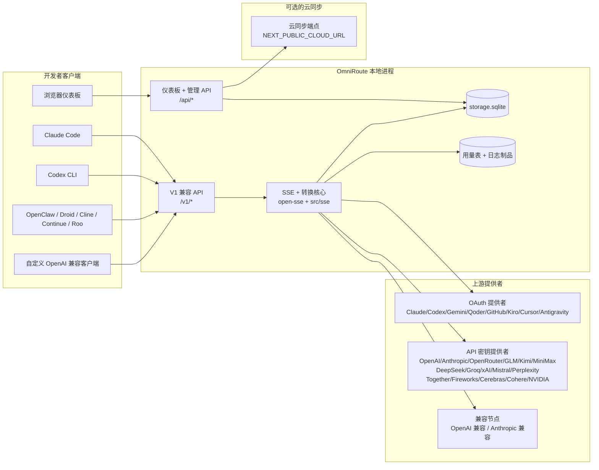
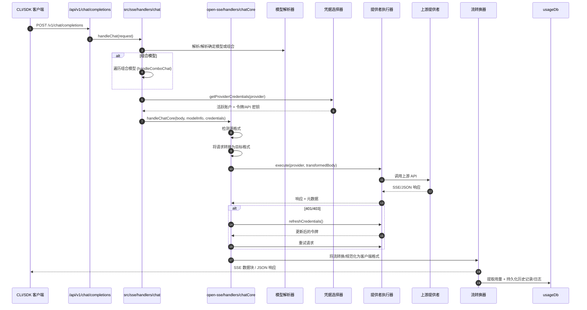
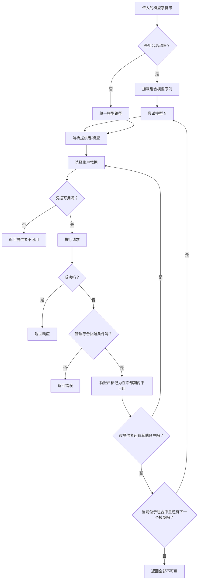
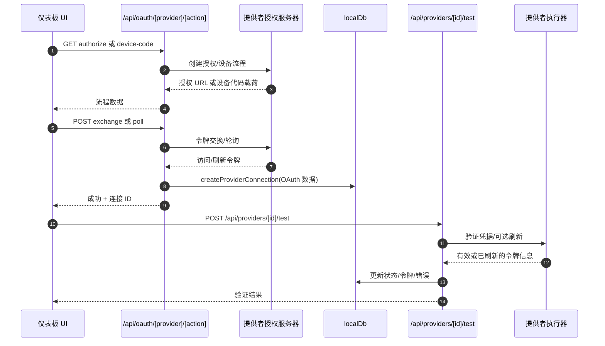
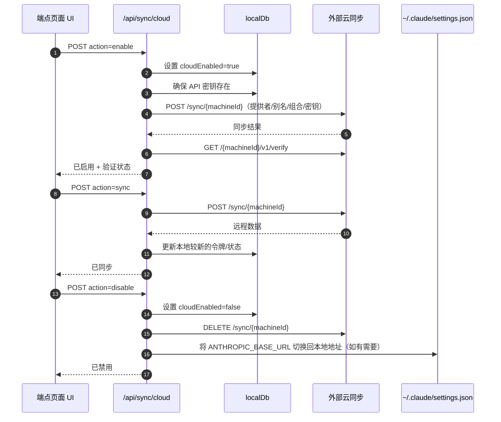
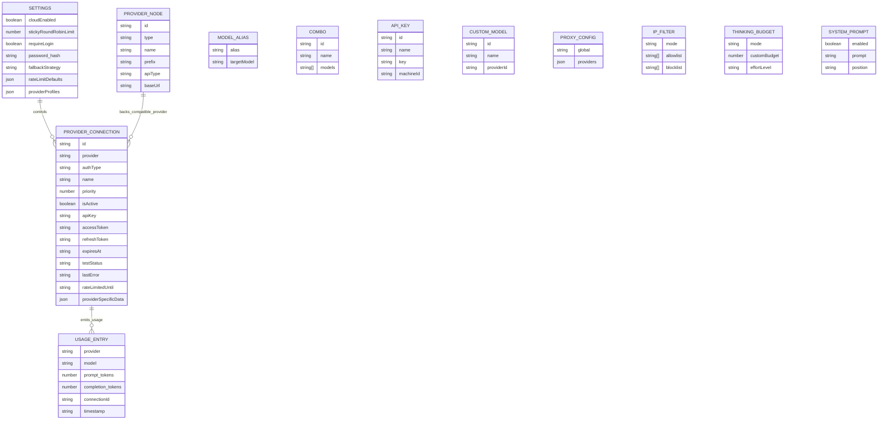
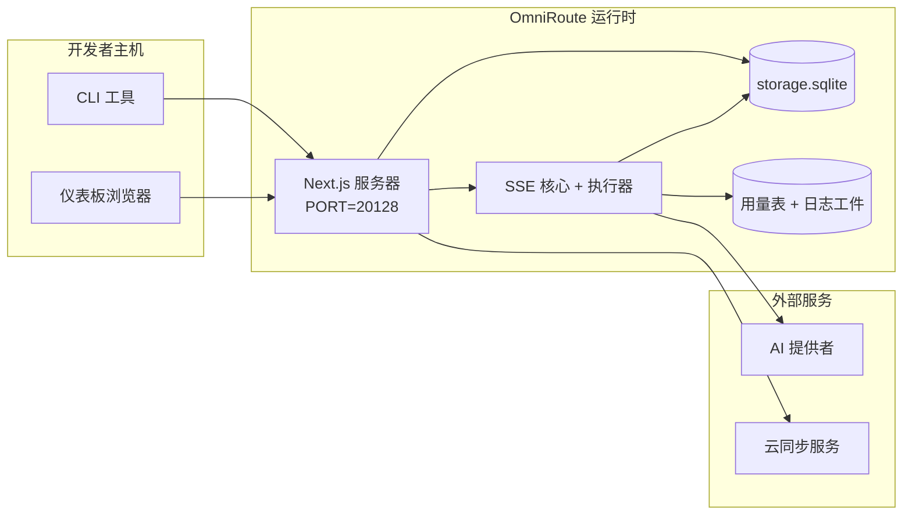

# OmniRoute Architecture (中文 (简体))

🌐 **Languages:** 🇺🇸 [English](../../../../architecture/ARCHITECTURE.md) · 🇪🇹 [am](../../../am/docs/architecture/ARCHITECTURE.md) · 🇸🇦 [ar](../../../ar/docs/architecture/ARCHITECTURE.md) · 🇦🇿 [az](../../../az/docs/architecture/ARCHITECTURE.md) · 🇧🇬 [bg](../../../bg/docs/architecture/ARCHITECTURE.md) · 🇧🇩 [bn](../../../bn/docs/architecture/ARCHITECTURE.md) · 🇧🇦 [bs](../../../bs/docs/architecture/ARCHITECTURE.md) · 🇨🇿 [cs](../../../cs/docs/architecture/ARCHITECTURE.md) · 🇩🇰 [da](../../../da/docs/architecture/ARCHITECTURE.md) · 🇩🇪 [de](../../../de/docs/architecture/ARCHITECTURE.md) · 🇬🇷 [el](../../../el/docs/architecture/ARCHITECTURE.md) · 🇪🇸 [es](../../../es/docs/architecture/ARCHITECTURE.md) · 🇪🇪 [et](../../../et/docs/architecture/ARCHITECTURE.md) · 🇮🇷 [fa](../../../fa/docs/architecture/ARCHITECTURE.md) · 🇫🇮 [fi](../../../fi/docs/architecture/ARCHITECTURE.md) · 🇫🇷 [fr](../../../fr/docs/architecture/ARCHITECTURE.md) · 🇮🇪 [ga](../../../ga/docs/architecture/ARCHITECTURE.md) · 🇮🇳 [gu](../../../gu/docs/architecture/ARCHITECTURE.md) · 🇳🇬 [ha](../../../ha/docs/architecture/ARCHITECTURE.md) · 🇮🇱 [he](../../../he/docs/architecture/ARCHITECTURE.md) · 🇮🇳 [hi](../../../hi/docs/architecture/ARCHITECTURE.md) · 🇭🇷 [hr](../../../hr/docs/architecture/ARCHITECTURE.md) · 🇭🇺 [hu](../../../hu/docs/architecture/ARCHITECTURE.md) · 🇦🇲 [hy](../../../hy/docs/architecture/ARCHITECTURE.md) · 🇮🇩 [id](../../../id/docs/architecture/ARCHITECTURE.md) · 🇳🇬 [ig](../../../ig/docs/architecture/ARCHITECTURE.md) · 🇮🇹 [it](../../../it/docs/architecture/ARCHITECTURE.md) · 🇯🇵 [ja](../../../ja/docs/architecture/ARCHITECTURE.md) · 🇬🇪 [ka](../../../ka/docs/architecture/ARCHITECTURE.md) · 🇰🇭 [km](../../../km/docs/architecture/ARCHITECTURE.md) · 🇮🇳 [kn](../../../kn/docs/architecture/ARCHITECTURE.md) · 🇰🇷 [ko](../../../ko/docs/architecture/ARCHITECTURE.md) · 🇱🇹 [lt](../../../lt/docs/architecture/ARCHITECTURE.md) · 🇱🇻 [lv](../../../lv/docs/architecture/ARCHITECTURE.md) · 🇮🇳 [ml](../../../ml/docs/architecture/ARCHITECTURE.md) · 🇮🇳 [mr](../../../mr/docs/architecture/ARCHITECTURE.md) · 🇲🇾 [ms](../../../ms/docs/architecture/ARCHITECTURE.md) · 🇲🇹 [mt](../../../mt/docs/architecture/ARCHITECTURE.md) · 🇲🇲 [my](../../../my/docs/architecture/ARCHITECTURE.md) · 🇳🇵 [ne](../../../ne/docs/architecture/ARCHITECTURE.md) · 🇳🇱 [nl](../../../nl/docs/architecture/ARCHITECTURE.md) · 🇳🇴 [no](../../../no/docs/architecture/ARCHITECTURE.md) · 🇮🇳 [or](../../../or/docs/architecture/ARCHITECTURE.md) · 🇮🇳 [pa](../../../pa/docs/architecture/ARCHITECTURE.md) · 🇵🇭 [phi](../../../phi/docs/architecture/ARCHITECTURE.md) · 🇵🇱 [pl](../../../pl/docs/architecture/ARCHITECTURE.md) · 🇵🇹 [pt](../../../pt/docs/architecture/ARCHITECTURE.md) · 🇧🇷 [pt-BR](../../../pt-BR/docs/architecture/ARCHITECTURE.md) · 🇷🇴 [ro](../../../ro/docs/architecture/ARCHITECTURE.md) · 🇷🇺 [ru](../../../ru/docs/architecture/ARCHITECTURE.md) · 🇱🇰 [si](../../../si/docs/architecture/ARCHITECTURE.md) · 🇸🇰 [sk](../../../sk/docs/architecture/ARCHITECTURE.md) · 🇸🇮 [sl](../../../sl/docs/architecture/ARCHITECTURE.md) · 🇷🇸 [sr](../../../sr/docs/architecture/ARCHITECTURE.md) · 🇸🇪 [sv](../../../sv/docs/architecture/ARCHITECTURE.md) · 🇰🇪 [sw](../../../sw/docs/architecture/ARCHITECTURE.md) · 🇮🇳 [ta](../../../ta/docs/architecture/ARCHITECTURE.md) · 🇮🇳 [te](../../../te/docs/architecture/ARCHITECTURE.md) · 🇹🇭 [th](../../../th/docs/architecture/ARCHITECTURE.md) · 🇹🇷 [tr](../../../tr/docs/architecture/ARCHITECTURE.md) · 🇺🇦 [uk-UA](../../../uk-UA/docs/architecture/ARCHITECTURE.md) · 🇵🇰 [ur](../../../ur/docs/architecture/ARCHITECTURE.md) · 🇺🇿 [uz](../../../uz/docs/architecture/ARCHITECTURE.md) · 🇻🇳 [vi](../../../vi/docs/architecture/ARCHITECTURE.md) · 🇳🇬 [yo](../../../yo/docs/architecture/ARCHITECTURE.md) · 🇹🇼 [zh-TW](../../../zh-TW/docs/architecture/ARCHITECTURE.md)

---

title: "OmniRoute 架构"
version: 3.8.40
lastUpdated: 2026-06-28
---

# OmniRoute 架构

🌐 **Languages:** 🇺🇸 [English](../../../../architecture/ARCHITECTURE.md) · 🇪🇹 [am](../../../am/docs/architecture/ARCHITECTURE.md) · 🇸🇦 [ar](../../../ar/docs/architecture/ARCHITECTURE.md) · 🇦🇿 [az](../../../az/docs/architecture/ARCHITECTURE.md) · 🇧🇬 [bg](../../../bg/docs/architecture/ARCHITECTURE.md) · 🇧🇩 [bn](../../../bn/docs/architecture/ARCHITECTURE.md) · 🇧🇦 [bs](../../../bs/docs/architecture/ARCHITECTURE.md) · 🇨🇿 [cs](../../../cs/docs/architecture/ARCHITECTURE.md) · 🇩🇰 [da](../../../da/docs/architecture/ARCHITECTURE.md) · 🇩🇪 [de](../../../de/docs/architecture/ARCHITECTURE.md) · 🇬🇷 [el](../../../el/docs/architecture/ARCHITECTURE.md) · 🇪🇸 [es](../../../es/docs/architecture/ARCHITECTURE.md) · 🇪🇪 [et](../../../et/docs/architecture/ARCHITECTURE.md) · 🇮🇷 [fa](../../../fa/docs/architecture/ARCHITECTURE.md) · 🇫🇮 [fi](../../../fi/docs/architecture/ARCHITECTURE.md) · 🇫🇷 [fr](../../../fr/docs/architecture/ARCHITECTURE.md) · 🇮🇪 [ga](../../../ga/docs/architecture/ARCHITECTURE.md) · 🇮🇳 [gu](../../../gu/docs/architecture/ARCHITECTURE.md) · 🇳🇬 [ha](../../../ha/docs/architecture/ARCHITECTURE.md) · 🇮🇱 [he](../../../he/docs/architecture/ARCHITECTURE.md) · 🇮🇳 [hi](../../../hi/docs/architecture/ARCHITECTURE.md) · 🇭🇷 [hr](../../../hr/docs/architecture/ARCHITECTURE.md) · 🇭🇺 [hu](../../../hu/docs/architecture/ARCHITECTURE.md) · 🇦🇲 [hy](../../../hy/docs/architecture/ARCHITECTURE.md) · 🇮🇩 [id](../../../id/docs/architecture/ARCHITECTURE.md) · 🇳🇬 [ig](../../../ig/docs/architecture/ARCHITECTURE.md) · 🇮🇹 [it](../../../it/docs/architecture/ARCHITECTURE.md) · 🇯🇵 [ja](../../../ja/docs/architecture/ARCHITECTURE.md) · 🇬🇪 [ka](../../../ka/docs/architecture/ARCHITECTURE.md) · 🇰🇭 [km](../../../km/docs/architecture/ARCHITECTURE.md) · 🇮🇳 [kn](../../../kn/docs/architecture/ARCHITECTURE.md) · 🇰🇷 [ko](../../../ko/docs/architecture/ARCHITECTURE.md) · 🇱🇹 [lt](../../../lt/docs/architecture/ARCHITECTURE.md) · 🇱🇻 [lv](../../../lv/docs/architecture/ARCHITECTURE.md) · 🇮🇳 [ml](../../../ml/docs/architecture/ARCHITECTURE.md) · 🇮🇳 [mr](../../../mr/docs/architecture/ARCHITECTURE.md) · 🇲🇾 [ms](../../../ms/docs/architecture/ARCHITECTURE.md) · 🇲🇹 [mt](../../../mt/docs/architecture/ARCHITECTURE.md) · 🇲🇲 [my](../../../my/docs/architecture/ARCHITECTURE.md) · 🇳🇵 [ne](../../../ne/docs/architecture/ARCHITECTURE.md) · 🇳🇱 [nl](../../../nl/docs/architecture/ARCHITECTURE.md) · 🇳🇴 [no](../../../no/docs/architecture/ARCHITECTURE.md) · 🇮🇳 [or](../../../or/docs/architecture/ARCHITECTURE.md) · 🇮🇳 [pa](../../../pa/docs/architecture/ARCHITECTURE.md) · 🇵🇭 [phi](../../../phi/docs/architecture/ARCHITECTURE.md) · 🇵🇱 [pl](../../../pl/docs/architecture/ARCHITECTURE.md) · 🇵🇹 [pt](../../../pt/docs/architecture/ARCHITECTURE.md) · 🇧🇷 [pt-BR](../../../pt-BR/docs/architecture/ARCHITECTURE.md) · 🇷🇴 [ro](../../../ro/docs/architecture/ARCHITECTURE.md) · 🇷🇺 [ru](../../../ru/docs/architecture/ARCHITECTURE.md) · 🇱🇰 [si](../../../si/docs/architecture/ARCHITECTURE.md) · 🇸🇰 [sk](../../../sk/docs/architecture/ARCHITECTURE.md) · 🇸🇮 [sl](../../../sl/docs/architecture/ARCHITECTURE.md) · 🇷🇸 [sr](../../../sr/docs/architecture/ARCHITECTURE.md) · 🇸🇪 [sv](../../../sv/docs/architecture/ARCHITECTURE.md) · 🇰🇪 [sw](../../../sw/docs/architecture/ARCHITECTURE.md) · 🇮🇳 [ta](../../../ta/docs/architecture/ARCHITECTURE.md) · 🇮🇳 [te](../../../te/docs/architecture/ARCHITECTURE.md) · 🇹🇭 [th](../../../th/docs/architecture/ARCHITECTURE.md) · 🇹🇷 [tr](../../../tr/docs/architecture/ARCHITECTURE.md) · 🇺🇦 [uk-UA](../../../uk-UA/docs/architecture/ARCHITECTURE.md) · 🇵🇰 [ur](../../../ur/docs/architecture/ARCHITECTURE.md) · 🇺🇿 [uz](../../../uz/docs/architecture/ARCHITECTURE.md) · 🇻🇳 [vi](../../../vi/docs/architecture/ARCHITECTURE.md) · 🇳🇬 [yo](../../../yo/docs/architecture/ARCHITECTURE.md) · 🇹🇼 [zh-TW](../../../zh-TW/docs/architecture/ARCHITECTURE.md)

---

_最后更新：2026-06-28_

## 执行摘要

OmniRoute是基于Next.js构建的本地AI路由网关和仪表板。它提供单个 OpenAI 兼容端点 (`/v1/*`)，并通过转换、回退、令牌刷新和使用跟踪在多个上游提供者之间路由流量。

核心能力：

- 用于CLI/tools的 OpenAI 兼容API表面（377 个提供者，156 个执行器模块）
- 跨提供者格式的Request/response翻译
- 模型组合后备（多模型序列）
- 结构化组合步骤 (`provider + model + connection`)，运行时按`compositeTiers`排序
- 账户级回退（每个提供者多个账户）
- 主聊天路径中的配额预检和配额感知P2C帐户选择
- OAuth + API 密钥提供者连接管理（27 个OAuth提供者模块）
- 通过`/v1/embeddings`嵌入生成（18 个提供者）
- 通过`/v1/images/generations`生成图像（10 个+提供者，20 个+模型）
- 通过`/v1/audio/transcriptions`进行音频转录（18 个提供者）
- 通过`/v1/audio/speech`进行文本转语音（24 个内置提供者）
- 通过`/v1/videos/generations`生成视频 (ComfyUI + SD WebUI)
- 通过`/v1/music/generations` (ComfyUI) 生成音乐
- 通过`/v1/search`进行网络搜索（20 个提供者）
- 通过`/v1/moderations`进行审核
- 通过`/v1/rerank`重新排名
- 考虑标签解析（`<think>...</think>`）用于推理模型
- 响应清理以实现严格的OpenAI SDK兼容性
- 角色规范化（开发者→系统、系统→用户）以实现跨提供者兼容性
- 结构化输出转换（json_schema → Gemini responseSchema）
- 提供者、密钥、别名、组合、设置、定价的本地持久性（122 个DB模块）
- Usage/cost跟踪和请求记录
- 用于multi-device/state同步的可选云同步
- IP allowlist/blocklist用于API访问控制
- 预算管理思维（passthrough/auto/custom/adaptive）
- 全局系统提示注入
- 会话跟踪和指纹识别
- 通过特定于提供者的配置文件增强每个帐户的速率限制
- 提供者弹性的断路器模式
- 通过互斥锁实现防雷群保护
- 基于签名的请求重复数据删除缓存
- 领域层：成本规则、回退策略、锁定策略
- 上下文中继：帐户轮换连续性的会话切换摘要
- 域状态持久性（用于回退、预算、锁定、断路器的SQLite直写式缓存）
- 用于集中请求评估的策略引擎（锁定→预算→后备）
- 使用p50/p95/p99延迟聚合请求遥测
- 通过`combo_execution_key` / `combo_step_id`组合目标遥测和历史组合目标健康状况
- 用于端到端跟踪的关联ID (X-Request-Id)
- 根据API密钥选择退出的合规性审核日志记录
- LLM质量保证评估框架
- 具有实时提供者断路器状态的健康仪表板
- MCP服务器（110 个工具），具有 3 种传输方式 (stdio/SSE/Streamable HTTP)
- A2A服务器（JSON-RPC 2.0 + SSE）具有技能和任务生命周期
- 记忆系统（提取、注入、检索、总结）
- 技能系统（注册中心、执行器、沙箱、内置技能）
- 具有证书管理和DNS处理功能的MITM代理
- 提示注入防护中间件
- 使用 Caveman、 RTK、堆叠管道、压缩组合、语言包和分析来提示压缩管道
- ACP （代理通信协议）注册表
- 模块化OAuth提供程序（ `src/lib/oauth/providers/`下有 22 个单独的模块）
- Uninstall/full-uninstall脚本
- OAuth环境修复行动
- 用于兼容 OpenAI 的WS客户端的WebSocket桥接器 (`/v1/ws`)
- 同步令牌管理（issue/revoke、ETag 版本配置包下载）
- GLM思维（`glmt`）一流提供者预设
- 混合令牌计数（具有估计回退的提供者端`/messages/count_tokens` ）
- 模型别名自动播种（启动时 30 个+跨代理方言标准化）
- 通过SSRF防护、私有URL阻止和可配置重试进行安全出站提取
- 使用可配置的`requestRetry`和`maxRetryIntervalSec`进行冷却感知聊天重试
- 启动时使用Zod验证运行时环境
- 具有分页、提供者CRUD事件和 SSRF 阻止的验证日志记录的合规性审核 v2

主要运行时模型：

- `src/app/api/*`下的Next.js应用程序路由同时实现仪表板APIs和兼容性APIs
- `src/sse/*` + `open-sse/*`中的共享SSE/routing核心处理提供程序执行、转换、流式传输、回退和使用

## 参考架构图

v3.8.0 平台的权威版本控制 Mermaid 源文件位于
[`docs/diagrams/`](../diagrams/README.md)。以下展示其中两幅以供概览；
其余图表可从各自领域指南中获取。


> 源文件：[diagrams/request-pipeline.mmd](../diagrams/request-pipeline.mmd)


> 源文件：[diagrams/resilience-3layers.mmd](../diagrams/resilience-3layers.mmd) — 另见
> [RESILIENCE_GUIDE.md](./RESILIENCE_GUIDE.md) 和 `CLAUDE.md` 中的容灾参考。

## 范围与边界

### 范围内

- 本地网关运行时
- 控制台管理 API
- 服务商认证与 Token 刷新
- 请求格式转换和 SSE 流式传输
- 本地状态 + 用量持久化
- 可选的云端同步编排

### 范围外

- `NEXT_PUBLIC_CLOUD_URL` 背后的云端服务实现
- 本地进程之外的服务商 SLA/控制面
- 外部 CLI 二进制程序本身（Claude Code、Codex CLI 等）

## 仪表盘界面（当前）

`src/app/(dashboard)/dashboard/` 下的主要页面：

- `/dashboard` — 快速入门 + 提供者概览
- `/dashboard/endpoint` — 端点代理 + MCP + A2A + API 端点标签页
- `/dashboard/providers` — 提供者连接和凭据
- `/dashboard/combos` — 组合策略、模板、分步构建器、模型路由规则、手动持久化排序
- `/dashboard/auto-combo` — Auto Combo Engine：评分权重、模式包、虚拟工厂预设、遥测
- `/dashboard/costs` — 成本汇总和定价可见性
- `/dashboard/analytics` — 使用情况分析、评估、组合目标运行状况
- `/dashboard/limits` — 配额/速率控制
- `/dashboard/cli-tools` — CLI 引导、运行时检测、配置生成
- `/dashboard/agents` — 检测到的 ACP 智能体 + 自定义智能体注册
- `/dashboard/cloud-agents` — 云托管智能体任务（Codex Cloud、Devin、Jules）及任务生命周期
- `/dashboard/skills` — A2A 技能注册表、沙盒执行、内置技能目录
- `/dashboard/memory` — 持久化对话记忆的检查和检索
- `/dashboard/webhooks` — 出站 Webhook 订阅、密钥轮换、重试统计
- `/dashboard/batch` — 批处理作业提交和进度
- `/dashboard/cache` — 直读缓存和推理缓存统计、驱逐控制
- `/dashboard/playground` — 面向任意已配置组合/模型的交互式聊天演练场
- `/dashboard/changelog` — 应用内变更日志查看器（渲染 `CHANGELOG.md`）
- `/dashboard/system` — 运行时诊断、版本信息、环境验证界面
- `/dashboard/onboarding` — 面向新安装实例的首次运行设置向导
- `/dashboard/media` — 图像/视频/音乐演练场
- `/dashboard/search-tools` — 搜索提供者测试和历史记录
- `/dashboard/health` — 正常运行时间、断路器、速率限制、配额监控会话
- `/dashboard/logs` — 请求/代理/审计/控制台日志
- `/dashboard/settings` — 系统设置标签页（常规、路由、组合默认值等）
- `/dashboard/context/caveman` — Caveman 压缩规则、语言包、预览和输出模式
- `/dashboard/context/rtk` — RTK 命令输出过滤器、预览和运行时安全设置
- `/dashboard/context/combos` — 分配给路由组合的命名压缩管线
- `/dashboard/translator` — 翻译器检查和请求格式转换预览
- `/dashboard/audit` — 支持分页和结构化元数据的合规审计日志浏览器
- `/dashboard/usage` — 与 `usage_history` 关联的逐请求使用情况浏览器
- `/dashboard/compression` — 压缩分析、统计和管线分配
- `/dashboard/api-manager` — API 密钥生命周期和模型权限

UI 层：每个页面都渲染在同一个外壳中 — `src/app/(dashboard)/layout.tsx` →
`src/shared/components/layouts/DashboardLayout.tsx` → `DashboardShell.tsx`（该工具包的
`SidebarProvider`/`SidebarInset`，以及 OmniRoute 的 `Sidebar.tsx` 和 `Header.tsx`）。页面从
`@/shared/components`（对 `packages/ui-kit` 中随附的 Keak CI UI Kit 的适配器）或工具包组件子路径（`@omniroute/ui-kit/table`、`…/page-header`）导入其
构建块，并通过 `<Icon>`（`ICON_MAP` → Lucide）导入图标。主题（默认为 `system`，支持浅色/深色）和令牌通过
`src/app/globals.css` 中的桥接层来自该工具包。详细信息：`docs/architecture/DESIGN_SYSTEM.md`。

## 高层系统上下文



## 核心运行时组件

## 1) API 与路由层（Next.js App Routes）

主要目录：

- `src/app/api/v1/*` 和 `src/app/api/v1beta/*` — 兼容 API
- `src/app/api/*` — 管理/配置 API
- `next.config.mjs` 中的 Next.js 重写规则将 `/v1/*` 映射到 `/api/v1/*`

重要的兼容路由：

- `src/app/api/v1/chat/completions/route.ts`
- `src/app/api/v1/messages/route.ts`
- `src/app/api/v1/responses/route.ts`
- `src/app/api/v1/models/route.ts` — 包含标记为 `custom: true` 的自定义模型
- `src/app/api/v1/embeddings/route.ts` — 向量嵌入生成（6 个服务商）
- `src/app/api/v1/images/generations/route.ts` — 图片生成（4+ 个服务商，含 Antigravity/Nebius）
- `src/app/api/v1/messages/count_tokens/route.ts`
- `src/app/api/v1/providers/[provider]/chat/completions/route.ts` — 专用每服务商聊
- `src/app/api/v1/providers/[provider]/embeddings/route.ts` — 专用每服务商向量嵌入
- `src/app/api/v1/providers/[provider]/images/generations/route.ts` — 专用每服务商图片生成
- `src/app/api/v1beta/models/route.ts`
- `src/app/api/v1beta/models/[...path]/route.ts`

管理领域：

- 认证/设置：`src/app/api/auth/*`, `src/app/api/settings/*`
- 服务商/连接：`src/app/api/providers*`
- 服务商节点：`src/app/api/provider-nodes*`
- 自定义模型：`src/app/api/provider-models` (GET/POST/DELETE)
- 模型目录：`src/app/api/models/route.ts` (GET)
- 代理配置：`src/app/api/settings/proxy` (GET/PUT/DELETE) + `src/app/api/settings/proxy/test` (POST)
- OAuth：`src/app/api/oauth/*`
- API Key/别名/Combo/定价：`src/app/api/keys*`, `src/app/api/models/alias`, `src/app/api/combos*`, `src/app/api/pricing`
- 用量：`src/app/api/usage/*`
- 同步/云端：`src/app/api/sync/*`, `src/app/api/cloud/*`
- CLI 工具辅助：`src/app/api/cli-tools/*`
- IP 过滤：`src/app/api/settings/ip-filter` (GET/PUT)
- Thinking Budget：`src/app/api/settings/thinking-budget` (GET/PUT)
- 系统提示：`src/app/api/settings/system-prompt` (GET/PUT)
- 压缩：`src/app/api/settings/compression`, `src/app/api/compression/*` 和
  `src/app/api/context/*`
- 会话：`src/app/api/sessions` (GET)
- 速率限制：`src/app/api/rate-limits` (GET)
- 容灾：`src/app/api/resilience` (GET/PATCH) — 请求队列、连接冷却、服务商熔断器、等待冷却配置
- 容灾重置：`src/app/api/resilience/reset` (POST) — 重置服务商熔断器
- 缓存统计：`src/app/api/cache/stats` (GET/DELETE)
- 遥测：`src/app/api/telemetry/summary` (GET)
- 预算：`src/app/api/usage/budget` (GET/POST)
- 容灾链：`src/app/api/fallback/chains` (GET/POST/DELETE)
- 合规审计：`src/app/api/compliance/audit-log` (GET, 含分页 + 结构化元数据)
- 评估：`src/app/api/evals` (GET/POST), `src/app/api/evals/[suiteId]` (GET)
- 策略：`src/app/api/policies` (GET/POST)
- 同步 Token：`src/app/api/sync/tokens` (GET/POST), `src/app/api/sync/tokens/[id]` (GET/DELETE)
- 配置包：`src/app/api/sync/bundle` (GET, ETag 版本控制的设置/服务商/Combo/Key 快照)
- WebSocket：`src/app/api/v1/ws/route.ts` — OpenAI 兼容 WS 客户端的 Upgrade 处理

## 2) SSE + 翻译核心

主要流程模块：

- 入口：`src/sse/handlers/chat.ts`
- 核心编排：`open-sse/handlers/chatCore.ts`
- 提供者执行适配器：`open-sse/executors/*`
- 格式检测/提供者配置：`open-sse/services/provider.ts`
- 模型解析/解析映射：`src/sse/services/model.ts`、`open-sse/services/model.ts`
- 账户回退逻辑：`open-sse/services/accountFallback.ts`
- 翻译器注册表：`open-sse/translator/index.ts`
- 流转换：`open-sse/utils/stream.ts`、`open-sse/utils/streamHandler.ts`
- 用量提取/标准化：`open-sse/utils/usageTracking.ts`
- Think 标签解析器：`open-sse/utils/thinkTagParser.ts`
- 嵌入处理程序：`open-sse/handlers/embeddings.ts`
- 嵌入提供者注册表：`open-sse/config/embeddingRegistry.ts`
- 图像生成处理程序：`open-sse/handlers/imageGeneration.ts`
- 图像提供者注册表：`open-sse/config/imageRegistry.ts`
- 响应清理：`open-sse/handlers/responseSanitizer.ts`
- 角色标准化：`open-sse/services/roleNormalizer.ts`

服务（业务逻辑）：

- 账户选择/评分：`open-sse/services/accountSelector.ts`
- 上下文生命周期管理：`open-sse/services/contextManager.ts`
- IP 过滤器强制执行：`open-sse/services/ipFilter.ts`
- 会话跟踪：`open-sse/services/sessionManager.ts`
- 请求去重：`open-sse/services/signatureCache.ts`
- 系统提示词注入：`open-sse/services/systemPrompt.ts`
- 思考预算管理：`open-sse/services/thinkingBudget.ts`
- 通配符模型路由：`open-sse/services/wildcardRouter.ts`
- 速率限制管理：`open-sse/services/rateLimitManager.ts`
- 熔断器：`src/shared/utils/circuitBreaker.ts`
- 上下文移交：`open-sse/services/contextHandoff.ts` — 为上下文中继策略生成并注入移交摘要
- 压缩：`open-sse/services/compression/*` — 在提供者转换之前主动压缩；
  包括 Caveman 规则、RTK 过滤器、堆叠管道、压缩组合、统计和验证
- Codex 配额获取器：`open-sse/services/codexQuotaFetcher.ts` — 获取 Codex 配额，用于上下文中继的移交决策
- 冷却感知重试：`src/sse/services/cooldownAwareRetry.ts` — 按模型执行冷却重试，可通过 `requestRetry` / `maxRetryIntervalSec` 配置
- 安全出站请求：`src/shared/network/safeOutboundFetch.ts` — 受保护的提供者/模型请求，具备 SSRF 防护、私有 URL 阻止、重试和超时功能
- 出站 URL 防护：`src/shared/network/outboundUrlGuard.ts` — 检查提供者 URL 的主机；`src/shared/network/outboundUrlGuardPolicy.ts` 根据 `OMNIROUTE_ALLOW_LOCAL_PROVIDER_URLS`、`OMNIROUTE_ALLOW_PRIVATE_PROVIDER_URLS` 及其仪表板开关选择模式（参见 `docs/reference/ENVIRONMENT.md`）
- 提供者请求默认值：`open-sse/services/providerRequestDefaults.ts` — 提供者级别的 `maxTokens`、`temperature`、`thinkingBudgetTokens` 默认值
- GLM 提供者常量：`open-sse/config/glmProvider.ts` — 共享的 GLM 模型、配额 URL、GLMT 超时和默认值
- Antigravity 上游：`open-sse/config/antigravityUpstream.ts` — 基础 URL 和发现路径常量
- Codex 客户端常量：`open-sse/config/codexClient.ts` — 带版本的用户代理和客户端版本值
- 模型别名种子：`src/lib/modelAliasSeed.ts` — 启动时植入 30 多个跨代理方言别名

领域层模块：

- 成本规则/预算：`src/domain/costRules.ts`
- 回退策略：`src/domain/fallbackPolicy.ts`
- 组合解析器：`src/domain/comboResolver.ts`
- 锁定策略：`src/domain/lockoutPolicy.ts`
- 策略引擎：`src/domain/policyEngine.ts` — 集中执行锁定 → 预算 → 回退评估
- 错误代码目录：`src/shared/constants/errorCodes.ts`
- 请求 ID：`src/shared/utils/requestId.ts`
- 请求超时：`src/shared/utils/fetchTimeout.ts`
- 请求遥测：`src/shared/utils/requestTelemetry.ts`
- 合规/审计：`src/lib/compliance/index.ts`
- 评估运行器：`src/lib/evals/evalRunner.ts`
- 领域状态持久化：`src/lib/db/domainState.ts` — 针对回退链、预算、成本历史、锁定状态和熔断器的 SQLite CRUD

OAuth 提供者模块（`src/lib/oauth/providers/` 下的 27 个独立文件）：

- 注册表索引：`src/lib/oauth/providers/index.ts`
- 各个提供者：`agy.ts`、`antigravity.ts`、`claude.ts`、`cline.ts`、`codebuddy-cn.ts`、`codebuddy-intl.ts`、`codex.ts`、`cursor.ts`、`devin-desktop.ts`、`ghe-copilot.ts`、`github.ts`、`gitlab-duo.ts`、`grok-cli-oauth.ts`、`grok-cli.ts`、`kilocode.ts`、`kimi-coding.ts`、`kiro.ts`、`muse-code.ts`、`openference.ts`、`qoder.ts`、`trae.ts`、`workbuddy.ts`、`xai-oauth.ts`、`zed-hosted.ts`、`zed.ts`
- 共享辅助程序：`codebuddyDeviceAuth.ts`（CodeBuddy CN/intl 设备流程）、`museCodeDeviceResponse.ts`
- 轻量封装：`src/lib/oauth/providers.ts` — 从各个模块重新导出

## 5) 嵌入式服务（v3.8.4）

OmniRoute 可以安装、监管并路由到本地运行的 AI 工具进程，称为**嵌入式服务**。
v3.8.4 中发布了两项：9Router 和 CLIProxyAPI。

架构层级：

- **UI** (`/dashboard/providers/services`) — 双标签页页面，含生命周期控制、
  实时日志流式传输、API Key 管理，以及（针对 9Router）通过内部反向代理提供嵌入式原生 UI。
- **API** (`/api/services/{name}/*`) — 9Router 8 个端点，CLIProxyAPI 7 个端点，
  均归类为 **LOCAL_ONLY**（硬规则 #17）。共享的 `GET /api/services/[name]/logs`
  SSE 端点同时服务于两者。
- **监管进程** (`src/lib/services/`) — 泛型 `ServiceSupervisor` 类封装了
  `child_process.spawn`，持有一个 5 MB 环形缓冲区用于 SSE 日志流式传输、一个健康
  探测循环、一个原子操作锁，以及 SIGTERM→SIGKILL 优雅关闭流程。
  `bootstrap.ts` 在进程启动时自动配置所有已启用的服务。
- **服务商/执行器** (`open-sse/executors/ninerouter.ts`) — 9Router 作为
  真实服务商对外暴露。模型前缀为 `9router/{sub}/{model}`，每 5 分钟从 9Router 的
  `/v1/models` 端点同步一次。

深入阅读：`docs/frameworks/EMBEDDED-SERVICES.md`

## 主要子系统 (v3.8.0)

### A. 汽车组合发动机

自动组合在请求时动态评分和选择路由目标，而不是依赖于静态组合定义。它为`auto/*`模型前缀系列提供支持。

- 引擎条目： `open-sse/services/autoCombo/` （`autoComboEngine.ts`， `scoringEngine.ts`， `virtualFactory.ts`， `modePacks.ts`）
- 解析器： `src/domain/comboResolver.ts` （自动检测`auto/`前缀）
- 仪表板： `/dashboard/auto-combo`
- 遥测： `auto_combo_decisions` SQLite表

关键能力：

- **20种路由策略**（优先级、加权、先填充、循环、 P2C、随机、最少使用、成本优化、重置感知、重置窗口、净空、配额加权、严格随机、**汽车**、lkgp、上下文优化、缓存优化、上下文中继、**融合**，管道） — auto是v3.8.0中的标题添加； `fusion` （面板扇出+判断综合， `open-sse/services/fusion.ts`）是 v3.8.36 中的新增功能。
- **16因素评分**：配额、运行状况、逆成本、逆延迟、任务适合度等等。因素的规范表及其默认权重位于[`docs/routing/AUTO-COMBO.md`](../routing/AUTO-COMBO.md) —中，在这里重述它会使其成为第二个过时的地方。
- **虚拟工厂**当不存在匹配的命名组合时，会实现临时组合，从健康的活跃提供者连接中寻找候选人。
- **自动前缀**： `auto/coding`、 `auto/cheap`、 `auto/fast`、 `auto/offline`、 `auto/smart`、 `auto/lkgp` —每个都由调整后的权重配置文件支持。
- **6 个模式包**： `ship-fast`、 `cost-saver`、 `quality-first`、 `offline-friendly`、 `reliability-first`和`chaos-mode` —可从仪表板调用的预设权重配置。 （不要与上面的`auto/*`前缀混淆，它们是请求时的变体。）

有关完整的算法详细信息（因子公式、权重调整），请参阅[`docs/routing/AUTO-COMBO.md`](../routing/AUTO-COMBO.md) 。

### B. 云代理

云代理将第三方托管代码代理平台（Codex Cloud、 Devin、 Jules）包装在统一的数据库支持的任务生命周期后面。所有任务creation/inspection端点都需要管理身份验证。

- 模块根： `src/lib/cloudAgent/` （`baseAgent.ts`、 `registry.ts`、 `api.ts`、 `types.ts`、 `db.ts`，以及`agents/`下的每个代理子目录）
- 每个代理实现： `agents/codex/`、 `agents/devin/`、 `agents/jules/`
- 公共端点： `/api/v1/agents/tasks/*` （list/create/get/cancel）
- 管理端点： `/api/cloud/*` （配置、状态、批次）
- 仪表板： `/dashboard/cloud-agents`
- 存储： `cloud_agent_tasks`表

有关每个代理配置和OAuth详细信息，请参阅[`docs/frameworks/CLOUD_AGENT.md`](../frameworks/CLOUD_AGENT.md) 。

### C、护栏

Guardrails 模块是一个可热重载的中间件层，用于检查PII、提示注入和不安全视觉内容的请求和响应。违规使HTTP短路请求**503**加上结构化错误代码，允许下游调用者重试或分支。

- 模块根： `src/lib/guardrails/` (`base.ts`, `registry.ts`, `piiMasker.ts`, `promptInjection.ts`, `visionBridge.ts`, `visionBridgeHelpers.ts`)
- 热重载：注册表监视配置更改并就地重建链
- 接入点：聊天处理程序入口、图像生成处理程序、响应清理程序
- HTTP合约：违规行为表现为`503`和`error.code = "GUARDRAIL_VIOLATION"`

有关规则集创作和阈值调整，请参阅[`docs/security/GUARDRAILS.md`](../security/GUARDRAILS.md) 。

### D. 域层

`src/domain/`命名空间集中了策略决策，因此路由处理程序不必自己组装lockout/budget/fallback逻辑。

- 策略引擎： `src/domain/policyEngine.ts` —执行前评估的单一入口点（锁定→预算→后备排序）
- 费用规则： `src/domain/costRules.ts`
- 后备策略： `src/domain/fallbackPolicy.ts`
- 锁定政策： `src/domain/lockoutPolicy.ts`
- 基于标签的路由： `src/domain/tagRouter.ts`
- 组合解析器： `src/domain/comboResolver.ts` —将组合名称、auto/\* 前缀和通配符模型目标解析为具体的执行计划
- Connection/model规则加入者： `src/domain/connectionModelRules.ts`
- 模型可用性快照： `src/domain/modelAvailability.ts`
- 提供者到期跟踪： `src/domain/providerExpiration.ts`
- 配额缓存： `src/domain/quotaCache.ts`
- 降解状态： `src/domain/degradation.ts`
- 配置审核： `src/domain/configAudit.ts`
- OmniRoute响应元数据生成器： `src/domain/omnirouteResponseMeta.ts`
- 评估子系统： `src/domain/assessment/` —定期评估作业

### E. 授权管道

授权管道对每个传入请求进行分类，并在分派之前应用适当的策略链。

- 管道入口： `src/server/authz/pipeline.ts`
- 请求分类器： `src/server/authz/classify.ts` —区分公共兼容路由和管理路由
- 公共路线库存： `src/shared/constants/publicApiRoutes.ts`
- 策略： `src/server/authz/policies/` —可组合谓词（`requireApiKey`、 `requireManagement`、 `requireFreshAuth`等）
- 标头实用程序： `src/server/authz/headers.ts`
- 断言助手： `src/server/authz/assertAuth.ts`
- 请求上下文： `src/server/authz/context.ts`

公共路由与管理路由是一个硬边界： agent/cooldown APIs和提供者突变需要管理身份验证（如果缺少，则为HTTP 401）。

完整的路由分类规则请参见[`docs/architecture/AUTHZ_GUIDE.md`](./AUTHZ_GUIDE.md) 。

### F. 工作流FSM和任务感知路由器

有限状态机驱动的路由器位于组合选择之上，可根据检测到的工作流程阶段（计划、执行、审查）和后台任务关联来引导流量。

- 工作流程FSM: `open-sse/services/workflowFSM.ts`
- 任务感知路由器： `open-sse/services/taskAwareRouter.ts`
- 后台任务检测器： `open-sse/services/backgroundTaskDetector.ts`
- 意图分类器： `open-sse/services/intentClassifier.ts`

FSM转换纳入 Auto Combo 的评分中，偏向于background/automation任务的更便宜的模型，以及用于交互式planning/review转弯的更强的模型。

### G. 特定于提供者的弹性

一些提供者提供了专用的弹性和隐形模块，这些模块搭载在全局断路器/连接冷却/模型锁定层上：

- Antigravity 429 引擎： `open-sse/services/antigravity429Engine.ts` （轮换身份、清理响应标头、通过`antigravityCredits.ts`、 `antigravityHeaderScrub.ts`、 `antigravityHeaders.ts`、 `antigravityIdentity.ts`、 `antigravityVersion.ts`驱动credits/version跟踪）
- Antigravity 429 防护： `open-sse/services/antigravity429Guard.ts` （所有主机上的上游 429 的每个请求预算， `ANTIGRAVITY_MAX_429_ATTEMPTS`；本地应答拒绝正文的相同重新发送； `src/sse/handlers/chat.ts`不会通过冷却感知重试重新启动此类请求）
- ModelScope配额政策： `open-sse/services/modelscopePolicy.ts`
- Claude代码CCH （兼容通道握手）： `open-sse/services/claudeCodeCCH.ts`，加上`claudeCodeCompatible.ts`、 `claudeCodeConstraints.ts`、 `claudeCodeExtraRemap.ts`、 `claudeCodeToolRemapper.ts`
- Claude代码指纹整形： `open-sse/services/claudeCodeFingerprint.ts`
- Claude代码混淆： `open-sse/services/claudeCodeObfuscation.ts`

有关完整的隐形剧本和操作指南，请参阅`docs/security/STEALTH_GUIDE.md` （git；未编译到`/docs`中）。

### H. Webhooks、推理缓存、读取缓存

- **网络钩子**—用于provider/account/task事件的出站调度。
  - 调度员： `src/lib/webhookDispatcher.ts`
  - 存储： `webhooks` SQLite表（通过`src/lib/db/webhooks.ts`）
  - 仪表板： `/dashboard/webhooks` （订阅、机密、重试历史记录）
  - 有关事件分类和重试语义，请参阅[`docs/frameworks/WEBHOOKS.md`](../frameworks/WEBHOOKS.md) 。
- **推理缓存**—可重播推理块，用于发出思考标记（Claude、 GLMT等）的提供者，因此连续回合可以跳过重新思考。
  - DB层： `src/lib/db/reasoningCache.ts`
  - 服务层： `open-sse/services/reasoningCache.ts`
  - 有关重播语义，请参阅[`docs/routing/REASONING_REPLAY.md`](../routing/REASONING_REPLAY.md) 。
- **读取缓存**—短期响应缓存，由签名键控，用于崩溃来自损坏的上游SDKs相同重试。
  - DB层： `src/lib/db/readCache.ts`
  - 统计端点： `GET /api/cache/stats`，仪表板位于`/dashboard/cache`

## 3) 持久化层

主状态数据库（SQLite）：

- 核心基础设施：`src/lib/db/core.ts`（better-sqlite3、数据迁移、WAL）
- 重新导出门面：`src/lib/localDb.ts`（供调用方使用的薄兼容层）
- 文件：`${DATA_DIR}/storage.sqlite`（或设置了 `$XDG_CONFIG_HOME` 时为 `$XDG_CONFIG_HOME/omniroute/storage.sqlite`，否则为 `~/.omniroute/storage.sqlite`）
- 实体（表 + KV 命名空间）：providerConnections, providerNodes, modelAliases, combos, apiKeys, settings, pricing, **customModels**, **proxyConfig**, **ipFilter**, **thinkingBudget**, **systemPrompt**

用量持久化：

- 门面：`src/lib/usageDb.ts`（拆解后的模块位于 `src/lib/usage/*`）
- `storage.sqlite` 中的 SQLite 表：`usage_history`、`call_logs`、`proxy_logs`
- 可选的文件工件保留以便兼容/调试（`${DATA_DIR}/log.txt`、`${DATA_DIR}/call_logs/`、`<repo>/logs/...`）
- 存在旧 JSON 文件时，启动迁移会将其迁移到 SQLite

域状态数据库（SQLite）：

- `src/lib/db/domainState.ts` — 域状态的 CRUD 操作
- 表（在 `src/lib/db/core.ts` 中创建）：`domain_fallback_chains`、`domain_budgets`、`domain_cost_history`、`domain_lockout_state`、`domain_circuit_breakers`
- 写穿式缓存模式：运行时以内存 Map 为权威数据源；变更同步写入 SQLite；冷启动时从数据库恢复状态

## 4) 身份验证 + 安全接口

- 仪表板 Cookie 身份验证：`src/proxy.ts`、`src/app/api/auth/login/route.ts`
- API 密钥生成/验证：`src/shared/utils/apiKey.ts`
- 提供者密钥持久化存储在 `providerConnections` 条目中
- 出站代理支持：通过 `open-sse/utils/proxyFetch.ts`（环境变量）以及 `open-sse/utils/networkProxy.ts`（可按提供者或全局配置）
- SSRF / 出站 URL 防护：`src/shared/network/outboundUrlGuard.ts` — 对提供者调用和 Webhook 目标执行主机检查；模式来自 `src/shared/network/outboundUrlGuardPolicy.ts`（相关标志位参见 `docs/reference/ENVIRONMENT.md`）
- 运行时环境变量验证：`src/lib/env/runtimeEnv.ts` — 针对所有环境变量的 Zod schema，验证结果以启动错误/警告的形式呈现
- 同步令牌：`src/lib/db/syncTokens.ts` — 用于配置包下载端点的作用域令牌；由 `sync_tokens` SQLite 表提供支持（迁移文件 `024_create_sync_tokens.sql`）
- WebSocket 握手身份验证：`src/lib/ws/handshake.ts` — 通过 API 密钥或会话 Cookie 验证 WS 升级请求
- 实时仪表板 WebSocket 身份验证：`src/server/ws/liveServer.ts` — Sidecar（端口 `LIVE_WS_PORT`）接受仪表板会话 Cookie，或持有管理作用域（`manage`/`admin`）的 Bearer API 密钥；仅限推理的密钥将被拒绝。其内部 `POST /__omniroute_event` 发布端点仅在不存在代理跳转标头（`x-forwarded-*`、`x-real-ip`、`forwarded`、`via`）时接受来自环回地址的对等端请求

## 5) 云端同步

- 调度器初始化：`src/lib/initCloudSync.ts`、`src/shared/services/initializeCloudSync.ts`、`src/shared/services/modelSyncScheduler.ts`
- 周期任务：`src/shared/services/cloudSyncScheduler.ts`
- 周期任务：`src/shared/services/modelSyncScheduler.ts`
- 控制路由：`src/app/api/sync/cloud/route.ts`

## 请求生命周期 (`/v1/chat/completions`)



## 组合 + 账户回退流程



回退决策由 `open-sse/services/accountFallback.ts` 根据状态码和错误消息启发式规则驱动。组合路由增加了一项额外保护：限定于提供者的 400 错误（例如上游内容拦截和角色验证失败）会被视为模型局部故障，因此后续组合目标仍可继续运行。

## OAuth 接入与令牌刷新生命周期



实时流量期间的刷新在 `open-sse/handlers/chatCore.ts` 内通过执行器的 `refreshCredentials()` 执行。

## 云同步生命周期（启用 / 同步 / 禁用）



启用云同步后，`CloudSyncScheduler` 会触发定期同步。

## 数据模型与存储映射



物理存储文件：

- 主运行时数据库：`${DATA_DIR}/storage.sqlite`
- 请求日志行：`${DATA_DIR}/log.txt`（兼容/调试工件）
- 结构化调用载荷存档：`${DATA_DIR}/call_logs/`
- 可选的翻译器/请求调试会话：`<repo>/logs/...`

## 部署拓扑



## 模块映射（决策关键）

### 路由与 API 模块

- `src/app/api/v1/*`、`src/app/api/v1beta/*`：兼容 API
- `src/app/api/v1/providers/[provider]/*`：专用每服务商路由（聊、向量嵌入、图片）
- `src/app/api/providers*`：服务商 CRUD、校验、测试
- `src/app/api/provider-nodes*`：自定义兼容节点管理
- `src/app/api/provider-models`：自定义模型管理（CRUD）
- `src/app/api/models/route.ts`：模型目录 API（别名 + 自定义模型）
- `src/app/api/oauth/*`：OAuth/设备码流程
- `src/app/api/keys*`：本地 API Key 生命周期
- `src/app/api/models/alias`：别名管理
- `src/app/api/combos*`：容灾 Combo 管理
- `src/app/api/pricing`：成本计算的定价覆盖
- `src/app/api/settings/proxy`：代理配置 (GET/PUT/DELETE)
- `src/app/api/settings/proxy/test`：出站代理连通性测试 (POST)
- `src/app/api/usage/*`：用量和日志 API
- `src/app/api/sync/*` + `src/app/api/cloud/*`：云端同步和云端辅助
- `src/app/api/cli-tools/*`：本地 CLI 配置写入/检查
- `src/app/api/settings/ip-filter`：IP 白名单/黑名单 (GET/PUT)
- `src/app/api/settings/thinking-budget`：思考 Token 预算配置 (GET/PUT)
- `src/app/api/settings/system-prompt`：全局系统提示 (GET/PUT)
- `src/app/api/settings/compression`：全局压缩设置 (GET/PUT)
- `src/app/api/compression/*`：压缩预览、规则元数据和语言包
- `src/app/api/context/caveman/config`：Caveman 设置别名 (GET/PUT)
- `src/app/api/context/rtk/*`：RTK 配置、过滤器目录、测试端点、原始输出恢复
- `src/app/api/context/combos*`：压缩 Combo CRUD 和路由 Combo 分配
- `src/app/api/context/analytics`：压缩分析别名
- `src/app/api/sessions`：活跃会话列表 (GET)
- `src/app/api/rate-limits`：每帐户速率限制状态 (GET)
- `src/app/api/sync/tokens`：同步 Token CRUD (GET/POST)
- `src/app/api/sync/tokens/[id]`：同步 Token 获取/删除 (GET/DELETE)
- `src/app/api/sync/bundle`：配置包下载 (GET, ETag 版本控制)
- `src/app/api/v1/ws`：OpenAI 兼容 WS 客户端的 WebSocket 升级处理

### 路由与执行核心

- `src/sse/handlers/chat.ts`：请求解析、Combo 处理、帐户选择循环
- `open-sse/handlers/chatCore.ts`：格式转换、执行器分发、重试/刷新处理、流设置

### 翻译器注册表与格式转换器

- `open-sse/translator/index.ts`：翻译器注册表与编排
- 请求翻译器：`open-sse/translator/request/*`（9 个模块 — `antigravity-to-openai`、`claude-to-gemini`、`claude-to-openai`、`gemini-to-openai`、`openai-responses`、`openai-to-claude`、`openai-to-cursor`、`openai-to-gemini`、`openai-to-kiro`）
- 响应翻译器：`open-sse/translator/response/*`（8 个模块 — `claude-to-openai`、`cursor-to-openai`、`gemini-to-claude`、`gemini-to-openai`、`kiro-to-openai`、`openai-responses`、`openai-to-antigravity`、`openai-to-claude`）
- 辅助模块：`open-sse/translator/helpers/*`（8 个模块 — `claudeHelper`、`geminiHelper`、`geminiToolsSanitizer`、`maxTokensHelper`、`openaiHelper`、`responsesApiHelper`、`schemaCoercion`、`toolCallHelper`）
- 格式常量：`open-sse/translator/formats.ts`
- 启动加载与注册表：`open-sse/translator/bootstrap.ts`、`open-sse/translator/registry.ts`
- 图片格式辅助：`open-sse/translator/image/`

### 持久化

- `src/lib/db/*`：SQLite 上的持久化配置/状态和域持久化
- `src/lib/localDb.ts`：DB 模块的兼容性重新导出
- `src/lib/usageDb.ts`：SQLite 表之上的用量历史/调用日志门面

## 服务商执行器覆盖（策略模式）

每个服务商都有一个继承 `BaseExecutor`（在 `open-sse/executors/base.ts` 中）的专用执行器，该基类提供了 URL 构建、Header 构造、带指数退避的重试、凭据刷新钩子以及 `execute()` 编排方法。

| 执行器                    | 服务商                                                                                                                                                   | 特殊处理                                             |
| ------------------------- | -------------------------------------------------------------------------------------------------------------------------------------------------------- | ---------------------------------------------------- |
| `DefaultExecutor`         | OpenAI, Claude, Gemini, Qwen, OpenRouter, GLM, Kimi, MiniMax, DeepSeek, Groq, xAI, Mistral, Perplexity, Together, Fireworks, Cerebras, Cohere, NVIDIA 等 | 每服务商动态 URL/Header 配置                         |
| `AntigravityExecutor`     | Google Antigravity                                                                                                                                       | 自定义项目/会话 ID、Retry-After 解析、429 混淆       |
| `AzureOpenAIExecutor`     | Azure OpenAI                                                                                                                                             | 基于部署的路由、api-version 查询参数强制执行         |
| `BlackboxWebExecutor`     | Blackbox AI (web-mode)                                                                                                                                   | Web 会话反向 + TLS 指纹模拟                          |
| `ClaudeIdentityExecutor`  | Claude.ai (CCH 通道)                                                                                                                                     | 约束 + Tool 重映射管线、指纹塑造                     |
| `CliProxyApiExecutor`     | CLIProxyAPI 兼容服务商                                                                                                                                   | 自定义认证和协议处理                                 |
| `CloudflareAiExecutor`    | Cloudflare Workers AI                                                                                                                                    | 帐户 ID 注入、基于 Neurons 的用量追踪                |
| `CodexExecutor`           | OpenAI Codex                                                                                                                                             | 注入系统指令、强制推理力度                           |
| `ChatGptWebCodexExecutor` | ChatGPT Web (Codex)                                                                                                                                      | 浏览器会话 Responses API 桥接与线程/轮次固定         |
| `CommandCodeExecutor`     | Command Code                                                                                                                                             | OAuth + 每会话 Header 轮换                           |
| `CursorExecutor`          | Cursor IDE                                                                                                                                               | ConnectRPC 协议、Protobuf 编码、基于校验和的请求签名 |
| `DevinCliExecutor`        | Devin CLI                                                                                                                                                | Devin 任务生命周期桥接（通过云代理模块）             |
| `GithubExecutor`          | GitHub Copilot                                                                                                                                           | Copilot Token 刷新、VSCode 模仿 Header               |
| `GitlabExecutor`          | GitLab Duo                                                                                                                                               | GitLab OAuth + 项目级路由                            |
| `GlmExecutor`             | Z.AI GLM（含 `glmt` 预设）                                                                                                                               | Thinking Budget 感知、GLMT 预设常量                  |
| `GrokWebExecutor`         | xAI Grok web                                                                                                                                             | Web 会话反向、模式选择（think/standard）             |
| `KieExecutor`             | KIE                                                                                                                                                      | 自定义 Token 签发 + 轮换会话锚点                     |
| `KiroExecutor`            | AWS CodeWhisperer/Kiro                                                                                                                                   | AWS EventStream 二进制格式 → SSE 转换                |
| `MuseSparkWebExecutor`    | Muse Spark (web)                                                                                                                                         | Web 会话反向 + 图片消息桥接                          |
| `NlpCloudExecutor`        | NLP Cloud                                                                                                                                                | 服务商专属请求体形状                                 |
| `OpenCodeExecutor`        | OpenCode                                                                                                                                                 | AI SDK 兼容服务商初始化                              |
| `PerplexityWebExecutor`   | Perplexity web                                                                                                                                           | Web 会话反向，用于聊延续                             |
| `PetalsExecutor`          | Petals distributed inference                                                                                                                             | 去中心化集群路由                                     |
| `PollinationsExecutor`    | Pollinations AI                                                                                                                                          | 无需 API Key、带速率限制的请求                       |
| `QoderExecutor`           | Qoder AI                                                                                                                                                 | PAT 和 OAuth 支持、多模型免费层                      |
| `VertexExecutor`          | Google Vertex AI                                                                                                                                         | 服务帐户认证、基于区域的端点                         |
| `DevinDesktopExecutor`    | Devin Desktop                                                                                                                                            | 导入的 API 密钥 + Connect-protobuf 聊天流            |

其余所有服务商（含自定义兼容节点）使用 `DefaultExecutor`。

## 服务商兼容性矩阵

> **注意：** 下表是 OmniRoute v3.8.0 中 351 个已注册服务商的代表性样本。
> 完整且持续更新的列表请参阅
> [`docs/reference/PROVIDER_REFERENCE.md`](../reference/PROVIDER_REFERENCE.md)（自动生成）或数据源头
> `src/shared/constants/providers.ts`（加载时通过 Zod 校验）。

| 服务商              | 格式             | 认证                  | 流式             | 非流式 | Token 刷新 | 用量 API         |
| ------------------- | ---------------- | --------------------- | ---------------- | ------ | ---------- | ---------------- |
| Claude              | claude           | API Key / OAuth       | ✅               | ✅     | ✅         | ⚠️ 仅管理员      |
| Gemini              | gemini           | API Key / OAuth       | ✅               | ✅     | ✅         | ⚠️ Cloud Console |
| Antigravity         | antigravity      | OAuth                 | ✅               | ✅     | ✅         | ✅ 完整配额 API  |
| OpenAI              | openai           | API Key               | ✅               | ✅     | ❌         | ❌               |
| Codex               | openai-responses | OAuth                 | ✅ 强制          | ❌     | ✅         | ✅ 速率限制      |
| ChatGPT Web (Codex) | openai-responses | 浏览器会话            | ✅ 强制          | ❌     | ❌         | ❌               |
| GitHub Copilot      | openai           | OAuth + Copilot Token | ✅               | ✅     | ✅         | ✅ 配额快照      |
| Cursor              | cursor           | 自定义校验和          | ✅               | ✅     | ❌         | ❌               |
| Kiro                | kiro             | AWS SSO OIDC          | ✅ (EventStream) | ❌     | ✅         | ✅ 用量限制      |
| Qwen                | openai           | OAuth                 | ✅               | ✅     | ✅         | ⚠️ 每请求        |
| Qoder               | openai           | OAuth / PAT           | ✅               | ✅     | ✅         | ⚠️ 每请求        |
| Kilo Code           | openai           | OAuth                 | ✅               | ✅     | ✅         | ❌               |
| Cline               | openai           | OAuth                 | ✅               | ✅     | ✅         | ❌               |
| Kimi Coding         | openai           | OAuth                 | ✅               | ✅     | ✅         | ❌               |
| OpenRouter          | openai           | API Key               | ✅               | ✅     | ❌         | ❌               |
| GLM/Kimi/MiniMax    | claude           | API Key               | ✅               | ✅     | ❌         | ❌               |
| DeepSeek            | openai           | API Key               | ✅               | ✅     | ❌         | ❌               |
| Groq                | openai           | API Key               | ✅               | ✅     | ❌         | ❌               |
| xAI (Grok)          | openai           | API Key               | ✅               | ✅     | ❌         | ❌               |
| Mistral             | openai           | API Key               | ✅               | ✅     | ❌         | ❌               |
| Perplexity          | openai           | API Key               | ✅               | ✅     | ❌         | ❌               |
| Together AI         | openai           | API Key               | ✅               | ✅     | ❌         | ❌               |
| Fireworks AI        | openai           | API Key               | ✅               | ✅     | ❌         | ❌               |
| Cerebras            | openai           | API Key               | ✅               | ✅     | ❌         | ❌               |
| Cohere              | openai           | API Key               | ✅               | ✅     | ❌         | ❌               |
| NVIDIA NIM          | openai           | API Key               | ✅               | ✅     | ❌         | ❌               |
| Cloudflare AI       | openai           | API Token + 帐户 ID   | ✅               | ✅     | ❌         | ❌               |
| Pollinations        | openai           | 无需密钥              | ✅               | ✅     | ❌         | ❌               |
| Scaleway AI         | openai           | API Key               | ✅               | ✅     | ❌         | ❌               |
| LongCat             | openai           | API Key               | ✅               | ✅     | ❌         | ❌               |
| Ollama Cloud        | openai           | API Key（可选）       | ✅               | ✅     | ❌         | ❌               |
| HuggingFace         | openai           | API Key               | ✅               | ✅     | ❌         | ❌               |
| Nebius              | openai           | API Key               | ✅               | ✅     | ❌         | ❌               |
| SiliconFlow         | openai           | API Key               | ✅               | ✅     | ❌         | ❌               |
| Hyperbolic          | openai           | API Key               | ✅               | ✅     | ❌         | ❌               |
| Vertex AI           | gemini           | 服务帐户              | ✅               | ✅     | ✅         | ⚠️ Cloud Console |
| Command Code        | openai           | OAuth                 | ✅               | ✅     | ✅         | ⚠️ 每请求        |
| Z.AI / GLM          | openai           | API Key / OAuth       | ✅               | ✅     | ❌         | ❌               |
| GLMT (preset)       | claude           | API Key               | ✅               | ✅     | ❌         | ⚠️ 每请求        |
| Kimi Coding         | openai           | OAuth / API Key       | ✅               | ✅     | ✅         | ❌               |
| KIE                 | openai           | API Key               | ✅               | ✅     | ❌         | ❌               |
| Devin Desktop       | openai           | 导入的 API 密钥       | ✅ (Connect→SSE) | ✅     | ❌         | ⚠️ 每请求        |
| GitLab Duo          | openai           | OAuth (GitLab)        | ✅               | ✅     | ✅         | ❌               |
| Devin CLI           | openai           | 本地 CLI 登录         | ✅               | ✅     | ❌         | ✅ 任务 API      |
| Codex Cloud         | openai-responses | OAuth                 | ✅               | ❌     | ✅         | ✅ 速率限制      |
| Jules               | openai           | OAuth                 | ✅               | ✅     | ✅         | ✅ 任务 API      |
| AgentRouter         | openai           | API Key               | ✅               | ✅     | ❌         | ❌               |
| Grok-Web            | openai           | 会话 Cookie           | ✅               | ✅     | ❌         | ❌               |
| Perplexity-Web      | openai           | 会话 Cookie           | ✅               | ✅     | ❌         | ❌               |
| BlackBox-Web        | openai           | 会话 Cookie + TLS     | ✅               | ✅     | ❌         | ❌               |
| Muse-Spark-Web      | openai           | 会话 Cookie           | ✅               | ✅     | ❌         | ❌               |
| ModelScope          | openai           | API Key               | ✅               | ✅     | ❌         | ⚠️ 配额策略      |
| BazaarLink          | openai           | API Key               | ✅               | ✅     | ❌         | ❌               |
| Petals              | openai           | 无需密钥              | ✅               | ✅     | ❌         | ❌               |
| Qoder               | openai           | OAuth / PAT           | ✅               | ✅     | ✅         | ⚠️ 每请求        |
| OpenCode (Go/Zen)   | openai           | OAuth                 | ✅               | ✅     | ✅         | ❌               |
| CLIProxyAPI         | openai           | 自定义                | ✅               | ✅     | ❌         | ❌               |

## 格式转换覆盖

检测到的源格式包括：

- `openai`
- `openai-responses`
- `claude`
- `gemini`

目标格式包括：

- OpenAI chat/Responses
- Claude
- Gemini/Antigravity 封装
- Kiro
- Cursor

格式转换采用 **OpenAI 作为中枢格式** — 所有转换都经过 OpenAI 作为中间格式：

```
源格式 → OpenAI（中枢）→ 目标格式
```

格式转换根据源载荷形态和服务商目标格式动态选择。

格式转换管线中的额外处理层：

- **响应净化** — 从 OpenAI 格式响应中剥离非标准字段（流式和非流式），确保严格的 SDK 兼容性
- **角色归一化** — 将 `developer` 转换为 `system`（面向非 OpenAI 目标）；将 `system` 合并为 `user`（针对拒绝 system 角色的模型，如 GLM、ERNIE）
- **Think 标签提取** — 将内容中的 `<think>...</think>` 块解析为 `reasoning_content` 字段
- **结构化输出** — 将 OpenAI 的 `response_format.json_schema` 转换为 Gemini 的 `responseMimeType` + `responseSchema`

## 支持的 API 端点

| 端点                                               | 格式               | 处理器                                        |
| -------------------------------------------------- | ------------------ | --------------------------------------------- |
| `POST /v1/chat/completions`                        | OpenAI Chat        | `src/sse/handlers/chat.ts`                    |
| `POST /v1/messages`                                | Claude Messages    | 同一处理器（自动检测）                        |
| `POST /v1/responses`                               | OpenAI Responses   | `open-sse/handlers/responsesHandler.ts`       |
| `POST /v1/embeddings`                              | OpenAI Embeddings  | `open-sse/handlers/embeddings.ts`             |
| `GET /v1/embeddings`                               | 模型列表           | API 路由                                      |
| `POST /v1/images/generations`                      | OpenAI Images      | `open-sse/handlers/imageGeneration.ts`        |
| `GET /v1/images/generations`                       | 模型列表           | API 路由                                      |
| `POST /v1/providers/{provider}/chat/completions`   | OpenAI Chat        | 带模型校验的专用每服务商路由                  |
| `POST /v1/providers/{provider}/embeddings`         | OpenAI Embeddings  | 带模型校验的专用每服务商路由                  |
| `POST /v1/providers/{provider}/images/generations` | OpenAI Images      | 带模型校验的专用每服务商路由                  |
| `POST /v1/messages/count_tokens`                   | Claude Token Count | API 路由                                      |
| `GET /v1/models`                                   | OpenAI Models 列表 | API 路由（聊 + 向量嵌入 + 图片 + 自定义模型） |
| `GET /api/models/catalog`                          | 目录               | 按服务商 + 类型分组的所有模型                 |
| `POST /v1beta/models/*:streamGenerateContent`      | Gemini native      | API 路由                                      |
| `GET/PUT/DELETE /api/settings/proxy`               | 代理配置           | 网络代理配置                                  |
| `POST /api/settings/proxy/test`                    | 代理连通性         | 代理健康/连通性测试端点                       |
| `GET/POST/DELETE /api/provider-models`             | 服务商模型         | 服务商模型元数据，支撑自定义和管理可用模型    |

## 旁路处理器

旁路处理器（`open-sse/utils/bypassHandler.ts`）拦截来自 Claude Code CLI 的已知"一次性"请求 — 预热 ping、标题提取和 Token 计数 — 并返回**伪响应**，不消耗上游服务商 Token。仅当 `User-Agent` 包含 `claude-cli` 时触发。

## 请求日志与工件

旧版基于文件的请求日志记录器（`open-sse/utils/requestLogger.ts`）仅为
旧版兼容而保留。当前运行时使用：

- `APP_LOG_TO_FILE=true` 则将应用和审计日志写入 `<repo>/logs/` 下
- `call_logs` 中基于 SQLite 的调用日志记录
- 当调用日志管线启用时，`${DATA_DIR}/call_logs/YYYY-MM-DD/...` 工件

## 故障模式与容灾

## 1) 帐户/服务商可用性

- 可在重试时有上游故障时执行连接冷却
- 在请求失败前进行帐户容灾
- 当前模型/服务商路径耗尽时的 Combo 模型容灾

## 2) Token 过期

- 对可刷新服务商进行预检查和刷新重试
- 核心路径中在刷新尝试后重试 401/403

## 3) 流安全性

- 连接断开感知的流控制器
- 带流结束刷新的转换流和 `[DONE]` 处理
- 服务商用量元数据缺失时的用量估算容灾

## 4) 云端同步降级

- 同步错误会暴露出来，但本地运行继续
- 调度器具有可重试的逻辑，但周期执行默认调用单次同步

## 5) 数据完整性

- SQLite Schema 迁移和启动时自动升级钩子
- 旧 JSON → SQLite 迁移兼���路径

## 6) SSRF / 出站 URL 守卫

- `src/shared/network/outboundUrlGuard.ts` 在请求到达服务商执行器之前拦截所有私有/loopback/本地链路目标 URL
- 服务商模型发现和校验路由使用 `src/shared/network/safeOutboundFetch.ts`，每次出站请求前施加守卫
- 守卫错误以 `URL_GUARD_BLOCKED` + HTTP 422 呈现，并通过 `providerAudit.ts` 记录到合规审计追踪中

## 可观测性与运维信号

运行时可见性来源：

- `src/sse/utils/logger.ts` 的控制台日志
- SQLite 中的每请求用量聚合（`usage_history`、`call_logs`、`proxy_logs`）
- 当 `settings.detailed_logs_enabled=true` 时 SQLite 中的四阶段详细载荷捕获（`request_detail_logs`）
- `log.txt` 中的文本请求状态日志（可选/兼容）
- 当 `APP_LOG_TO_FILE=true` 时 `logs/` 下的可选应用日志文件
- 当调用日志管线启用时 `${DATA_DIR}/call_logs/` 下的可选请求工件
- 控制台用量端点（`/api/usage/*`）供 UI 消费

详细请求载荷捕获为每个路由调用存储最多四个 JSON 载荷阶段：

- 从客户端接收的原始请求
- 实际发送到上游的翻译后请求
- 以 JSON 重构的服务商响应；流式响应压缩为最终摘要加流元数据
- OmniRoute 返回的最终客户端响应；流式响应以相同压缩摘要形式存储

## 安全敏感边界

- JWT 密钥（`JWT_SECRET`）保护控制台会话 Cookie 验证/签名
- 初始密码引导（`INITIAL_PASSWORD`）用于首次运行配置时显式设定
- API Key HMAC 密钥（`API_KEY_SECRET`）保护生成的本地 API Key 格式
- 服务商密钥（API Key/Token）持久化存储在本地数据库中，应在文件系统层面加以保护
- 云端同步端点依赖 API Key 认证 + 机器 ID 语义

## 环境与运行时矩阵

代码中活跃使用的环境变量：

- 应用/认证：`JWT_SECRET`、`INITIAL_PASSWORD`
- 存储：`DATA_DIR`
- 兼容节点行为：`ALLOW_MULTI_CONNECTIONS_PER_COMPAT_NODE`
- 可选存储基础路径覆盖（Linux/macOS，`DATA_DIR` 未设置时）：`XDG_CONFIG_HOME`
- 安全哈希：`API_KEY_SECRET`、`MACHINE_ID_SALT`
- 日志：`APP_LOG_TO_FILE`、`APP_LOG_RETENTION_DAYS`、`CALL_LOG_RETENTION_DAYS`
- 同步/云 URL：`NEXT_PUBLIC_BASE_URL`、`NEXT_PUBLIC_CLOUD_URL`
- 出站代理：`HTTP_PROXY`、`HTTPS_PROXY`、`ALL_PROXY`、`NO_PROXY` 及小写变体
- SOCKS5 特性开关：`ENABLE_SOCKS5_PROXY`、`NEXT_PUBLIC_ENABLE_SOCKS5_PROXY`
- 平台/运行时辅助（非应用特定配置）：`APPDATA`、`NODE_ENV`、`PORT`、`HOSTNAME`

## 已知架构说明

1. `usageDb` 和 `localDb` 共享相同的基础目录策略（`DATA_DIR` -> `XDG_CONFIG_HOME/omniroute` -> `~/.omniroute`），并有旧文件迁移机制。
2. `/api/v1/route.ts` 委托给 `/api/v1/models`（`src/app/api/v1/models/catalog.ts`）使用的同一统一目录构建器，避免语义漂移。
3. 请求日志记录器在启用时写入完整的 Header 和 Body；应将日志目录视为敏感信息。
4. 云端行为取决于正确的 `NEXT_PUBLIC_BASE_URL` 和云端端点可达性。
5. `open-sse/` 目录作为 `@omniroute/open-sse` **npm workspace 包**发布。源码通过 `@omniroute/open-sse/...` 导入（由 Next.js 的 `transpilePackages` 解析）。本文档中的文件路径为了一致性仍使用目录名 `open-sse/`。
6. 控制台图表使用 **Recharts**（基于 SVG），提供可访问的交互式分析可视化（模型用量柱状图、带成功率的服务商分组表）。
7. E2E 测试使用 **Playwright**（`tests/e2e/`），通过 `npm run test:e2e` 运行。单元测试使用 **Node.js 测试运行器**（`tests/unit/`），通过 `npm run test:unit` 运行。`src/` 下的源码为 **TypeScript**（`.ts`/`.tsx`）；`open-sse/` workspace 保留 JavaScript（`.js`）。
8. 设置页面分为 7 个标签页：通用、外观、AI、安全、路由、容灾、高级。容灾页面仅配置请求队列、连接冷却、服务商熔断器和等待冷却行为；熔断器的实时运行时状态显示在健康页面。
9. **Context Relay** 策略（`context-relay`）分布在两个层中：`combo.ts` 决定是否应生成交接信息，`chat.ts` 在帐户解析后注入交接信息。交接数据存储在 `context_handoffs` SQLite 表中。这种分离是故意的，因为只有 `chat.ts` 知道实际帐户是否发生了变更。
10. **代理执行**现已全面覆盖：`tokenHealthCheck.ts` 按连接解析代理，`/api/providers/validate` 使用 `runWithProxyContext`，`proxyFetch.ts` 使用 `undici.fetch()` 以在 Node 22 上保持 dispatcher 兼容性。
11. **Node.js 运行时策略检测**：`/api/settings/require-login` 返回 `nodeVersion` 和 `nodeCompatible` 字段。当运行时不在支持的 Node.js 安全版本范围内时，登录页面会渲染警告横幅。

## 运维验证清单

- 从源码构建：`npm run build`
- 构建 Docker 镜像：`docker build -t omniroute .`
- 启动服务并验证：
- `GET /api/settings`
- `GET /api/v1/models`
- 当 `PORT=20128` 时，CLI 目标基 URL 应为 `http://<host>:20128/v1`
