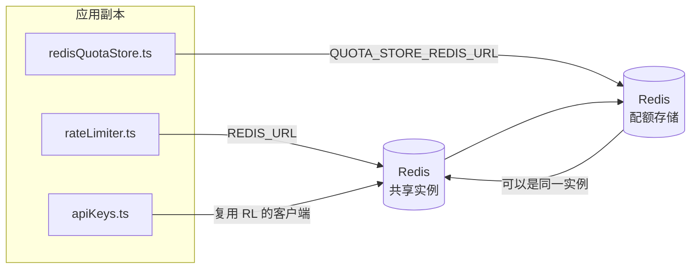

# Redis Production Configuration Guide (中文 (简体))

🌐 **Languages:** 🇺🇸 [English](../../../../ops/REDIS_PRODUCTION_CONFIG.md) · 🇪🇹 [am](../../../am/docs/ops/REDIS_PRODUCTION_CONFIG.md) · 🇸🇦 [ar](../../../ar/docs/ops/REDIS_PRODUCTION_CONFIG.md) · 🇦🇿 [az](../../../az/docs/ops/REDIS_PRODUCTION_CONFIG.md) · 🇧🇬 [bg](../../../bg/docs/ops/REDIS_PRODUCTION_CONFIG.md) · 🇧🇩 [bn](../../../bn/docs/ops/REDIS_PRODUCTION_CONFIG.md) · 🇧🇦 [bs](../../../bs/docs/ops/REDIS_PRODUCTION_CONFIG.md) · 🇨🇿 [cs](../../../cs/docs/ops/REDIS_PRODUCTION_CONFIG.md) · 🇩🇰 [da](../../../da/docs/ops/REDIS_PRODUCTION_CONFIG.md) · 🇩🇪 [de](../../../de/docs/ops/REDIS_PRODUCTION_CONFIG.md) · 🇬🇷 [el](../../../el/docs/ops/REDIS_PRODUCTION_CONFIG.md) · 🇪🇸 [es](../../../es/docs/ops/REDIS_PRODUCTION_CONFIG.md) · 🇪🇪 [et](../../../et/docs/ops/REDIS_PRODUCTION_CONFIG.md) · 🇮🇷 [fa](../../../fa/docs/ops/REDIS_PRODUCTION_CONFIG.md) · 🇫🇮 [fi](../../../fi/docs/ops/REDIS_PRODUCTION_CONFIG.md) · 🇫🇷 [fr](../../../fr/docs/ops/REDIS_PRODUCTION_CONFIG.md) · 🇮🇪 [ga](../../../ga/docs/ops/REDIS_PRODUCTION_CONFIG.md) · 🇮🇳 [gu](../../../gu/docs/ops/REDIS_PRODUCTION_CONFIG.md) · 🇳🇬 [ha](../../../ha/docs/ops/REDIS_PRODUCTION_CONFIG.md) · 🇮🇱 [he](../../../he/docs/ops/REDIS_PRODUCTION_CONFIG.md) · 🇮🇳 [hi](../../../hi/docs/ops/REDIS_PRODUCTION_CONFIG.md) · 🇭🇷 [hr](../../../hr/docs/ops/REDIS_PRODUCTION_CONFIG.md) · 🇭🇺 [hu](../../../hu/docs/ops/REDIS_PRODUCTION_CONFIG.md) · 🇦🇲 [hy](../../../hy/docs/ops/REDIS_PRODUCTION_CONFIG.md) · 🇮🇩 [id](../../../id/docs/ops/REDIS_PRODUCTION_CONFIG.md) · 🇳🇬 [ig](../../../ig/docs/ops/REDIS_PRODUCTION_CONFIG.md) · 🇮🇹 [it](../../../it/docs/ops/REDIS_PRODUCTION_CONFIG.md) · 🇯🇵 [ja](../../../ja/docs/ops/REDIS_PRODUCTION_CONFIG.md) · 🇬🇪 [ka](../../../ka/docs/ops/REDIS_PRODUCTION_CONFIG.md) · 🇰🇭 [km](../../../km/docs/ops/REDIS_PRODUCTION_CONFIG.md) · 🇮🇳 [kn](../../../kn/docs/ops/REDIS_PRODUCTION_CONFIG.md) · 🇰🇷 [ko](../../../ko/docs/ops/REDIS_PRODUCTION_CONFIG.md) · 🇱🇹 [lt](../../../lt/docs/ops/REDIS_PRODUCTION_CONFIG.md) · 🇱🇻 [lv](../../../lv/docs/ops/REDIS_PRODUCTION_CONFIG.md) · 🇮🇳 [ml](../../../ml/docs/ops/REDIS_PRODUCTION_CONFIG.md) · 🇮🇳 [mr](../../../mr/docs/ops/REDIS_PRODUCTION_CONFIG.md) · 🇲🇾 [ms](../../../ms/docs/ops/REDIS_PRODUCTION_CONFIG.md) · 🇲🇹 [mt](../../../mt/docs/ops/REDIS_PRODUCTION_CONFIG.md) · 🇲🇲 [my](../../../my/docs/ops/REDIS_PRODUCTION_CONFIG.md) · 🇳🇵 [ne](../../../ne/docs/ops/REDIS_PRODUCTION_CONFIG.md) · 🇳🇱 [nl](../../../nl/docs/ops/REDIS_PRODUCTION_CONFIG.md) · 🇳🇴 [no](../../../no/docs/ops/REDIS_PRODUCTION_CONFIG.md) · 🇮🇳 [or](../../../or/docs/ops/REDIS_PRODUCTION_CONFIG.md) · 🇮🇳 [pa](../../../pa/docs/ops/REDIS_PRODUCTION_CONFIG.md) · 🇵🇭 [phi](../../../phi/docs/ops/REDIS_PRODUCTION_CONFIG.md) · 🇵🇱 [pl](../../../pl/docs/ops/REDIS_PRODUCTION_CONFIG.md) · 🇵🇹 [pt](../../../pt/docs/ops/REDIS_PRODUCTION_CONFIG.md) · 🇧🇷 [pt-BR](../../../pt-BR/docs/ops/REDIS_PRODUCTION_CONFIG.md) · 🇷🇴 [ro](../../../ro/docs/ops/REDIS_PRODUCTION_CONFIG.md) · 🇷🇺 [ru](../../../ru/docs/ops/REDIS_PRODUCTION_CONFIG.md) · 🇱🇰 [si](../../../si/docs/ops/REDIS_PRODUCTION_CONFIG.md) · 🇸🇰 [sk](../../../sk/docs/ops/REDIS_PRODUCTION_CONFIG.md) · 🇸🇮 [sl](../../../sl/docs/ops/REDIS_PRODUCTION_CONFIG.md) · 🇷🇸 [sr](../../../sr/docs/ops/REDIS_PRODUCTION_CONFIG.md) · 🇸🇪 [sv](../../../sv/docs/ops/REDIS_PRODUCTION_CONFIG.md) · 🇰🇪 [sw](../../../sw/docs/ops/REDIS_PRODUCTION_CONFIG.md) · 🇮🇳 [ta](../../../ta/docs/ops/REDIS_PRODUCTION_CONFIG.md) · 🇮🇳 [te](../../../te/docs/ops/REDIS_PRODUCTION_CONFIG.md) · 🇹🇭 [th](../../../th/docs/ops/REDIS_PRODUCTION_CONFIG.md) · 🇹🇷 [tr](../../../tr/docs/ops/REDIS_PRODUCTION_CONFIG.md) · 🇺🇦 [uk-UA](../../../uk-UA/docs/ops/REDIS_PRODUCTION_CONFIG.md) · 🇵🇰 [ur](../../../ur/docs/ops/REDIS_PRODUCTION_CONFIG.md) · 🇺🇿 [uz](../../../uz/docs/ops/REDIS_PRODUCTION_CONFIG.md) · 🇻🇳 [vi](../../../vi/docs/ops/REDIS_PRODUCTION_CONFIG.md) · 🇳🇬 [yo](../../../yo/docs/ops/REDIS_PRODUCTION_CONFIG.md) · 🇹🇼 [zh-TW](../../../zh-TW/docs/ops/REDIS_PRODUCTION_CONFIG.md)

---

## 概述

Redis是一个**可选的，软依赖**在OmniRoute —中，当Redis不可用时，应用程序会正常降级（内存中回退）。在生产中，调整Redis可减少四种不同工作负载的延迟：

| 工作量     | 司机                          | 客户工厂                                 | 按键模式                             |
| ---------- | ----------------------------- | ---------------------------------------- | ------------------------------------ |
| 速率限制   | `rateLimiter.ts`              | `getRedisClient()` —惰性`ioredis`单例    | `<prefix>rl:*` Lua 原子速率限制窗口  |
| 验证缓存   | `apiKeys.ts`                  | 复用`rateLimiter`的客户端                | `<prefix>auth:api_key:<sha256>`与TTL |
| 配额商店   | `redisQuotaStore.ts`          | 单独的`getRedisClient(url)`单例          | `<prefix>quota:*`可按实例配置        |
| 预热断路器 | `redisCircuitBreakerStore.ts` | `circuitBreakerFactory.ts`中的单独客户端 | `<prefix>warmup:cb:<connectionId>`   |

所有四个工作负载共享一个命名空间前缀，因此OmniRoute可以与单个Redis实例（例如`127.0.0.1:6379`）上的其他应用程序共存。请参阅[键命名空间](#key-namespacing)。

---

## 当前配置（代码默认值）

| 环境                             | 价值                                       | 在哪里                                                                                |
| -------------------------------- | ------------------------------------------ | ------------------------------------------------------------------------------------- |
| `REDIS_URL`环境变量              | `redis://redis:6379` （撰写），可选        | `rateLimiter.ts:5`, `.env.example`                                                    |
| `REDIS_KEY_PREFIX`环境变量       | `omniroute:` （默认）                      | `rateLimiter.ts`, `redisQuotaStore.ts`, `redisCircuitBreakerStore.ts`, `.env.example` |
| `QUOTA_STORE_REDIS_URL`环境变量  | 独立的，可以与`REDIS_URL`不同              | `quota/storeFactory.ts`                                                               |
| `QUOTA_STORE_DRIVER`             | `"sqlite"` （默认）， `"redis"`可选        | `quota/storeFactory.ts`                                                               |
| 伊奥雷迪斯`maxRetriesPerRequest` | `3`                                        | `rateLimiter.ts`客户端创建                                                            |
| `enableReadyCheck`               | 未设置（ioredis 默认值： `true`）          | —                                                                                     |
| `lazyConnect`                    | 未设置（ioredis 默认值： `false`）         | —                                                                                     |
| `retryStrategy`                  | 未设置（ioredis 默认值：200ms 基数，指数） | —                                                                                     |
| TLS /密码/ DB索引                | **未配置**                                 | —                                                                                     |
| 哨兵/集群                        | **未配置**仅—独立单节点                    | —                                                                                     |

---

## 键命名空间

OmniRoute 与主机上运行的其他服务共享 Redis 实例。如果没有命名空间，`auth:api_key:<sha256>` 或 `rl:*` 等键可能会与使用同一 Redis 的其他应用程序的键发生冲突（此实例在 `127.0.0.1:6379` 上运行 Redis，并与其他服务共存）。

将 `REDIS_KEY_PREFIX` 设置为非空字符串，为**每个** OmniRoute 键添加前缀：

```bash
# .env — 所有 OmniRoute 键都会变成 omniroute:rl:*、omniroute:auth:*、omniroute:quota:*、omniroute:warmup:cb:*
REDIS_KEY_PREFIX=omniroute:
```

- **默认值：** `omniroute:`（当 `REDIS_KEY_PREFIX` 未设置或为空时应用）。
- **应用范围：**速率限制器 + 身份验证缓存（通过 `keyPrefix` 共享 `ioredis` 客户端）、配额存储（`KEY_PREFIX = "${REDIS_KEY_PREFIX}quota"`）以及预热熔断器（`KEY_PREFIX = "${REDIS_KEY_PREFIX}warmup:cb:"`）。
- 当 Redis 中已存在键时，**更改前缀**会使旧键成为孤立键（它们会通过 TTL / LRU 过期）。可以安全更改，无需迁移。唯一的例外是标记为禁止的连接所对应的预热熔断器键：该键会在不设置 TTL 的情况下持久保存，因此请使用 `redis-cli --scan --pattern '<old-prefix>warmup:cb:*'` 列出残留键并将其删除。
- **ioredis `keyPrefix`**会在写入时自动添加前缀，**并且**在读取时将其去除，因此应用程序代码永远不会看到该前缀。

---

## 推荐的生产调整

### 1.连接池/客户端选项（ioredis `Redis`构造函数）

当前代码创建一个没有自定义选项的`new Redis(url)` 。对于生产多副本部署，在代码中传递客户端工厂或包装`getRedisClient()`：

```typescript
const redis = new Redis(REDIS_URL, {
  maxRetriesPerRequest: null, // no retry limit; let retryStrategy decide
  enableReadyCheck: true, // verify server is ready before accepting calls
  lazyConnect: true, // don't connect on construction; wait for first call
  retryStrategy: (times) => {
    if (times > 10) return null; // give up after 10 retries → reconnect later
    return Math.min(times * 200, 5000); // 200ms, 400ms, …, 5s cap
  },
  enableAutoPipelining: true, // coalesce concurrent commands into one TCP write
  keepAlive: 10000, // TCP keep‑alive every 10s
});
```

**关键权衡：**

- `maxRetriesPerRequest: null` + `retryStrategy` —首选用于生产，因此短暂的Redis重新启动不会立即使每个请求失败。 `checkRateLimit()`中的内存回退吸收了故障路径。
- `lazyConnect: true` —避免了在服务器开始接受连接之前对Redis启动的依赖。
- `enableAutoPipelining: true` —减少了并发速率限制检查的往返次数；在单个连接上对> 50 RPS有利。

### 2. Redis服务器配置（`redis.conf`）

```
# Memory
maxmemory 80%                        # leave room for OS page cache
maxmemory-policy allkeys-lru         # evict stale auth cache entries under pressure

# Persistence (optional — OmniRoute is crash‑safe without it)
save 300 1                           # snapshot at least every 5 min if ≥1 key changed
appendonly no                        # AOF not needed; data is regeneratable
appendfsync no                       # no fsync overhead (RDB is sufficient)

# Networking
timeout 0                            # no idle disconnect
tcp-keepalive 300                    # 5 min keep‑alive
tcp-backlog 511                      # connection backlog for bursty load

# Performance
hz 10                                # default; 100 for latency‑sensitive
activedefrag yes                     # auto‑defragment when fragmentation >10%
```

**`maxmemory-policy allkeys-lru`的权衡：**在内存压力下，身份验证缓存条目可能会被逐出。这是安全的— `setCachedApiKey`总是会在未命中时重新填充，并且SQLite后备是权威的。速率限制器 Lua 脚本创建的小键在设计上是短暂的。

### 3. Docker撰写设置

产品组合 (`docker-compose.prod.yml`) 使用`redis:8.6.2-alpine`。添加：

```yaml
redis:
  image: redis:8.6.2-alpine
  command:
    [
      "redis-server",
      "--maxmemory",
      "512mb",
      "--maxmemory-policy",
      "allkeys-lru",
      "--activedefrag",
      "yes",
      "--save",
      "300 1",
    ]
  healthcheck:
    test: ["CMD", "redis-cli", "ping"]
    interval: 10s
    timeout: 3s
    retries: 3
    start_period: 5s
```

### 4. 多实例/扩展注意事项

**适用于所有副本的单一Redis** —速率限制器 Lua 脚本依赖于单个权威密钥空间。副本背后的多个Redis实例将失去原子性并使预算加倍。对所有应用程序副本使用单个Redis （或具有故障转移功能的Redis Sentinel 集群）。

**连接数：**每个应用程序副本打开**2 个TCP连接**至Redis （速率限制器客户端+配额存储客户端）。 10 个副本→ 20 个连接，完全在默认Redis实例的 10k 连接上限之内。

### 5. 监控

通过健康检查端点公开：

```typescript
// src/app/api/monitoring/health/route.ts already calls rateLimiter functions
// Add Redis-specific checks:
//   1. PING latency via ioredis .ping()
//   2. Memory usage via INFO memory
//   3. Connection count via INFO clients
//   4. Hit rate for maxmemory-policy (evicted_keys / keyspace_hits)
```

需要关注的关键指标：

- **驱逐键/秒**如果—始终不为零，则增加`maxmemory`
- **被阻止的客户**—非零表示 Lua 脚本缓慢或争用较多
- **拒绝连接**—连接限制达到；罕见，连接数为 20

### 6.Redis兼容服务器

这里使用的任何服务器都必须运行 Lua 脚本：速率限制器是一个`EVAL`。在没有 Lua 的服务器上， `checkRateLimit()`会记录`[RATE_LIMITER] Redis eval failed, falling back to in-memory rate limiting`并按进程进行计数，因此每个副本都会自行执行限制。选择加入共享会话关联存储 (`OMNIROUTE_SESSION_AFFINITY_STORE=redis`) 还可以使用`EVAL`读取和更新 pin；如果没有 Lua，它会记录`[SESSION_AFFINITY] Redis error; falling back to SQLite.`并且每个副本都保留自己的引脚。其他工作负载使用普通命令（`SET ... EX`、 `GET`、 `DEL`、 `MGET`、 `EXPIRE`、 `INCRBYFLOAT`、哈希和集合），并且语义缓存的Redis后端不发送`FT.*`命令。

使用OmniRoute 3.8.52 进行测试： KiviDB 1.2.0 及其 Lua 图像 (`kividb/kividb:v1.2.0-lua`)。速率限制器（包括共享计数器的第二个进程）、身份验证缓存、配额存储、预热断路器、语义缓存存储和通过聊天处理程序的`/v1/chat/completions`请求通过了Redis 8.10.3 上通过的 19 项检查中的 18 项。不同之处在于： `INCRBYFLOAT`将`0.1 + 0.2`存储为`0.30000000000000004` ，其中Redis存储`0.3` ( [kividbio/kividb#387](https://github.com/kividbio/kividb/issues/387) )。配额存储使用`parseFloat`解析这两个数字，但两个数字的最后一位数字不同，因此恰好落在配额边界上的比较可能会得出不同的结果。会话关联存储不是该运行的一部分。 （[设置](https://github.com/kividbio/kividb/blob/master/docs/integrations/omniroute.md)，[结果](https://github.com/kividbio/kividb/tree/master/benchmarks/omniroute-compat)）

---

## 架构图



---

## 参考

| 文件                               | 目的                                        |
| ---------------------------------- | ------------------------------------------- |
| `src/shared/utils/rateLimiter.ts`  | 主要Redis客户端、Lua 速率限制脚本、内存回退 |
| `src/lib/db/apiKeys.ts`            | 身份验证缓存— Redis→SQLite后备              |
| `src/lib/quota/redisQuotaStore.ts` | 用于可选配额存储的单独Redis客户端           |
| `src/lib/quota/storeFactory.ts`    | 在`sqlite`和`redis`配额驱动程序之间切换     |
| `docker-compose.prod.yml`          | 产品Redis容器（图像`redis:8.6.2-alpine`）   |
| `.env.example`                     | Redis环境变量文档                           |
| `src/app/api/local/redis/`         | 用于开发容器编排的API路由                   |
| `bin/cli/commands/redis.mjs`       | 用于开发容器编排的CLI命令                   |
