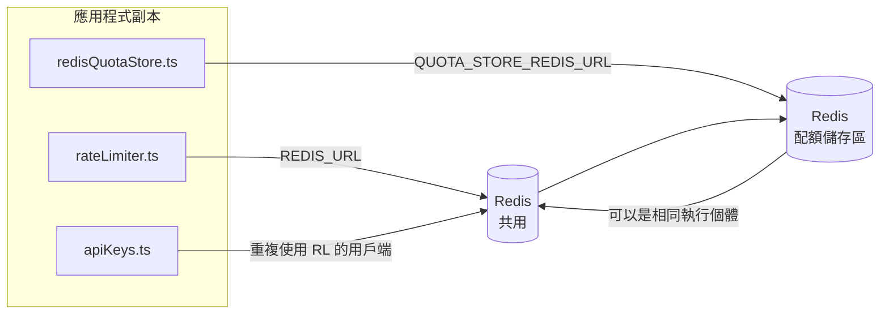

# Redis Production Configuration Guide (中文 (繁體))

🌐 **Languages:** 🇺🇸 [English](../../../../ops/REDIS_PRODUCTION_CONFIG.md) · 🇪🇹 [am](../../../am/docs/ops/REDIS_PRODUCTION_CONFIG.md) · 🇸🇦 [ar](../../../ar/docs/ops/REDIS_PRODUCTION_CONFIG.md) · 🇦🇿 [az](../../../az/docs/ops/REDIS_PRODUCTION_CONFIG.md) · 🇧🇬 [bg](../../../bg/docs/ops/REDIS_PRODUCTION_CONFIG.md) · 🇧🇩 [bn](../../../bn/docs/ops/REDIS_PRODUCTION_CONFIG.md) · 🇧🇦 [bs](../../../bs/docs/ops/REDIS_PRODUCTION_CONFIG.md) · 🇨🇿 [cs](../../../cs/docs/ops/REDIS_PRODUCTION_CONFIG.md) · 🇩🇰 [da](../../../da/docs/ops/REDIS_PRODUCTION_CONFIG.md) · 🇩🇪 [de](../../../de/docs/ops/REDIS_PRODUCTION_CONFIG.md) · 🇬🇷 [el](../../../el/docs/ops/REDIS_PRODUCTION_CONFIG.md) · 🇪🇸 [es](../../../es/docs/ops/REDIS_PRODUCTION_CONFIG.md) · 🇪🇪 [et](../../../et/docs/ops/REDIS_PRODUCTION_CONFIG.md) · 🇮🇷 [fa](../../../fa/docs/ops/REDIS_PRODUCTION_CONFIG.md) · 🇫🇮 [fi](../../../fi/docs/ops/REDIS_PRODUCTION_CONFIG.md) · 🇫🇷 [fr](../../../fr/docs/ops/REDIS_PRODUCTION_CONFIG.md) · 🇮🇪 [ga](../../../ga/docs/ops/REDIS_PRODUCTION_CONFIG.md) · 🇮🇳 [gu](../../../gu/docs/ops/REDIS_PRODUCTION_CONFIG.md) · 🇳🇬 [ha](../../../ha/docs/ops/REDIS_PRODUCTION_CONFIG.md) · 🇮🇱 [he](../../../he/docs/ops/REDIS_PRODUCTION_CONFIG.md) · 🇮🇳 [hi](../../../hi/docs/ops/REDIS_PRODUCTION_CONFIG.md) · 🇭🇷 [hr](../../../hr/docs/ops/REDIS_PRODUCTION_CONFIG.md) · 🇭🇺 [hu](../../../hu/docs/ops/REDIS_PRODUCTION_CONFIG.md) · 🇦🇲 [hy](../../../hy/docs/ops/REDIS_PRODUCTION_CONFIG.md) · 🇮🇩 [id](../../../id/docs/ops/REDIS_PRODUCTION_CONFIG.md) · 🇳🇬 [ig](../../../ig/docs/ops/REDIS_PRODUCTION_CONFIG.md) · 🇮🇹 [it](../../../it/docs/ops/REDIS_PRODUCTION_CONFIG.md) · 🇯🇵 [ja](../../../ja/docs/ops/REDIS_PRODUCTION_CONFIG.md) · 🇬🇪 [ka](../../../ka/docs/ops/REDIS_PRODUCTION_CONFIG.md) · 🇰🇭 [km](../../../km/docs/ops/REDIS_PRODUCTION_CONFIG.md) · 🇮🇳 [kn](../../../kn/docs/ops/REDIS_PRODUCTION_CONFIG.md) · 🇰🇷 [ko](../../../ko/docs/ops/REDIS_PRODUCTION_CONFIG.md) · 🇱🇹 [lt](../../../lt/docs/ops/REDIS_PRODUCTION_CONFIG.md) · 🇱🇻 [lv](../../../lv/docs/ops/REDIS_PRODUCTION_CONFIG.md) · 🇮🇳 [ml](../../../ml/docs/ops/REDIS_PRODUCTION_CONFIG.md) · 🇮🇳 [mr](../../../mr/docs/ops/REDIS_PRODUCTION_CONFIG.md) · 🇲🇾 [ms](../../../ms/docs/ops/REDIS_PRODUCTION_CONFIG.md) · 🇲🇹 [mt](../../../mt/docs/ops/REDIS_PRODUCTION_CONFIG.md) · 🇲🇲 [my](../../../my/docs/ops/REDIS_PRODUCTION_CONFIG.md) · 🇳🇵 [ne](../../../ne/docs/ops/REDIS_PRODUCTION_CONFIG.md) · 🇳🇱 [nl](../../../nl/docs/ops/REDIS_PRODUCTION_CONFIG.md) · 🇳🇴 [no](../../../no/docs/ops/REDIS_PRODUCTION_CONFIG.md) · 🇮🇳 [or](../../../or/docs/ops/REDIS_PRODUCTION_CONFIG.md) · 🇮🇳 [pa](../../../pa/docs/ops/REDIS_PRODUCTION_CONFIG.md) · 🇵🇭 [phi](../../../phi/docs/ops/REDIS_PRODUCTION_CONFIG.md) · 🇵🇱 [pl](../../../pl/docs/ops/REDIS_PRODUCTION_CONFIG.md) · 🇵🇹 [pt](../../../pt/docs/ops/REDIS_PRODUCTION_CONFIG.md) · 🇧🇷 [pt-BR](../../../pt-BR/docs/ops/REDIS_PRODUCTION_CONFIG.md) · 🇷🇴 [ro](../../../ro/docs/ops/REDIS_PRODUCTION_CONFIG.md) · 🇷🇺 [ru](../../../ru/docs/ops/REDIS_PRODUCTION_CONFIG.md) · 🇱🇰 [si](../../../si/docs/ops/REDIS_PRODUCTION_CONFIG.md) · 🇸🇰 [sk](../../../sk/docs/ops/REDIS_PRODUCTION_CONFIG.md) · 🇸🇮 [sl](../../../sl/docs/ops/REDIS_PRODUCTION_CONFIG.md) · 🇷🇸 [sr](../../../sr/docs/ops/REDIS_PRODUCTION_CONFIG.md) · 🇸🇪 [sv](../../../sv/docs/ops/REDIS_PRODUCTION_CONFIG.md) · 🇰🇪 [sw](../../../sw/docs/ops/REDIS_PRODUCTION_CONFIG.md) · 🇮🇳 [ta](../../../ta/docs/ops/REDIS_PRODUCTION_CONFIG.md) · 🇮🇳 [te](../../../te/docs/ops/REDIS_PRODUCTION_CONFIG.md) · 🇹🇭 [th](../../../th/docs/ops/REDIS_PRODUCTION_CONFIG.md) · 🇹🇷 [tr](../../../tr/docs/ops/REDIS_PRODUCTION_CONFIG.md) · 🇺🇦 [uk-UA](../../../uk-UA/docs/ops/REDIS_PRODUCTION_CONFIG.md) · 🇵🇰 [ur](../../../ur/docs/ops/REDIS_PRODUCTION_CONFIG.md) · 🇺🇿 [uz](../../../uz/docs/ops/REDIS_PRODUCTION_CONFIG.md) · 🇻🇳 [vi](../../../vi/docs/ops/REDIS_PRODUCTION_CONFIG.md) · 🇳🇬 [yo](../../../yo/docs/ops/REDIS_PRODUCTION_CONFIG.md) · 🇨🇳 [zh-CN](../../../zh-CN/docs/ops/REDIS_PRODUCTION_CONFIG.md)

---

## 概述

Redis是一個**可選的，軟依賴**在OmniRoute —中，當Redis不可用時，應用程式會正常降級（記憶體中回退）。在生產中，調整Redis可減少四種不同工作負載的延遲：

| 工作量     | 司機                          | 客戶工廠                                 | 按鍵模式                             |
| ---------- | ----------------------------- | ---------------------------------------- | ------------------------------------ |
| 速率限制   | `rateLimiter.ts`              | `getRedisClient()` —惰性`ioredis`單例    | `<prefix>rl:*` Lua 原子速率限制窗口  |
| 驗證快取   | `apiKeys.ts`                  | 復用`rateLimiter`的客戶端                | `<prefix>auth:api_key:<sha256>`與TTL |
| 配額商店   | `redisQuotaStore.ts`          | 單獨的`getRedisClient(url)`單例          | `<prefix>quota:*`可依實例配置        |
| 預熱斷路器 | `redisCircuitBreakerStore.ts` | `circuitBreakerFactory.ts`中的單獨客戶端 | `<prefix>warmup:cb:<connectionId>`   |

所有四個工作負載共享一個命名空間前綴，因此OmniRoute可以與單一Redis實例（例如`127.0.0.1:6379`）上的其他應用程式共存。請參閱[鍵命名空間](#key-namespacing)。

---

## 當前配置（代碼預設值）

| 環境                             | 價值                                       | 在哪裡                                                                                |
| -------------------------------- | ------------------------------------------ | ------------------------------------------------------------------------------------- |
| `REDIS_URL`環境變數              | `redis://redis:6379` （撰寫），可選        | `rateLimiter.ts:5`, `.env.example`                                                    |
| `REDIS_KEY_PREFIX`環境變數       | `omniroute:` （預設）                      | `rateLimiter.ts`, `redisQuotaStore.ts`, `redisCircuitBreakerStore.ts`, `.env.example` |
| `QUOTA_STORE_REDIS_URL`環境變數  | 獨立的，可以與`REDIS_URL`不同              | `quota/storeFactory.ts`                                                               |
| `QUOTA_STORE_DRIVER`             | `"sqlite"` （預設）， `"redis"`可選        | `quota/storeFactory.ts`                                                               |
| 伊奧雷迪斯`maxRetriesPerRequest` | `3`                                        | `rateLimiter.ts`客戶端創建                                                            |
| `enableReadyCheck`               | 未設定（ioredis 預設值： `true`）          | —                                                                                     |
| `lazyConnect`                    | 未設定（ioredis 預設值： `false`）         | —                                                                                     |
| `retryStrategy`                  | 未設定（ioredis 預設值：200ms 基數，指數） | —                                                                                     |
| TLS /密碼/ DB索引                | **未配置**                                 | —                                                                                     |
| 哨兵/集群                        | **未配置**僅—獨立單節點                    | —                                                                                     |

---

## 鍵命名空間

OmniRoute 會與主機上執行的其他服務共用 Redis 執行個體。若沒有命名空間，`auth:api_key:<sha256>` 或 `rl:*` 等鍵可能會與使用同一 Redis 的其他應用程式所建立的鍵發生衝突（此執行個體在 `127.0.0.1:6379` 上執行 Redis，並與其他服務並存）。

將 `REDIS_KEY_PREFIX` 設為非空字串，為 OmniRoute 的**每一個**鍵加上前綴：

```bash
# .env——所有 OmniRoute 鍵都會變成 omniroute:rl:*、omniroute:auth:*、omniroute:quota:*、omniroute:warmup:cb:*
REDIS_KEY_PREFIX=omniroute:
```

- **預設值：** `omniroute:`（當 `REDIS_KEY_PREFIX` 未設定或為空白時套用）。
- **套用範圍：**速率限制器與驗證快取（透過 `keyPrefix` 共用 `ioredis` 用戶端）、配額儲存區（`KEY_PREFIX = "${REDIS_KEY_PREFIX}quota"`），以及預熱斷路器（`KEY_PREFIX = "${REDIS_KEY_PREFIX}warmup:cb:"`）。
- 當 Redis 中已存在鍵時，**變更前綴**會使舊鍵成為孤立鍵（它們會透過 TTL／LRU 到期）。此變更是安全的，無需移轉。唯一的例外是標示為禁止之連線的預熱斷路器鍵：該鍵會在沒有 TTL 的情況下持久保存，因此請使用 `redis-cli --scan --pattern '<old-prefix>warmup:cb:*'` 列出遺留鍵並將其刪除。
- **ioredis `keyPrefix`** 會在寫入時自動加上前綴，並在讀取時將其移除，因此應用程式碼永遠不會看到該前綴。

---

## 建議的生產調整

### 1.連接池/客戶端選項（ioredis `Redis`建構函數）

當前程式碼建立一個沒有自訂選項的`new Redis(url)` 。對於生產多副本部署，在程式碼中傳遞客戶端工廠或包裝`getRedisClient()`：

```typescript
const redis = new Redis(REDIS_URL, {
  maxRetriesPerRequest: null, // no retry limit; let retryStrategy decide
  enableReadyCheck: true, // verify server is ready before accepting calls
  lazyConnect: true, // don't connect on construction; wait for first call
  retryStrategy: (times) => {
    if (times > 10) return null; // give up after 10 retries → reconnect later
    return Math.min(times * 200, 5000); // 200ms, 400ms, …, 5s cap
  },
  enableAutoPipelining: true, // coalesce concurrent commands into one TCP write
  keepAlive: 10000, // TCP keep‑alive every 10s
});
```

**關鍵權衡：**

- `maxRetriesPerRequest: null` + `retryStrategy` —首選用於生產，因此短暫的Redis重新啟動不會立即使每個請求失敗。 `checkRateLimit()`中的記憶體回退吸收了故障路徑。
- `lazyConnect: true` —避免了在伺服器開始接受連線之前對Redis啟動的依賴。
- `enableAutoPipelining: true` —減少了並發速率限制檢查的往返次數；在單一連線上對> 50 RPS有利。

### 2. Redis伺服器設定（`redis.conf`）

```
# Memory
maxmemory 80%                        # leave room for OS page cache
maxmemory-policy allkeys-lru         # evict stale auth cache entries under pressure

# Persistence (optional — OmniRoute is crash‑safe without it)
save 300 1                           # snapshot at least every 5 min if ≥1 key changed
appendonly no                        # AOF not needed; data is regeneratable
appendfsync no                       # no fsync overhead (RDB is sufficient)

# Networking
timeout 0                            # no idle disconnect
tcp-keepalive 300                    # 5 min keep‑alive
tcp-backlog 511                      # connection backlog for bursty load

# Performance
hz 10                                # default; 100 for latency‑sensitive
activedefrag yes                     # auto‑defragment when fragmentation >10%
```

**`maxmemory-policy allkeys-lru`的權衡：**在記憶體壓力下，身份驗證快取條目可能會被逐出。這是安全的— `setCachedApiKey`總是會在未命中時重新填充，並且SQLite後備是權威的。速率限制器 Lua 腳本創建的小鍵在設計上是短暫的。

### 3. Docker撰寫設置

產品組合 (`docker-compose.prod.yml`) 使用`redis:8.6.2-alpine`。添加：

```yaml
redis:
  image: redis:8.6.2-alpine
  command:
    [
      "redis-server",
      "--maxmemory",
      "512mb",
      "--maxmemory-policy",
      "allkeys-lru",
      "--activedefrag",
      "yes",
      "--save",
      "300 1",
    ]
  healthcheck:
    test: ["CMD", "redis-cli", "ping"]
    interval: 10s
    timeout: 3s
    retries: 3
    start_period: 5s
```

### 4. 多實例/擴展注意事項

**適用於所有副本的單一Redis** —速率限制器 Lua 腳本依賴單一權威金鑰空間。副本背後的多個Redis實例將失去原子性並使預算加倍。對所有應用程式副本使用單一Redis （或具有故障轉移功能的Redis Sentinel 叢集）。

**連接數：**每個應用程式副本打開**2 個TCP連接**至Redis （速率限制器客戶端+配額儲存客戶端）。 10 個副本→ 20 個連接，完全在預設Redis實例的 10k 連接上限之內。

### 5. 監控

透過健康檢查端點公開：

```typescript
// src/app/api/monitoring/health/route.ts already calls rateLimiter functions
// Add Redis-specific checks:
//   1. PING latency via ioredis .ping()
//   2. Memory usage via INFO memory
//   3. Connection count via INFO clients
//   4. Hit rate for maxmemory-policy (evicted_keys / keyspace_hits)
```

需要關注的關鍵指標：

- **驅逐鍵/秒**如果—始終不為零，則增加`maxmemory`
- **被阻止的客戶**—非零表示 Lua 腳本緩慢或爭用較多
- **拒絕連線**—連線限制達到；罕見，連線數為 20

### 6.Redis相容伺服器

這裡使用的任何伺服器都必須執行 Lua 腳本：速率限制器是一個`EVAL`。在沒有 Lua 的伺服器上， `checkRateLimit()`會記錄`[RATE_LIMITER] Redis eval failed, falling back to in-memory rate limiting`並按進程進行計數，因此每個副本都會自行執行限制。選擇加入共用會話關聯儲存 (`OMNIROUTE_SESSION_AFFINITY_STORE=redis`) 也可以使用`EVAL`讀取和更新 pin；如果沒有 Lua，它會記錄`[SESSION_AFFINITY] Redis error; falling back to SQLite.`並且每個副本都保留自己的引腳。其他工作負載使用普通命令（`SET ... EX`、 `GET`、 `DEL`、 `MGET`、 `EXPIRE`、 `INCRBYFLOAT`、哈希和集合），並且語義快取的Redis後端不發送`FT.*`命令。

使用OmniRoute 3.8.52 進行測試： KiviDB 1.2.0 及其 Lua 影像 (`kividb/kividb:v1.2.0-lua`)。速率限制器（包括共享計數器的第二個進程）、身份驗證快取、配額儲存、預熱斷路器、語義快取儲存和通過聊天處理程序的`/v1/chat/completions`請求通過了Redis 8.10.3 上通過的 19 項檢查中的 18 項。不同之處在於： `INCRBYFLOAT`將`0.1 + 0.2`儲存為`0.30000000000000004` ，其中Redis儲存`0.3` ( [kividbio/kividb#387](https://github.com/kividbio/kividb/issues/387) )。配額儲存使用`parseFloat`解析這兩個數字，但兩個數字的最後一位數字不同，因此恰好落在配額邊界上的比較可能會得出不同的結果。會話關聯儲存不是該運行的一部分。 （[設置](https://github.com/kividbio/kividb/blob/master/docs/integrations/omniroute.md)，[結果](https://github.com/kividbio/kividb/tree/master/benchmarks/omniroute-compat)）

---

## 架構圖



---

## 參考

| 文件                               | 目的                                          |
| ---------------------------------- | --------------------------------------------- |
| `src/shared/utils/rateLimiter.ts`  | 主要Redis客戶端、Lua 速率限制腳本、記憶體回退 |
| `src/lib/db/apiKeys.ts`            | 身份驗證快取— Redis→SQLite後備                |
| `src/lib/quota/redisQuotaStore.ts` | 用於可選配額存儲的單獨Redis客戶端             |
| `src/lib/quota/storeFactory.ts`    | 在`sqlite`和`redis`配額驅動程式之間切換       |
| `docker-compose.prod.yml`          | 產品Redis容器（圖像`redis:8.6.2-alpine`）     |
| `.env.example`                     | Redis環境變數文件                             |
| `src/app/api/local/redis/`         | 用於開發容器編排的API路由                     |
| `bin/cli/commands/redis.mjs`       | 用於開發容器編排的CLI指令                     |
